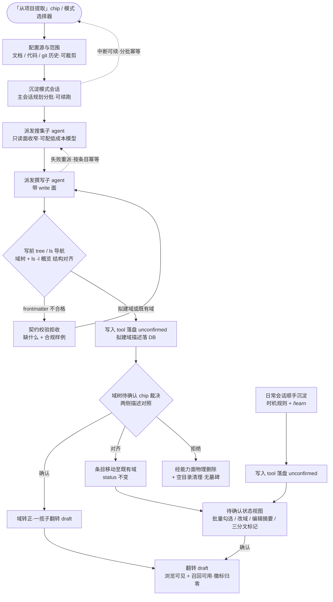
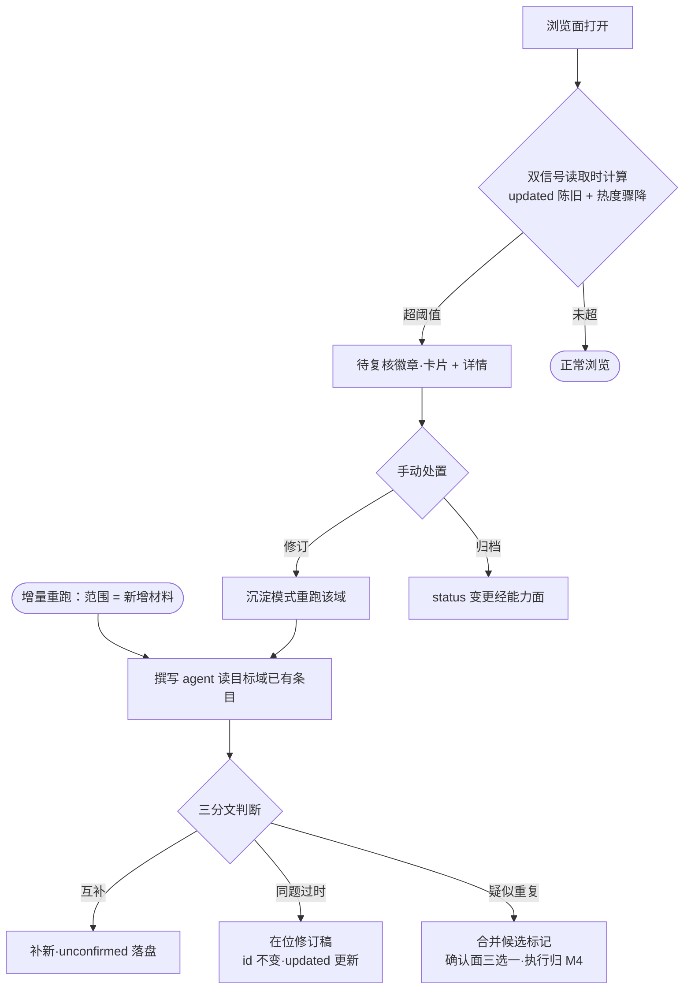

# dsh-forge M3.5：知识沉淀与保鲜（进气端 + 保鲜端） — PRD Spec

> PRD Spec：定义该特性**是什么、为什么**。业务上下文与阶段裁决继承自已批准的里程碑提案 [`proposals/dsh-forge-m3.5-knowledge-consolidation/proposal.md`](../../proposals/dsh-forge-m3.5-knowledge-consolidation/proposal.md)（宪法输入 = 总纲 dsh-forge-redesign；硬前置 M3 模式预设已收官 2026-10-08、SC1–SC9 全绿，降级路径退役）。本文件不重复提案全文，只落实 PRD 层要求；**已裁决项不重开**（含 2026-10-06 用户定向、两轮评审 F1–F13 与 M3 收官重梳的全部结论）；提案 20 项设计期定缝项归 `/tech-design` 逐项裁决，本文件只登记不预裁。用户故事见 [prd-user-stories.md](./prd-user-stories.md)，UI 功能规格见 [prd-ui-functions.md](./prd-ui-functions.md)。

## Background

### Why (Reason)

M1 落地了知识库的「出气端」（浏览 / 召回 / 热度），但**没有进气端**（老项目冷启动提取与新项目持续沉淀）与**保鲜端**（增量更新与漂移处置）：空库让召回能力形同虚设，核心卖点「知识资产飞轮」转不起来；即便有货，随项目快速演化失真的知识无人处置——召回越准伤害越大。

M3 已收官（2026-10-08）且自举纪律已生效——本里程碑是**自举纪律生效后的首个自举 feature**，其 PRD / 设计 / 任务链跑在自身管线上。若知识库仍空，自举开发期的召回无货可用，飞轮燃料要等 M4 会话抽取落地之后才产生——核心卖点的自我验证被推迟两个里程碑。且老项目批量导入会使库存**瞬间变大**（非渐进积累），产品自身快速演化使「上月提的约束这月就过时」立刻可观察——漂移处置不必等 P5 触发条件。本仓自身即第一批 dogfood 素材（`docs/proposals/`、`docs/lessons/`、代码现状、git 历史）。

### What (Target)

把知识库从「只有出气端」带到「进气 + 保鲜闭环」，五个交付面：

- **① 写入与分层读取地基**：知识插件写入 tool（契约校验拒收 + 写入即生成 frontmatter `id` + 返回体附 agent 友好 hint——拒收即教学 + **批量模式**：一次 N 条跨域可、逐条校验逐条结果、批末单次索引联动 + **`mkdir --desc` 显式建域**：描述种子落 DB、write 拒绝落盘未建域、不设 append（追加语义归 revise 且 revise 产出回 `unconfirmed` 重审）、cp/ln 显式排除）与宿主能力面同一后端 API（落实总纲「一切知识写入经宿主能力面」裁决）；**导航动词三件 `ls` / `tree` / `stat`**（2026-10-11 二轮裁决·browse 拆解——Linux 文件操作完备性定向，先聚焦知识沉淀）——`tree` 域树含描述（L0）、`ls -l` 长格式 = **域概览**（L1 = 索引缓存计算投影，零存储零 LLM 零新鲜度维护）、`stat` 单对象元数据全量；**`read`（全文工作面读）前移本里程碑**（三分文在位修订读现状正文 + 幂等重跑读已落盘 `unconfirmed`；非召回动词——可见 unconfirmed、不入召回日志，grep/glob 锚点后置）；域描述载体 = **DB**（用户裁决 2026-10-10——文件形态侵入知识目录且 ≤50 字不值得独立文件，描述 = agent 生成·用户审核·可再生的运行时数据；知识目录零产品文件侵入）；写后索引联动（确认面 / 域树可见性关键缝；批量写入批末单次联动、单条写入即时联动）。
- **② 知识沉淀模式**（出厂第三预设，riding M3 已交付预设机制——同款安装路径）：完全自定义系统提示词（**提示词最小化**：存在声明 + 沉淀时机规则 + 技能指针，仅此而已）+ 沉淀技能（提取方法论 / 写作契约细则 / 子 agent 派发模板 / 分域规则）+ 工具集；专业子 agent 分工（主会话规划分批 → 知识搜集[按源，只读面] → 知识撰写[三分文 + 合规产出]），经 knowledge 派发 tool 分派（in-process spawn + 工具面收窄 + 模型分级可选）；模式**通用不绑死 forge**（组合零 forge 插件、方法论不含 SDD 概念）。
- **③ 待确认准入面**（浏览页签内，信息架构零扩张）：**文件先行**（`unconfirmed` 条目直接落盘拟建域目录，单一数据源）+ 状态档过滤 chips + 队列批量操作 + 域树待确认 chip 就地裁决（确认 / 对齐 / 拒绝物理删除）+ 左栏徽标计数；两级准入语义（域归属裁决先行 → 条目批量勾选 / 逐条过）；**未确认不入召回**（浏览可见、召回侧按 status 过滤）。
- **④ 双入口 + 双机制**：老项目「从项目提取」chip（源与范围可配置可裁剪：结构化文档 / 现状代码 / git 历史）+ 新会话模式选择器「知识沉淀」（上游内建，预设声明后自动出现，零自研 UI）；新项目显式增量重跑 + 日常会话顺手沉淀（提示词时机规则 + `/learn` 显式入口）。
- **⑤ 保鲜与记账**：增量更新**读后三分文**（互补补新 / 同题过时在位修订[`id` 不变、`updated` 更新] / 疑似重复合并候选标记）；漂移**被动标记**（双信号读取时计算：`updated` 陈旧度阈值 + 热度骤降对比窗；待复核徽章 + 手动处置修订 / 归档；无墓碑、无后台监听）；旧线沉淀技能迁移（`/learn` + `/consolidate-specs` 提取段，漂移段不迁）；路书记账（总纲 M3.5 插行、M4 聚焦收窄、P5 部分兑付、business-rules 两笔、域描述归属注记、M6 收编与 M5 分工缝注记）。

### Who (Users)

- **单人开发者**（产品唯一人类用户与干系人）：发起老项目提取、在待确认准入面做两级裁决（域 chip 确认 / 对齐 / 拒绝，条目批量勾选 / 改域 / 编辑摘要 / 三分文标记）、处置漂移（发起修订重跑 / 归档）、随徽标计数与待复核徽章感知知识库状态。
- **dsh agent 会话**（系统协作者，非人类角色）：**沉淀模式主会话**（规划分批 + 经派发 tool 分派子 agent）、**知识搜集子 agent**（按源搜集，只读工具面）、**知识撰写子 agent**（三分文判断 + frontmatter 合规产出 `unconfirmed` 落盘）、**日常开发会话 agent**（按提示词时机规则顺手沉淀）——其行为经各 Story 的系统侧断言覆盖，不出现在用户故事角色位。

## Goals

| Goal | Metric | Notes |
|------|--------|-------|
| SC-1 提取准入链路 | e2e：三源 fixture（结构化文档 + 代码 + git 历史）→「从项目提取」入口 → 沉淀模式会话分批执行 → 浏览页签内完成域确认（域树「待确认」chip 裁决）与待确认状态视图批量勾选 → 确认后浏览页签可见且 `knowledge.search` 命中 ≥1 条；**`unconfirmed` 条目浏览可见但 `search` 零命中**；**`read-abstract` 对 `unconfirmed` 条目拒收**（错误码与 ID 漂移语义区分） | 两级准入 + 召回侧 status 过滤双断言 |
| SC-2 写入纪律 | ① 文件系统级监控一次全流程：知识目录写入仅经宿主能力面（写入 tool 与确认面同一 API 后端），且**零产品自有文件**（`_domain.md` 类保留文件全流程零存在——域描述 DB 化的侵入性断言）；② 契约校验拒收各验一例——缺 `summary`、缺 `keywords`、域层级 >3 层，拒收反馈可观察；③ 批量写入：N 条一调、逐条校验逐条结果（构造含一条不合格的批次断言混合结果）、**批末单次索引联动**（联动次数断言）、按条目幂等重提；④ `mkdir` 显式建域（描述种子落 DB）与 `write` 落盘未建域拒收各验一例；`revise` 产出回 `unconfirmed`（id 不变、updated 更新——重审断言） | SC3 只读纪律验证扩至知识写入面 |
| SC-3 模式纪律 | 双轨：机制断言用 deterministic fixture，提取链另跑真 agent smoke；每个执行写入的 agent 首次 `write` 前存在 `tree` / `ls` / `stat` / `search` 调用；子 agent 经派发 tool in-process 分派（**toolFilter 收窄为机制断言**——搜集类派发事件载荷 deny 含写入面；模型分级可选生效为配置态断言）；新建域目录为磁盘真实目录（域描述经写入面落 DB、磁盘无产品自有文件）且其内条目全部 `status: unconfirmed`；拒绝后条目文件物理移除 + 空目录清理（均经能力面）；**运行时工具面断言**：沉淀模式会话运行时不含 forge task 命令 tools（对齐 M3 SC-2 强度），persona 与技能清单不含 SDD / forge 管线概念 | 工程兜底留档：派发 tool 受阻退纯 prompt 差异化时收窄断言降为行为面（搜集类不执行 write） |
| SC-4 日常顺手沉淀 | e2e：开发会话 agent 经写入 tool 产出条目 → 待确认状态视图单条确认入库，左栏徽标计数随之变化（产出 +1、确认归零）；提示词知识段**最小化断言（沉淀侧）**——含存在声明 + 沉淀时机规则 + 技能指针，**不含**写作契约细则与提取方法论正文；**召回侧提示词维持 M1 现状不动**（拆分断言）；沉淀技能在 knowledge 技能目录可显式调用 | 原定 M4 续写段按最小化原则前移 |
| SC-5 增量更新三分文 | 结果面断言（fixture 三态显式构造：互补材料 / 同题过时条目 / 近似重复条目）：同题过时 → 撰写 agent `read` 现状正文后在位修订（frontmatter `id` 不变 + `updated` 更新 + 正文变化 + 回 `unconfirmed` 重审——轨迹断言）；互补 → 新条目；近似重复 → 合并候选标记于确认面可见（各一条断言） | v1 无 n-gram 判据，断言只落结果；合并执行归 M4 |
| SC-6 漂移被动标记 | 时间可控模拟：构造超阈值陈旧条目与热度骤降条目 → 浏览卡片与详情呈待复核徽章；归档处置经能力面落盘（status 变更断言）；全程无后台监听（审计） | 双信号读取时计算（总纲 SC2 纪律） |
| SC-7 路书记账合入 | 文档断言，InScope-8 ①–⑨ 逐项在位（总纲插行 / P5 兑付 / 徽标位注记 / 召回分层记账去向 / M3 OoS#7 落地 / BIZ-002·003 修订 / 域描述归属注记 / M6 收编 / M5 分工缝） | 全清单文档断言 |
| SC-8 分层读取与域描述 | `tree` 返回全部域且各域附 DB 域描述（L0）；`ls` 仅列直接子项（不越界）、`-l` 长格式 = **域概览 L1**（计算投影与索引缓存该域条目集一致断言，含 status/updated/keywords，上限可分页）；`stat` 单对象元数据全量（条目含 frontmatter 全字段/热度/id）；`read`（工作面全文读）可读 `unconfirmed`（幂等重跑依赖）且不入召回日志——召回过滤断言仍限 `search`/`read-abstract`（SC-1 不变）；无描述的域不渲染上下文条（不报错、不显占位文案）；域描述只存 DB（知识目录零产品自有文件断言）且不作为知识卡片出现；rebuild 按路径合并保留既有描述、路径消失行清理；选中域树节点 → 卡片区上方域上下文条呈现描述（浏览面 e2e）；拟建域带描述、chip 裁决对照呈现两侧描述 | 能力面 + 浏览面双断言；载体 DB 化（2026-10-10）+ 导航三件拆解与 read 前移（2026-10-11 二轮） |
| SC-9 旧线沉淀技能迁移 | `/learn` 四类型（decision / lesson / convention / business-rule）元数据落位各验一例：产出条目立即落盘 `unconfirmed` → 待确认视图确认入库；`/consolidate-specs` 提取段对 feature 文档批量产出 CROSS 条目落 `unconfirmed`，非交互模式自动落 `unconfirmed` 而非 `draft`（准入不破断言）；漂移段不迁（代码审计：新线无 specs-vs-代码自动修复路径） | M3 Out of Scope #7 去向落地 |

## Scope

### In Scope

- [ ] **InScope-1 写入地基**：core 写服务（create / revise / archive / move / confirm / **mkdir[建域 + 描述种子]** + 契约校验 + `id` 生成 + **写后索引联动**[单条即时 / 批量批末单次——定缝项 2 tool 面定案]）+ contracts 扩展（`status` 状态集常量新建[现仅 `STATUS_DEFAULT`，枚举终裁 = 定缝项 1]、错误码族、`ListEntriesQuery` 增 statusFilter / 分页、DomainNode 契约增 description / status 维度）+ 写入 tool（与 `search`/`read-abstract` 仅 tool 壳同构，后端为本里程碑最大新建面；**write 拒绝落盘未建域、不设 append**——追加语义归 revise 且 revise 产出回 `unconfirmed` 重审；**cp / ln 显式排除**：反重复[合并队列 M4] / 路径即身份）+ **knowledge 派发 tool**（子 agent 收窄通道，照抄 M3 dispatchTask 已实证形态）+ prompt 段改写 + **写入批量模式**（一次 N 条跨域可、逐条校验逐条结果、批末单次索引联动、按条目幂等续跑——2026-10-11 用户裁决，借鉴 OpenViking batch_write）；**本里程碑新建 tool（写入[单条+批量]·mkdir / 导航读 ls·tree·stat·read / 确认处置 / 派发）返回体一律附 agent 友好 hint**——拒收给缺什么与合规样例、未命中给替代路径、边界情形给语义说明，hint 与工具定义对象同源单一事实源。
- [ ] **InScope-2 知识沉淀模式**（出厂第三预设）：组合 = 镜像 `standard` 基础行 + persona 行（提取方法论作风，守「只谈作风、不谈工具禁令」铁律）+ skill-filesystem 行（customSkillDirs = knowledge 技能目录，M3 同款物化）；经 profile patch 安装（M3 出厂双预设现役机制）；knowledge 插件行**不进组合**（host 全局产品行供给一切会话——能力抽取原则的运行时载体）；**模式通用**——零 forge 插件、方法论不含 SDD 概念、文档源 = 通用结构化文档（forge feature 文档仅为一种源形态）；知识库与项目绑定不变（工具按注册项目解析，未注册回退不做）；能力抽取原则：写入 tool / 提示词段 / 沉淀技能 / 派发模板一律随 knowledge 插件交付，凡含 knowledge 的组合皆可用，沉淀模式只是主演场景；子 agent 角色规格 = 派发模板 + 派发 tool（搜集 = 只读面收窄、撰写 = 带 write；搜集类可配低成本模型；派发 prompt 为角色差异化唯一通道）。
- [ ] **InScope-3 老项目批量提取 · 双入口**：知识视图工具栏「从项目提取」chip（源与范围配置，产品自绘）——发起时以配置合成沉淀模式会话首消息，会话编排 riding M3「打开新会话」绑定入口先例（blank 会话 + 预设选择 + 上下文预填；残留差异 = 首消息自动发送 vs 预填不发送，定缝项 10）；新会话模式选择器入口（上游内建 hero chip，预设声明后自动出现，门控已由 M3 前置解）；执行 = 沉淀模式会话（分批、可续；blank-session 锁保证一会话一模式）。
- [ ] **InScope-4 待确认状态视图**（浏览页签内，不加页签）：`unconfirmed` 状态档（状态过滤 chips 新建维度——现状工具栏仅范围 Pill + 搜索框）+ 队列态批量操作（勾选 / 全选 / 分页 / 改域 / 编辑摘要 / 三分文标记）；域树目录待确认 chip（挂起条件：含 `unconfirmed` 条目且无已确认条目——混合目录不挂）点击就地裁决——**确认**（域转正，域内全部待确认条目一揽子翻转 `draft`）/ **对齐既有域**（条目移动，status 不变仍待条目级确认）/ **拒绝**（经能力面物理删除，无墓碑——重提由待确认准入面兜底，保有增量重跑再提取自由）；左栏知识库入口待确认徽标计数（总纲「待审核徽标」既定设计前移启用，M4 审核台同位复用）；两级准入——域归属裁决先行，既有域新条目（日常沉淀 / 对齐移入 / 增量产出）走条目级批量确认；**未确认不入召回**；视觉语言统一（chip = 状态标记，域树节点与知识卡片同语言）。
- [ ] **InScope-5 增量更新 · 读后三分文**：agent 写入前读目标域已有条目——互补补新 / 同题过时在位修订稿（`id` 不变、`updated` 更新）/ 疑似重复合并候选标记；三选一 = 标记去向，合并执行归 M4（n-gram 队列），本里程碑不做就地合并。
- [ ] **InScope-6 日常会话顺手沉淀（提示词最小化）**：加载分工——知识 tool 与 skill 经 dsh 扩展体系加载（自带描述、按需读取），系统提示词只存核心通用规则（存在声明 + **沉淀时机规则** + 「详细方法论经沉淀技能获取」指针，仅此而已）；召回侧提示词内容维持 M1 现状（其瘦身归召回提案）；沉淀技能（提取方法论 / 写作契约细则 / 派发模板 / 分域规则）随 knowledge 插件交付、全模式可用；降载明细——写作契约细节降载写入 tool 自描述与契约校验错误信息（拒收即教学）、方法论正文降载技能；产出经待确认状态视图准入。
- [ ] **InScope-7 漂移被动标记**：待复核徽章（浏览卡片 + 详情），双信号 = `updated` 陈旧度阈值 + 热度骤降对比窗（读取时计算、无后台 watch）；处置 = 手动发起修订（沉淀模式重跑该域）或归档（status 变更经能力面）；agent 巡检比对与自动纠偏 = 未来（P5 锚点继续挂账）；阈值与对比窗 = 定缝项 11。
- [ ] **InScope-8 路书记账**：① 总纲演进路书 M3.5 插行 + M4 聚焦收窄注记（含「契约校验拒收移入 M3.5」显式化）；② P5 漂移锚点部分兑付注记；③ 左栏徽标位前移启用注记；④ 召回增强分层记账移至召回提案（Tier 1 首发）；⑤ M3 Out of Scope #7 去向落地注记；⑥ business-rules BIZ-002 / BIZ-003 回写两笔（`unconfirmed` 枚举 + 拒收落地 + 入索引不入召回口径；知识段最小化 + 召回 tools 按 status 过滤）；⑦ 总纲数据形态节域描述归属注记 + 召回面动词落地名映射注记（DB 载体；宪法 browse → 导航三件 ls·tree·stat、read-full → `read` 前移——2026-10-11 二轮）；⑧ M6 收编注记（确认面对齐移动 = 首条移动路径，M6 单一 API 收编；目录移动时域行路径改键、描述随迁——载体 DB 化后移动不得丢描述）；⑨ M5 分工缝注记（双信号与置信衰减同源，语义分工 M5 立项时定）。
- [ ] **InScope-9 分层读取与域描述**（导航动词 `ls` / `tree` / `stat`——2026-10-11 二轮裁决·browse 拆解，Linux 完备性定向、先聚焦知识沉淀）：宿主能力面导航三件——`tree`（递归域树，含各域描述 L0 + 计数）+ `ls`（直接子项；**`-l` 长格式 = 域概览 L1**：条目 `[status] title — summary（updated；keywords）` 清单，支持上限/分页；零存储零 LLM 零新鲜度维护，与 `knowledge_search` 同款直读纪律）+ `stat`（单对象元数据全量：条目 = frontmatter 全字段/热度/id，域 = 描述/深度/分状态计数）；**`read`（全文工作面读）前移本里程碑**（三分文在位修订读现状正文 + 幂等重跑读已落盘 `unconfirmed`；非召回动词——不入召回日志，trace 面 M7 统一定义）；写前对齐与三分文读 `ls -l` 概览（一次调用替代 N 次 read-abstract）；grep / glob 锚点后置（召回提案/M7，字面检索由宿主原语服务）；域描述载体 = **DB**（用户裁决 2026-10-10——原 `_domain.md` 文件形态退役：侵入用户知识目录、≤50 字不值得独立文件、描述 = agent 生成·用户审核·可再生的运行时数据；知识目录**零产品自有文件**）；非投影——DB 即权威，rebuild 按 domain_path 合并（结构列随目录刷新、描述列保留）、路径消失行清理（丢失可由 agent 再生成）；缓存表推荐兄弟表每域一行（描述权威列 + 结构缓存列，schema = 定缝项 6）；沉淀模式域生成时产出描述（chip 裁决对照两侧描述）；描述编辑经确认面 / 写入面直写 DB、≤50 字 = 写入面校验（拒收 vs 截断 = 定缝项 5 残留）；浏览面消费——域描述不作知识卡片、选中域树节点 → 卡片区上方**域上下文条**展示描述（无描述不渲染、不报错、不显占位）；**宪法动词落地（定缝项 7 二轮定案）**：宪法召回面四动词之 `browse` 由导航三件（ls/tree/stat）承载、`read-full` 以 `read` 落地并前移（命名映射注记随总纲回写——InScope-8⑦）；UI 域树双派生路径收敛 = 定缝项 20。
- [ ] **InScope-10 旧线沉淀技能迁移**：`/learn` = 日常顺手沉淀显式入口（四类型学 decision / lesson / convention / business-rule + 词汇表分类进方法论；「先写后审」→ 待确认准入同构：立即落盘 `unconfirmed`、待确认视图后置审）；`/consolidate-specs` 提取段 = 文档源子流程（feature 文档一等源 + CROSS 跨切判定 + 非交互自动落 `unconfirmed` 不破准入；**通用化**——feature 文档 = 通用文档源的一种形态，非前提）；漂移段不迁（= 知识巡检族，P5 届时合并）；`.vocabulary.md` 派生索引零迁移；类型学元数据形态 = 定缝项 4；本仓 `docs/{lessons,business-rules,conventions}/` 存量 = 第一批 dogfood 素材。

### Out of Scope

- **会话对话内抽取**（用户触发 + agent 自动·回溯式）与**完整审核工作台**、n-gram 近似去重合并队列 —— M4 余项原样（边界：M4 = 对话历史回溯式提取；本里程碑 InScope-6 = 工作进行中即时单条落盘——提示词续写段前移 ≠ 会话抽取前移；本里程碑确认面为其最简前置，语义兼容待移交）。
- 置信度四信号动态计算、置信阈值召回过滤 —— M5。
- agent 漂移巡检比对、使用骤降自动检测、自动纠偏建议 —— 未来（P5 锚点挂账；v1 仅被动标记；含 `/consolidate-specs` 旧线漂移段）。
- **全局库（两层知识库）操作整体归 M6** —— 本里程碑一切能力（提取 / 准入 / 待确认流转 / 漂移标记 / 技能）**仅项目级**。
- 稳定 ID 移动 / 换域单一 API、外部修改对账 UI、晋升流、元数据编辑对话框 —— M6（本里程碑仅写入时生成 `id`；确认面「对齐移动」为首条移动路径，M6 收编）。
- **知识召回体验与增强**（用户定向拆分至独立召回提案）：查找技能（两步法 + rerank 与四步法演进）、召回侧提示词内容、M1 `search` 零命中 UX、向量检索分层全量（Tier 1 FTS5 BM25 为其首发）、**tags k=v 显式检索标签**（2026-10-11 记账锚点——OpenViking 式检索标签，与 CROSS 跨切检索契合；写入面 frontmatter 契约保持可扩展）；**本里程碑保留召回侧准入投影与共享地基**——`unconfirmed` 召回过滤（SC-1 断言）与导航读取三件 + `read`（写前对齐交付，召回提案消费）。
- AGENTS.md 分层加载 —— 既有延后锚点，不动。

## Flow Description

### Business Flow Description

**流程一：老项目冷启动提取（双入口 → 分批 → 准入）**

1. 单人开发者在知识视图浏览页签工具栏点「从项目提取」chip → 配置源与范围（结构化文档 / 现状代码 / git 历史，可选可裁剪）→ 确认；另一入口 = 新会话模式选择器「知识沉淀」（上游内建，零自研）。
2. 发起编排 riding M3「打开新会话」先例：blank 会话 + 选择沉淀模式 + 以配置合成首消息预填（发送语义 = 定缝项 10）；blank-session 锁保证一会话一模式。
3. 沉淀模式主会话规划分批（token 纪律、可续跑）→ 经 knowledge 派发 tool 分派**知识搜集子 agent**（按源，只读工具面收窄；可配低成本模型）→ 汇集素材分派**知识撰写子 agent**（带 write 面）。
4. 撰写子 agent **写前先 `tree` / `ls` 已有域**（结构对齐、避免重复——域树含描述 + `ls -l` 域概览为精确依据）→ 三分文判断 → 新域先 `mkdir --desc`（描述种子落 DB）→ 批次条目经 `write --batch` 落盘 `status: unconfirmed`（磁盘无产品自有文件）；**域由 agent 生成、用户确认**。
5. 契约校验拒收不合格 frontmatter（缺 `summary` / `keywords`、域层级 >3 层）——拒收即教学（返回缺什么与合规样例）。
6. 边界：提取中断可续（分批幂等）；子 agent 失败重派不重复落盘（按条目幂等）；空源项目（无文档无 git）→ 提取空结果反馈；agent 拟建域与既有域近似 → 用户裁决对齐或新建（确认面两侧对照）。
7. 提取完成 → 浏览页签新域目录带「待确认」chip → 进入流程二裁决。

**流程二：两级准入（域裁决 → 条目确认）**

1. 域树目录名右侧「待确认」chip（派生：目录含 `unconfirmed` 条目且无已确认条目）→ 点击就地裁决，对照呈现拟建域与既有域两侧描述：
   - **确认** → 域转正，域内全部待确认条目一揽子翻转 `draft`（冷启动批量导入的轻量质检形态——一揽子裁决降低逐条负担）；
   - **对齐既有域** → 条目移动至目标域，status 不变，仍待条目级确认；
   - **拒绝** → 经能力面物理删除域内未确认条目文件 + 空目录清理（无墓碑——重提由准入面兜底）。
2. 条目级确认（待确认状态视图队列）：批量勾选 / 域级全选 / 分页，逐条可改域 / 编辑摘要 / 三分文标记 → 确认翻转 `draft` 入库。
3. 确认后：浏览页签可见、`search` 可命中；左栏徽标计数随产出 +1、随确认递减归零；**未确认不入召回**（浏览可见、`search` / `read-abstract` 按 status 过滤——`read-abstract` 对 `unconfirmed` 拒收）。
4. 积压治理：徽标计数常显提醒 + 域级全选 + 分页；确认面积压不阻塞浏览与召回。

**流程三：新项目日常沉淀（显式增量重跑 + 隐式顺手沉淀）**

1. 显式：沉淀模式随时增量重跑（范围 = 新增材料）→ 撰写 agent 读目标域 `ls -l` 概览、同题候选 `read` 现状正文 → 三分文（互补补新 / 同题过时在位修订[`id` 不变、`updated` 更新、回 `unconfirmed` 重审] / 疑似重复合并候选标记[确认面三选一最简标记，合并执行归 M4]）→ 产出落 `unconfirmed` → 流程二条目级确认。
2. 隐式：开发会话解决可复用问题 → agent 按提示词沉淀时机规则（或显式 `/learn` 技能入口——四类型学 + 词汇表分类）经写入 tool 产出条目落盘 `unconfirmed`（既有域内）→ 待确认状态视图单条 / 批量确认（徽标计数联动）。

**流程四：漂移被动标记与处置**

1. 浏览面打开时读取时计算双信号（`updated` 陈旧度阈值 + 热度骤降对比窗——召回日志时间窗聚合；无后台 watch）→ 待复核徽章（浏览卡片 + 详情）。
2. 处置：手动发起修订（沉淀模式重跑该域 → 三分文在位修订）或归档（status 变更经能力面）。
3. agent 巡检比对与自动纠偏 = 未来（P5 锚点挂账）。

**流程五：写前结构对齐（三条纪律的机制面）**

1. **写前先看已有域**：导航三件（`tree` 域树 / `ls` 直接子项含 `-l` 概览 / `stat` 单对象）为写前结构对齐与召回选域的精确依据（定缝项 7 二轮定案——Linux 完备性定向、先聚焦知识沉淀）；工作面动词（ls/tree/stat/read）非召回动词，可见 `unconfirmed`、不入召回日志。
2. **域由 agent 生成、用户确认**：拟建域带描述（落 DB），与既有域近似时 chip 裁决对照两侧描述。
3. **分批执行守 token 纪律、可续跑**：搜集 / 撰写子 agent toolFilter 收窄 + 可选模型分级经派发 tool 机制承载；派发 prompt 为角色差异化唯一通道。

### Business Flow Diagram

**主链：提取 → 准入 → 入库（含边界分支）**：

**保鲜链：增量三分文与漂移处置**：

### Data Flow Description

| Data Flow ID | Source System | Target System | Data Content | Transport | Frequency | Format | Notes |
|-----------|--------|----------|----------|----------|------|------|------|
| DF001 | 知识插件 tools（写入[单条+批量]·mkdir / 导航读 ls·tree·stat·read / 确认处置 / 派发） | 宿主能力面（core 知识服务） | 动词调用与结果（返回体附 hint 指引；`ls -l` 域概览 = 计算投影随查询返回） | 宿主能力服务注入（M1 已验证缝） | agent 沉淀 / 查询 / 裁决时 | 结构化结果 | 写入与 UI 同一后端（SC-2①） |
| DF002 | web 知识视图（状态视图 / 域树 chip / 上下文条 / 提取 chip / 徽标 / 徽章） | core 知识查询与写入服务 | 列表（statusFilter / 分页）/ 域树与描述 / 裁决动词 / 徽标计数 / 漂移信号 | RPC 通道（allowlist） | 交互时 | 直读零副本 | 写与 tool 同门；UI 域树数据源收敛 = 定缝项 20 |
| DF003 | 沉淀主会话 | 搜集 / 撰写子 agent | 派发请求（角色 prompt + 工具面收窄 + 模型分级可选） | knowledge 派发 tool（in-process spawn） | 每次分派 | 派发事件载荷 | M3 dispatchTask 同款已实证通道；SC-3 轨迹断言面（事件链 + 审计） |
| DF004 | 撰写子 agent / 日常会话 agent | 知识目录（经写入 tool）+ 域描述 DB 面 | `unconfirmed` 条目（frontmatter 文件）+ 拟建域描述（DB 行） | 能力面写入 API | 每条目产出时 | 知识文件 / DB 行 | 文件先行·单一数据源；写入即生成 `id`；磁盘零产品自有文件 |
| DF005 | 知识目录 | 索引缓存（条目行 + 域行结构列） | 目录扫描 + frontmatter 解析（域描述不经文件——DB 权威列，rebuild 按路径合并保留） | 本地只读扫描 + 写后索引联动 | 重建 / 写后 | 缓存行 | `tree`/`ls` 域树面纯缓存直读、域概览读时计算；联动形态 = 定缝项 2、域表 schema = 定缝项 6 |
| DF006 | 召回日志 + frontmatter `updated` | 漂移双信号 | 陈旧度 + 热度对比窗 | 库内聚合查询（读取时计算） | 浏览打开时 | 派生值 | 无后台 watch（总纲 SC2 纪律）；召回日志动词映射（工作面 ls/tree/stat/read 暂不记）= 定缝项 19 |
| DF007 | 提取 chip 编排 | 新会话（沉淀模式） | blank 会话 + 预设选择 + 配置合成首消息 | M3「打开新会话」绑定入口先例通道 | 发起提取时 | 会话预填 | 发送语义 = 定缝项 10 |

## Functional Specs

> UI 功能规格详见 [prd-ui-functions.md](./prd-ui-functions.md)（待确认状态视图 / 域树 chip 裁决 / 域上下文条 / 左栏徽标 / 提取 chip / 待复核徽章 / 模式选择器引用——全部既有页面扩展，信息架构零扩张）。

### Related Changes

| # | Project | Module | Change Point | Updated Logic |
|------|----------|----------|------------|----------------|
| 1 | dsh-forge | contracts | `status` 状态集常量新建（现仅 `STATUS_DEFAULT`）+ 写入面错误码族 + `ListEntriesQuery` 增 statusFilter / 分页 + DomainNode 契约增 description / status 维度 | 枚举终裁 = 定缝项 1；词汇 `draft`/`unconfirmed`/`archived`（`unconfirmed` 已定案 2026-10-06） |
| 2 | dsh-forge | core · 知识域 | 写服务（create / revise / archive / move / confirm / mkdir[建域+描述种子] + 契约校验[含 write 未建域拒收] + `id` 生成 + 写后索引联动[单条即时 / 批量批末单次]）+ 导航读取三件（tree / ls·`-l` 概览投影 / stat）+ `read` 全文工作面读 + 域描述 DB 权威面（rebuild 合并保留 / 路径消失清理）+ 漂移双信号聚合 + 列表 status 过滤 / 分页 | 本里程碑最大新建面（评审核实）；联动形态 = 定缝项 2；缓存表 schema = 定缝项 6；评审 A 条件①——写入面为 `/tech-design` 首节独立首发任务 |
| 3 | dsh-forge | plugin-knowledge | 写入 tool（单条 + **批量模式** + mkdir·revise·rm 等结构动词）+ 导航读取工具面（tree / ls / stat / read——定缝项 7 二轮定案）+ 派发 tool + prompt 段最小化改写 + skills/ 目录新建与装配（沉淀技能 + `/learn` + `/consolidate-specs` 提取段） | 新建 tool 返回体一律附 hint（与定义对象同源）；技能目录装配 = 定缝项 3；迁移形态 = 定缝项 4 |
| 4 | dsh-forge | 沉淀模式预设工件（出厂第三预设） | 组合（镜像 standard 基础行 + persona 行 + skill-filesystem 行）+ persona 方法论 | profile patch 安装（M3 现役机制）；组合零 forge 插件行；全局插件行去向 = 定缝项 18（裁决须使 SC-3 运行时断言可满足） |
| 5 | dsh-forge | web · 知识视图 | 状态 chips + 队列批量操作 + 域树待确认 chip + 域上下文条 + 待复核徽章 + 提取 chip 与源 / 范围配置 | 浏览页签内扩展、3 页签不动；服务端分页 / 过滤参数改造；批量交互细节 = 定缝项 13 / 14 |
| 6 | dsh-forge | web · 会话编排 | 提取 chip → 沉淀模式会话（riding M3「打开新会话」先例） | 残留差异 = 首消息发送语义（定缝项 10）+ 源 / 范围合成格式（M2 dispatchPrompt 先例沿用） |
| 7 | dsh-forge | web · 左栏 | 知识库入口待确认徽标计数 | 总纲「待审核徽标」前移启用；M4 审核台同位复用；计数口径 = 定缝项 15 |
| 8 | dsh-forge | host | RPC 面扩展（知识写入 / 域结构 / 裁决 / 徽标 / 漂移信号通道）+ 知识索引 / 契约常量接线 | 与 UI 同一后端（SC-2① 同门断言） |
| 9 | dsh-forge | docs 记账 | 总纲路书 M3.5 插行 + M4 收窄 + P5 兑付 + BIZ-002 / 003 + 域描述归属注记（DB 载体）+ M6 / M5 注记 | InScope-8 ①–⑨ 全清单（SC-7 断言面） |

## Other Notes

### Performance Requirements

<!-- Override: Performance Baseline enabled by signal「千条级候选可分页不卡顿 / token 纪律」 -->
- 待确认状态视图**千条级候选可分页不卡顿**（服务端分页 / 过滤——浏览页签内过滤形态，不新增页签）。
- token 纪律：分批执行 + 摘要先行（沿用召回侧既定纪律）+ 提示词最小化（提示词不随方法论膨胀）+ 按需加载（tool / skill 自带描述、按需读取）。
- 写后索引联动避免「批量导入 × 逐条全量重扫」的平方级文件读（批量写入批末单次联动；服务端内部形态 = 定缝项 2）；`tree`/`ls` 域树面 = 纯缓存直读、零文件扫描，域概览 = 读时计算零维护。
- 漂移双信号读取时计算，无后台 watch（总纲 SC2 无投影纪律）；大库浏览打开无监听开销。

### Data Requirements

- `status` 词汇：`draft` / `unconfirmed` / `archived`（`unconfirmed` 已定案；`archived` 承接归档处置；余下终裁 = 定缝项 1）；写入即生成 frontmatter `id`（M6 结构维护预留，本里程碑不做移动单一 API）。
- 域描述：只存 DB（≤50 字、写入面校验）——`knowledge_domains` 描述列为权威面（非文件投影，SC2 投影回流禁令不适用）；rebuild 按路径合并保留、路径消失行清理（丢失可由 agent 再生成——用户裁决 2026-10-10「重建成本低、丢失无所谓」）；知识目录零产品自有文件。
- 拒绝 = 物理删除经能力面，**无墓碑**（用户裁决 2026-10-06：墓碑复杂度大于问题，阻断「现在不要 ≠ 永远不要」的日后再提取）。
- 数据迁移：无（新增能力不迁移旧数据；本仓 docs 存量经提取链 dogfood 吸收，不走迁移工具）。
- 无遥测（单机产品）；派发事件与写入路径入审计面（SC-3 / SC-2 断言源）。

### Monitoring Requirements

- 单机产品无服务端监控；质量监控面 = G0–G2 门（lint / 类型 / 契约面 pin / e2e 池）。
- 写入纪律监控：文件系统级监控验证一次全流程（SC-2①——知识目录写入仅经能力面）。
- 一致性监控：SC-1 / SC-3 / SC-4 的 e2e 与双轨断言（写后索引可见性、子 agent 轨迹、召回过滤）天然覆盖确认面 / 域树 / 徽标的数据一致缝。

### Security Requirements

- 本机运行：宿主服务仅本机回环可达；知识目录为本地数据，v1 无加密需求。
- **写入路径单一**：一切知识写入（tool / 确认面 / 裁决 / 归档 / 删除）经宿主能力面同一后端（总纲写入边界裁决——不存在绕过能力面的 agent 直写）。
- 模型 API 凭证归 dsh profile 域，产品不经手、不存储、不展示。

---

## Quality Checklist

- [x] 需求标题准确描述特性
- [x] 背景含三要素（原因 / 目标 / 用户——单人开发者 + 沉淀主会话 / 搜集 / 撰写 / 日常会话 agent 系统协作者）
- [x] 目标量化（SC×9 各带机械判据：e2e 条数 / 双轨断言 / 代码审计零值 / 文档断言全清单）
- [x] 流程描述完整（五流程 + 拒收 / 中断续跑 / 失败重派 / 空源 / 近似域 / 积压异常分支）
- [x] 业务流程图为 Mermaid 且含决策菱形与异常分支（主链 + 保鲜链两图）
- [x] 引用 prd-ui-functions.md 且 UI 规格完整
- [x] 相关变更已分析（九模块改动点 + 定缝项归属注记）
- [x] 非功能需求已考虑（性能 / 数据 / 监控 / 安全）
- [x] 表格填写完整
- [x] 无模糊措辞（量化或可断言表述；已裁决项带裁决日期可溯）
- [x] 可执行可验证（每项可映射 SC / e2e / 代码审计 / 文档断言）

> 自检注记：无 `docs/sitemap/sitemap.json`（沿 P1 / M2 注记——本仓未生成 sitemap；M3.5 全部 UI Function 为既有知识视图 / 左栏 / 会话入口上的扩展，不依赖既有路由校验）。20 项设计期定缝项登记归属 `/tech-design`（2026-10-11 起：2 / 7 已定案、5 已退役，余项待裁），本文件不预裁余项；评审 A 条件①（写入面含写后索引联动为 `/tech-design` 首节独立首发任务）与条件②（M3 收官确认——已了结）照录。召回拆分边界（用户定向 2026-10-06）：共享地基（域结构查询 + `unconfirmed` 召回过滤）留本里程碑，召回体验与增强归独立召回提案。评审修订 2026-10-10：用户裁决域描述载体 DB 化（`_domain.md` 退役——侵入知识目录 + ≤50 字不值得独立文件 + 描述为可再生运行时数据），SC-2/3/8、InScope-8⑦⑧/InScope-9、DF005、Data Requirements 与流程同步修订；提案已同步（Assumptions Challenged 新增 overturn 行、定缝项 5 退役/6 更新）。评审修订 2026-10-11（借鉴 OpenViking 重设计读写能力）：读取面 = 三层读取模型（L0 域描述 / **L1 域概览 = 索引缓存计算投影** / L2 条目正文）经 `browse` 分层读取动词统一承载（定缝项 7 定案）；写入面增批量模式（批末单次索引联动，定缝项 2 tool 面定案，SC-2③）；六项明确不采纳（LLM 概览机器 / remember 后台抽取 / 动词全家桶 / 向量栈 / tags→召回提案锚点 / 多租户）——宪法一致性（应用不编排 + SC2 无后台 + 动词极小）。评审修订 2026-10-11 二轮（用户定向「严格且直观、跟 Linux 文件操作一样完备；先聚焦知识沉淀」）：`browse` 拆解为导航三件 `ls`/`tree`/`stat`（域概览 = `ls -l`）；`read` 全文工作面读前移（M7 锚点解除，SC-5 增修订轨迹断言）；`mkdir --desc` 显式建域 + `write` 拒绝落盘未建域（SC-2④）；write 不设 append（追加归 revise·revise 产出回 `unconfirmed` 重审）；工作面动词不记召回日志（trace 面 M7）；grep/glob 锚点后置、cp/ln 显式排除；宪法动词落地名映射随总纲回写（InScope-8⑦）。
