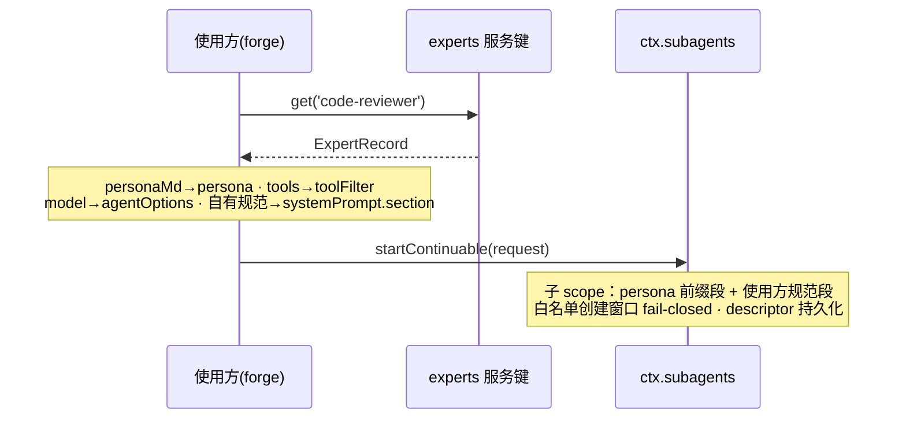

# 取用 API 契约（通道二 · 程序面）

> 适用对象：**通道二使用方**——经服务键 `experts` 取档案、自行组装 `SubagentStartRequest` 派发的宿主应用（如 forge）。通道一（模型面）不读本契约。
> 正本接口定义：tech-design §7；本文与其逐字段一致，冲突以 §7 为准。

## 1. 接入方式

使用方在宿主半经官方 inject 正门取服务键（同构先例 tool-agent-team → agentTeams），禁止 `ctx.reflect.get`：

```ts
import type { ExpertsService, ExpertRecord } from 'expert-squad'

function apply(ctx: Context) {
  const experts = ctx.inject('experts')   // 服务键 experts
  const rec = experts.get('code-reviewer')
}
```

## 2. 服务键 `experts` 方法面

| 方法 | 签名 | 语义 |
|---|---|---|
| `get` | `(key: string) => ExpertRecord` | 字符串键取单份档案；**不存在/已禁用 → 抛业务错（fail-loud，见 §3）** |
| `list` | `(opts?: { includeDisabled?: boolean }) => ExpertRecord[]` | 默认只返回启用项；`includeDisabled: true` 时含禁用（`enabled: false` 标记在场） |
| `registerRoot` | `(ctx: Context, dir: string) => void` | 上层插件声明随包内置专家目录（plugin 内置层，同型 customSkillDirs） |
| `setEnabled` | `(key: string, enabled: boolean) => void` | 启停；状态按工作区隔离（AD2/D4），`get` 视调用工作区判定 |

## 3. `ExpertRecord` 字段表（与 §7 逐字段一致）

| 字段 | 类型 | 组装映射 | 说明 |
|---|---|---|---|
| `name` | `string` | 不注入内容 | 英文键正本；取用/派发/遮蔽均按它，仅作键 |
| `title` | `string` | 按需（展示/规范段） | 岗位 |
| `description` | `string` | 按需（选人） | 简介，≤120 字，选人依据 |
| `personaMd` | `string` | **→ `persona`** | 人设 Markdown 原文，**不拼接**；作为子会话 system prompt 的**人格前缀段**（`deployment:persona-prefix`），非完整系统提示词 |
| `tools` | `string[]` | **→ `toolFilter`** | 工具白名单；受 §5.2 前置约束 |
| `skills` | `string[]` | 无注入缝 | 技能标签；搭配指引由使用方经 `systemPrompt.section` 承载（如需） |
| `model` | `string?` | **→ 派发模型（agentOptions）** | 可选派发模型偏好；缺省用使用方默认 |
| `origin` | `'plugin' \| 'user' \| 'project'` | 不注入 | 三层来源（遮蔽定序 project > user > plugin 内置），供禁用键与遮蔽回落判定 |
| `enabled` | `boolean` | 不注入 | 启用态；`get` 层面已挡禁用，仅 `list({ includeDisabled })` 可见 false |

## 4. 错误语义（fail-loud 清单）

降级契约单点化在 `get`：调用方在派发组装点不可能拿到禁用档案「误用」，守卫不推给使用方。

| 错误 | 触发 | 携带 | 使用方处置建议 |
|---|---|---|---|
| `expert not found: <key>` | `get` 键不存在（未建档/键拼错/被同名遮蔽后回落目标不存在） | 键名 | 按键名分支：提示建档或修正键 |
| `expert disabled: <key>` | `get` 命中已禁用档案 | 键名 + 状态 | 该工作区该专家不可派发；分支跳过或提示用户启用 |

补充语义：

- **热刷新竞态**：索引整体换代（快照语义），任意时刻 `get`/`list` 返回**某一代完整索引**，无半代状态。
- **root 级降级**：某层 root 不可读时 warn + 跳过该 root，其余层照常可取用（插件侧兜底，不抛给使用方）。

## 5. 派发前置约束（三条硬约束）

### 5.1 persona 子 scope 注入唯一

- 人设**只经子 scope 注册**（`composition.persona` 正门）注入为 `deployment:persona-prefix` 前缀段；
- **禁止在 registry 全局 scope 二次注册 `deployment:persona-prefix`**——全局 scope 撞名即抛错；
- 子 scope 遮蔽全局是官方合法语义（非错误状态）；人设随 descriptor 持久化、续聊 reapplied；
- 使用方自有业务规范走 `systemPrompt.section` **独立成段**，与人格前缀段由官方机械组合，互不顶掉（`complete` 整段替换缝不采用）。

### 5.2 工具白名单：子 scope 创建窗口内 fail-closed

- 控制链：档案 `tools` → `SubagentStartRequest.toolFilter` → 子代理**创建窗口**内 scoped `tools.restrict`；
- **fail-closed**：白名单在创建窗口内一次性收紧——被滤工具不进 prompt schema 且拒执行；**禁止派发后再裁剪**；
- 随 descriptor 持久化、续聊 reapplied；负向判据：白名单外工具在子会话 prompt schema 不可见且调用被拒。

### 5.3 仅 in-process provider 支持 toolFilter

- 官方 subagent 面中**仅 in-process provider（spawn/fork）落地 `toolFilter`**，进程外 provider 硬拒；
- 通道二派发钉死 in-process 路线：使用方组装时不得选择进程外 provider，否则 toolFilter 失效面 = 白名单约束整体不成立。

## 6. 通道二组装示例



伪代码（组装内核同构；通道一直接调内核，通道二使用方自行等价组装）：

```ts
const rec = experts.get('code-reviewer')          // 不存在/禁用在此 fail-loud

await ctx.subagents.startContinuable({
  persona: rec.personaMd,                          // 约束 §5.1：子 scope 唯一注入，前缀段
  toolFilter: rec.tools,                           // 约束 §5.2：创建窗口 fail-closed
  agentOptions: rec.model ? { model: rec.model } : undefined,
  systemPrompt: {
    sections: [forgeOwnRules],                     // 使用方自有规范：独立成段，不并入 persona
  },
  provider: { kind: 'in-process' },                // 约束 §5.3：toolFilter 仅 in-process
  prompt: task,
})
```

组装要点：

1. `personaMd` 原样进 `persona`，**不拼接、不包模板**——拼接语义归官方前缀段机械；
2. `tools` 原样进 `toolFilter`，不做使用方侧二次过滤（过滤语义归创建窗口 `tools.restrict`）；
3. `model` 缺省不传，回落使用方默认派发模型；
4. 追问/中断走官方 `dsh-tool-subagent-control`（`send_message`/`interrupt_agent`），不在本契约面内。

## 7. 归档与引用

- 本契约随提案目录归档：`.forge/docs/proposals/expert-squad/design/api-contract.md`（同内容副本）；
- tech-design §14 PRD Coverage Map 需求 7（persona scope 唯一 + 契约附前置约束）由本文承载。
