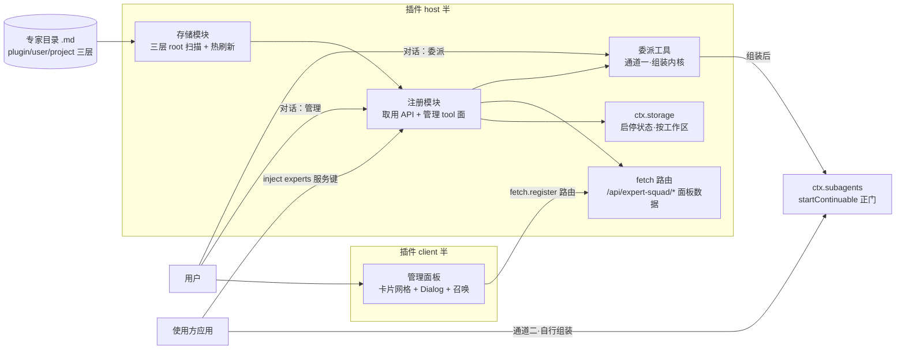
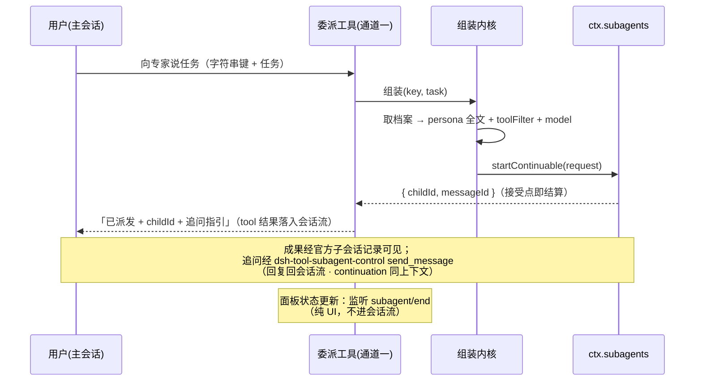
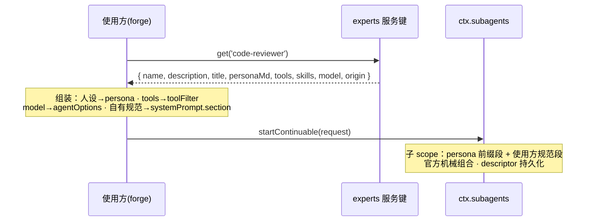

# 技术设计：专家团插件（expert-squad）

> intent: new-feature · db-schema: no（无自建持久化模型——正本 = `.md` 文件，状态经官方 `ctx.storage`）
> 上游：proposal（已 accept）· prd-spec · user-stories · ui-functions · ui-design v2
> D1–D4 决策已全部源码核销（见 §13），无开口。

## 1. 概述

独立 dsh 插件，三类能力：**档案存储**（三层来源 `.md` 扫描 + 热刷新）、**注册取用**（字符串键 API + 管理工具面 + Web 面板）、**委派**（双通道）。**通道一（模型面）**：插件委派工具，主会话对专家说任务即派发——纯 dsh 环境开箱可用。**通道二（程序面）**：使用方（如 forge）经取用 API 拿档案自行组装 `SubagentStartRequest`（人设 → persona、白名单 → toolFilter、model → 派发模型、自有规范 → systemPrompt.section）。两通道共用同一组装内核（§4 AD4）。

## 2. 架构



## 3. 技术栈与关键选型（ADR 摘要）

| 决策 | 候选 | 决策与理由 |
|---|---|---|
| 档案装载 | 官方 agent-presets vs 自建扫描 | **自建扫描，语义照抄 skill-filesystem**——preset 是部署期 YAML 静态行，无用户目录形态；已裁决（proposal §2.4） |
| 委派 | dsh-tool-subagent / 插件委派工具 / 使用方代码 | **双通道**：通道一 = 插件委派工具（薄自建层，纯 dsh 开箱）；通道二 = 使用方经取用 API 自行组装；dsh-tool-subagent 静态 Config 否决理由见 proposal §2.4；承重机械（provider/capability/toolFilter 落地/continuation）两通道全走官方 `startContinuable` 正门 |
| 面板数据通道 | rpc.handle / webServer / intercept("/api") / connection.fetch.register | **fetch.register 精确路由**——其余三者有不可达面（annotutor 实证） |
| client 构建 | 裸 tsc / esbuild 自拼 | **按官方 `tsdown.client.ts` 配方**：cjs + `__ModuleLoader__.load` 自注册 + PLATFORM_MODULES 外置（react 永不内联）+ client face 组合 `apply` |
| 持久化 | 自建 DB / ctx.storage | **ctx.storage**——仅启停状态与 UI 偏好，无 schema 需求（db-schema: no） |

## 4. 架构决策（ADR）

**AD1 档案取用 API = 同步读内存索引，fail-loud 错误语义（Q1 裁决）**
候选：抛业务错 vs 返回 enabled 标记。决策：`get(key)` 对不存在键抛 `expert not found: <key>`；对**已禁用**专家抛 `expert disabled: <key>`（错误信息含键名与状态码，供使用方分支）；`list({ includeDisabled })` 默认只返回启用项。理由：调用方在派发组装点不可能拿到禁用档案「误用」，降级契约单点化；返回标记把守卫责任推给每个使用方。弃选标记方案：契约面翻倍、守卫散落。

**AD2 禁用状态 = 按工作区隔离（Q4 裁决）**
候选：profile 全局 vs 按工作区。决策：**按工作区隔离**——同一专家在 A 工作区禁用、B 工作区可用。存储 key = `<origin>：<name>`，作用域挂工作区（ctx.storage 的 workspace 作用域语义须在 D4 核销；若官方 storage 无工作区隔离，回退方案 = storage key 前缀工作区标识，工作区标识来源随 D4 一起核销）。

**AD3 三层来源遮蔽 = 同构官方 scoped shadowing**
project > user > plugin 内置；同名键低层不可见（非合并）。`origin` 记录在取用结果中，供禁用键与「遮蔽回落」判定。

**AD4 组装内核单点，两通道共用**
取用 API 返回结构化字段（含人设 Markdown 原文）；**组装内核**（结构化字段 → `SubagentStartRequest`：人设合成 persona 全文、tools → toolFilter、model → agentOptions）实现为单一内部模块 `dispatch/compose.ts`。通道一委派工具与通道二使用方共用：通道一直接调内核派发；通道二由使用方取档案后按《取用 API 契约》自行组装（persona 前缀段语义、子 scope 注入唯一、白名单创建窗口 fail-closed、in-process provider 才支持 toolFilter 载明于契约文档）。

## 5. 模块设计（packages/plugins/expert-squad）

```
packages/plugins/expert-squad/
├─ package.json            # dsh.bundle.patch + dsh.client(platform:web) + peer pin
├─ cordis.patch.yml        # 单行插入 {id: expert-squad, name}
├─ experts/                # 随包内置专家样例（root 注册缝自证）
├─ scripts/bundle-client.mjs
├─ src/                    # host 半
│  ├─ index.ts             # apply: inject + 服务键 provide + tool 注册
│  ├─ store/scan.ts        # 三层 root 扫描（skill-filesystem 语义）
│  ├─ store/watch.ts       # chokidar + fs/observed 热刷新
│  ├─ store/frontmatter.ts # 解析 + 校验（裸 {{ / 撞名 / 必填）
│  ├─ registry.ts          # 内存索引 + 取用 API（服务键 experts）
│  ├─ dispatch/
│  │  ├─ compose.ts        # 组装内核：档案 → SubagentStartRequest（persona/toolFilter/model）
│  │  └─ dispatch.ts       # 通道一委派工具 delegate_expert（startContinuable 接受点结算：返回 childId；subagent/end 监听仅驱动面板状态）
│  ├─ tools.ts             # 管理 tool 面（招募/修改/禁用/列表；output 声明 + zod 子集净化）
│  ├─ routes.ts            # fetch.register /api/expert-squad/*（面板数据 + zod 门）
│  └─ state.ts             # ctx.storage 启停状态（工作区隔离）
├─ src-client/             # client 半
│  ├─ index.ts             # apply：slots.inject(main) + 面板挂载
│  └─ panel/               # 卡片网格 + Dialog + 召唤对话
└─ tests/                  # 结构镜像 + 装载契约守卫
```

- **能力边界**：管档案全生命周期、取用与通道一委派；不管通道二使用方的编排细节、不管履历（career 提案）。
- **依赖方向**：store → registry → dispatch/tools/routes；client → fetch 路由；全部指向官方服务键，禁止 `ctx.reflect.get`。
- **对外接口**：服务键 `experts`（`get/list/registerRoot/setEnabled`）；tool 面 5 工具（4 管理 + 1 委派）；fetch 路由族。

## 6. 交互契约

**通道一：主会话委派时序（B2 钉死：工具返回 childId 即结算）**：



**通道二：使用方取用时序**：



失败分支：键不存在 / 已禁用 → 抛业务错（AD1）；档案热刷新中 → 返回上代完整索引快照（US15 一致性）。

**面板数据通道**：`GET /api/expert-squad/list|get`、`POST /api/expert-squad/update|enable|disable`，路由面 zod 门，非法 400 文本；`[召唤]` 对话建档走同一 update 通道。

**跨面联动**：fetch 即时 + 5s 轻轮询兜底（D2 主案，forwarded 事件缝因官方 pin 包不可改制而弃选，见 §13 D2）。

## 7. 接口：取用 API（服务键 `experts`）

```ts
interface ExpertsService {
  get(key: string): ExpertRecord                    // 不存在/禁用 → 抛业务错（AD1）
  list(opts?: { includeDisabled?: boolean }): ExpertRecord[]
  registerRoot(ctx: Context, dir: string): void     // 上层内置专家目录（plugin 内置层）
  setEnabled(key: string, enabled: boolean): void   // 工作区隔离（AD2）
}
interface ExpertRecord {
  name: string          // 英文键正本
  title: string
  description: string   // 简介（选人依据）
  personaMd: string     // 人设 Markdown 原文（不拼接）
  tools: string[]       // 使用方映射 toolFilter
  skills: string[]
  model?: string        // 派发模型偏好
  origin: 'plugin' | 'user' | 'project'
  enabled: boolean
}
```

**tool 面**（动词+名词命名，全局注册即用）：管理 4 工具 `recruit_expert`（招募建档）/ `update_expert`（修改档案）/ `enable_expert`·`disable_expert`（启停）/ `list_experts`（列表取用）；**通道一委派工具 `delegate_expert`**（字符串键 + 任务 → 组装内核 → startContinuable，接受点结算返回 childId）——每工具声明 `output { schema, render }`（zod 子集净化，annotutor 先例）。

## 8. 数据模型（档案 `.md`）

```yaml
---
name: code-reviewer        # 英文键正本，唯一，建档后不可改
description: >-            # ≤120 字，选人依据
  Runs code review on diffs/files…
title: 资深评审
tools: [read, edit, grep]  # 插件自有字段 → 使用方映射 toolFilter
skills: [review, tsc]
model: sonnet              # 可选，派发模型偏好
---
## 职责
…
## 边界
…
## 信条
…
```

无 DB、无 ER/schema（db-schema: no）。校验：必填 name/title/description/tools；禁裸 `{{`；撞名（跨层同键即遮蔽、同层同键拒绝写入）。

**字段弃选记录（评审 Q1）**：`SKILL 引用` 从字段清单移除——官方技能搭配粒度 = 技能面整体开关 + 人设指引，无 per-expert SKILL 注入缝；技能搭配指引由使用方经 systemPrompt.section 承载（如需）。

## 9. 错误处理（FMEA 摘要）

| 故障模式 | 严重度 | 对策 |
|---|---|---|
| 坏档案（frontmatter/裸 `{{`/撞名） | 高频中损 | 写入口 + 扫描期 fail-loud 单文件跳过，其余专家不受影响 |
| 三层 root 不可读 | 低频中损 | root 级降级：warn + 跳过该 root，面板 ErrorBar 提示 |
| 热刷新竞态 | 低频低损 | 索引整体换代（快照语义），无半代索引 |
| storage 不可用 | 低频中损 | 启停降级为内存态 + warn（重启回到全启用） |
| 激活链任一环失败 | 高损 | annotutor 纪律：结构镜像测试 + 真机逐环重验（§11） |

## 10. 测试策略

1. **单元**：frontmatter 解析/校验负向用例、三层遮蔽定序、禁用状态工作区隔离、热刷新快照一致性、组装内核（persona 合成/toolFilter/model 映射）与委派工具负向用例（禁用专家 fail-loud、白名单映射、接受点结算返回 childId）——vitest 针对性执行。
2. **契约镜像**：tool output 门、fetch 路由 zod 门——先读官方测试再写镜像（annotutor 教训）。
3. **装载契约守卫**：client bundle 四项断言（自注册/工厂物化/禁 ESM 顶层/react 无副本，间接 eval 模拟 classic script）。
4. **真机结算门**：CLI 安装（`--store-dir`）→ boot 判据 → curl 探针 → 面板走查，配方按 annotutor 真机手册；单测全绿不算交付。

## 11. 改动范围

- 新增：`packages/plugins/expert-squad/**`（全量，见 §5）
- 不改：官方 deepseek-harness 包（零改制）；dsh-forge host（装配在消费提案 expert-squad-forge 内做）；`packages/plugins/*` 既有插件
- 文档：本特性 `.forge/docs/features/expert-squad/**`、提案目录

## 12. 影响范围

- 下游消费方：expert-squad-forge（消费取用 API 做通道二代码式派发与 HR 预设——接口面即 §7）；expert-squad-career（履历写入缝，未来提案）。
- 运行时影响：dsh desktop 经 plugin-manager 装载新增 bundle（可禁用，卸载零残留——patch 单行 + storage 键随 origin）。
- 未触及：会话发送链、system-prompt 机械、subagent 服务本体（插件仅消费 `startContinuable` 正门，不 import 服务本体）——判据：§2 架构图插件侧仅一条 `startContinuable` 调用边。

## 13. 已核销决策（源码取证，2026-10-22）

| # | 决策 | 结论（证据见核销记录） |
|---|---|---|
| D1 | 管理 tool 注册 scope | **全局注册**：插件宿主半 apply 内 `ctx.tools.register`（官方语义 globally-or-agent-scope，`core/tools/src/index.ts:1057-1063`）；管理面跨 agent 一致可见是需求本义，preset 行 scope 不采用 |
| D2 | UI ↔ 会话流联动 | **fetch 即时 + 5s 轻轮询兜底（主案）**。forwarded-Host-event 缝弃选：allowlist 表在官方 pin 包 `packages/api/remotes` 内（唯一控制点，本地无副本），登记即改制官方包，违反零改制纪律；且本 host 实测无 `ctx.remote.$on` 消费面。弃选留痕：官方缝本身存在（`remote-events.ts:16-48`、`ui-plugin-manager/client/index.ts:88-91`），若未来官方开放插件级事件转发登记可重评 |
| D3 | 三层 root 物理位置 | 同构 skill-filesystem（`skill-filesystem/src/index.ts:245-265`）：project = `<projectRoot>/.dsh/experts/`（cwd 向上解析至 git 根）；user = `$DSH_HOME/experts/`（默认 `~/.dsh/experts/`）；plugin 内置层 = 随包 `experts/`（customExpertDirs 配置位，同型 customSkillDirs） |
| D4 | 禁用状态存储 | 官方 storage 无工作区隔离语义（domain 全局、table 按 id 键控）→ **key 前缀方案**：自有 domain 表，key = `disabled/<canonicalWorkspacePath>/<expertId>`，canonicalWorkspacePath = `realpathNormalize(cwd)`（与 workspace 包 canonical cwd 判据一致，`workspace/src/entity.ts:122-143`）。**取值点钉死（评审 Q2/Q3）**：tool 面操作取调用 agent scope 的 cwd（会话工作区）；fetch 路由由 client 请求显式携带 `workspace` 参数——取值来源 = workspace-controller client store 的 `WorkspaceView.path`（官方正缝，`WorkspaceId` 同源；`__DSH_BOOT__` 无 workspace 字段），经 zod 门校验——杜绝进程级 cwd 串域 |

## 14. PRD Coverage Map

| PRD AC | 设计元素 |
|---|---|
| 1 管理对话式 + 通道一委派端到端（含负向白名单/续聊） | §7 tool 面（5 工具）+ §6 通道一时序 + §5 dispatch/* |
| 2 取用 API 契约（禁用降级 + 通道二） | §7 ExpertsService + AD1 + §6 通道二时序 |
| 3 面板三能力 | §5 client 半 + §6 fetch 路由 |
| 4 安装/启停真机 | §3 构建配方 + §10 真机结算门 |
| 5 热刷新 + 坏档案隔离 | §5 store/* + §9 FMEA 前两行 |
| 6 独立装载 + 通道一通用派发 | §5 dispatch/* + §12 未触及判据 |
| 7 persona scope 唯一 + 契约附前置约束 | AD4《取用 API 契约》文档 + §13 D1 |
| 8 三层来源/遮蔽/禁用隔离 | AD3 + AD2 + §7 registerRoot |
| 用户故事 US1–US15 | §6 双通道时序、§8 数据模型、§9 错误处理、ui-design（已批原型） |
