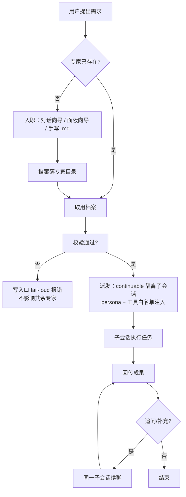

# PRD 规格：专家团插件

```yaml
db-schema: "no"
intent: new-feature
```

## 背景

dsh 生态没有「专家/角色」基础设施：角色 prompt 硬编码在各应用源码（如 forge 的 `PERSONA_VARIANTS` 矩阵），用户调优（话术、履历、工具搭配）与源码发版强耦合；也没有「目录 `.md` 文件 → 可派发子代理」的机制。用户与上层应用都需要一个独立于任何应用源码演进的专家能力层。

**干系人**：终端用户（管理与委派专家）；上层应用开发者（如 forge，经服务键消费专家、随包内置专家）。

## 目标

1. 新建/修改专家全程零源码改动、零发版；建档（对话指令或向导提交）完成后**立即可委派**。
2. 档案热刷新生效 **≤ 5s**（下一次派发即可用新内容）。
3. 单个坏档案不中断其余专家服务（坏文件被拒、其余照常可取用可派发）。

## 范围

**In Scope**：
- 专家档案：`.md` 正本（frontmatter + 正文）、对话式增改禁用、文件直编热刷新
- 委派调度：continuable 隔离子会话、工具白名单强制、追问续聊
- 三层档案来源：plugin 内置（root 注册缝）/ user / project，同名遮蔽
- Web 管理面板：列表 / 详情 / 入职向导 / 委派入口
- HR 预设：部署侧 agent 预设（dsh-forge 装配层）——人格履历专职招聘与管理，绑定专家团管理工具（招募/修改/禁用/取用列表），不含委派；专家团插件自身不感知 HR
- 独立插件发布：本仓 `packages/plugins/expert-squad` → npm 包，plugin-manager 安装启停

**Out of Scope**：
- 存储选型细节、UI 视觉细节（归 tech-design / ui-design）
- 多专家并行竞争、专家绩效评估、执行日志分析（展望项）
- 官方 agent-presets / skill 装载机制改制
- 并发写入冲突的合并语义（last-write-wins 等，归 tech-design）；派发只要求读到某一时点的一致档案快照

## 用例图

```mermaid
flowgraph LR
    用户((终端用户)) --> UC1([对话式增改禁用专家])
    用户 --> UC2([文件直编专家档案])
    用户 --> UC3([面板管理专家：浏览/检索/详情])
    用户 --> UC4([委派任务给专家])
    用户 --> UC5([追问续聊])
    HR((HR 预设)) --> UC1
    开发者((上层应用开发者)) --> UC6([经服务键取用与派发专家])
    开发者 --> UC7([随包内置专家目录声明])
    UC7 -.扩展.-> UC4
```

## 业务流程



## 功能规格

1. **专家档案**：`.md` 正本 = frontmatter（name、岗位 title、信条、工具白名单、技能标签、SKILL 引用）+ 正文（履历/工作流 SOP）；全量内容用户可编辑；坏档案（缺 frontmatter/坏 YAML/含裸 `{{`）注册期 fail-loud。
2. **对话式管理**：主会话经插件 tool 面完成招募、修改、禁用；被禁用专家不可被取用与派发（降级契约由 tech-design 钉死）。
3. **文件直编**：专家目录直接编辑/新增 `.md`（含模型经 edit/write），热刷新生效。
4. **三层来源与遮蔽**：project > user > plugin 内置同名遮蔽；禁用状态按来源隔离、升级不丢失。
5. **委派执行**：字符串键取档案 → continuable 隔离子会话；白名单外工具在子会话不可见且调用被拒；成果回传主会话，追问在同一专家上下文续聊。
6. **Web 管理面板**：见 ui-functions 文档。
7. **HR 预设**：人格履历（招聘/管理专家的 SOP）+ 工具绑定 = 专家团管理工具集；对话式完成招募、修改、禁用与专家查询；无委派工具，不代替用户派活。
8. **独立发布**：安装/启用/禁用经 plugin-manager；管理面板经 Host `/plugins/` 路由加载。

## 非功能注记（保健项）

- **可移植性**：插件源码与档案 schema 零上层业务词汇；无任何上层应用环境可独立装载并完成通用派发。
- **官方合规**：只走官方合法缝（inject 服务键、storage、subagents continuable 面、ui-slots、fetch 路由、plugin-manager）；persona 子 scope 唯一注入。
- **真机结算**：外部依赖装配面以 dsh desktop 真机端到端取证为交付门。
