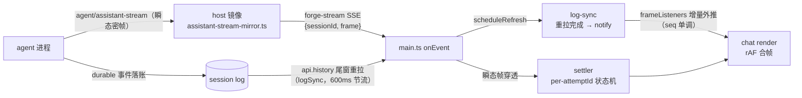

# chat 对话管线（会话流数据面 + 渲染语义）

mobile 端 chat 视图的当前事实：数据从何而来、何时渲染、如何折叠、消息如何装饰。正本锚点标注在括号内。

## 总览

两条腿分工：

- **瞬态腿（流式）**：`agent/assistant-stream`（官方 dsh-agent 瞬态发布面，start/chunk/end 密帧）经 host 镜像逐帧到达，`settler` 按 attemptId 累积 text/reasoning 增量——打字机渲染。瞬态帧不落 durable 历史。
- **durable 腿（事实）**：一切落账事件（user/message、assistant/message、tool/call+result、turn/end…）只经 `api.history` 重拉到达。SSE 镜像帧（8 个官方事件名）只做**失效信号**：触发 600ms 节流重拉，重拉完成后 notify（frameListeners 重读缓存，按 seq 尾序外推）。

## 渲染合帧

`scheduleRender()`（rAF，非浏览器环境 setTimeout 16ms 兜底）：一帧内多次变更（chunk 群、settle + 重拉 notify 背靠背）合并为单次全量重建，重建次数 = 帧率上限而非事件数。加载路径（loadInitial/loadOlder）仍同步 render——上翻页滚动锚依赖 render 后的 scrollHeight。

## turn 折叠

- 边界 = durable `turn/end`（官方信号）。段内活动 seq 全部落在最后 `turn/end` 之前 → 折叠；被打断/进行中 turn 保持展开。
- 摘要行 = 桌面端 turn 头同形：`已完成 · N 步 · 用时 X`（N = step/end 计数，回退活动项数；耗时 = turn/start→turn/end 时差）+ 水平分隔线，无底盒。
- 过程内容双来源：
  - durable 活动在账（思考/工具落账的模型）→ 折叠组原材料 = durable 事件；
  - durable 无活动（flash 类模型，step 内零事件）→ `settle` 保留瞬态 reasoning 作为折叠原料，渲染 `思考与执行 · N 项` 组（文本仍由 durable 卡取代）。
  - 互斥开关 = 尾段有无 durable 活动投影，防同一 turn 双折叠组。插入位 = 尾段 user-bubble 之后的第一个非用户投影前（气泡→折叠→回复语序）。

## 消息元信息行

- 用户气泡下（右对齐）：时间 + 复制；agent 回复下（左对齐）：复制 + 用量 + 时间。
- 数据：`WireEvent.time`（投影透传）；用量 = durable `data.usage.totalTokens`，K 缩写（14.6K tok）。
- 复制：clipboard API 优先，LAN http（非 secure context）回退 execCommand；成功闪绿。
- 流式瞬态行不挂元信息行。
- 点赞/点踩/分享未挂——官方唯一反馈缝是会话级 remark（`sessionFeedback.record`），无逐消息语义。

## 模式芯片

hero 选择（突击/远征 + 内置预设）经 `heroModeRef` 外推，chat composer 芯片跟随；forge 双预设 = prompt mode 语义（突击 steer / 远征 queue），运行中发送自动 steer 抢占、空闲 queue 排队。

## 生效路径

| 面 | 生效方式 |
|---|---|
| mobile bundle（渲染/投影/合帧） | 重建 bundle + 刷新页面 |
| host 镜像/代理通道（assistant-stream-mirror、preset-select） | 重启宿主进程 |
| durable 数据（usage/turn-end 折叠） | 仅新产生数据携带；旧会话经重拉读取在场字段 |
