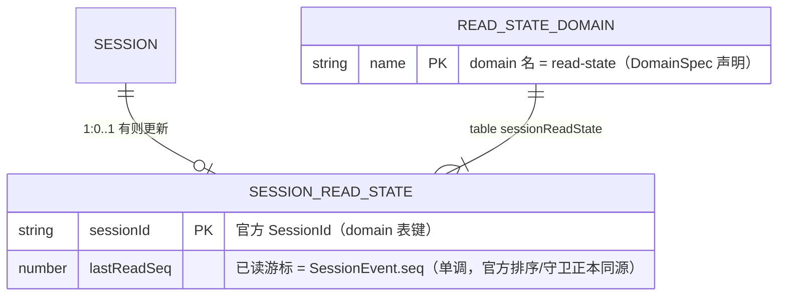

# ER 图：read-state（host 共享已读游标 · dsh-storage domain 表）

本特性引入的唯一持久化 = per-session `lastReadSeq`（已读游标）。**载体 = 官方 `dsh-storage-domain` 域表**（`read-state` domain，表 `sessionReadState`；JSON backend 落 dsh-home storages）——原子写链、change 事件、损坏边界由官方存储缝提供，零自持文件。**定位：host 侧共享数据能力，不绑定移动端**——移动端经 `forge:remote/read-state` 薄方法消费，桌面端（web-app / IPC 面）复用同一域表与通道。

- **实体**：`SESSION_READ_STATE`（domain 表一行/会话）；domain `read-state`（独立 DomainSpec——与其它域数据隔离、schema 可单独演进，基础设施复用存储缝）。
- **未读计算（对齐 dsh 消息体）**：dsh 每个 SessionEvent 带单调 `seq`。host 进程内监听 session append 维护 `tailSeq[sessionId]`（零持久化）；**`unread = tailSeq − lastReadSeq`（O(1)）**；host 重启后由 session store 按 seq 范围重放重建。
- **写者**：仅 host（薄方法 `forge:remote/read-state`：读 `{sessionId}` → `{seq, unread}`；写 `{sessionId, seq: tailSeq}` —— 手机端打开会话/触底、桌面端打开会话均可触发；`KvTable.update`（putIfAfter 原子 RMW——单调守卫在此实现）走域写链原子落盘）。
- **消费方**：移动端（抽屉双级未读徽标；轮询口径 15s 可配 + 本地归零）与桌面端（同一域表与通道复用）。
- **生命周期**：域表行随会话存续；`domain/changed` 事件可驱动未来推送式增强（当前轮询口径不依赖）。
