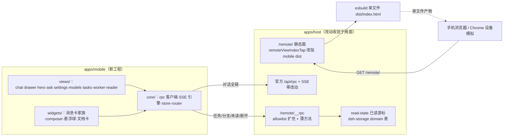
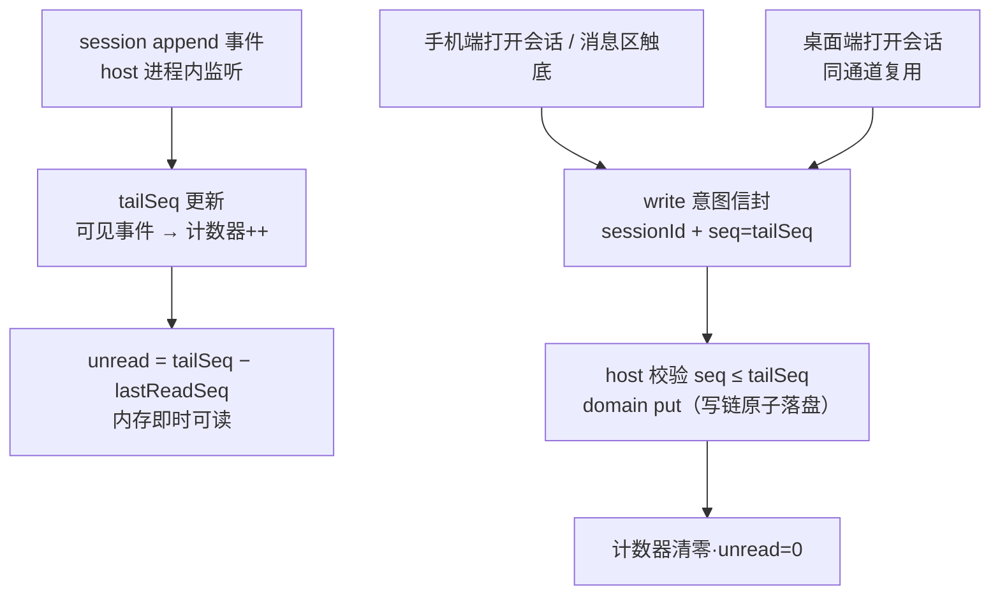
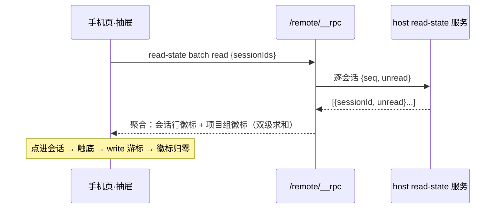
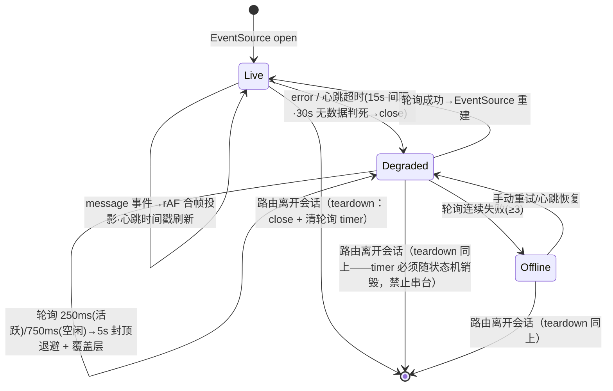
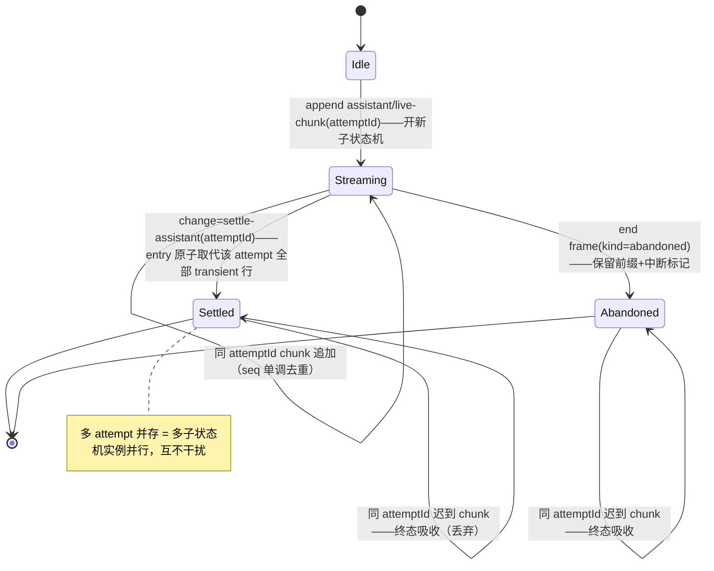
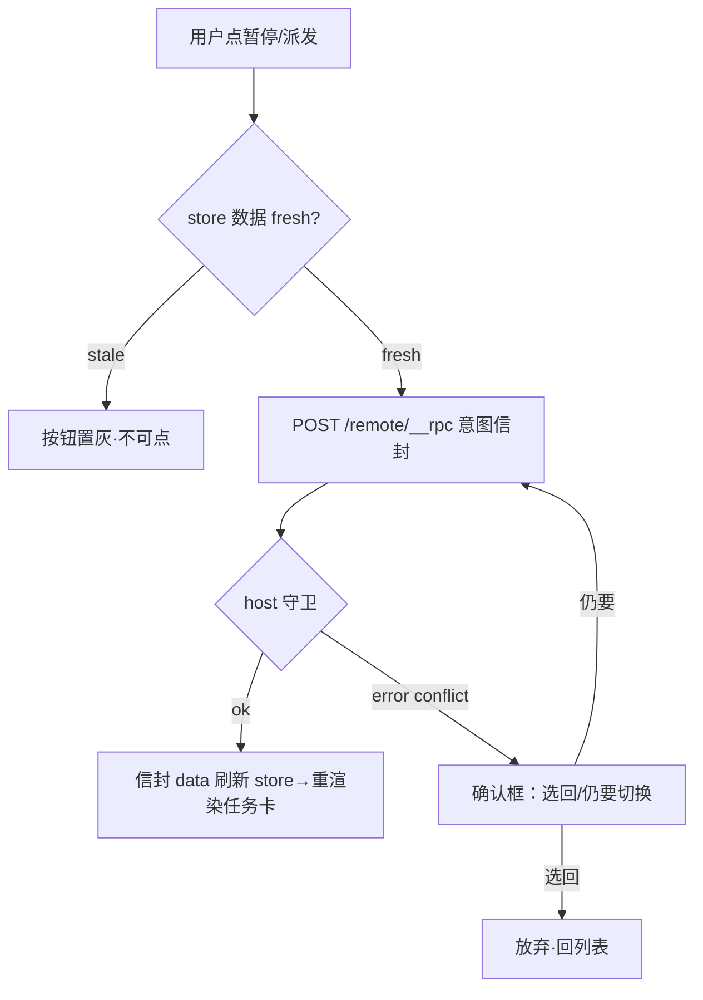
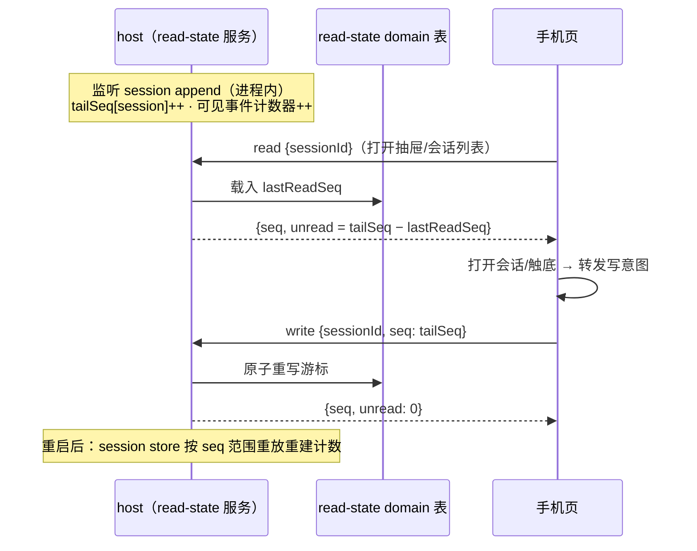
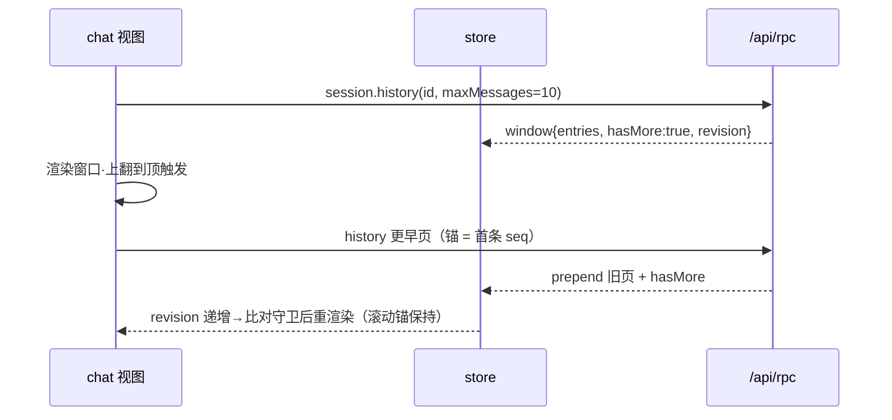
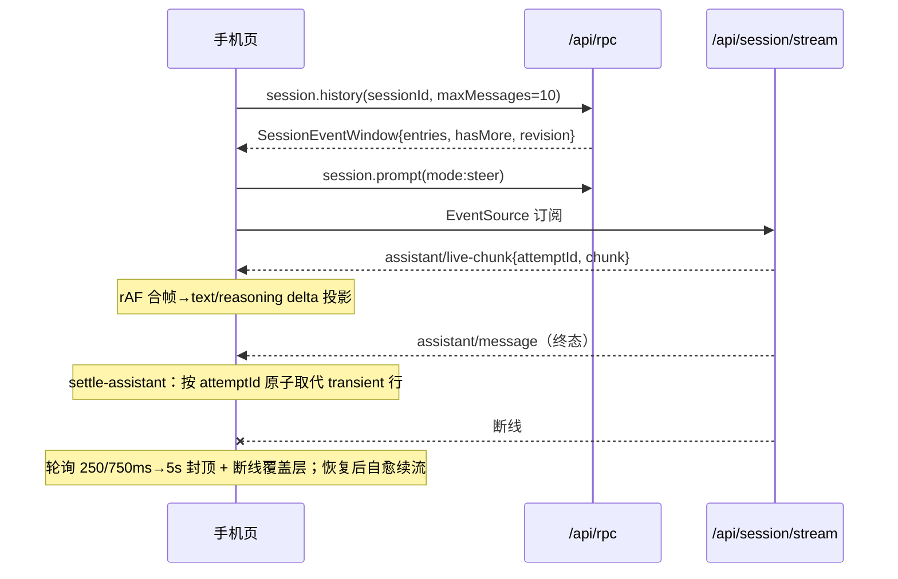
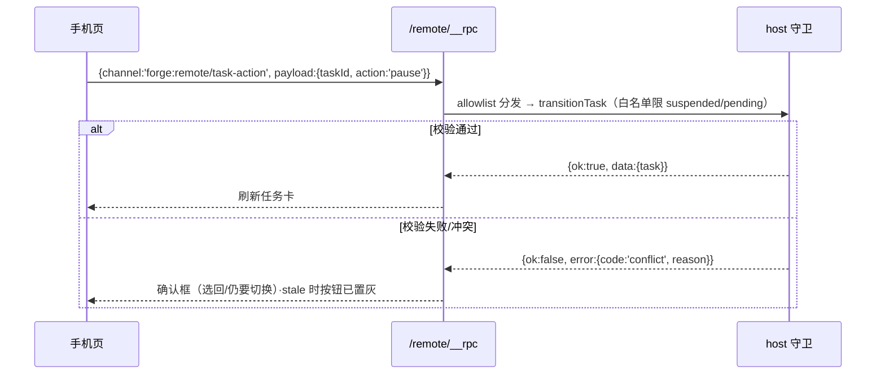

# 技术设计：mobile-ui 手机端受限视图独立工程

意图 = `new-feature`（全量设计）。UI 定稿基准（10 屏 mockup）已经用户裁决冻结，本设计不重开 UI 决策；用户故事即 AC 清单（US-1～US-10，见 prd-spec/user-stories 注册件）。

## 概述

mobile = 纯 view 层独立工程（`apps/mobile`）：TypeScript 源码经 esbuild 打包为单文件 dist，由 host `/remote/` 静态面服务；数据面双通道——官方 API 面（`/api/rpc` + `/api/session/stream`，零改动）直连 + forge 扩展面（`/remote/__rpc` allowlist 扩充 + 薄方法）。手机端只做「接收数据、渲染页面、转发输入与动作意图」。

## 架构图



## 技术栈选型

| 决策点 | 候选 | 权衡矩阵结论 | 决策 |
|---|---|---|---|
| 构建工具 | esbuild / Vite / webpack | 秒开要求单文件产物：esbuild 零配置单文件 IIFE + 最快构建；Vite 优势在 dev server 与 HMR（移动页无此需求，且禁 watch 纪律下意义更小）；webpack 过重 | **esbuild**（提案裁决 + 矩阵一致） |
| 语言 | TypeScript / 裸 JS | 类型化消费 wire 契约（SessionEvent 判别集）需 .d.ts；仓库全域 TS | **TypeScript**（`verbatimModuleSyntax` 对齐仓库 tsconfig 风格） |
| UI runtime | vanilla DOM / Preact / lit | 提案裁决无框架 runtime（重评阈值未触发）；桌面组件不可迁移（pointer/hover 密度） | **vanilla DOM**（模板函数 + 事件委托，零运行时依赖） |
| 路由 | 自写 hash router / naive-router 库 | 页面 ≤9、无嵌套守卫需求；引库违背零依赖 | **自写 hash router**（~60 行：`#/chat/:id` 等 5 路由 + 浮层不走路由） |
| md 渲染 | marked 级轻量函数 / markdown-it | 移动端包体敏感；需求仅标题/列表/表格/代码块 | **自写轻量 md 函数**（~200 行，白名单标签）+ `@dsh-forge/md-mermaid` DOM 增强器动态 import |
| 状态 | 模块级 store（发布订阅） / Redux 类 | 单页单会话、SSE 单源；发布订阅足矣 | **自写 20 行 store**（`{get,set,subscribe}`），revision 守卫内置 |

## 架构决策（ADR 风格）

### AD-1 手机端 = 纯 view 层，机制零感知（承 PRD 硬边界）

- 候选：①纯 view + 意图转发；②手机端内置轻校验（如 stale 预判）加速反馈。
- 权衡：②减少一次往返但引入双源真值（手机判 stale vs host 判冲突），分歧路径不可测；①的代价仅为一次 RTT，且确认框交互已定稿。
- 决策：**①**。手机端所有动作 = `POST /remote/__rpc {channel, payload}` 意图信封；校验失败 = host 回 `{ok:false, error:{code, reason}}` → 手机端渲染确认框/提示。判据字段（`mode`/`activity`/`label`/`source.kind`）只读不推理。

### AD-2 双通道分工（官方面管对话，forge 面管任务域）

- 候选：①全部走 `/remote/__rpc` 转发；②官方面直连 + forge 面扩展。
- 权衡：①需在 host 重实现 session.proxy 层（转发即新增 host 代码，违背零改动裁决）；②对话链复用官方已实证契约（SSE 合帧/重连/revision 守卫），host 零改动。
- 决策：**②**。手机页同源 fetch/EventSource 直连官方面；任务域走 forge 扩展面。

### AD-3 dist 接入 = 静态面改指，不动官方 webServer

- 候选：①`child.ts` 静态路由把 `/remote/` 目录改指 `apps/mobile/dist`；②新增 `/m/` 前缀并存。
- 权衡：②保留桌面裁剪分支入口但形成双入口漂移；提案已裁 mobile 替代裁剪分支。
- 决策：**①**。改指单点 = `/remote/` handler 内的 **webDistRoot 局部值**（`resolveWebDistDir` 调用结果）+ `remoteViewIndexTap` index 弹射注入两处对齐；**不得改共享 `resolveWebDistDir`**（主进程窗口共用）。桌面 web-app 构建产物不再进 `/remote/`。

### AD-4 循环哨兵 = source.kind 类型化注入（PRD 契约升级落地）

- 决策：宿主循环注入走 `agent.inject()`/`agent.followup()`，声明合并 `MessageSourceMap` kind `'forge-loop'`（`MessageSourceMap` merge-extensible 有官方 documented 保证——`message.d.ts`；`agent.send/steer/followup/inject` 全收显式 `UserMessage`，注入方完全控制 source）。**改动落点（评审修正）**：`packages/plugin-forge/src/faces.ts`（`forgeUserMessage`——现声明 `source.kind:'user'`）与 `notify/` 通道注入点 + `run-dag-tasks.ts` 指令单行 followup 一并声明 `'forge-loop'`；`MessageSourceMap` 声明合并放 plugin-forge 自有模块。结构化字段 `{loopKind, runId, task, state}` + `ContextForm` 挂 source。
- **先例引用修正（评审）**：`model-selection` notice 的证据 = 官方类型正本（`dsh-agent` `model-selection.d.ts` 模块扩充 `MessageSourceMap`），**非 wire-samples 样本**（持久日志中该 notice 未被本次提取捕获）；瞬态类样本（live-chunk/interrupted/abandoned）JSONL 持久提取天然不含，由 T3 录制回放补证。
- **循环卡数据正本修正（真实日志发现）**：`forge/progress` 已作为**持久会话事件**存在于日志（`{sourceSlug, verb, status, taskKey, counts, at}`——wire-samples 实证）。循环卡渲染判别正本 = `type === 'forge/progress'`（sourceSlug ↔ runId、verb/status → kind 色条、taskKey、counts）；注入 notice 仅作叙述面补充。手机端零参与（桌面 progress 面既有产出）。
- **followup 消息特殊处理（用户裁决）**：任务循环 followup（`agent.followup` 注入的续轮叙述）是机器发出的 user-role 消息——若不带类型化 source，手机端无法与人工输入区分，会被误渲染为蓝气泡。桌面侧约束：**followup 注入一律声明 `source.kind:'forge-loop'`**（+ ContextForm）；手机端判别 `source.kind==='forge-loop'` → 渲染为**循环叙述卡**（左对齐浅蓝系统卡，非用户气泡、不带人工输入的未读语义），进度细节仍由 `forge/progress` 事件承担。此为桌面循环侧改动（`packages/plugin-forge/src/loop/` followup 注入点），手机端只消费 kind。

**投影白名单（真实日志 37 类事件 → UI 处置辨识）**：

| 处置 | 事件类型 | UI 形态 |
|---|---|---|
| A 消息流渲染 | `user/message`（`source.kind:'user'`）、`assistant/live-chunk`（SSE transient）、`assistant/message`、`tool/call`、`tool/result` | 蓝气泡（**仅人工输入**）/ 流式+thinking / 终态取代 / 活动卡（配对键 = `data.message.toolCallId`，另携信封级 `sourceEventSeqs`） |
| B 系统层轻投影 | `forge/progress`（循环卡正本）、`user/message`·`source.kind:'forge-loop'`（**followup 循环叙述卡——特殊处理，非用户气泡**）、`model-selection` notice、`compaction/summary`、`session/title`（标题）、`command/run`+`command/done`（**成对投影**——开始态必须有配对终态，防悬挂「进行中」）、`deliverables/presented`（文档卡双行确定处置：卡+链接行）、`plan/mode` | 循环卡/循环叙述卡/chip/系统行 |
| C 只读提示 | `approval/asked`、`approval/decided` | 只读审批提示卡（成对：decided 到达更新 asked 卡；手机端不做审批交互——既有 approval 通道负责） |
| D 特判 | `assistant/attempt`（失败尝试）、`user/message`·`source.kind` **未知（中性系统行，非蓝气泡——unknown≠人工）** | 默认不渲染 / 中性系统行 |
| E 忽略（状态与机械） | `system/message`（**source.kind:'system-prompt' 的系统提示——surfaceOp:'append' 也不投影**）、`turn/start·end`、`step/start·end`、`request/header·context`、`permission/preset`、`sandbox/mode`、`approval/policy`、`agent-preset/selected`、`agent/inbox/spliced`、`session/title-llm-request`、`llm/retry·retry-started`、`web/deepseek-search-llm-request`、`workspace/changes`、`session/end-seed`、`compaction/start·end·prune`（prune 需钳制 lastReadSeq 与可见计数——被裁事件不计为未读）、`command/done`（并入 B 配对口径）、`subagent/catalog`（task 浮层经薄方法读，非消息流）、`model/selection`（结构事件） | 零渲染，skippable 纪律兜底 |

**判定顺序与信封注记**：`user/message` 判定顺序 = `source.kind` 分派（'user'→A / 'forge-loop'→B 叙述卡 / 'model-selection'→B chip / 未知→D 中性系统行）；`surfaceOp` 为**条件字段**（仅五类 SurfaceEventType 携带，`tool/call` 等无）——投影判据 = 事件类型 + kind 白名单，不得以「surfaceOp:'append'」为投影条件；**成对纪律**：开始态事件（command/run、approval/asked）必须声明配对终态，终态缺失 = 渲染为可收起 chip 而非常驻卡。

### AD-5 构建纪律 = run-once，无 watch（Windows commit 纪律）

- 决策：mobile 构建一律 run-once 命令（禁 `--watch` 形态）；host 质量门/dev 流程同既有仓库口径。`/remote/` 启动时若 dist 缺席 fail-soft 降级为提示页。

### AD-6 未读 = seq 游标（read-state），非时间戳

- 候选：①时间戳 lastSeen（对比新消息 time）；②seq 游标 lastReadSeq（对比 SessionEvent.seq）。
- 权衡：①时钟依赖、乱序敏感，且 dsh 消息体的排序/守卫正本本就是单调 seq；②O(1) 计算（`unread = tailSeq − lastReadSeq`）、与 revision 守卫同源、host 重启可由 session store 按 seq 范围重放重建。
- 决策：**②**。命名随之正名为 `read-state`（`forge:remote/read-state` 通道 / `ReadStateEntry`——lastseen 的时间戳词不再名不副实）。host 进程内监听 session append 维护 `tailSeq` 与可见事件计数（内存，零持久化）；持久侧只存游标（载体见 AD-7）。
- **计算单源纪律**：`unread` 只在 host 计算（tailSeq 监听仅在 host 进程可达）；移动端/桌面端一律经通道读结果，**不各自独立计算**——移动端「触底后本地置 0」仅为显示层乐观更新，下次读即对账，不构成第二计算源（与 AD-1 无双源真值同纪律）。

### AD-7 read-state 载体 = 官方 dsh-storage domain 域表（不自持文件、不进会话日志）

- 候选：①写进会话日志（session store）；②手机页 localStorage；③自持独立 JSON 文件；④**官方 `dsh-storage-domain` 域表**。
- 权衡：①读端视图状态不是会话数据，写日志撞「会话格式零改动」裁决；②换设备丢失、抽屉跨会话聚合无源、桌面复用不了；③自持文件要自己实现原子写/写链/损坏恢复——而官方 `dsh-storage` + `dsh-storage-domain` + `dsh-storage-json`（dsh-home storages/*.json 即其产物）已提供 DomainSpec 声明、KvTable 类型化读写、单域写链原子化、`domain/changed` 事件、损坏边界——自持即重复造轮子；④零基础设施新增，只声明一个 DomainSpec。
- 决策：**④**。`read-state` 注册为独立 domain（表 `sessionReadState`，键 = SessionId，值 = `{lastReadSeq}`）——**独立性只到 domain 层（与其它域数据隔离、可单独演进 schema），基础设施（原子写/落盘/事件）全部复用官方存储缝**。目录树中 `remote-read-state.ts` 相应改为 `read-state-domain.ts`（DomainSpec 注册 + 薄方法 handler），无自持文件、无自写原子写。
- **复用前提（2026-10-17 核实）**：host package.json 现无 `dsh-storage*` 依赖、仓内零 import——但存储缝已在运行时活动（`dsh-home/storages/*.json` 由官方发行组合的存储域路由写：`dsh-schedule` 的 tasks 表即 DomainTableSpec、`dsh-session-projection-cache` spec 注明「shipped composition's json」medium）。落地三步：① host 增补 `@deepseek-ai/dsh-storage`(+`-domain`+`-json`) 精确 pin（0.2.0-rc.2 同轨）；② 批次实现首步核实官方组合是否已挂 storage registry/domain facility（官方件在用即大概率已挂），缺席则挂官方 storage 插件；③ 声明 read-state DomainSpec。三包能力/边界全谱与 read-state 实现精化（**single 布局 + `KvTable.update()` 原子 RMW 实现单调守卫**）见 [tech-research.md](tech-research.md) R6。
- **实时未读口径 = 轮询 + 本地归零**（配对隧道无常连推送）：抽屉打开时批量读；抽屉存留期间轻 RPC 轮询（默认 15s，可配常量——同源 POST 成本极低，与 SSE 断线退避同族口径）；会话内触底写游标后**本地即时置 0**（不等网络往返）。

### read-state 写入与消费流程

**写入流程**（谁在什么时候推进游标）：



**消费流程**（抽屉双级未读徽标聚合）：



## 模块/包设计（apps/mobile）

- **能力边界**：只管「契约字段 → DOM」与「用户输入 → 意图信封」；不管校验、循环、缓存策略（分页由 `hasMore` 驱动）、任何持久化（唯一例外 localStorage 最近使用模型——纯视图偏好）。
- **职责划分**：
  - `core/`：`rpc.ts`（`__rpc` 信封客户端）、`api.ts`（官方面窄面）、`sse.ts`（EventSource + rAF 合帧 + 退避轮询 + 心跳判活）、`wire.ts`（SessionEvent 判别集窄化 + 投影纯函数——fake 可测主战场）、`store.ts`、`router.ts`。
  - `views/`：一屏一文件（chat/drawer/hero/ask/settings/models/tasks/worker/reader），只做装配。
  - `widgets/`：消息卡家族（气泡/thinking/ioCard/终端块/循环卡/chip/acard/文档卡）、composer、悬浮球、确认框。
- **依赖方向**：`views → widgets → core`，禁止反向；`core` 不 import views/widgets。
- **对外接口**：入口 `main.ts` = `mount(root)`；构建产物单文件 IIFE，无外部导出。

### 目录树

```text
apps/mobile/
├─ package.json                # 独立依赖清单（零运行时 deps；devDeps: esbuild 精确 pin + typescript）
├─ tsconfig.json               # verbatimModuleSyntax 对齐仓库风格
├─ esbuild.mjs                 # run-once 构建脚本：src/main.ts → dist/index.html（单文件 IIFE 内联）
├─ src/
│  ├─ main.ts                  # mount(root)：路由注册 + 首屏装配
│  ├─ core/
│  │  ├─ rpc.ts                # /remote/__rpc 信封客户端（{channel,payload}→{ok,data}|{ok,error}）
│  │  ├─ api.ts                # 官方面窄面：session.history/prompt/rpc、interaction.*、workspace.list
│  │  ├─ sse.ts                # EventSource(命名事件 snapshot/event) + rAF 合帧 + 官方三值退避轮询(250/750/5000ms) + 心跳判活 + 覆盖层状态机
│  │  ├─ wire.ts               # SessionEvent 判别集窄化 + 投影纯函数（fake 可测主战场）
│  │  ├─ store.ts              # {get,set,subscribe} + revision 守卫
│  │  └─ router.ts             # hash router（5 路由 + 浮层管理）
│  ├─ views/                   # 一屏一文件，只做装配
│  │  ├─ chat.ts  drawer.ts  hero.ts  ask.ts
│  │  ├─ settings.ts  models.ts
│  │  └─ tasks.ts  worker.ts  reader.ts
│  └─ widgets/
│     ├─ msg-cards.ts          # 气泡/thinking/ioCard/终端块/循环卡/chip/acard/文档卡家族
│     ├─ composer.ts           # 输入行（模式/worktree/滑杆/发送）
│     ├─ fab.ts                # 悬浮球（拖拽/贴边半圆）
│     └─ confirm.ts            # 确认框（host 拒绝 → 选回/仍要切换）
└─ dist/                       # 构建产物（run-once 产出；静态面服务目标）

apps/host/src/boot/
├─ child.ts                    # 改：/remote/ 静态面改指 + rpc deps 注入扩充
├─ remote-http-rpc.ts          # 改：allowlist 扩充 + 薄方法 handler（纯函数）
└─ read-state-domain.ts        # 新：read-state DomainSpec + 薄方法 handler（官方存储缝；host 共享能力，非 mobile 专属）

packages/contracts/src/
└─ remote-channels.ts          # 改：REMOTE_CHANNELS 扩充（task-action/session-links/read-state/workers）
```

### 关键逻辑 UML

**SSE 连接状态机**（`core/sse.ts`——对话可用性的核心逻辑；含心跳判活与 teardown 纪律）：



- **双通道写纪律**：Degraded 期间轮询与 EventSource 重连并存时，全部写入经 store 的 **seq 单调门**（每事件按 seq 丢弃 ≤ 已应用 seq 的写入；live-chunk 按 attemptId+index 去重）——20 行 revision 守卫之上再加此单调合并层，禁止双通道裸写。
- **半开连接**：心跳判活即半开对策（readyState OPEN 但 30s 无数据 → 主动 close → Degraded）。

**消息结算状态机**（`core/wire.ts`——**per-attemptId 子状态机**；配对键来自 `window.change` 判别帧 `{kind:'settle-assistant', attemptId, entry}`——持久 `assistant/message.data` 无 attemptId 字段，不得与 live-chunk 直接配对）：



**任务意图守卫交互**（AD-1 意图信封唯一动作通道）：



**未读计算与已读上报**（AD-6 seq 游标）：



**历史分页时序**（`session.history` + `hasMore`）：



## 跨模块交互契约

- **流通道（官方手机页实证，tech-research R1）**：
`new EventSource('/api/session/stream?sessionId=…')`，两个**命名事件**——`snapshot`（`{records, projections}` 全量应用）与 `event`（增量，`frame.event || frame`，帧内瞬态类型真名 `assistant/chunk`，非 chunk 触发 pending 同步 150ms 防抖）；`onerror` → 降级轮询。RPC = `POST /api/rpc {method,payload}` → `{ok,error?}`，401/fetch 异常 → disconnected 覆盖层。轮询常量照官方三值：活跃 250ms / 空闲 750ms / 封顶 5000ms；`visibilitychange` 前台回连（官方同款）。

### 流程时序 1：对话全链（官方面，零 host 改动）



### 流程时序 2：任务意图转发（forge 面，host 守卫）



### 交互方式

同步 HTTP RPC（信封 `{ok,data}|{ok,error}`，ipc 信封同语义——既有 `remote-http-rpc.ts` 口径不变）；对话流 = SSE 推 + 断线轮询兜底。选型理由：任务域低频、强守卫，同步信封足够；对话流高频单向，SSE 原生重连最小成本。

### 契约数据模型（forge 扩展面 allowlist 增量）

| channel | 方向 | payload → data | host 落点 |
|---|---|---|---|
| `forge:remote/progress`（已有） | 读 | `RemoteProgressQuery` → `{tasks, stats}` | 不变 |
| `forge:remote/approval`（已有） | 意图 | `RemoteApprovalDecisionInput` → `RemoteApprovalForwardResult` | 不变 |
| `forge:remote/task-action`（新） | 意图 | `{taskId, action:'pause'│'dispatch'}` → `{task}` | `transitionTask` 白名单限 suspended/pending |
| `forge:worktree/branches`、`forge:worktree/list`、`forge:worktree/sessionCreate`（透传） | 读/意图 | 桥上已有通道透传 | child.ts 桥直通 |
| `forge:remote/session-links`（新薄方法） | 读 | `{branch, worktree}` → `{running:[{taskId,slug,title}], blocked:bool}` | `sessionLinks`+`listTasks` 组合反查（分支切换校验） |
| `forge:remote/read-state`（新薄方法） | 读/写 | 读 `{sessionId}` → `{seq, unread}`（域重建窗口返回 `stale:true`）；写 `{sessionId, seq}` → `{seq, unread}`（**host 单调守卫：仅接受 seq > 当前 lastReadSeq**，防旧端写回退；越界 clamp 至 tailSeq） | read-state domain 表（**官方 dsh-storage 缝，host 共享能力**；AD-6/AD-7；写链 + 单调守卫） |
| `forge:remote/workers`（新薄方法） | 读 | `{parentSessionId}` → catalog 切片 `[{id(=SessionId，worker 路由键), mode:'one-shot'│'continuable', activity, label?, hasChildren}]` | wire 实证字段投影（subagent/catalog 样本实证；label 在 one-shot 分支可选） |
| `forge:remote/disconnect`（已有）+ 状态读 | 意图/读 | — | 不变 |

## 数据模型（db-schema: yes）

持久化仅一处：per-session `lastReadSeq`（已读游标），载体 = **官方 `dsh-storage-domain` 域表**（`read-state` domain / 表 `sessionReadState`；JSON backend 落 dsh-home storages，原子写链与 change 事件由存储缝提供，零自持文件）。**定位 = host 共享数据能力，不绑定移动端**：通道与 DomainSpec 注册在 host 侧 contracts，桌面端（web-app/IPC）可直接复用同一域表与通道。未读 = `tailSeq − lastReadSeq`（AD-6，对齐 dsh 消息体的单调 seq，无时钟依赖）。ER 与结构声明见 [er-diagram.md](er-diagram.md) / [schema.sql](schema.sql)（独立评审单元）。

## 错误处理（FMEA 摘要）

| 故障模式 | 严重度 | 对策 |
|---|---|---|
| SSE 断线且轮询也失败 | 高 | 断线覆盖层 + 手动重试钮；`/api/status` 心跳判活 |
| `/remote/__rpc` 服务缺席 | 中 | fail-soft 错误信封（既有口径）→ 任务浮层显示不可用态，对话不受影响 |
| dist 缺席/构建失败 | 中 | 静态面降级提示页（含诊断行） |
| 未知 SessionEvent 类型 | 中 | `skippable:true` 跳过；必选类型拒绝 → 会话渲染错误卡（不静默吞） |
| read-state 域数据损坏 | 低 | 官方存储缝损坏边界处理；游标丢失 = unread 全量重算（seq 重放自愈） |
| localStorage 不可用（隐私模式） | 低 | 最近使用模型静默降级为空列表 |
| commit 耗尽（Windows） | 高 | run-once 构建纪律（AD-5）；诊断正本见 `docs/conventions/windows-commit-exhaustion.md` |
| 配对 cookie/隧道过期中途 | 高 | 全端点 401 → 全屏重新配对覆盖层 + 停止轮询/SSE（防打失效端点）；重配对成功自动恢复 |
| domain 表 put 失败 | 中 | 域写链拒绝即回滚（官方保证读写不发散）；薄方法回 fail-soft 信封，游标不变 |

## 测试策略（分层 + 录制回放）

### T1 单测（vitest，fake 主战场）

- `core/wire.ts` 投影纯函数：**钉住真实 wire 样本**——[wire-samples.md](wire-samples.md)（从 dsh-home 真实会话 v4 JSONL 提取的 **37 种事件类型**逐类型样本，含 `surfaceOp` 条件字段、`subagent/catalog`、`forge/progress` 实证）；持久类 fixture 以同法提取的未截断样本为准，不手造；**瞬态类（live-chunk/settle/interrupted）由 T3 首任务录制补证**——判别集：settle-assistant 判别帧、skippable/必选、source.kind 分派、成对纪律。
- `rpc.ts` 信封、`store.ts` revision 守卫、`router.ts`、md 函数、ask 选项语义（单选即选/多选组合/other 输入态）。
- host 侧：allowlist 新通道沿用 `remote-http-rpc.test.ts` 纯 handler fake 模式；read-state 读写与损坏重建（fake fs）。

### T2 契约测试（防漂移）

- `@dsh-forge/contracts` 新通道类型 + 官方包 `.d.ts` 关键判别面（SessionEventType、SubagentCatalogRow.mode）pin 测试——上游包升级破坏契约时编译/测试即红（先例：官方 pin 契约测试）。

### T3 e2e（Playwright + Chrome 设备模拟 + 录制回放——PRD 裁决）

- **录制真实响应回放**：e2e 基建带录制器——首跑连真实 host（本地起服，配对绕过测试门），把 `/api/rpc`、`/api/session/stream`（SSE 逐事件）、`/remote/__rpc` 的真实响应录成回放 fixtures（HAR 扩展或自建 JSONL：method/url/事件序列）；后续 e2e 一律 **Playwright `page.route` 回放**（SSE 按 timed 事件序列重放），离线可重复、断言稳定。
- **mobile 项目**：`e2e/playwright.config.ts` 新增 project，设备描述符（视口 390×844、触摸、移动 UA）。
- **旅程**：mockup 十屏逐位对照走查 + 对话（流式/断线恢复/分页）/ask 三题型/抽屉未读/hero 确认框/任务意图守卫/worker 双形态/文档阅读，全部跑在回放 fixtures 上。
- fixtures 落 `e2e/fixtures/mobile/`（进 git——测试资产非过程产物）。

### T4 取证门禁

- 配对/隧道**装配面**真机端到端取证按工作区裁决保留（Chrome 模拟不覆盖隧道与 cookie 断点）；每批 walkthrough 归档 `.forge/docs/features/mobile-ui/`。

### 质量门

- 每批：compile/fmt/lint/test 全绿；mobile 源码纳入 vitest/tsc/oxlint 工作区口径；批次①②③各自 T3 旅程子集 + T4。

## 实现纪律（用户裁决 2026-10-17：代码清晰，host 侧改动入口/分支清楚，不与既有业务混合）

1. **新逻辑新文件**：host 侧新增能力一律独立文件（`read-state-domain.ts` 等），不往 `child.ts`/`remote-http-rpc.ts` 既有函数体内塞业务分支；既有文件只做「装配行」级改动（import + 注入 + 路由注册），每处 ≤ 数行。
2. **allowlist 扩充 = 表项增量**：新通道以独立 handler 模块 + `channelTableOf` 表项一行挂入；禁止在既有通道 handler（progress/approval/projects）内加分支。
3. **分支即判别键**：所有分发以显式判别键 switch（`channel`/`error.code`/`source.kind`/事件 `type`），禁止隐式条件链；每个分支的入口在签名或表项上可一眼定位。
4. **改动面可审计**：每任务提交只含指名文件（工作区提交规范）；`child.ts` 的改动行数是评审硬指标（预期仅装配行——超出即说明逻辑放错了地方，应外提为新文件）。
5. 此纪律写入 breakdown 任务简报与 code review 清单。
6. **官方机械拦截对照**：本设计五处 host 侧改动（session/event global 监听、storage domain 声明、MessageSourceMap 声明合并、followup source.kind、/remote/ 静态面改指）均落在官方合法缝，遵 `docs/conventions/official-mechanics-interception.md`（只插孔不改制；单写者铁律；正确性 host 单点）。

## 改动范围

| 位置 | 改动 |
|---|---|
| `apps/mobile/`（新） | 源码 core/views/widgets、esbuild 构建脚本、tsconfig、package.json |
| `apps/host/src/boot/child.ts` | `/remote/` 静态面改指 mobile dist；`/remote/__rpc` deps 注入扩充（transitionTask/worktree 桥/read-state/workers/disconnect） |
| `apps/host/src/boot/remote-http-rpc.ts` | channelTable allowlist 扩充 + 薄方法 handler（纯函数，fake 可测） |
| `apps/host/src/boot/read-state-domain.ts`（新） | read-state DomainSpec 注册 + 薄方法 handler + tailSeq 监听（官方存储缝） |
| `packages/contracts/` | 新通道名与 payload 类型（`REMOTE_CHANNELS` 扩充） |
| `packages/plugin-forge/src/faces.ts` + `src/notify/` + `src/commands/run-dag-tasks.ts` + `src/loop/` | 注入面 `source.kind:'forge-loop'` 声明合并与落点改造（AD-4；**批次③先行任务**——循环叙述卡判据前置） |
| `e2e/` | mobile Playwright 项目 + 设备描述符 + 录制回放基建 + fixtures |
| 根 `package.json` / `pnpm-workspace` | `apps/mobile` 工作区接入 + esbuild devDep（精确 pin） |

## 影响范围

- **下游消费方**：`/remote/` 现有桌面裁剪分支入口被替换（唯一行为变化点）；`@dsh-forge/contracts` 消费方（apps/web remote-transport——channel 枚举只增不改，向后兼容）；循环注入面消费方（桌面消息流将看到 source.kind 判别的新循环消息——桌面端投影按 unknown-kind opaque 默认容忍，官方 documented default 保证）。
- **运行时影响**：构建面新增 esbuild 管线（run-once）；`/remote/` 表面产物更换；无 schema 迁移（read-state 为新增域表，无历史数据）。
- **未触及**：官方 webServer API、配对/PIN/隧道机械、桌面 web-app UI、会话格式——判据：PRD Out of Scope + AD-2/AD-3 零改动决策。

## PRD Coverage Map

| PRD AC（用户故事） | 设计元素 |
|---|---|
| US-1 独立产物 | AD-3 静态面改指；`apps/mobile` 独立构建单元（零桌面 import——lint-imports 钉住） |
| US-2 流式对话 | 时序 1；`core/sse.ts` 状态机；`wire.ts` live-chunk/settle 投影；历史 10 条 = `session.history maxMessages` |
| US-3 ask 面板（单选即选/多选/other） | views/ask（`interaction.answer` 直连官方面）；选项语义状态（T1 单测覆盖） |
| US-4 模型切换 | views/settings+models（`session.rpc` 模型面 + localStorage 最近使用） |
| US-5 抽屉未读 | views/drawer；`forge:remote/read-state` 薄方法（AD-6 seq 游标；双级未读） |
| US-6 hero | views/hero；`forge:worktree/*` 透传 + `forge:remote/session-links` 校验薄方法 → 确认框 |
| US-7 任务进度 | views/tasks 悬浮球；`forge:remote/progress` + `task-action` 意图信封（时序 2） |
| US-8 worker 会话 | views/worker；`forge:remote/workers` catalog 切片（`mode` 定只读/可续聊） |
| US-9 循环卡/文档 | AD-4 source.kind 判别；widgets 循环卡家族；文档卡 `meta` 通道（批次③探针确认）+ views/reader |
| US-10 宿主守卫 | AD-1 意图信封唯一动作通道；stale 置灰 = 数据驱动 |
