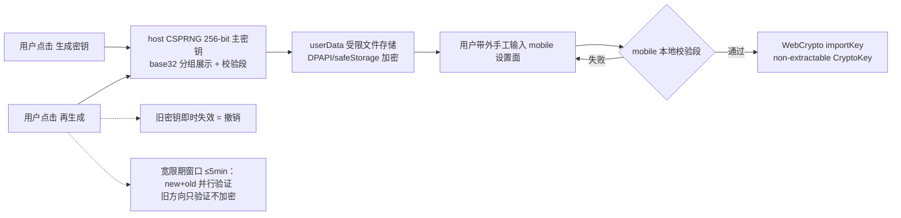
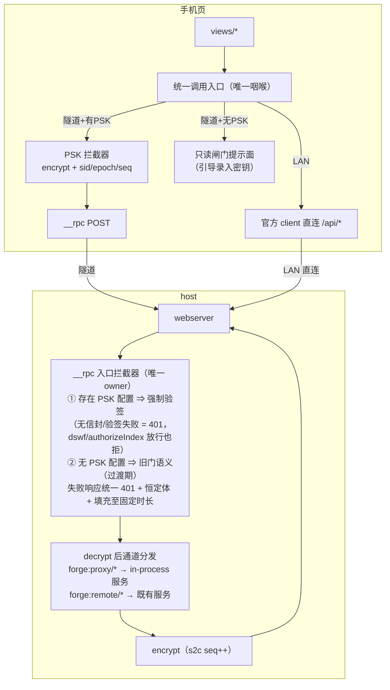
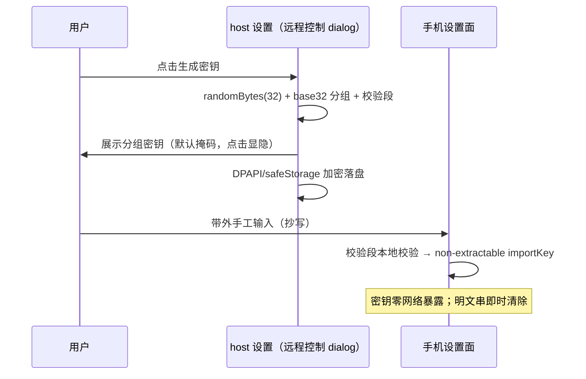
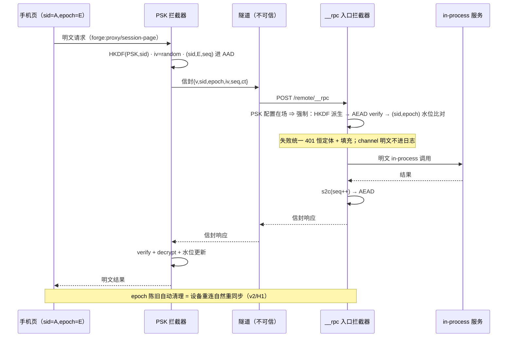

# 隧道模式 RPC+PSK 安全方案 v2（forge mobile）

状态：v2（2026-10-17，红队对抗评审收敛版）。v1 的「统一 401 无 oracle」「双端高水位」「旧密钥即时失效」三条在评审中被证伪/证不完整，v2 已按 C1/C2/H1-H4 修复口径重写。传输面正本 = tech-research R11；端点清单 = api-handbook §6.0/6.2。

## 0. 可交付判定门槛（红队评审结论）

C1/C2/H1/H4 修复完成前**不进入实现**；H2/H3 随实现一并落 AC；M/L 项交付后加固。

## 1. 目标与威胁模型

| 项 | 内容 |
|---|---|
| 目标 | 隧道模式下 mobile 全功能访问（chat/审批/任务），**业务数据面**端到端机密性 + 完整性 + 防重放——不信任隧道基础设施（Cloudflare 边缘是 TLS 终结点） |
| 攻击者能力 | 知道/猜测隧道 URL；被动监听隧道流量；重放/篡改捕获密文；向 `/remote/*` 发垃圾请求 |
| 攻击者做不到 | 看到 host 屏幕 QR/PIN/PSK；物理接触 host；伪造 PIN |
| **显式声明的残余风险（v2 新增，接受并公示）** | ①凭据建立通道（PIN 提交、BrowserAuth cookie 签发）经隧道明文——PIN 为 6 位第二因子且一次一用窗口极小，接受；②Cloudflare 可见元数据（端点存在性/频率/密文大小/时序）——接受，审批通道加定长填充缓解体积画像 |
| 结构性前提 | 官方 `/api` 在隧道域被 Host 围栏结构性 403（trustedHosts 只收 IP 字面量 + cookie authority 绑定，fix-27 先例实证）——隧道下唯一数据通道 = `/remote/__rpc` + forge 代理面 |

## 2. 双模式通道矩阵

| | LAN 模式 | 隧道模式 |
|---|---|---|
| 探测 | `connection.rpc.call('/api','session/list')` → 200 | → 403/连接失败 |
| 业务单呼 | 官方 client 直连 `/api/*` | `__rpc` `forge:proxy/*` / `forge:remote/*` 通道，**PSK 拦截器加解密（强制，见 §5）** |
| 事件推送 | `$events`（mux）+ `session/follow` | 无——轮询降级（15s 档） |
| assistant 流式 | `session/follow` 帧 | `session/page` 轮询 assistant-stream baseline 兜底 |
| 认证 | BrowserAuth cookie | **PSK 强制（数据 POST 面）** + dswf/authorizeIndex 仅 GET 页面 |

## 3. 密钥生命周期



- **生成**：host 侧 CSPRNG（`randomBytes(32)`），展示 = base32 分组 + 校验段；**展示默认掩码、点击显隐**（防肩窥/截图）；提示勿走剪贴板云同步。
- **分发**：带外手工（抄写/扫码），零网络暴露。
- **存储**：host = userData 文件经 **DPAPI/electron safeStorage 加密**（明文落盘禁止）；mobile = **non-extractable CryptoKey**（WebCrypto `extractable:false`，明文串输入后立即从 DOM/内存清除）。
- **轮换/撤销**：host 再生成 = 旧密钥失效；**宽限期 ≤5min 双密钥并行验证**（v2/H3——手工分发两端切换必然不同步），宽限期内 mobile 收 401 呈「请在桌面端确认新密钥」引导而非裸断连。
- **UI 位置**：桌面**远程控制 dialog**，连接密码字段下方。

## 4. PSK 信封格式 v2（多设备 + 持久化语义）

```jsonc
// 请求/响应体（forge:proxy/* 与 forge:remote/* 通道体）
{
  "v": 1,                              // 算法版本（仅升不降，无多版本并存回退）
  "sid": "<base64 设备会话标识>",       // v2 新增：per-sender 随机 128-bit（首联注册）
  "epoch": 3,                          // v2 新增：sender epoch（页面刷新/重连自增）
  "iv": "<base64 96-bit 随机>",
  "seq": 42,                           // (sid,epoch) 内单调
  "ct": "<base64 AES-256-GCM 密文>"
}
// 密钥 = HKDF(PSK, sid) 派生的 per-device 子密钥（v2/C2——多设备互不干扰）
// AAD  = ASCII("forge-psk-v2") || direction || sid || epoch || seq
// 明文 = 原通道 JSON 体（channel 在信封内层；外层零明文语义字段——AC 固定）
```

- **设备会话（v2/C2）**：每设备/每标签页持随机 `sid`，首联向 host 注册（PSK 验签通过即注册），host 按 `(sid, epoch)` 维护**独立高水位**——多设备/多标签页互不误杀。
- **高水位持久化（v2/H1）**：host 水位持久化到 userData（防 host 重启重放窗）；mobile `sid`/`epoch` 持久化到 localStorage（防刷新归零）；**epoch 陈旧（TTL 超限）的水位记录自动清理**——设备长期静默后重连 = 新 epoch 从零起算，天然重同步，无需「再生成」。
- **单密钥消息数上限**（红队 L 项）：同 PSK 下 AEAD 消息计数阈值触发「建议再生成」提示（GCM 随机 IV birthday 界保健）。
- **信封纪律（AC 固定）**：外层除 v/sid/epoch/iv/seq/ct 外**零明文语义字段**；v 仅升不降。

## 5. 门与拦截器（v2/C1 + H2 + H4）



- **模式强制位（v2/C1+H4）**：host 存在 PSK 配置 ⇒ `__rpc` **一切数据 POST 必须有效 PSK 信封**——无信封/验签失败一律 401，dswf/authorizeIndex 放行也拒（**无明文降级路径**）；mobile 隧道无 PSK = 只读闸门提示面。PSK 未配置（纯 LAN 用户）⇒ 旧门语义过渡。
- **dswf cookie 降级（v2/C1）**：`dswf_forge_remote` 仅用于 **GET 页面**用途；POST 数据面不再凭它放行。
- **错误归一（v2/H2）**：隧道+PSK 模式下**全部失败路径（门/版本/tag/seq/未知通道）唯一 owner = __rpc 入口拦截器**，统一 401 + 恒定响应体 + 响应填充至固定时长（抗时序侧信道）；解密前的 channel 字面量**不进 diag 日志**（定长标记替代，防日志注入）。
- **官方面（LAN）**：官方协议原样（本机网络边界 + 围栏 + cookie 为安全边界），不纳入 PSK。

## 6. 时序图

### 6.1 密钥建立（带外）



### 6.2 隧道模式调用（多设备 + 失败语义）



## 7. 攻击场景消解（v2）

| 攻击 | 消解 |
|---|---|
| 重放（同/跨重启） | (sid,epoch) 持久化水位 + epoch TTL 清理 |
| 篡改 | GCM tag |
| 乱序/反射 | direction + sid + epoch + seq 全进 AAD |
| 多设备互杀 | per-device HKDF 子密钥 + 独立水位（v2/C2） |
| 明文降级 | PSK 强制位：有配置 ⇒ 无信封必 401（v2/H4） |
| 状态码/时序分型 | 统一 401 恒定体 + 填充（v2/H2） |
| 凭据明文穿隧道 | **残余风险，显式接受**（PIN 窗口极小；数据面已 PSK 覆盖）——§1 |
| 元数据画像 | 接受 + 审批通道定长填充（缓解） |
| 轮换竞态 | 宽限期双密钥并行验证 ≤5min（v2/H3） |
| XSS 窃钥 | non-extractable CryptoKey（明文串不落 storage） |
| 日志注入 | 解密前 channel 字面量不进 diag |
| URL 泄漏 | 无 cookie/dswf/PSK → 统一 401 |

## 8. 裁决记录

| # | 裁决 |
|---|---|
| 1 | PSK 分发 = 用户带外手工（host 生成 → 手抄/扫码输入 mobile）；展示默认掩码 |
| 2 | AEAD 单原语（AES-256-GCM），per-device HKDF 子密钥 |
| 3 | 防重放 = (sid, epoch, seq) 三元 AAD + 双端持久化水位 + epoch TTL 清理 |
| 4 | 统一拦截器 = mobile 调用入口 + host `__rpc` 入口单点，**唯一 401 owner** |
| 5 | 官方面 `/api`（LAN）不纳入 PSK |
| 6 | 密钥 UI = 远程控制 dialog（连接密码下方）；再生成 = 撤销 + ≤5min 宽限期 |
| 7 | 隧道模式 UX = 全功能轮询降级；无 PSK = 只读闸门 |
| 8 | 模式强制位 = PSK 配置在场 ⇒ 数据 POST 必验签（v2/C1+H4） |
| 9 | host 密钥文件 DPAPI/safeStorage 加密；mobile non-extractable CryptoKey（v2/M2/M3） |
