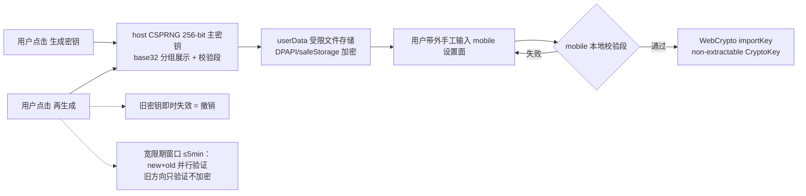
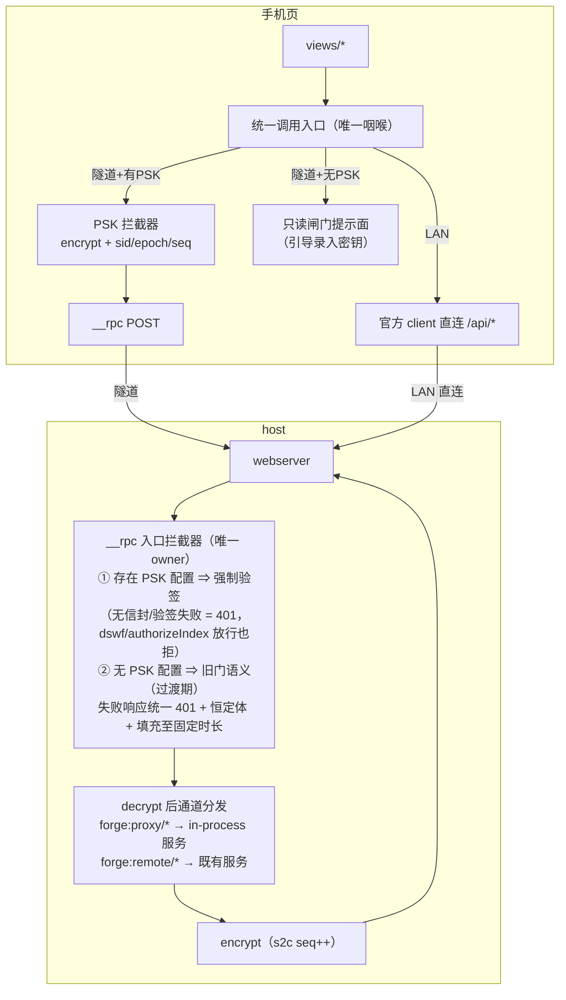
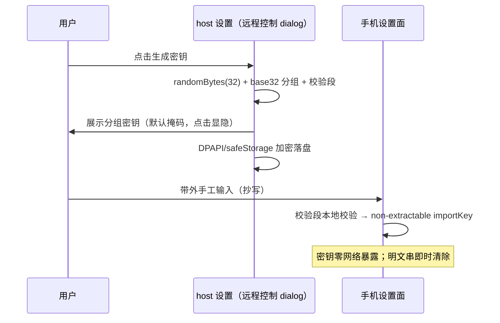
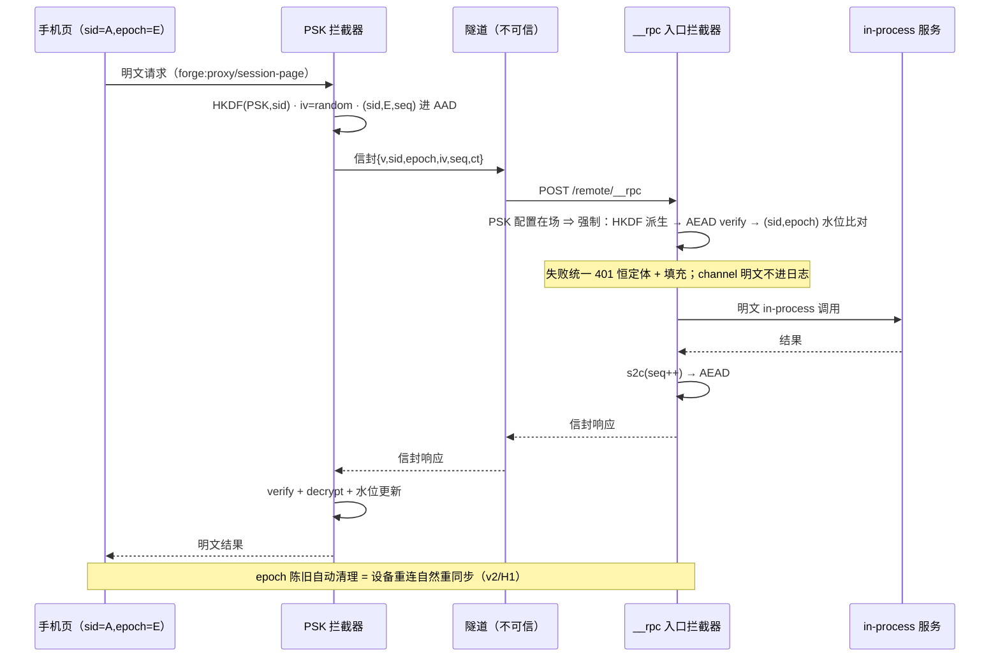

# 隧道模式 RPC+PSK 安全方案 v3（forge mobile）

状态：v3（2026-10-17）。v2 = 红队评审收敛（C1/C2/H1-H4 修复口径）；v3 新增 = PIN 入 KDF、全通道加解密规范（§4.1）、签名层、性能预算（§6.3）、文件传输策略（§6.4）。传输面正本 = tech-research R11；端点清单 = api-handbook §6.0/6.2。

## 0. 可交付判定门槛（红队评审结论）

C1/C2/H1/H4 修复完成前**不进入实现**；H2/H3 随实现一并落 AC；M/L 项交付后加固。

## 1. 目标与威胁模型

| 项 | 内容 |
|---|---|
| 目标 | 隧道模式下 mobile 全功能访问（chat/审批/任务），**业务数据面**端到端机密性 + 完整性 + 防重放——不信任隧道基础设施（Cloudflare 边缘是 TLS 终结点） |
| 攻击者能力 | 知道/猜测隧道 URL；被动监听隧道流量；重放/篡改捕获密文；向 `/remote/*` 发垃圾请求 |
| 攻击者做不到 | 看到 host 屏幕 QR/PIN/PSK；物理接触 host；伪造 PIN |
| **显式声明的残余风险（v2 新增，接受并公示）** | ①凭据建立通道（PIN 提交、BrowserAuth cookie 签发）经隧道明文——PIN 为 6 位第二因子且一次一用窗口极小，接受；②Cloudflare 可见元数据（端点存在性/频率/密文大小/时序）——接受，审批通道加定长填充缓解体积画像 |
| 结构性前提 | 官方 `/api` 在隧道域被 Host 围栏结构性 403（trustedHosts 只收 IP 字面量 + cookie authority 绑定，fix-27 先例实证）——隧道下唯一数据通道 = `/remote/__rpc` + forge 代理面 |

## 2. 双模式通道矩阵

| | LAN 模式 | 隧道模式 |
|---|---|---|
| 探测 | `location.hostname` IP 字面量 / `GET /remote/forge-stream` 可达（200/401 语义） | 域名形态 / forge-stream 按 PSK 门响应 |
| 业务单呼 | `__rpc` `forge:proxy/*` / `forge:remote/*`（LAN 明文旧门或 PSK 叠加均可） | 同通道，**PSK 拦截器强制（见 §5）** |
| 事件推送 | forge-stream（host 事件镜像 SSE） | 同通道（PSK 逐帧加密——隧道恢复推送） |
| assistant 流式 | forge-stream sessionQuery 镜像帧 + `forge:proxy/session-page` 轮询兜底 | 同左 |
| 认证 | 旧门（authorizeIndex/dswf——本机网络边界） | **PSK 强制（隧道域数据 POST 面）** + dswf/authorizeIndex 仅 GET 页面 |

## 3. 密钥生命周期



- **密钥派生（v3/PIN 因子）**：实际通信密钥 = `HKDF-SHA256(ikm=PSK‖PIN, salt=pairingId, info="forge-psk-v3")`——**双因子**（持有 PSK + 知道当前 PIN）；PIN 轮换（官方 PIN TTL/再生成）= 通信密钥重派生，旧密文自动作废；PIN 校验失败次数限速沿用官方 /pair/verify 限速语义。分发仍 = 带外（PSK 手输 + PIN 用户自知识）。
- **生成**：host 侧 CSPRNG（`randomBytes(32)`），展示 = base32 分组 + 校验段；**展示默认掩码、点击显隐**（防肩窥/截图）；提示勿走剪贴板云同步。
- **分发**：带外手工（抄写/扫码），零网络暴露。
- **存储**：host = userData 文件经 **DPAPI/electron safeStorage 加密**（明文落盘禁止）；mobile = **non-extractable CryptoKey**（WebCrypto `extractable:false`，明文串输入后立即从 DOM/内存清除）。
- **轮换/撤销**：host 再生成 = 旧密钥失效；**宽限期 ≤5min 双密钥并行验证**（v2/H3——手工分发两端切换必然不同步），宽限期内 mobile 收 401 呈「请在桌面端确认新密钥」引导而非裸断连。PIN 变更 = 即时重派生（无宽限——PIN 由用户自知，无分发延迟）。
- **UI 位置**：桌面**远程控制 dialog**，连接密码字段下方。

## 4. PSK 信封格式 v2（多设备 + 持久化语义）

```jsonc
// 请求/响应体（forge:proxy/* 与 forge:remote/* 通道体）
{
  "v": 3,                              // 算法版本（仅升不降，无多版本并存回退）
  "sid": "<base64 设备会话标识>",       // per-sender 随机 128-bit（首联注册）
  "epoch": 3,                          // sender epoch（页面刷新/重连自增）
  "iv": "<base64 96-bit 随机>",
  "seq": 42,                           // (sid,epoch) 内单调
  "ct": "<base64 AES-256-GCM 密文>",
  "sig": "<base64 Ed25519 签名>"       // v3：覆盖 ct‖iv‖seq（见 §4.2）
}
// 密钥 = HKDF-SHA256(ikm=PSK‖PIN, salt=pairingId, info="forge-psk-v3")（v3：PIN 入 KDF）
// 每设备子密钥 = HKDF(通信密钥, sid)
// AAD  = ASCII("forge-psk-v3") || direction || sid || epoch || seq
// 明文 = 原通道 JSON 体（channel 在信封内层；外层零明文语义字段——AC 固定）
```

### 4.1 逐渠道加解密规范（v3——哪些字段加密、哪些保持明文）

| 渠道 | 外层明文（路由必需） | 加密域（AEAD 密文内） | 密钥 | 签名 |
|---|---|---|---|---|
| `POST /remote/__rpc`（forge:proxy/* + forge:remote/*，隧道） | 路径 `/remote/__rpc`、信封 `v/sid/epoch/iv/seq` | **整个通道体**：`{channel,payload}`（channel 名也保密） | HKDF(PSK‖PIN, sid) | c2s=设备 Ed25519 / s2c=host Ed25519 |
| `GET /remote/forge-stream`（v3 新增加密 SSE 推送） | 路径、信封头 `v/sid/epoch/iv/seq` | **每帧事件体**（api-session/*、approval、forge/progress 推送镜像） | 同上（s2c 方向） | host Ed25519 逐帧 |
| 官方 `/api/*` 单呼 + `WS /api/remote.mux`（LAN） | 官方信封原样 | **不加密**——本机网络边界 + IP 围栏 + cookie 即安全边界（裁决 5） | — | — |
| `/remote/`、`/pair*`（页面/配对） | HTML/token/PIN | 不加密（**残余风险显式接受**——PIN 窗口极小） | — | — |
| **静态资源**（dist html/css/js/组合脚本，v3.1） | 路径、`X-Forge-Sig`/`X-Forge-Key-Id` 签名头 | **不加密**（公开产物） | — | **host Ed25519 签名**（mobile 运行时验证——见 §4.5） |
| 文件下载（隧道，v3/§4.4） | 路径、块信封头 | **分块 AEAD**（每块独立 seq，断点安全） | 同上 | host Ed25519 逐块（清单模式：块 hash 清单首块签名） |
| 文件/消息体（LAN） | 官方原样 | 不加密 | — | — |

### 4.2 签名层（v3——独立于 AEAD 的完整性/身份层）

- **s2c（host→mobile）**：host 持 Ed25519 密钥对（随隧道启用生成），**公钥随 PSK 材料带外分发**；每信封 `sig = Ed25519.sign(sk, ct‖iv‖seq‖AAD)`。作用：①防「PSK 泄露后伪造 host 下发审批诱导帧」（AEAD 对称密钥失窃即双向失守——签名把完整性锚在非对称钥上）；②mobile 可验证「对端确为配对 host」。
- **c2s（mobile→host）**：mobile 设备密钥对（输入 PSK 时生成），公钥经**首个 AEAD 注册调用**提交 host 绑定到 sid；此后请求签名。注册前请求仅 AEAD（PSK 持有即信任）。
- 语义：AEAD 保证「PSK 未泄露时的防篡改」；签名保证「PSK 泄露后 host→mobile 方向仍防伪造、并具备不可否认性」。两层独立失效域。

### 4.2.1 会话/水位/信封纪律（v2 沿用）

- **设备会话（v2/C2）**：每设备/每标签页持随机 `sid`，首联向 host 注册（PSK 验签通过即注册），host 按 `(sid, epoch)` 维护**独立高水位**——多设备/多标签页互不误杀。
- **高水位持久化（v2/H1）**：host 水位持久化到 userData（防 host 重启重放窗）；mobile `sid`/`epoch` 持久化到 localStorage（防刷新归零）；**epoch 陈旧（TTL 超限）的水位记录自动清理**——设备长期静默后重连 = 新 epoch 从零起算，天然重同步，无需「再生成」。
- **单密钥消息数上限**（红队 L 项）：同 PSK 下 AEAD 消息计数阈值触发「建议再生成」提示（GCM 随机 IV birthday 界保健）。
- **信封纪律（AC 固定）**：外层除 v/sid/epoch/iv/seq/ct/sig 外**零明文语义字段**；v 仅升不降。
- **加密 SSE 推送通道（v3）**：`GET /remote/forge-stream`（PSK 信封头认证）——forge 侧订阅 host 事件（含 `api-session/*`、`approval/request`、forge 任务进度）经 typert/服务 in-process 直调后**逐帧 AEAD 加密**推送。作用：隧道模式从 v2 的轮询降级**恢复推送能力**（会话变更/审批到达/任务进度实时到达，帧体加密）。

## 4.5 静态资源签名（v3.1——不加密，但要签名）

- **host 侧**：全部 `/remote/` 静态响应（dist html/css/js、`/plugins` 组合脚本、资源文件）统一附 `X-Forge-Sig: base64(Ed25519.sign(sk, path ‖ body))` + `X-Forge-Key-Id`（对应 mobile 手中的 host 公钥）。
- **mobile 侧验证分层**：
  - **动态资源（必须验签后才执行）**：已受信页面加载的懒加载脚本/组合脚本/视图 chunk——`fetch → Ed25519 验签 → 再 import/eval`。**boot 组合脚本必经此通道**（组合脚本被篡改 = PSK 加密层运行在被污染代码里——PSK 完整性的根）。
  - **入口 HTML（结构性残余风险，显式声明）**：首个 HTML 无法自证（篡改页的 JS 先于任何验证代码执行）。缓解 = 首次激活经 LAN 访问建立受信基线（入口缓存 + host 公钥录入同窗完成）；隧道直连首次访问且无基线 = 接受风险并提示用户。
- host 公钥与 PSK 同窗带外录入（mobile 设置面同屏两字段：PSK + host 公钥指纹）。

## 4.6 性能预算（v3——数据量评估）

| 负载 | 规模 | AES-256-GCM 开销（AES-NI） | 结论 |
|---|---|---|---|
| 会话列表（grouped，数百会话） | ~100KB | <1ms（任一端） | 可忽略 |
| **chat 历史整包**（数百条消息，单信封整包加密） | ~1MB/页 | host 1-3ms / mobile WebCrypto 5-15ms | **列表类一律整包单信封**（不做逐条信封——500 条 × 逐条 AEAD = 500 次调用 + 500×~50B 头开销，无安全增益） |
| 流式帧（assistant delta，逐帧） | ~100B-2KB/帧，秒级数帧 | 每帧 <0.1ms | 可忽略 |
| 加密 SSE 推送（隧道） | 事件粒度，低频 | 可忽略 | — |
| 文件分块（§6.4） | 64KB/块 | 每块 <1ms | 大文件线性 |

WebCrypto async 开销：批量解密用单 `decrypt` 调用（整包）而非逐条 Promise——mobile 主线程不阻塞（必要时 worker）。**结论：数百条消息量级无性能风险；纪律 = 整包优先、逐帧仅在流式语义必须处。**

## 4.4 文件传输策略（v3）

| 场景 | 通道 | 策略 |
|---|---|---|
| agent 生成 md/文本文档 | **随会话消息体**（message content 内联） | 已在信封加密域内，零额外处理 |
| 独立文件下载（附件图片/导出物，隧道模式） | `forge:proxy/file` 通道（**分块 AEAD 流**：64KB/块，块 seq 进 AAD，末块带全文件 SHA-256 清单签名） | 加密 + 防拼接重排 |
| 大文件（>10MB） | 同上分块流 | WebCrypto 分块增量解密，内存可控 |
| LAN 模式文件 | 官方原样 | 不加密 |

## 5. 门与拦截器（v2/C1 + H2 + H4）



- **模式强制位（v2/C1+H4；生效域 2026-10-17 A3 裁决）**：host 存在 PSK 配置 ⇒ **隧道域请求**（Host 非 loopback/非 IP 字面量）的 `__rpc` 数据 POST 必须有效 PSK 信封——无信封/验签失败一律 401，dswf/authorizeIndex 放行也拒（**隧道无明文降级路径**）；LAN/回环请求维持旧门（桌面 fetch 兜底面不受影响；桌面 Electron 主路径走 preload IPC 本不经 HTTP）。mobile 隧道无 PSK = 只读闸门提示面。
- **dswf cookie 降级（v2/C1）**：`dswf_forge_remote` 仅用于 **GET 页面**用途；POST 数据面不再凭它放行。
- **错误归一（v2/H2）**：隧道+PSK 模式下**全部失败路径（门/版本/tag/seq/未知通道）唯一 owner = __rpc 入口拦截器**，统一 401 + 恒定响应体 + 响应填充至固定时长（抗时序侧信道）；解密前的 channel 字面量**不进 diag 日志**（定长标记替代，防日志注入）。
- **官方面（LAN）**：官方协议原样（本机网络边界 + 围栏 + cookie 为安全边界），不纳入 PSK。

## 6. 时序图

### 6.1 密钥建立（带外）



### 6.2 隧道模式调用（多设备 + 失败语义）



## 7. 攻击场景消解（v2）

| 攻击 | 消解 |
|---|---|
| 重放（同/跨重启） | (sid,epoch) 持久化水位 + epoch TTL 清理 |
| 篡改 | GCM tag |
| 乱序/反射 | direction + sid + epoch + seq 全进 AAD |
| 多设备互杀 | per-device HKDF 子密钥 + 独立水位（v2/C2） |
| 明文降级 | PSK 强制位：有配置 ⇒ 无信封必 401（v2/H4） |
| 状态码/时序分型 | 统一 401 恒定体 + 填充（v2/H2） |
| 凭据明文穿隧道 | **残余风险，显式接受**（PIN 窗口极小；数据面已 PSK 覆盖）——§1 |
| 元数据画像 | 接受 + 审批通道定长填充（缓解） |
| 轮换竞态 | 宽限期双密钥并行验证 ≤5min（v2/H3） |
| PSK 泄露后的伪造 | Ed25519 签名层（完整性锚非对称钥，v3/§4.2） |
| PIN 猜测辅助解密 | PIN 入 KDF——无 PSK 时 PIN 无用，有 PSK 无 PIN 亦无用（双因子，v3） |
| XSS 窃钥 | non-extractable CryptoKey（明文串不落 storage） |
| 日志注入 | 解密前 channel 字面量不进 diag |
| URL 泄漏 | 无 cookie/dswf/PSK → 统一 401 |

## 8. 裁决记录

| # | 裁决 |
|---|---|
| 1 | PSK 分发 = 用户带外手工（host 生成 → 手抄/扫码输入 mobile）；展示默认掩码 |
| 2 | AEAD 单原语（AES-256-GCM），per-device HKDF 子密钥 |
| 3 | 防重放 = (sid, epoch, seq) 三元 AAD + 双端持久化水位 + epoch TTL 清理 |
| 4 | 统一拦截器 = mobile 调用入口 + host `__rpc` 入口单点，**唯一 401 owner** |
| 5 | 官方面 `/api`（LAN）不纳入 PSK |
| 6 | 密钥 UI = 远程控制 dialog（连接密码下方）；再生成 = 撤销 + ≤5min 宽限期 |
| 7 | 隧道模式 UX = 全功能轮询降级；无 PSK = 只读闸门 |
| 8 | 模式强制位 = PSK 配置在场 ⇒ **隧道域**数据 POST 必验签（生效域 A3 裁决：LAN/回环维持旧门） |
| 9 | host 密钥文件 DPAPI/safeStorage 加密；mobile non-extractable CryptoKey（v2/M2/M3） |
| 10 | PIN 入 KDF（双因子派生）；PIN 变更 = 密钥重派生即旧密文作废（v3） |
| 11 | 签名层独立于 AEAD：s2c host Ed25519、c2s 设备 Ed25519（注册后），失效域分离（v3/§4.2） |
| 12 | 隧道推送 = 加密 SSE `forge-stream`（forge 侧订阅 host 事件镜像），隧道模式恢复推送（v3） |
| 13 | 性能纪律 = 列表整包单信封、逐帧仅限流式语义、文件分块 AEAD（v3/§4.3-4.4） |
| 14 | 静态资源不加密 + host Ed25519 签名；动态加载脚本验签后才执行；入口 HTML 首访信任 = 显式残余风险，缓解 = LAN 首激活建立基线（v3.1/§4.5） |
