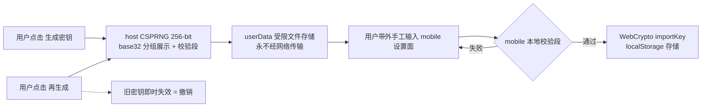
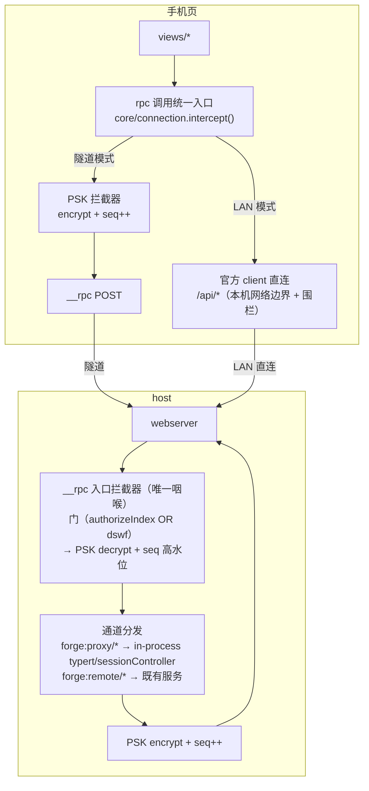
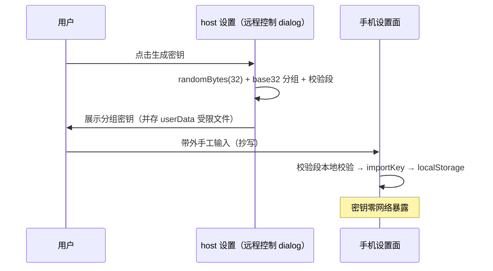
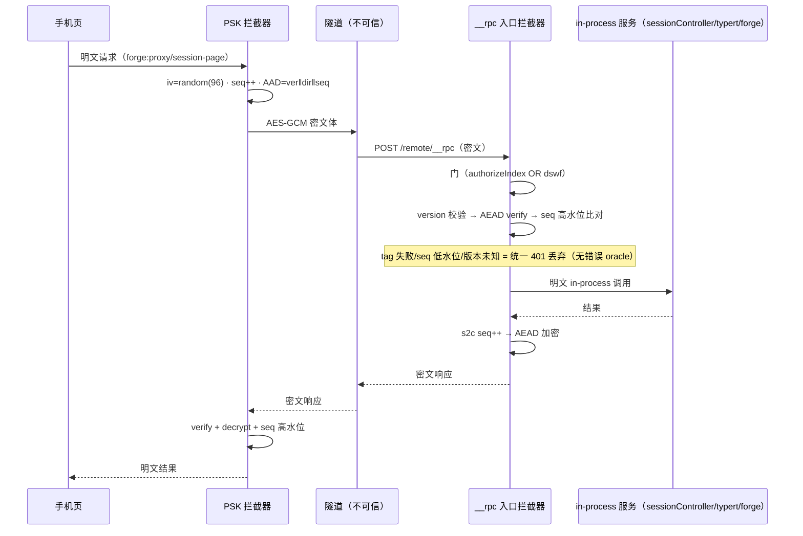

# 隧道模式 RPC+PSK 安全方案（forge mobile）

状态：设计定稿（2026-10-17），对抗式评估后回填结论。传输面正本 = tech-research R11；端点清单 = api-handbook §6.0/6.2。

## 1. 目标与威胁模型

| 项 | 内容 |
|---|---|
| 目标 | 隧道模式下 mobile 全功能访问（chat/审批/任务），且数据**端到端机密性 + 完整性 + 防重放**——不信任隧道基础设施（Cloudflare 边缘是 TLS 终结点，能看到明文） |
| 攻击者能力 | 知道/猜测隧道 URL（trycloudflare 随机子域或固定域名）；可被动监听隧道流量；可重放/篡改捕获的密文；可向 `/remote/*` 发垃圾请求 |
| 攻击者做不到 | 看到 host 屏幕上的 QR/PIN/PSK；物理接触 host；伪造 PIN 第二因子 |
| 结构性前提 | 官方 `/api` 在隧道域被 Host 围栏结构性 403（trustedHosts 只收 IP 字面量 + cookie authority 绑定，fix-27 先例实证）——隧道下唯一数据通道 = `/remote/__rpc` + forge 代理面 |

## 2. 双模式通道矩阵

| | LAN 模式 | 隧道模式 |
|---|---|---|
| 探测 | `connection.rpc.call('/api','session/list')` → 200 | → 403/连接失败 |
| 业务单呼 | 官方 client 直连 `/api/*`（typert 面 + forge 面） | `__rpc` `forge:proxy/*` / `forge:remote/*` 通道，**PSK 拦截器加解密** |
| 事件推送 | `$events`（mux）+ `session/follow` | 无——轮询降级（15s 档） |
| assistant 流式 | `session/follow` 帧 | `session/page` 轮询 assistant-stream baseline 兜底 |
| 认证 | BrowserAuth cookie（IP 字面量 authority） | BrowserAuth cookie（隧道 authority，authorizeIndex 面）**⊕ PSK AEAD** |

## 3. 密钥生命周期



- **生成**：host 侧 CSPRNG（Node `randomBytes(32)`），展示格式 = base32 分组 `XXXXX-XXXXX-…` + 末尾 2 字符校验段（手抄防错，mobile 输入时本地校验）。
- **分发**：**带外手工**（抄写/扫码）——密钥零网络暴露。
- **存储**：host = userData 受限文件（与凭据同域）；mobile = localStorage（与 cookie 同级）。
- **轮换/撤销**：host 再生成即旧密钥失效；与配对会话生命周期解耦。
- **UI 位置**：桌面**远程控制 dialog**，连接密码字段下方。

## 4. PSK 信封格式（版本化，算法可演进）

```jsonc
// 请求/响应体（forge:proxy/* 与 forge:remote/* 通道体替换为下述信封）
{
  "v": 1,                          // 算法版本字节
  "iv": "<base64 96-bit 随机>",    // 每消息随机
  "seq": 42,                       // 发送方向单调计数器（进 AAD，防重放/防乱序）
  "ct": "<base64 AES-256-GCM 密文>"
}
// AAD = ASCII("forge-psk-v1") || direction("c2s"/"s2c") || seq
// 明文 = 原通道 JSON 体（__rpc {channel,payload} / 代理请求）
```

- 算法：AES-256-GCM（WebCrypto ↔ Node crypto 同构，双端零第三方依赖）。
- tag 失败 / seq ≤ 高水位 / 版本未知 → 统一 401 语义丢弃（不区分原因——避免错误 oracle）。
- 双端高水位独立维护（c2s 与 s2c 各自单调）。

## 5. 统一拦截器（防遗漏的唯一加解密咽喉）



- **mobile 侧**：拦截器在 `core/connection` 调用入口统一实现（transport 层/调用层单点）——views 永远拿明文对象，加解密无感知。
- **host 侧**：拦截器在 `__rpc` 入口单点（decrypt 在门后、encrypt 在分发前）——新增通道天然被覆盖，**结构性防遗漏**。
- **官方面（LAN）**：走官方协议原样（本机网络边界 + IP 围栏 + cookie 为安全边界），**不纳入 PSK**——纳入需改官方 `/api` 信封行为（破坏桌面兼容 + 降级探测面），裁决为不纳入（对抗式评估复核中）。

## 6. 时序图

### 6.1 密钥建立（带外）



### 6.2 隧道模式调用（读 + 写 + 失败语义）



### 6.3 攻击场景消解

| 攻击 | 消解 |
|---|---|
| 重放捕获的审批密文 | seq 单调高水位拒收 |
| 篡改密文 | GCM tag 校验失败丢弃 |
| 乱序/反射 | direction 进 AAD（c2s 密文不能当 s2c 回放）+ 双向独立水位 |
| URL 泄漏 | 无 cookie/dswf/PSK 时只有 401——数据体全程密文 |
| Cloudflare 被动监听 | 仅见密文 |
| 错误 oracle | 统一 401 语义，不泄露失败原因分类 |

## 7. 裁决记录

| # | 裁决 |
|---|---|
| 1 | PSK 分发 = **用户带外手工**（host 生成 → 手抄/扫码输入 mobile）——密钥零网络暴露 |
| 2 | AEAD 单原语（AES-256-GCM），不自拼 加密+HMAC |
| 3 | 防重放 = 方向隔离 AAD + 双向单调 seq 高水位 |
| 4 | 统一拦截器 = mobile 调用入口 + host `__rpc` 入口**双端单点**，结构性防遗漏 |
| 5 | 官方面 `/api`（LAN）不纳入 PSK（本机网络边界 + 围栏 + 官方协议兼容），对抗式评估复核 |
| 6 | 密钥 UI = 远程控制 dialog，连接密码下方；再生成 = 撤销 |
| 7 | 隧道模式 UX = 全功能轮询降级（原「断线降级轮询」口径复活） |
