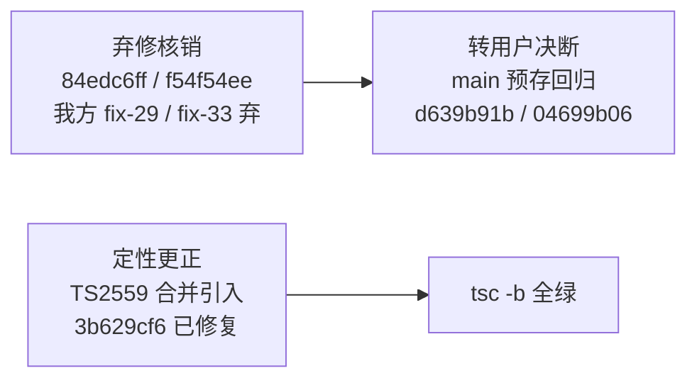

# mobile-ui 合并核销记录（verification-record）

记录日期：2026-10-22。本文件只呈现当前事实。

## 结论总览

## bug 84edc6ff —— 弃修核销

- **症状**：首条消息主树绑定断链。
- **复现点**：会话发送链首条消息写入时主树绑定缺失，后续消息落错树。
- **A++ 对应机制**：A++ 预铸串行链下不复现——预铸阶段树绑定已在装配期单点完成，不存在首条消息时的绑定空窗。
- **处置**：我方 fix-29（9a851d6e）正式弃，价值保留为分支自洽；症状不再出现。

## bug f54f54ee —— 弃修核销

- **症状**：风险框取消后残留草稿重弹。
- **复现点**：风险确认框取消操作后，草稿未被卸载、再次弹出。
- **A++ 对应机制**：原症状由 A++ 条件卸载机制覆盖（取消即条件卸载草稿）；现存同族症状为新成因，已另立 bug 04699b06 追踪。
- **处置**：我方 fix-33（f49214eb）正式弃，价值保留为分支自洽。

## main 基线事实（纯 main 6e98bef3，merge 父；2026-10-22 主会话实测）

纯 main 上以下 3 支 spec 均在同断言行失败，与合并分支上的失败一致：

| spec | 结果 |
|---|---|
| worktree-mandatory-bind-1-27 | 同断言行失败 |
| worktree-pure-selection-1-29 | 同断言行失败 |
| worktree-confirm-latch-1-34 | 同断言行失败 |

**main 预存回归清单**（转用户决断，不属合并范围）：

- d639b91b
- 04699b06（f54f54ee 现存同族症状的新成因）

## TS2559 定性更正

- **更正前定性**：main 预存——**不成立**。
- **更正后定性**：合并引入。根 package.json 残留 `@types/node@22.10.2` pin 与子包 24.19.0 双版本并存，导致 `ProcessEnv` 类型分裂，触发 TS2559。
- **修复**：commit 3b629cf6（移除残留 pin），修复后 `pnpm lint:types`（tsc -b）全绿。
