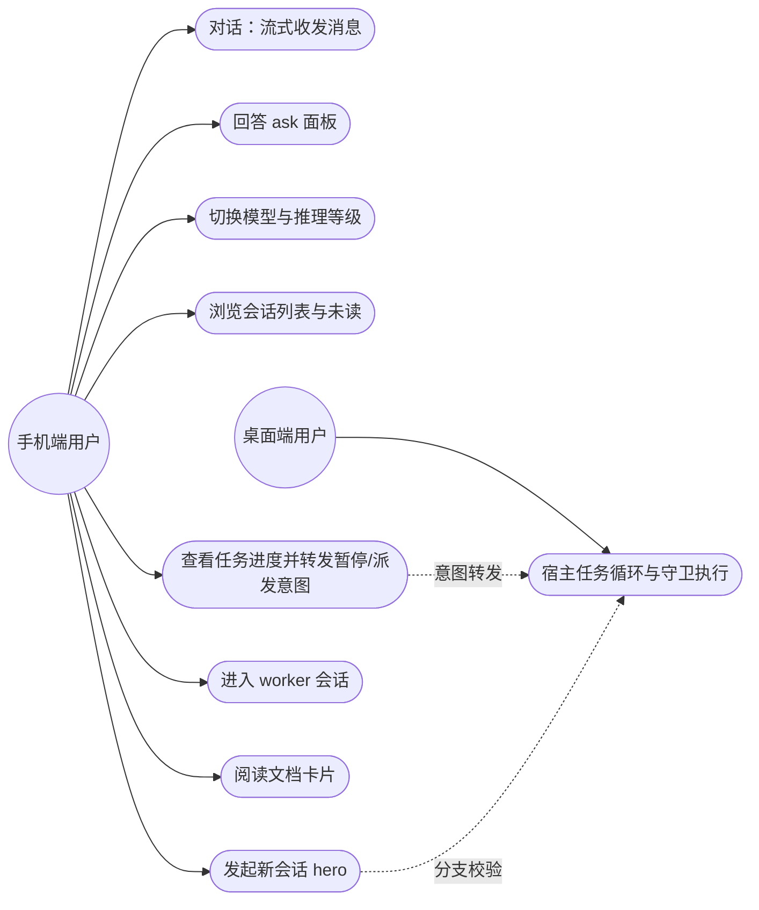
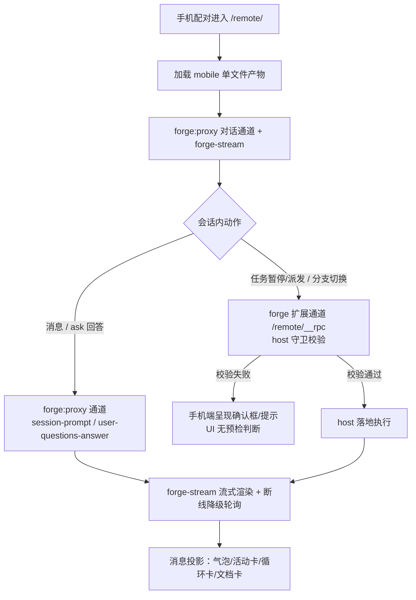

# PRD：mobile-ui 手机端受限视图独立工程

## 背景

- 手机端（经配对进入的远程受限视图）当前复用桌面 web-app 的裁剪分支，UI 与桌面工程耦合，无法独立演进。
- 用户已完成 UI 定稿（`mobile-ui-mockup-final.html`，10 屏综合稿），并裁决：**手机端做独立插件/工程，不与桌面版混合**。
- 角色：**手机端用户**（经配对进入受限视图的操作者）、**桌面端用户**（会话与任务循环的宿主，手机端操作对其可见）；host 侧为守卫执行方，非独立角色。

## 目标

| # | 目标 | 量化口径 |
|---|---|---|
| G1 | 手机端成为独立 view 层工程，与桌面 web-app 零模块引用 | 互不 import、互不构建；扫码秒开（单文件产物） |
| G2 | 对话体验对齐官方手机页机械 | forge-stream 流式、断线降级轮询（750ms→5s）、恢复自愈 |
| G3 | forge 任务域手机可见可控（只读展示 + 意图转发） | 暂停/派发等动作全部经 host 守卫落地 |
| G4 | 各屏与 UI 定稿逐位一致 | 真机逐位对照 `mobile-ui-mockup-final.html` |
| G5 | 分批交付，每批独立 e2e 验收 | 3 批，每批质量门全绿 + walkthrough 取证归档；**UI/交互验收 = Chrome 设备模拟移动端**（开发在 PC 上进行） |

## 范围

### In Scope

- mobile 独立工程（apps/mobile：源码、esbuild 构建、单文件产物接入 `/remote/` 静态面）。
- 对话通道全链经 forge 单通道（`forge:proxy/*` 代理 + `forge-stream` 事件镜像：对话流、ask 分页卡、设置面板与模型切换）。
- forge 扩展面接入与 host 侧薄方法：`/remote/__rpc` allowlist 扩充、分支切换校验、未读游标 = 手机端 localStorage（2026-10-17 裁决：read-state host 面不建）、worker 类型派生（视探针）。
- 抽屉、hero 新会话、未读徽标、任务进度悬浮球、worker 会话、循环卡、文档卡片/全屏阅读。

### Out of Scope

- 官方 webServer API 面（`/api`——mobile 不消费，R12）、配对/PIN/隧道机械——零改动。
- 桌面 web-app 与桌面任务循环——零改动。
- 会话格式——循环哨兵是读侧约定，不改写会话数据。
- 手机端业务逻辑/校验/循环状态维护——硬边界禁止（见下）。
- 框架 runtime 引入——重评阈值见提案（复杂表单编辑器 / PWA 级离线回放 / 有状态浮层 ≥15 个，出现任一再议）。

## 硬边界（产品级裁决）

**手机端 = 纯 view 层。除用户输入与动作意图的转发外，只做两件事：接收数据、渲染页面。**

- 任务循环全部执行（派发 worker、结算、followup 注入、runId 铸发、哨兵消息生成）→ 桌面端。
- 数据获取、会话操作、状态校验、分支冲突检查 → host 侧；校验失败 → 手机端只呈现确认框/提示。
- 手机端发送的只有：消息输入、ask 回答、暂停/派发等**动作意图**（host 守卫后落地）；数据 stale 时按钮置灰。
- 手机端永远不出现「循环因手机端操作而改变行为」的路径。
- **机制无关纪律**：subagent/job 的创建、结算、续聊、catalog 维护等机制全部归属 host 侧；移动端只对齐**数据契约字段**（如 worker 双形态 = `mode: 'one-shot'|'continuable'`、状态 = `activity: 'running'|'inactive'`、展示名 = `label`），不感知也不实现任何机制侧逻辑。

## 用例图



## 业务流程



## 功能规格

### 依赖前提：API 面来源与集成现状

「官方 API 直达」已由 R12 裁决取代：**mobile 不消费 `/api` 官方面**（含 LAN）——对话数据经 `forge:proxy/*` 代理通道（host in-process 直调官方能力），事件流经 `forge-stream` 镜像。

| 面 | 来源 | 现状 |
|---|---|---|
| 对话数据（`forge:proxy/*` 代理通道族） | host `/remote/__rpc` 桥扩充（官方 session/commands 能力 in-process 直调，contracts DTO zod 校验） | 本工程新增 allowlist 表项 + 代理 handler（R12 终版口径） |
| 事件流（`GET /remote/forge-stream`） | forge 侧订阅 host 事件镜像，加密 SSE 逐帧推送 | 本工程消费端（mobile stream.ts） |
| 配对/PIN 门 → `/remote/` 静态面 | host 既有注册（弹射 tap + 静态路由） | ✅ 已有，已改指 mobile 单文件产物 |
| forge 原生通道（`POST /remote/__rpc`） | host 既有桥（allowlist 门） | ✅ 桥已在用（桌面 remote-transport 消费中）；本工程扩 allowlist |

```text
手机浏览器（配对隧道同源）
├─ POST /remote/__rpc {channel: forge:proxy/*|forge:remote/*}   ← 单通道（R12）
├─ GET /remote/forge-stream（加密 SSE 事件镜像）                 ← 会话事件流
└─ GET /remote/  → mobile 单文件产物 + 官方注入行                ← 已落地（挂载三缝）
```

硬边界（手机端零业务逻辑）成立的前提即此分工：校验与执行在 host/桌面侧，手机页只剩「调用 + 渲染」。

逐功能规格见 [ui-functions.md](../ui-functions.md)（注册件 `ui-functions`），含 10 屏落位、关键页线框与交互流转。用户故事见 [user-stories.md](../user-stories.md)（注册件 `user-stories`）。

### 消息渲染要点（定稿基准 = gallery-v2 + 综合稿屏②③）

- 官方投影：`user/message`→蓝右气泡、`assistant/live-chunk`→流式/折叠 thinking 卡、`assistant/message`→终态覆盖、`tool/call+tool/result`→折叠活动卡；无角色标识，样式区分。

### 消息 wire 契约（官方正本，已核实）

正本：`@deepseek-ai/dsh-api-session-controller`（client contract/events）+ `@deepseek-ai/dsh-session`（SessionEventMap）+ `@deepseek-ai/dsh-llm`（Message/StreamChunk）。

| 事件 | data 契约 | 手机端消费 |
|---|---|---|
| 信封 | `{type, seq, time, data, skippable?}`（skippable=true 读者可跳过；缺省 = 不识别必须拒绝） | 未知 skippable 类型静默跳过；未知必选类型拒绝渲染会话 |
| `user/message` | `UserMessage{id, content: ContentBlock[], source}` | 蓝右气泡 |
| `assistant/live-chunk`（**SSE transient，非持久事件**；流上帧内类型真名 `assistant/chunk`——官方手机页实证，`live-chunk` 为 client-store 内部判别名） | `{attemptId, turn, step, chunk: StreamChunk}`；`seq` 仅排序用 | 流式渲染；`reasoning-delta`→thinking 卡、`text-delta`→正文、`tool-call-delta`→调用中卡 |
| `assistant/message`（终态） | `{turn, step, message: AssistantMessage, stream: AssistantStreamRecord[], usage?, interrupted?}` | **按 attemptId 原子取代该 attempt 的全部 transient 行**（settle-assistant 语义=「末条补丁」契约来源）；`interrupted:true` = 取消流前缀，需呈现中断标记 |
| `assistant/attempt` | `{turn, step, stream}`（无 surface message 的失败/重试尝试） | 默认不渲染（失败尝试） |
| `tool/call` | `{turn, step, callId, name, arguments: string}`（arguments = 模型原始 JSON 串，未解析） | 活动卡调用段 |
| `tool/result` | `{turn, step, message: ToolResultMessage(source.callId 配对), error?:{name, code, reason?}, meta?}` | 活动卡结果段（callId 配对）；`meta` = 工具私有 JSON 呈现载荷（文档卡候选通道）；`error.reason` 用户可见、不进模型内容 |
| 事件窗分页 | `SessionEventWindow{entries, hasMore, revision, change}`；change ∈ replace/prepend/append/settle-assistant | `hasMore`→上翻分页；`revision`→revision 守卫正本 |

StreamChunk 判别集：`block-start｜text-delta｜reasoning-delta｜tool-call-delta｜block-end｜usage｜finish`——thinking 卡的数据源是 `reasoning-delta`，非独立消息类型。

- 视觉三层级：正文气泡 ＞ 左缘活动卡（thinking/tool/subagent/job）＞ 居中系统层（循环卡/chip、turn-status）。
- shell 工具（仅 pwsh/sh）= 终端风格块；其它工具 = 桌面官方 ui-tool ioCard 双段展开卡同型（hairline 边框 + 粘性标签列｜内容 + 0.5px 分隔线 + 150px 限高滚动）；活动卡行语言对齐桌面刻度（24px 行高 · 16px 图标位 · 2px 点隔符）；subagent/job 异步三工具结果可隔多条消息返回 → 异步结果卡。
- 折叠空间纪律全类型统一：收起 = 摘要行 + ~3 行预览渐隐；展开就地撑开；`details[open]` chevron 旋转。
- 循环消息渲染（正本以 tech-design 实证为准）：`forge/progress` 持久事件（真实日志已存在：sourceSlug/verb/status/taskKey/counts）为循环卡主数据源；桌面循环注入 `user/message`·`source.kind:'forge-loop'` 类型化 notice 为叙述面补充（官方 `model-selection` notice 先例，真实日志实证）；`⟨forge:loop⟩` 文本头仅展示兼容。同 runId 非最新卡退化单行 chip；runId = slug + 序号/时间戳。
- 历史加载：默认最近 10 条（移动端可配置常量），上翻到顶分页拉更早。

## 非功能约束

| 类别 | 约束 | 性质 |
|---|---|---|
| 性能 | 扫码即用秒开：单文件轻量页，无框架 runtime；forge-stream→rAF 合帧渲染 | 保健 |
| 可用性 | forge-stream SSE 重连 + 心跳判活 + 断线覆盖层；仅消息区竖直滚动 | 保健 |
| 兼容 | 手机浏览器（配对隧道环境）；100+ 模型多提供商列表可检索 | 保健 |
| 安全 | 动作意图一律 host 守卫；preset 锁定语义 host 侧执行，UI 不展示 | 保健 |
| 一致性 | 设计令牌对齐 DESIGN.md；图标全 SVG，无 emoji；选中态配方全站统一 | 保健 |
| 取证 | UI/交互 e2e 验收 = Chrome 设备模拟移动端（视口/触摸/UA 模拟）；配对/隧道等外部装配面仍按工作区真机端到端取证门禁；每批 walkthrough 归档 | 保健 |

（本特性无 KANO 兴奋项：全部为定稿范围的期望/基本需求，防范围膨胀。）
