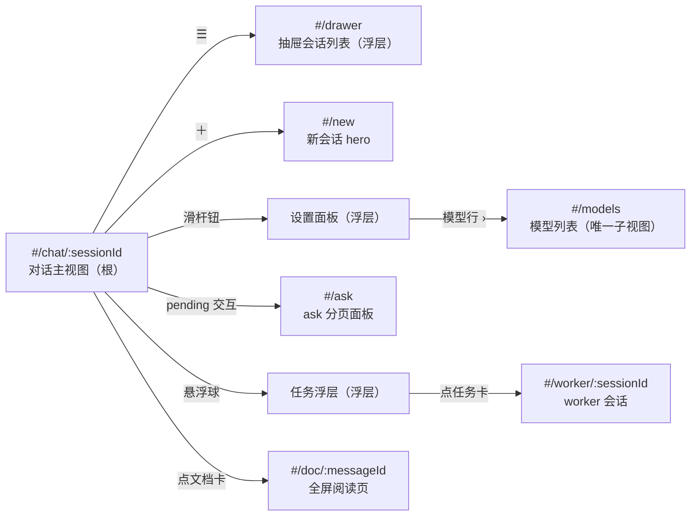
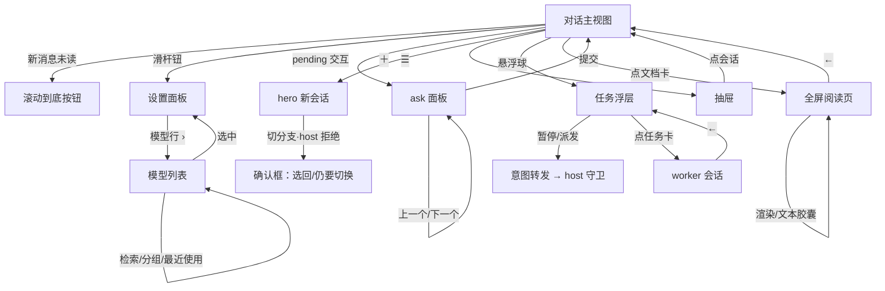

# UI 功能：mobile-ui

单轻量页 + hash 路由的独立手机工程。全部页面均为 `new-page`（独立工程，无既有页面复用）；基准 = `mobile-ui-mockup-final.html` 10 屏（屏 11 为屏 10 暗色变体）。

## 导航架构



- 根路由恒为对话主视图；抽屉/设置/任务为浮层，模型列表/ask/worker/阅读页为路由子视图。
- 顶栏：☰（24px，12px 未读徽标）· 居中标题（截断）· ＋新会话图标；无项目/分支/模式控件。
- 图标全 SVG（官方资产/同风格自绘 16px viewBox、1px 描边、currentColor），无 emoji。

## 关键页线框

### 屏 1 · 对话主视图 · 默认态（根）

```text
┌──────────────────────────────┐
│ ☑³  会话标题（截断）        ＋ │  ← 顶栏固定
├──────────────────────────────┤
│              ┌────────────┐  │
│              │ 蓝右气泡    │  │  ← user/message
│              └────────────┘  │
│ ▎thinking 卡（折叠，渐隐）    │  ← 左缘活动卡
│ ▎$ pwsh -c ...  终端风格块   │  ← shell 工具
│          ┌─ 循环卡 ─┐        │  ← 居中系统层
│  ┌────────────────┐ 📄       │  ← 文档卡
│  └────────────────┘          │
│                    ↓ 新消息② │  ← 滚动到底按钮（未读红点）
├──────────────────────────────┤
│ 突击│wt-name│ ≡ │      发送 ➤ │  ← 输入行固定
└──────────────────────────────┘
```

- 消息输入行：模式（左，已建会话只读）· worktree（中，截断只显 wt 名，点看全量：名称与路径分行）· 滑杆设置钮 · 发送（右）。
- 仅消息区竖直滚动（3px 细滚动条）；新消息未在底部时出现「滚动到底」按钮带未读计数。

### 屏 4 · 抽屉会话列表（浮层）

```text
┌──────────────────────────────┐
│ 会话列表                  ✕  │
│ ▾ 项目 A                     │
│   📌 会话1            ②     │  ← 置顶 + 双级未读徽标
│   会话2                      │
│ ▸ 项目 B              5      │  ← 折叠组，不显数量
│ ────────────────────────────│
│ ● 已连接 · 点看详情/断开      │  ← 底部连接状态
└──────────────────────────────┘
```

## 逐功能规格

### F1 对话主视图（屏 1/2/3）`new-page #/chat/:sessionId`

官方 API/SSE 对话引擎全链：SSE→rAF 合帧→末条补丁、乐观提示、revision 守卫、触底跟随、EventSource 原生重连 + 心跳判活 + 断线覆盖层。消息投影与视觉三层级、折叠空间纪律、shell 终端块、异步结果卡、循环哨兵卡（kind 定色条：dispatch 蓝/followup 浅蓝/state 灰/done 绿）、历史默认最近 10 条（可配置常量）+ 上翻分页，均按 prd-spec「消息渲染要点」执行。

### F2 ask 分页面板（屏 6）`new-page #/ask`

一屏一题，左上角序号/总数；上一个｜提交｜下一个；主按钮 #4176e6；占位输入框（互斥）。经 `interaction.answer` 提交。

选项语义（按题型互斥呈现）：

- **单选（radio）**：圆形选项，**点击某一选项即表示选中**（无需二次确认，选中态即时高亮；提交前可改选）。
- **多选（checkbox group）**：方框对勾，点选/取消任意组合。
- **other 选项**：= 官方 **customAnswer 自由文本域**（每题附带，非选项成员；载荷字段 `custom`）；**单选**——输入值即表示选中 other；**多选**——输入值表示用户**额外选中** other（不影响已勾选的其它选项）。
- **载荷契约（官方页实证，tech-research R9#2）**：`questions[{id, header?, question, detail?, options?[{label, description?, recommended?}], multiSelect?}]`——题型判别 = `multiSelect`；选项另有 recommended 徽标与 previous/skip/continue 按钮族（对齐官方交互词汇）。

### F3 设置面板与模型切换（屏 7/8）`浮层 + new-page #/models`

composer 滑杆设置钮 → 最小化面板（无标题/无说明文本）：模型行 + 推理等级分段控件内联，选档即生效。唯一子视图 = 模型列表：返回钮与搜索框同行（sticky）、~300ms 防抖检索、提供商分组折叠（计数）、最近使用置顶（手机页 localStorage，按配对域隔离）、当前模型对勾、选中态 = primary 边 + 7% tint。推理档位随模型 `reasoning.efforts` 联动，不支持则隐藏。

### F4 抽屉会话列表（屏 4）`浮层`

项目树分组（桌面同折叠规则，不展示会话数量）· 置顶/归档（手机不展示归档）· 双级未读徽标（host read-state 游标）· 底部连接状态（点看详情 + 断开）。

### F5 新会话 hero（屏 5）`new-page #/new`

默认模式=突击、分支=当前所在分支/worktree（不强切）；乐观切换；host 校验失败弹确认框（选回/仍要切换），UI 无预检说明文本。

### F6 任务进度悬浮球与浮层（屏 3 配套）`浮层`

悬浮球可拖拽、贴边收纳透明半圆；浮层主标题=提案名/副标题=slug；任务卡=编号·title + 右上角状态徽标（对齐桌面端状态集），运行中显暂停，底部统一派发；运行中置顶、已完成折叠；无审批、无进度百分比；多 run 顶部切换 chips，悬浮球只反映最近 running run；数据 stale 按钮置灰。暂停/派发 = 意图转发（host 守卫执行）。

### F7 worker 会话（双形态）`new-page #/worker/:sessionId`

点任务卡进入，← 图标退出；one-shot 只读、continuable 可发送（注入下一轮）；状态徽标同任务面板；模式/worktree 跟随主会话只读继承。

### F8 文档卡片与全屏阅读页（屏 9/10/11）`消息流内卡 + new-page #/doc/:messageId`

类型徽标卡（文件名 + size 右对齐于 › 前；无类型说明文案）；全屏阅读页 = ← 退出 + 文件名 + 「渲染｜文本」胶囊；html/md/csv 默认渲染可切纯文本，csv/md 表格居中，txt 恒纯文本；链接走内置浏览器。md 渲染 = 轻量 md 函数 + mermaid DOM 增强器（动态 import、暗色锚同源、横滚/双指缩放）。

## 页面/动作流转


