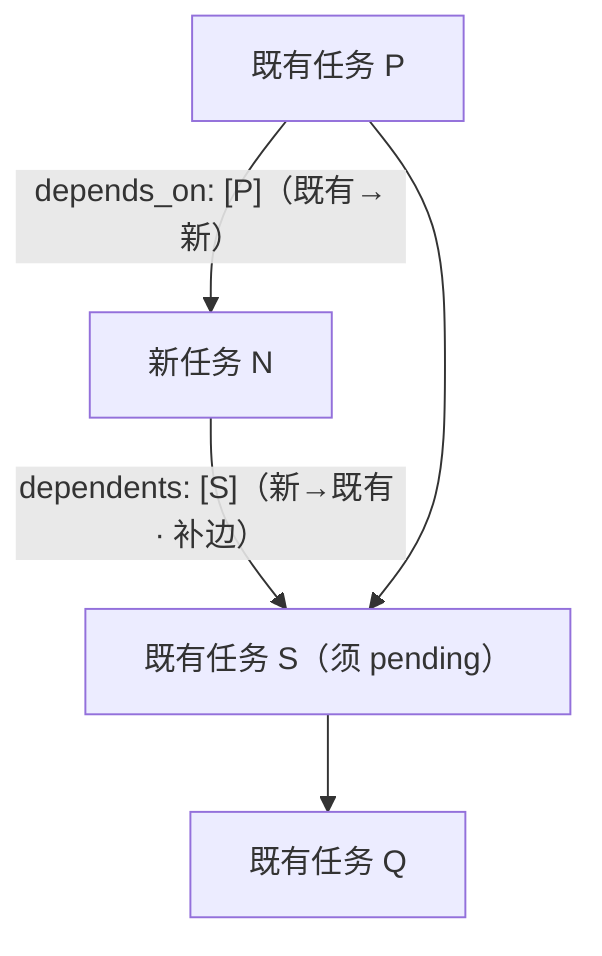
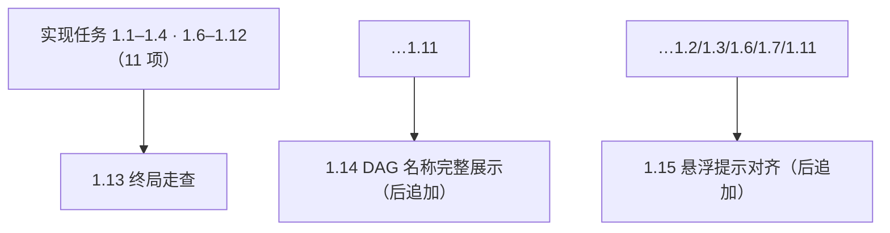
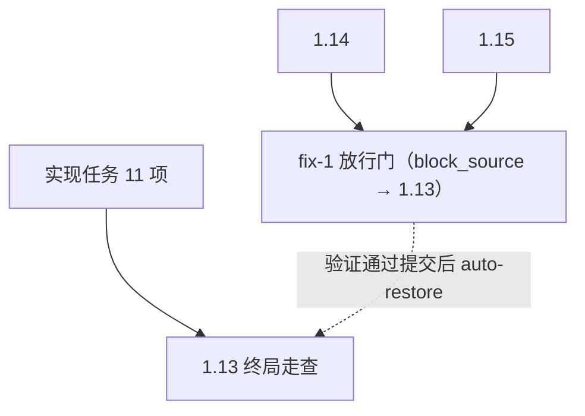
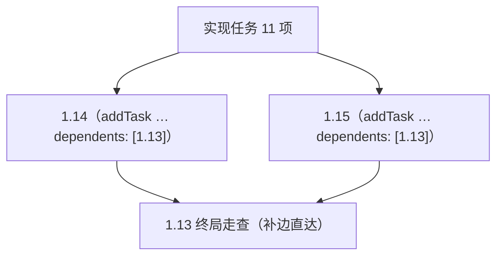
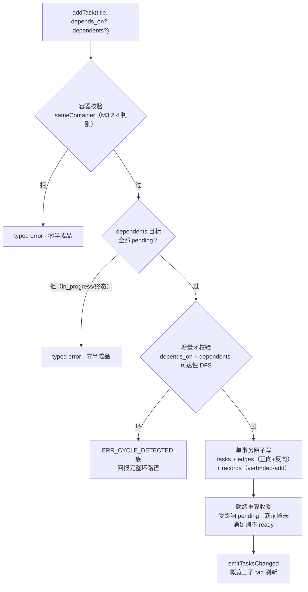

# Proposal: addTask 依赖接线完善——动态插入任务时为既有任务补前置

> **定位**：管线能力增强（blitz）。**参照源 = 老 forge CLI `forge task add`**（`Z:\project\ai\forge\forge-cli\internal\cmd\task\add.go`，冻结只读实证）。
>
> **源起（dogfood 实证）**：M3.1 UI 对齐轮动态追加任务 1.14 后，无法为既有终局任务 1.13 补挂前置边（1.14→1.13）——只能以 `block_source` 链 off-label 占位（该轮 fix-1 放行门）。本提案把「追加时反向补边」做成一等公民能力。

## 一、老 CLI 参照契约（add.go 实读）

### 1. 旗标面 → 现行映射

| 老 CLI | 现行 addTask | 裁决 |
|---|---|---|
| `--title/--type/--priority/--estimated-time/--breaking/--description/--var` | `title/type/priority/estimated_time/breaking/task_desc/vars` | 已对齐（snake_case 平铺） |
| `--depends-on IDS`（逗号分隔前置） | `depends_on`（数组） | 已对齐 |
| `--source-task-id` + `--block-source`（fix 链） | `source_task_slug/local_id` + `block_source` | 已对齐（同构） |
| `--id`（自定义 ID；缺省 `disc-N`） | — | **不采纳**：现行身份策略 = 状态层自管（常规整数顺延 + fix-N/disc-N 链前缀，M2/M3 既定）；开放自定义 ID 破坏自然键纪律 |
| `ActiveFixExistsError → SKIPPED`（幂等出口，exit 0） | 核心两级去重（任务级 fix 复用 reused） | 概念同构，保持 |
| 结果块 `KEY/FILE/RECORD/DEPENDENCIES/SOURCE_BLOCKED` | formatOk ✓ 模板 | 同构；dependents 扩参后输出**增补边回报行**（受影响任务键清单） |
| 「The CLI is a pure tool — the caller decides what to add」 | 工具面纯透传、零策略 | 沿袭：dependents 同为纯数据参数，语义校验归 core |

### 2. 老 CLI 实现核对项（任务 1.1 承接）

- **根祖先自动解析**：老 `--source-task-id` 自动解析到 fix 链根祖先——核对现行状态层 source 对是否已有等价解析（M2 链深 ≤6 机制族）；无则本能力**不强制补**（独立语义，记对照差异）。
- **`{{SOURCE_TASK_ID}}` 模板变量注入**：老 CLI 向 fix 任务描述注入源 ID 变量——核对现行 dispatchPrompt/模板面是否等价承载；同上不强制。

### 3. 关键结论

老 CLI **没有反向补边参数**——「既有任务要等新任务」的唯一表达 = `--block-source` 链（与现状同构）。故 `dependents` 为**超出参照的新增能力**；命名随老 CLI 对称惯例（`--depends-on` → `depends_on` ⇒ 反向 = `dependents`；弃 `blocks`——与 block_source 撞语义）。

## 二、能力设计

`addTask` 增可选参 `dependents`（同容器既有任务 local_id 数组）：

- **语义**：这些既有任务**自此依赖本新任务**（补边 方向 new → existing）；与 `depends_on`（既有任务为本新任务前置，方向 existing → new）双向对称。
- **状态门**：仅 **pending** 目标容许——in_progress（已在执行，补边无意义）/ 终态（破坏既成事实）一律 typed error 拒。
- **容器门**：同容器（sameContainer 判别，M3 2.4 既有）；跨容器拒。
- **不变量**：单事务全成全败（tasks + edges + records 记账行 verb='dep-add'，与 auto-block/auto-restore 族并列）；增量环校验（depends_on × dependents 组合可达性 DFS 回报完整环路径——新节点同时有出入边时环可能成立）；相位重算（feature 容器）；事务尾 `emitTasksChanged`（受影响任务就绪重算收紧）。
- **面分治不破**：仍 tool 专属恒不上 RPC（SC7）；tool 面纯透传零策略。

## 三、图示

### 图 1 · 双向参数方向语义（DAG）

`depends_on` 与 `dependents` 双向对称：前者声明新任务的前置（边 既有→新），后者声明以新任务为前置的既有任务（边 新→既有，即给既有任务补前置）。

### 图 2 · 1.13 案例三态回放（源起实证）

**态 A · 问题态（无反向补边能力）**——1.13 依赖集创建时定死，后追加的 1.14/1.15 无法成为其前置：

缺陷：1.13 与 1.14 同时 ready 时池面按创建序先领 1.13 → 终局走查漏 D29/D30，其「全绿 + D1–D30 逐行汇总」在 1.14/1.15 落地即过时。

**态 B · off-label 占位（现行解法 = M3.1 轮 fix-1）**——借用 fix 链机械硬排序：

代价：1.13 留 auto-block 记录 + 池中多一个占位任务；语义是挪用（1.13 并无缺陷）。

**态 C · 新能力（本提案）**——追加时直接补边，零占位：

### 图 3 · 单事务校验与写入流程（flowchart）

## 四、任务映射

| 任务 | 覆盖 |
|---|---|
| 1.1 core：dependents 反向补边 | §二全部不变量 + §一.2 两核对项 |
| 1.2 tool 面：schema 扩参 + pin 同步 | §一.1 输出增补边回报行 + pin/SC7 |
| 1.3 spec/drift 台账 + e2e 回归 | 参照契约与语义记账（本档为源） |

## Out of Scope

- 自定义 local id（老 `--id`——身份策略既定，见 §一.1 裁决）。
- 既有任务依赖**编辑/删除**（本能力只增边不改边）。
- 人类 GUI/CLI 加任务门（面分治既定，恒不破）。
