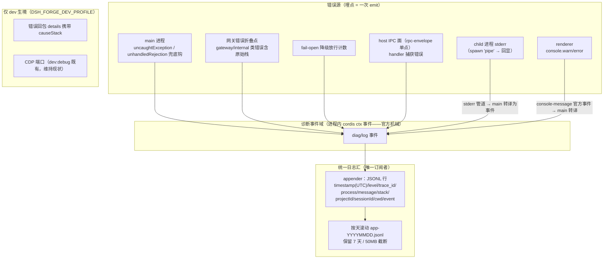

# 应用错误证据链可观测性

## 需求

dsh-forge 出问题时的「错误证据链」必须自动留存、开箱可查：任何错误（含被 UI/拦截层捕获的）自动留存到统一日志文件并携带完整栈，打包版开箱生效——排查 = 打开一个文件，回答「哪里崩的、为什么崩、哪次请求」。

证据与紧迫性：2026-10-18 会话绑定排查（bug dcdc1b4d / 79344f27）耗时两天，全程受阻于五个证据缺口——① 网关 dispatch 折叠错误时丢弃原始栈；② 被捕获的错误（toast 面）不进任何 console/stderr/文件；③ main/child/renderer/worker 四进程无统一日志汇，打包版无终端即无日志；④ 错误不携带关联信息，跨进程证据无法对齐；⑤ fail-open 降级路径静默放行，把契约违例掩蔽成测试绿灯（单参调用绿灯数十轮）。同类问题再发，排查成本重复支付。

## 方案

目标形态：三进程错误证据统一汇入单一日志文件，错误自带栈，trace_id 串联请求全流程，诊断增强仅 dev 生境生效。

方案要点（交付物级）：

1. **诊断事件域（埋点归一）**：宿主内新增 `diag/log` 诊断事件（cordis `ctx.emit`/`on` 官方事件总线承载）——所有埋点 = 一次 emit，零对 appender 的静态依赖；appender 为该事件域的唯一订阅者；新增错误源 = 新增 emit 点，订阅侧零改动；
2. **进程间管道层**：事件不跨进程——child 诊断事件经 stderr 管道回 main 转译为诊断事件；renderer console 经 main `console-message` 官方事件转译；即「进程内 cordis 事件、进程间管道」两层结构；
3. **折叠点落栈**：网关错误折叠（`gateway/internal` 类非 RemoteError）发生时 emit 诊断事件（含原始错误栈）——栈在抛出点即在手上，与下游如何被吞无关；
4. **统一日志汇（唯一订阅者）**：appender 持有 main 兜底钩（uncaughtException / unhandledRejection）、renderer console 转发（warn/error 级）订阅、child stderr 管道订阅，行格式含进程标签；child spawn 由 `inherit` 改 `'pipe'` + 回显转写（`inherit` 不可拦截——对官方 Desktop 同款模式的显式偏离，评审 Blocker 2 修订）；
5. **留存策略**：按天分文件（日切 = UTC 日界，与 timestamp 字段同口径）、保留 7 天自动清理、单文件 50MB 截断；Windows 句柄占用致截断/清理失败时降级为跳过本轮 + 下一轮重试（不阻塞应用）；
6. **dev causeStack**：dev 生境下错误回包 `details` 携带原始栈（DevTools Network 面板点开即得），生产零税；
7. **trace_id 贯穿（传播机制，调研定版 2026-10-19）**：官方无 trace 机械（rpcId = 每请求对账 UUID 非关联 ID；OTel 包为未接线传递依赖；官方 UI bundle 固定版不可注入 header）——故分链定机制：**链 A（forge IPC，自方面全可控）**：renderer 侧 `dshForge.invoke` 批次生成 trace_id，`rpcEnvelope` 单点读入 Node `AsyncLocalStorage`，handler 内全部日志自动携带；**链 B（官方 UI → /api，bundle 不可改）**：宿主 prompt dispatch 入口生成 trace_id，进程内以 AsyncLocalStorage 包裹（拦截层 = 天然挂点，覆盖 judge/reroute/sessionCreate 等同链派生调用）；**跨进程**：main↔child bridge 方法调用显式携带（ALS 过序列化断点需显式传递）；trace_id 覆盖范围如实收窄为「单次发送的完整派生链」，跨 bundle 独立请求以 sessionId+时间对齐；
8. **上下文字段尽量携带**：诊断事件负载含可用时的 `projectId` / `sessionId` / `cwd`（由 emit 点就近取——会话域事件从 header/请求取，项目域从注册行取），日志行落为结构化上下文段；三字段均缺席时省略上下文段；
9. **fail-open 计数**：每笔降级放行 emit 诊断事件落日志计数（UI 零呈现）；
10. **host IPC 面埋点**：`ipc/rpc-envelope.ts` 信封单点 emit——handler 捕获错误写错误回包的同时落诊断事件（含栈），消除「捕获即静默」面（评审 Blocker 1 修订）；
11. **拓扑裁决（方案 A：central 单文件）**：错误证据链收敛为 main 唯一写者的单一 JSONL 文件——与仓内单写者铁律同构，保住「排查 = 打开一个文件」的需求锚点；renderer 无 fs 权限（contextIsolation）本就须经 main，故「各进程自写」不成立、不采混合形态；
12. **性能红线（硬约束，拆解期逐条落实）**：① appender 写盘 fire-and-forget，业务路径永不 await，写失败降级为内存计数不反压业务；**崩溃路径豁免**——兜底钩（uncaughtException/unhandledRejection）行伴随退出，须同步写或退出前 flush（核心证据行不许丢，评审 B-1）；② 管道背压保护——child stdout 暂停/背压时丢弃 + 计数，不阻塞 child 的 console 调用（宁丢日志不卡业务）；③ 噪音治理——renderer 转发限 warn/error 级 + 同文重复行折叠计数（实测 changes.summary 404 轮询为最大噪音源）；④ main 侧待写队列上界——超界丢弃 + 计数（防 fs 线程池无界积压，评审 Q-2）；
13. **trace_id 生成点落位（评审 Q-1）**：链 A 的 renderer 侧生成收敛于 **preload 单点**（`preload-api.ts` invoke 面统一生成/携带——三处镜像消费面零改动）；链 B 宿主 prompt dispatch 入口生成不变。

日志文件定版：**JSONL（每行一个 JSON 对象，统一结构化）**，字段全集——`timestamp`（UTC ISO 8601，如 `2026-10-19T04:20:31.123Z`；跨时区/跨机器对齐无歧义）、`level`（warn/error/info）、`trace_id`（无则 `-`）、`process`（main/child/renderer）、`message`、`stack`（可选，完整栈）、`projectId`/`sessionId`/`cwd`（可选，可用者呈现）、`event`（诊断事件类别，如 gateway-fold / fail-open / ipc-handler）——固定字段恒在、可选字段缺席省略；结构化事件负载整体入行，后续接日志分析工具（jq/采集器）零转换。

边界裁决记录：**CDP 端口不向打包版用户开放**（风险 = 本机任意进程无鉴权经 CDP 接管应用），dev:debug 既有 CDP 维持现状；诊断能力由日志链承担。

跨模块/服务交互面：host main（日志汇唯一订阅者、兜底钩、console 转发）↔ child（stderr 管道）↔ renderer（console 转发）；诊断事件域承载 = cordis ctx 事件总线（官方既有机械，复用优先纪律正面命中——不自造事件总线）；网关错误折叠点（官方机械——挂接方式须循复用优先纪律核销官方缝，不改制官方包）；`diag` 既有诊断通道归入诊断事件域单源。

## 改动影响范围

- `apps/host/src`：诊断事件域 + 日志汇 appender（新）、boot 兜底钩、run.ts child spawn `inherit`→`pipe` + 回显、window/renderer console 转发、网关折叠点日志挂接、fail-open 计数埋点（worktree-rpc 拦截层）、`ipc/rpc-envelope.ts` 单点埋点、trace_id 生成与传播；
- `packages/contracts`：错误回包 details 可选 `causeStack` 字段（dev 生境）；
- 官方包零改制——折叠点挂接循官方留缝核销后落位（TypertGatewayService.invokeRpc 方法 wrap + wireStream.failure 属性替换，评审已核销）；
- 不做：CDP 打包版开放、UI 呈现（横幅/面板）、实时监控指标。

## 验收

1. 打包形态（无终端）下，分别注入测试错误（main 兜底钩 / child stderr / renderer console / host IPC handler 捕获错误四路）→ `data/logs/app-*.jsonl` 各出现一条含完整栈的结构化行；会话/项目域错误行含 `projectId`/`sessionId`/`cwd` 字段（可用者呈现）；
2. 模拟网关错误折叠（gateway/internal 类）→ 日志含原始 TypeError 栈帧（含函数名与文件行号）；
3. 日志文件按天滚动、第 8 天自动清理、注入超 50MB 内容触发截断；句柄占用致截断/清理失败时跳过本轮不阻塞应用、下一轮重试成功；
4. dev 生境下触发一次业务错误 → DevTools Network 面板可见错误回包 `details.causeStack`；生产生境回包无此字段（零税）；
5. 触发 fail-open 路径（如能力缺席场景）→ 日志出现降级计数行；
6. host IPC handler 抛错 → 错误回包正常返回的同时，日志出现含栈条目（rpc-envelope 单点）；
7. trace_id 分链传播（链 A forge IPC renderer 生成 + 链 B 宿主 prompt 入口生成；AsyncLocalStorage 进程内贯穿、bridge 显式携带）→ 一次 prompt 发送的全链路日志行（prompt/reroute/sessionCreate/attachment）共享同一 trace_id；无 trace_id 行以 `-` 占位且格式不破；
8. 现有全量测试零回归；日志汇自身单测覆盖滚动/截断/四路写入/trace_id 传播；
9. 性能红线可测（方案 12）：注入写失败句柄 / 慢消费背压 / 待写队列超上界 → 业务路径（prompt/发送）不受阻照常完成，丢弃与计数按红线语义落日志；崩溃路径（兜底钩）行经同步写/flush 确定落盘。

## 一致性检查

双向核对：验收 1↔方案 2/4（四路错误源汇 + 上下文字段）、2↔方案 3（折叠落栈）、3↔方案 5（留存+降级）、4↔方案 6（dev causeStack）、5↔方案 9（fail-open 计数）、6↔方案 10（IPC 埋点）、7↔方案 7/13（trace_id 贯穿 + preload 单点生成）、8↔方案 1/4/5（事件域/appender 自身质量）、9↔方案 12（性能红线，含崩溃路径豁免与队列上界）；方案 11（拓扑裁决 A：central 单文件单写者）为方案 1/4 的结构前提；无互斥条目。
