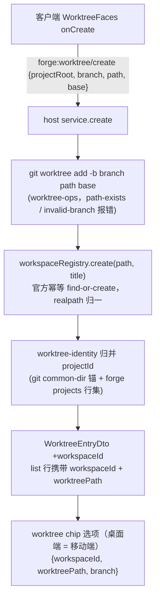
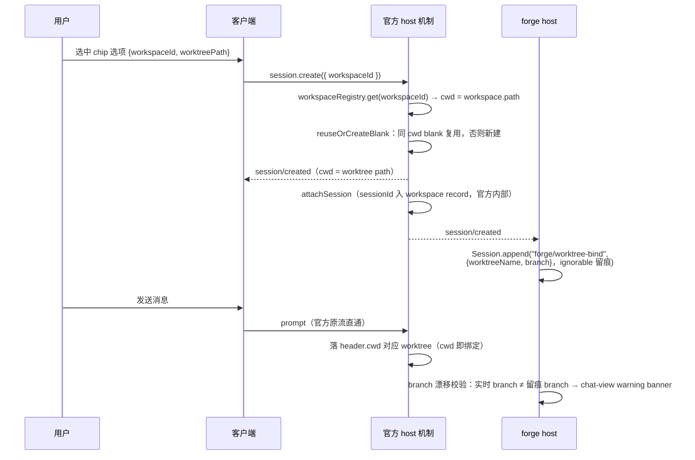

# 提案：绑定推导制——退役预铸子系统，会话归属回归官方 blank 池

- slug：`binding-derivation`
- 提出：2026-10-24（绑定失配族 bug 修复会话演化而来的根治性换代）
- 状态：accepted（2026-10-24 用户批准）

## 1. 需求界定

绑定失配族 bug（bf377bea / c6367ec7 / c931aa28 / 换绑竞态抢跑）的修复过程中，
体系逐步叠加了四层补偿机制；每层都正确，但叠起来是一个庞大的平行子系统：

```
host 预铸（persistence.create 自铸 id + 落绑定事件）
    → {sessionId, cwd} 补调官方 adopt 正门（单写者铁律 + 账本合并）
    → G3 产物池（同树 blank 互斥复用）
    → 占位回收扫描（后台化 + 复用池分层）
    → 点选即换绑（同步编排 + seal.blank 事件判读）
    → 发送哨兵（blank 失配改投 chip 显示树）
```

这一切的唯一根源：host 以前不走官方 `session.create({ workspaceId })`，
只能自铸 sessionId 预铸会话、再回填预铸绑定事件（`forge/worktree-attach`）
——于是衍生出「预铸 → 采纳」两段式及其全部配套。

根本需求：**会话归属回归官方机制，绑定信息从事实推导而非事件台账**。
备选（已否决）：继续在预铸体系上修补失配族——补偿层只会继续增厚。

### 1.1 根因：host 为什么这么重（5 Whys）

1. 为什么有发送哨兵？——池交付的会话可能与 chip 显示不一致，发送前要兜底改投；
2. 为什么有池？——host 自己预铸会话，绕开了官方 create 路径，官方 blank
   复用对预铸会话不生效，只能自建互斥复用池；
3. 为什么要预铸？——预铸绑定事件必须在官方接管写句柄之前写入（单写者），
   「创建时点」是唯一窗口，host 想写事件就得抢先创建会话；
4. 为什么绑定要走事件？——当时认定绑定是需要持久化的独立事实，没意识到
   header.cwd 本身就编码了绑定（1.19 守护反向证明了这一点）；
5. **根**：错误前提「绑定需要独立承载面、且必须在创建时点写进会话日志」。
   前提错一步，后续每步都是对上一步副作用的补偿——预铸制造池的问题，
   池制造回收的问题，时序错位制造哨兵的问题。失配族 bug 修复以「加层」
   而非「删前提」落地，每修一次加厚一层。

host 的正当职责边界（推导制后）：

| 职责 | 为什么必须在 host |
|---|---|
| 正确性单点保证 | 工作区硬约束：官方竞速只算体验优化，兜底必须 host 单点 |
| 跨进程汇聚 | mobile 隧道中继、三进程诊断日志（emitDiag 单面） |
| 可观测性 | 留痕 append（wire 面无 append）、漂移校验、埋点 |
| wiring | 通道注册、服务 provide、Face 注入——装配薄缝 |

不该重的：路由、池化、复用、回收——官方机制全部现成（`createOrAdopt` /
`reuseOrCreateBlank` / workspace record），host 再做即平行机制。

意图推断：refactor 为主（预铸子系统整体退役、路由改官方直通），
附小增强（branch 漂移 warning banner、chip 内联 ahead/behind 与行序重排
（§2.3.1）、「路径」→「工作区」措辞）。

## 2. 方案

### 2.1 绑定推导制

```
binding = (worktree = header.cwd, branch = git 实时解析(header.cwd))
```

- **worktree 即 header.cwd**：worktree 的身份就是盘上路径（官方
  `workspace.path` = worktree path），cwd 唯一确定所属 worktree；
  worktree 展示名由 list DTO / 留痕事件携带，不参与归属判定；
- host 创建会话只做一次查表：`worktreePath → workspaceId`（projects 表 /
  官方 workspace registry 单源），然后调官方 `session.create({ workspaceId })`——
  官方自己定 `cwd = workspace.path`，客户端 `reuseOrCreateBlank` 自动复用
  同树 blank 或新建。零双段、零自铸 id。
- 绑定不再需要独立台账：官方 `attachSession` 已把 sessionId 持久化进
  workspace record，归属事实从 `header.cwd` 随时可推导。
- `forge/worktree-attach` 预铸绑定事件整体退役（写侧与全部读侧消费面）。

### 2.2 留痕事件与 branch 漂移警示（ignorable 正门）

官方 create 之后，host 进程内经 `Session.append` 写一条 ignorable 留痕事件
（合法缝：AGENTS 1.1「ignorable 事件直写」；官方先例 `model/selection`）：

- 事件类型：`forge/worktree-bind`（SessionEventMap 声明合并），
  载荷 = `{ worktreeName, branch }`（创建时刻快照）；
- **ignorable 分类 = 词表运行期注册，非信封标记**：`Session.append` 的信封
  构造无 `ignorable` 设置口——实现为插件激活时向官方导出的
  `KNOWN_SESSION_EVENT_TYPES` 公开 Set 追加注册（幂等，零官方源码改动），
  官方持久化读路径对「构建未知且无 ignorable 标记」的类型拒绝解读整本日志，
  注册后该类型按 ignorable 安全跳过（不入 surface，事件随日志保留）；
- **外部构建边界**：未做词表注册的外部官方构建读取含 `forge/worktree-bind`
  的会话日志时，读路径 fail-closed（拒绝解读）——留痕事件只承诺在本
  插件在场（host 进程）的进程内可读；跨构建/换机读旧日志以官方
  v3→v4 迁移的 `plugin:` 前缀归名兜底；
- 漂移校验：当前实时 branch ≠ 留痕 branch（用户在 worktree 里手动
  `git switch` 所致）→ chat-view 顶部 banner 展示 warning，非阻断；
- **创建路径（桌面端官方直通）**：客户端直呼官方
  `session.create({ workspaceId })`，host 零中介；留痕由 host 监听官方
  `session/created` 事件追加（`Session.append` 仅 host 进程可写，wire
  面无 append——这是 host 在创建链路的唯一角色）；
- **留痕时序与惰性补写**：首条消息理论上可能先于 session/created 留痕；
  兜底两道——缺留痕时漂移校验按「不警示」跳过（fail-soft，路由不受
  影响）；host 首次为某会话校验发现无留痕时，以当前实时 branch 补写
  留痕（诞生到首次校验之间完成切分支的概率可忽略，补写值 ≈ 创建时
  branch，语义不失真）；
- 该警示是「预防 git switch」的显示面，不参与路由。

### 2.3 各面语义

- **chip 分支**：实时解析 header.cwd，分支切换后 chip 跟随（零持久化）；
- **发送哨兵**（下文简称哨兵）：退役——官方 blank 复用即路由，不保留 cwd 比对版；
- **创建路由（两端语义一致、传输分叉）**：worktree chip 选项统一双发
  （双发 = `workspaceId + worktreePath` 同时携带），零猜测零回退。
  桌面端 = 客户端直呼官方网关命令 `session.create({ workspaceId })`，
  host 零改道；移动端 = 经 `forge:proxy/session-create` 由 host 进程内
  转调同一 `sessionController`。mobile proxy 预铸正门退役；
- **UI 措辞**：worktree 表单 / 会话头的分支 chip，「路径」label 改为「工作区」；

### 2.3.1 chat-view 分支 chip 显示规范

现状示例：

```
分支 main
worktree dsh-forge
路径 Z:\project\dsh\dsh-forge
项目 Z:\project\dsh\dsh-forge
领先/落后 ↑16
```

目标形态：

```
分支 main 2↓ 16↑
worktree dsh-forge
项目 Z:\project\dsh\dsh-forge
工作区 Z:\project\dsh\dsh-forge
```

1. 「路径」label 更名「工作区」（与 §2.3 措辞统一）；
2. 分支名旁以 `数字+箭头` 内联展示本地相对 origin 的差异
   （`2↓ 16↑` = 落后 2 / 领先 16），数据面复用现有 `aheadBehind`
   （worktree-ops.ts:155，`rev-list --left-right --count <upstream>...<branch>`），
   随 chip 实时分支同源解析（header.cwd）；
3. 移除独立的「领先/落后」行；
4. 行序自上而下：分支、worktree、项目、工作区（项目在工作区之外——
   项目是 git 归属锚，工作区是盘上位置）。

### 2.4 流程

#### 流程 A：添加 worktree → 创建 workspace → 绑定 project

现状 workspace 到首次建会话才惰性创建（`attachWorkspace`），且 worktree
list 通道不带 workspaceId。推导制下 workspace 创建前移至添加 worktree 时点
（官方 `workspace.create` 幂等 find-or-create），chip 数据源由此携带双字段：



绑定语义：

- worktree 的 workspace 经 `worktree-identity` 归并到所属 project（现状
  通道沿用，不建 projects 行）；
- 项目根 workspace 维持 `projects.workspace_id` 现状 + 启动对账 relink：
  `workspace_id`（forge `state.db`）与官方 registry（dsh durable 存储）
  是同一 path 的两份持久化，可能失配（state.db 还原/搬移、registry 重建）；
  host 启动 `reconcileAtStartup` 逐项目核对——id 失配但 path 找得到则按
  ws_path relink（forge 行向官方事实对齐），registry 侧缺失则
  `registry.create(ws_path)` 幂等重建。推导制下 workspaceId 是一切建
  会话路径的硬前置，此对账保证重启后 id 与官方 registry 收敛一致。

#### 流程 B：选中 worktree → 创建会话 → 发送消息



#### 数据流明细

流程 A 逐步数据（添加 worktree → 创建 workspace → 绑定 project）：

| 步 | 动作 | 数据载荷 | 落盘位置 |
|---|---|---|---|
| A1 | 客户端发起创建 | `{projectRoot, branch, path, base}`（path = joinWorktreePath(root, worktreeName)，展示名 worktreeName 即 path 末段） | —（RPC 传参） |
| A2 | host 目录预创建与 ACL 授权 | 空目录创建 + win32 `ensureDirAcl`（`(OI)(CI)F`，幂等短路；posix no-op）。注：此「预创建」与退役的「预铸」（会话预铸）无关，保留 | 盘上目录 |
| A3 | git 建 worktree | `git worktree add -b <branch> <path> <base>` → 分支与目录同时诞生 | `.git/worktrees/`（git 元数据） |
| A4 | 创建官方 workspace | `registry.create(path, worktreeName)` → `WorkspaceId(randomUUID)`，幂等 find-or-create | 官方 `workspaces` KvTable（dsh durable） |
| A5 | 归并 project | worktree-identity：git common-dir 锚 + projects 行集 → `projectId`（纯推导，零落盘） | 无 |
| A6 | 返回 + 列表携带 | `WorktreeEntryDto {path, branch, worktreeName, workspaceId, isMain, present, …}` | —（DTO；host 重启后 list 时按 A4 幂等重建/解析） |

流程 B 逐步数据（选中 worktree → 创建会话 → 发送消息）：

| 步 | 动作 | 数据载荷 | 落盘位置 |
|---|---|---|---|
| B1 | chip 选项双发 | `{workspaceId, worktreePath}`（桌面端 = 移动端） | —（RPC 传参） |
| B2 | 官方解析 cwd | `workspaceRegistry.get(workspaceId)` → `cwd = workspace.path` | 官方 workspaces KvTable（读） |
| B3 | blank 复用判定 | `blank && summary.cwd === path && workspace.sessionIds.includes(id) && !archived` → 命中复用，否则新建会话 | 会话 header：`cwd` 写定、终身不可变（会话日志 header 段） |
| B4 | workspace 挂账 | `attachSession`：sessionId 入 record | 官方 workspace record `sessionIds`（durable） |
| B5 | 留痕事件 | host 监听官方 `session/created` → `Session.append("forge/worktree-bind", {worktreeName, branch})`（ignorable）；缺留痕时首次校验惰性补写 | 会话日志事件流 |
| B6 | 返回客户端 | `{sessionId, cwd}` | — |
| B7 | 发送消息 | prompt 走官方原流，落 header.cwd 对应 worktree（cwd 即绑定，零 host 介入） | 会话日志消息流 |
| B8 | chip 渲染 | 实时 `branch` + `aheadBehind`（↑n/↓n）由 host 数据面解析（桌面经 seal 通道随渲染拉取；移动端漂移判定经 forge-stream 推送触发）→ 按显示规范渲染；漂移判定：实时 branch ≠ B5 留痕 branch → warning banner | 无新落盘（git 只读探测） |

持久化清单（推导制全集）：会话 header.cwd（会话日志）、官方 workspace
record（dsh durable）、`forge/worktree-bind` 留痕事件（会话日志）、
projects 行（forge `state.db`，仅主树）。forge 侧绑定台账不存在。

### 2.6 边缘场景与诊断埋点

#### 边缘场景

流程 A（创建域）：

| 场景 | 处置 |
|---|---|
| worktree 重复创建（path 已在盘上 / git 元数据已存在） | `CreateWorktreeError('path-exists')` 服务端拒绝（worktree-ops.ts:74-79），客户端同名冲突预检（branch-exists / worktree-exists）先进 git 前拦截 |
| 同分支二次检出 | git 自身拒绝（一分支一 worktree）；客户端 `createConflicts` 预检兜底 |
| 分支名非法 | `check-ref-format` 预检 → `invalid-branch` 报错（worktree-ops.ts:104-106） |
| git add 成功但 `registry.create` 失败 | 不回滚 git 树——官方 create 幂等，下次 list / find-or-create 自愈补齐；emitDiag warn |
| icacls 补权失败（win32） | fail-soft 照常交付（现行语义），emitDiag warn |
| worktree 目录被手动删除 | list 行 `present=false`，chip 选项标禁；官方 workspace record 残留无害（无引用方），不清理 |

流程 B（会话域）：

| 场景 | 处置 |
|---|---|
| chip 双发 stale workspaceId（选项打开期间 worktree 被删） | 仅移动端中继路径成立：host 转调时 `registry.get` miss → 明确报错 + emitDiag warn，客户端刷新列表，不静默回退；桌面端为官方网关原生报错（无 host emitDiag 点） |
| 同树 blank 已归档 | 复用四条件不命中 → 官方新建，零 host 介入 |
| fork 会话 | 官方继承 source cwd 新建，同样发布 `session/created` → host 监听面统一 append 留痕；监听缺失场景由惰性补写兜底——不存在「永久无留痕」状态 |
| 分支切走又切回 | 实时 branch == 留痕 branch → banner 消失（判定随渲染现算、无状态残留，数据源为 host 解析面） |
| 会话日志移动 / 换机 | 绑定随 header.cwd 仍在（推导制的自带收益） |
| 非 git 项目域 | 官方原流不变（非目标，零介入） |

#### 诊断埋点（复用现有事件式日志系统）

全部流程埋点走 `emitDiag(ctx, payload)`（`apps/host/src/telemetry/diag-events.ts:48`，
官方 cordis 事件总线 `diag/log` 域，订阅侧 appender 落 JSONL；payload 携带
`level / event / message / projectId / sessionId / cwd / traceId`）。埋点面：

- `worktree-create`：A3-A6 各步失败与幂等自愈（warn/error）；
- `session-bind`：B3 复用/新建判定结果、B5 留痕 append 失败（warn）；
- `bind-drift`：漂移警示触发与消除（info，携带 sessionId/cwd/两侧分支名）。

新增错误源 = 新增 emit 点，订阅侧零改动（诊断域既有架构约定）。

bind 相关名称对照（三面三名，勿混）：

| 面 | 名称 |
|---|---|
| 留痕事件（会话日志，ignorable） | `forge/worktree-bind` |
| 诊断埋点（diag/log 域） | `bind-drift` |
| forge-stream 推送事件（移动端 banner 触发，发射缝原 `session-binding-mismatch`） | `forge/binding-mismatch` |

### 2.7 桌面端 / 移动端统一机制

两端共用同一套机制，差异只在传输（桌面本地 IPC，mobile 经 `forge:proxy`
隧道），业务语义零分叉：

1. **同一数据源**：`WorktreeEntryDto` 补 `workspaceId` 后，list 通道经
   proxy 镜像自然到达 mobile——chip 选项两端同构 `{workspaceId,
   worktreePath, branch}`，mobile 不再有「workspaceId 恒缺席」的专属
   缺席域（bug 16ac5bc2 随 DTO 携带根治）；
2. **同一创建通道语义**：mobile `createPlainSession` 携带
   `{workspaceId, worktreePath}` 经 `forge:proxy/session-create` 转发给
   官方 `session.create`（隧道域必经 host 中继，与桌面直通消费同一官方
   机制）；proxy 预铸
   正门（`proxy-channels.ts` 转发 worktrees.sessionCreate）退役；
3. **同一 host 侧机制**：留痕 append、漂移校验、诊断埋点全部在 host
   进程单点实现——两端天然一致，mobile 端 chat-view 同样展示漂移 banner；
4. **移动端统一改造**：移动端两端（bundle 与 host）随本提案一次切换，
   不设旧 bundle 兼容窗口；host 不做 `resolveByPath` 反解过渡缝；
5. **移动端专属逻辑清单 = 空**：移动端为 forge 自研 Web 应用，官方
   wire 命令不在 `/remote/__rpc` allowlist 内（`remote-http-rpc.ts:77-100`），
   经 `TUNNEL_OFFICIAL_RPC_PROXY` method→`forge:proxy/*` 映射中继到同一
   `sessionController`（进程内直调，`proxy-channels.ts:171-182`）——传输
   分叉、机制零分叉。具体改动点：

   | # | 改动点 | 位置 |
   |---|---|---|
   | M1 | chip 选项双字段随 DTO 自动到达（同份 `WorktreeEntryDto`，proxy-channels.ts:516 直调同一列表服务） | contracts/dto/worktree.ts |
   | M2 | `heroDeps` 注入 workspaceId（现状从不注入，官方面为死代码），chip 选中双发 `{workspaceId, worktreePath}` | apps/mobile/src/views/hero.ts:392-409 |
   | M3 | 退役绑定选中树的预铸单门（hero.send → forge:worktree/session-create → worktrees.sessionCreate） | hero.ts:378、proxy-channels.ts:520-523、worktree-rpc.ts:712 |
   | M4 | 双域统一代理化即正门：移动端**不可直调**官方命令名（`/api/rpc` 无 endpoint claim 恒 404 + api-loopback-guard 非回环恒 403 + 隧道不暴露 webserver）；WiFi/互联网两域统一经 `forge:proxy/session-create` 映射 → `sessionController` 进内直调，载荷透传 `{workspaceId, worktreePath}` | main.ts:711-784、proxy-channels.ts:171-187、remote-http-rpc.ts:98 |
   | M5 | 退役从首项目 wsPath 推树锚的 hack（workspaceId 由 DTO 自带） | hero.ts:416-421 |
   | M6 | 漂移 banner 推式承载：`session-binding-mismatch` 发射缝（child.ts:559-565）并入 `/remote/forge-stream` 镜像目录 + mobile onEvent 消费，banner 实时出现/消失，与桌面一致 | forge-stream.ts:97-106 |

### 2.8 迁移

一次性切换（用户裁决）：读侧、写侧、退役、移动端、e2e 重写单批落地，
不留双轨、不留兼容窗口。

## 3. 改动影响范围（file 粒度）

### 复用核销（官方机制，全部已到源码核销）

| 机制 | 证据 |
|---|---|
| `session.create({workspaceId})` → cwd = workspace.path | dsh-api-session-controller/lib/index.js:686-694 |
| 客户端 blank 复用 `reuseOrCreateBlank`（blank + cwd 相同 + workspace 挂账 + 未归档） | dsh-client-ui-workspace/lib/client.js:800-809 |
| workspace record 持久化 sessionIds（`attachSession`） | dsh-workspace/lib/index.js:111-129 |
| `Session.append` 公开追加 + `KNOWN_SESSION_EVENT_TYPES` 词表运行期注册（ignorable 分类）+ session/event 通用落盘 | dsh-session/lib/types/index.d.ts:246、types.d.ts:250、known-event-types.d.ts:9-19 |
| header.cwd 创建时写入、终身不可变（fork 继承新建） | dsh-session/lib/index.js:1257-1264、session-controller:815 |

结论：官方机制完整覆盖预铸事件的一切职能，无官方缺缝、零自建机制。

### 触点清单

退役 / 改造：

- `apps/host/src/ipc/worktree-rpc.ts`（1175 行，主战场）：
  `doSessionCreate` L909-992 退役（桌面创建不经 host）；会话创建中继收敛
  为 `forge:proxy/session-create` 一条腿（仅移动端，proxy-channels.ts:171-182）；
  `service.create` L648-669 前移 `workspaceRegistry.create(worktreePath)`
  （添加 worktree 时点即建官方 workspace，幂等 find-or-create）；
  退役 G3 池 L457/L738-769、recycledPool L459/L772-780、blankOf L429-441、
  回收扫描 L1000-1029、sealStateOf blank 判读 L577-601、
  发送哨兵 judge L844-901 + interceptRequiredBinding L1113-1152 +
  装载自证 L1160-1175；
- `packages/contracts/src/dto/worktree.ts`：`WorktreeEntryDto` 补
  `workspaceId` 字段，list / create 返回携带（chip 双发数据源）；
- `packages/plugins/git-worktree/src/session-attach.ts`（148 行）：
  预铸 `preseedWorktreeSession` L152-176 与 `forge/worktree-attach`
  读写退役；改造为 `forge/worktree-bind` ignorable 留痕事件（append + 读取）；
- `apps/web/src/client-plugin/create-wrap.ts`（263 行）：
  adopt 补账本 L288-294、`adoptMismatchDetour` L189-214 退役；
- `apps/web/src/client-plugin/start-session-wrap.ts`（186 行）：入口锚定改
  workspaceId 直通；
- `apps/host/src/boot/child.ts` L651-706：哨兵装配方退役；
- `apps/mobile/src/views/hero.ts`：`heroDeps` 注入 workspaceId（L392-409），
  chip 选中双发 `{workspaceId, worktreePath}`；退役预铸单门消费（L378）
  与树锚 hack（L416-421）；
- `apps/mobile/src/main.ts`：`TUNNEL_OFFICIAL_RPC_PROXY` 映射确认透传
  `{workspaceId}` 载荷（L775-784）；
- `apps/host/src/boot/proxy-channels.ts` L32/L187/L515-522：mobile proxy
  承接保持 `sessionController` 直调（L171-182），预铸单门转发退役；
- `/remote/forge-stream` 镜像：并入 `forge/…binding-mismatch` 事件
  （发射缝 `apps/host/src/boot/child.ts:559-565`），mobile onEvent 消费；
- `packages/plugins/git-worktree/src/client/seal-notice.tsx`（130 行）：随
  seal 语义调整；chat-view 新增 branch 漂移 warning banner；分支 chip
  渲染面按 §2.3.1 显示规范重排（行序/内联 ahead-behind/label 更名）。
- `packages/plugins/git-worktree/src/client/model.ts`：分支 chip「路径」
  label → 「工作区」。

测试 / e2e 重写：

- 单测：`session-attach.test.ts`（267 行）、`worktree-rpc.test.ts`（1496 行，
  预铸/池/哨兵族重写）、`start-session-wrap.test.ts`（194 行）、
  `session-chip-seal.test.tsx`（105 行）；
- e2e：`e2e/specs/worktree-mandatory-bind-1-27.spec.ts`（210 行）、
  `worktree-pure-selection-1-29.spec.ts`（225 行）、
  `worktree-hero-chip.spec.ts`（139 行）随新语义重写。

量级：中等偏上但高度集中（主战场单文件 + 插件域两 wrap），突击可收
（用户裁决维持突击）。

## 4. 行为差异（诚实列全）

1. chip 分支从「挂靠时刻快照」变「当前实时分支」（用户裁决采纳实时）——
   手动切分支后 chip 跟随，显示与实际永不分叉；创建时刻的分支另以
   ignorable 留痕事件保存，仅服务于漂移警示；
2. 绑定路由改官方 blank 复用后，发送哨兵不再存在——依赖哨兵兜底的
   失配场景由官方复用天然命中；
3. 桌面端与移动端统一为 chip 双发 `workspaceId + worktreePath` 的
   官方 create 直通，proxy 预铸正门与 host 侧查表回退均不存在；
4. 封存（sealed）判读源不变（盘上 worktree 在场性），零影响。

## 5. 非目标

- 不改官方机制（selectWorkspace / createOrAdopt / Session.append 原样消费——纯插孔）；
- 不处理非 git 项目域（官方原生路径不变）;
- 性能再优化不进本提案——预铸退役后回收扫描等问题随之消失；
- 留痕事件仅做漂移警示数据源，不扩展为通用 host 元数据通道
  （通用承载面另议，候选 dsh-storage-domain）。

## 6. 验收

- 选树 → 新会话/发送：会话 cwd = 所选树，官方 blank 复用天然生效（真机）；
- mobile：chip 选中某树 → 会话落该树（workspaceId 双发链路真机取证）；
  **WiFi（LAN 直连）与互联网（隧道 + PSK）两种模式下均调通**
  `session.create` 中继链（`forge:proxy/session-create` → sessionController
  进内直调）；
  手动 `git switch` 后 mobile chat-view 经 forge-stream 推送实时出现
  warning banner，切回实时消失；
- branch 漂移：worktree 内手动 `git switch` 后 chat-view 出现 warning
  banner；切回后消失；
- chip 分支实时跟随：切分支后 chip 显示新分支；ahead/behind 以
  `数字+箭头` 内联展示于分支名旁，独立「领先/落后」行不再出现；
- 预铸子系统代码删除量 ≥ 500 行；绑定失配族 bug 回归用例全绿；
- chip 形态：「路径」label 更名「工作区」、行序与内联 ahead/behind 符合
  §2.3.1 目标形态（真机截图对照）；
- e2e 三 spec 重写后全绿。
