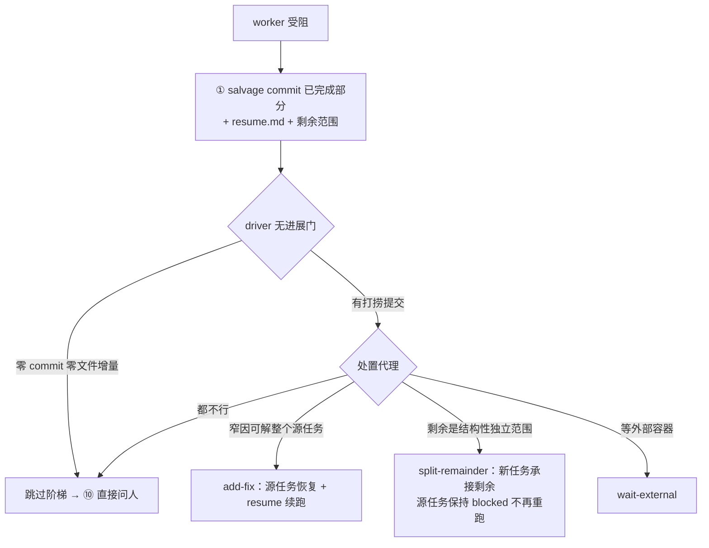

# blocked-salvage-split — 阻塞处置三改造：打捞提交 + 分割承接 + 无进展硬停

## 裁决原文（用户 2026-10-13）

> 阻塞性任务，记录已经完成的部分，并且提交，把未完成的部分塞进新任务。不要每次重头开始。如果任务没有进展，则直接停止，向人类求助。

## 问题（现状三缺口）

| 缺口 | 现状 | 代价 |
|---|---|---|
| 无打捞提交 | persona 只约束写 resume.md（persona.ts:74），不约束 commit | blocked 时 WIP 悬树，主会话/他工作流被迫 pathspec 绕行 |
| 无分割动作 | 处置枚举封闭三值 add-fix/wait-external/ask-user（decision.ts:123） | 源任务恢复后重跑全简报全验收，已完成部分重复执行 |
| 无进展信号 | 阶梯重试 ×3、fix 链 ≤6、abort ×3，全不看进展 | 卡死/环境坏空转烧轮次，本该立即问人 |

## 目标语义

## 任务拆解

### A · 打捞提交纪律 + resume.md 升格单一进度文档（coding-feature）

- `packages/core/src/forge/tasks/prompt/persona.ts:74` 断点续跑约束句扩义：阻塞时先把**过质量门的完成部分** git commit（消息带任务键），再把 resume.md 覆盖写为**单一进度文档**——固定三段：「已完成（含 commit hash）／进行中／待办」；结算 blocked 附 commit hash + 剩余范围描述。
- resume.md 携带 commit hash 的意义：`<resume>` 段领取瞬间注入下一轮简报（compose.ts 既有机械），接手 worker 直接知道已落地哪些提交、可自 hash diff 续跑——不重做已完成部分。
- `packages/plugin-forge/skills/submit-task/SKILL.md` blocked 结算规范同步：先提交、后写 resume.md（三段形）、后结算。
- 验收：persona 单测断言新约束句（含三段形与 commit hash 要求）；skill 文案在场。

### B · split-remainder 处置动作（coding-feature）

- `packages/plugin-forge/src/triage/decision.ts`：枚举增 `split-remainder` `{title, type, taskDesc, note}`（越权校验同 add-fix）。
- `packages/plugin-forge/src/triage/prompt.ts`：三动作示例区增第四态 + 分界指引（窄因→add-fix；结构性剩余→split）。
- `packages/plugin-forge/src/loop/driver.ts` add-fix 分支旁增分支：`addTask(block_source: false)`（即 disc-N 机械）承接剩余；源任务保持 blocked。
- 验收：decision 解析单测（有效/越权/字段错）；driver 分支单测（新任务落账、源任务不恢复）；叙述模板在场。

### C · 无进展硬停（coding-feature）

- `packages/plugin-forge/src/loop/driver.ts` 结算分支（:736 前）插机械门：blocked 结算**零 commit hash 且零 files 增量** → 跳过处置阶梯，直接 ⑩ blocked-ask-user 升级（followup 唤醒 + 问询 + 回执，复用 2026-10-13 两笔闭环）。
- 依赖 A 的结算协议（commit hash 字段）作为进展信号。
- 验收：driver 单测——无信号 blocked 即升级（阶梯零调用）；有 commit 正常入阶梯。

## 已定取舍

- 源任务终态 = blocked（不谎报 completed）；deadlock 判词因 pending 继任路径在场不误报。
- 无进展信号 = 结算 commit hash 缺席（A 落地后的免费副产物），不引入新的进度机械。
- 叙述通道分工保持 2026-10-13 修复：⑩ followup 唤醒 + 问询 + 答案回执。
