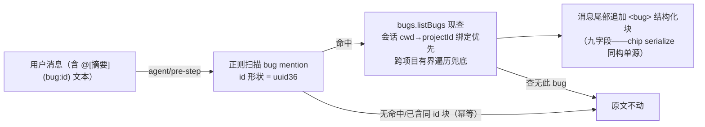

# 提案：bug mention 发送期展开 pre-step

## 问题

bug 引用 chip 在两条官方降级路径上退化为纯文本 `@[摘要](bug:<bugId>)`，且模型侧无展开面：

- **刷新持久化**：官方草稿持久化即纯文本投影（client.js:16404——setDraft 回填 + 占位符剥离，对一切 source 同权，台账 c61d7b23）；
- **粘贴**：官方 paste 面设计性纯文本注入（台账 d2de4a8d）。

差量伤害独 bug 一家：@file 退文本后路径可读、@session 有官方 pre-step 兜底，bug mention 模型只见原文、九字段全失。

## 方案

目标形态：**发送期文本 mention 展开**——官方 `agent/pre-step` 缝（session-reference 同构先例）扫描外发用户消息中的 bug mention，模型侧追加结构化字段块。

行为约束：

- **只追加不替换**：原文 mention 保留（可读性），结构化块追加消息尾部——session-reference「校验+捕获上下文」同型语义。
- **幂等**：消息已含同 bugId 的 `<bug>` 块（真 chip serialize 产物）不重复展开。
- **取数单源**：展开块与 chip serialize 共用同一字段投影（`<bug bugId=…>` 九字段，可空缺席不出键）。
- **项目锚定**：会话 cwd→projectId 绑定（4.2 绑定表）优先，未解析则注册项目有界遍历——client 侧 ea4fe3be 同口径。
- **fail-soft**：查无此 bug = 原文不动（占位块都不加——避免伪造上下文）；pre-step 异常静默不阻断发送。

跨模块交互面：plugin-forge（宿主 agent 面，挂 `agent/pre-step`）↔ core bugs 域（`listBugs` 服务，零新通道）↔ 会话绑定表；无 UI/DB 变更。

## 改动范围

- `packages/plugin-forge/src/`——bug mention pre-step 模块：扫描正则 + 取数 + 追加块（纯函数核心）+ 事件挂接。
- 既有 bugs 工具装配处——pre-step 注册行。
- 对应测试文件。

排除边界：不改 composer/官方持久化（设计边界尊重）；不改 chip serialize（展开块复用其投影，不自成格式）；不做 bug 短号；不做 mention 改写。

## 影响范围

- 用户可感知：刷新/粘贴后发出的 bug mention 文本，模型自动获得九字段上下文——三条引用路径（chip/按钮/降级文本）语义归一。
- 不受影响：真 chip 的 serialize（pre-step 幂等让路）；官方 @file/@session；发送时序（pre-step 同步快查，有界）。
- 风险面：正则误匹配（uuid36 + `bug:` scheme 双重锚定，误报面极小）；消息长度增长（每 mention 一块，多 mention 有界累积）。

## 验收

1. 消息含 `@[摘要](bug:<真bugId>)` 文本且台账在场：模型收到尾部追加的 `<bug>` 九字段块，字段与台账行一致。
2. 消息含真 chip（serialize 已产块）+ 同 id 文本 mention：只出一块（幂等）。
3. mention 的 bugId 不在任何注册项目台账：原文不动、无占位块、不阻断发送。
4. 会话绑定项目与 bug 实际项目不一致（跨项目）：有界遍历命中仍展开。
5. pre-step 挂接缺席/服务缺席：发送不受任何影响。

## 一致性检查

- 验收 1←展开核心；2←幂等；3←fail-soft；4←项目锚定；5←挂接韧性。每条验收有纳入项承接，无互相矛盾。
