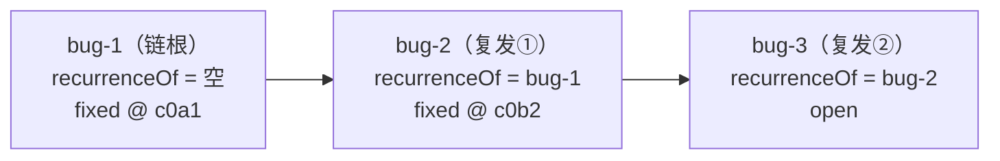
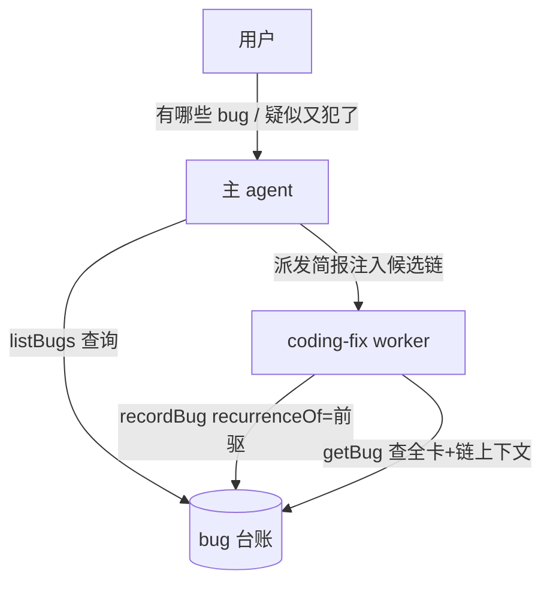

# bug 复发链（bug-recurrence-chain）

## 需求

bug 台账当前为扁平单表：每次 recordBug 都是一条独立记录（open → fixed/unresolved 单向终态），同一问题反复出现时台账里是 N 条互不相干的行，「修了又犯」的模式无法追溯。

要达成的效果：

1. 同一问题的多次发生串成一条**复发链**，可追溯复发次数、历次修法与前后相继关系。
2. agent 能回答「有哪些 bug」——关键词、状态筛选，分页返回。
3. 按 bug_id 查单条全卡详情，主 agent 与 worker 均可用。

紧迫性：复发治理（哪些 bug 反复出现、修法是否有效）目前无从谈起；台账已积累实际数据。

## 方案

### 术语定义

- **复发链** = 同一问题的多次 bug 记录按发生先后串成的时间线；链上第一条为**链根**（recurrenceOf 为空）。
- **recurrenceOf** = 本条登记时链上时间最近一条的 bug_id（**前驱指针**，链表式）。读作「本条是 X 的复发」。登记时写入、终态后不可改；链根缺省；指向的 bug_id 必须存在（悬空引用拒写）。
- 复发识别 = **agent 判定 + 显式引用**：诊断时 agent 判断疑似同一问题，recordBug 时显式填 recurrenceOf；不做自动匹配。

### 落库模型

每次复发是一条**新 bug 行**，各走自身 open → fixed/unresolved 状态机——不碰「终态不可改史」铁律；复发计数与链视图由查询期沿前驱指针反向展开聚合。

### 工具面与流程

- **主 agent 查询工具（listBugs）**：关键词命中六字段任一（summary / bugDesc / triggerDesc / expected / actual / errorType），状态 chips 过滤，**offset/limit 分页**（服务端排序后切片）。仅主 agent。
- **getBug**：按 bug_id 返回 BugCard 全量 + 链上下文（recurrenceOf 与链上前后条）。**主 + worker**——worker forge 面由四动词扩为五动词（submitTask / addTask / recordBug / resolveBug / getBug）；派发简报注入（链候选发现）与 getBug（详情深查）两径互补。
- **recordBug 扩参**：新增 recurrenceOf 可选参数。机器语义由**工具 schema description 显式定义**（前驱 bug_id、首次发生不填、可用主 agent 查询工具检索候选）+ fix-bug 流程文本同步（persona 挂链指引），不靠字段名自明。

### UI 呈现

**线框正本 = [mockup.html](mockup.html)（本目录，过程产物不进 git）——apps/web 实现的对照基准**：布局结构、行语言、chips / 徽标 / 时间线节点形态、展开与同框切换的交互词汇一律以原型逐位对照实现，不自行发明形态。

#### 列表（Bug 子 tab）

| 要点 | 说明 |
|---|---|
| 链折叠行 | 链根 summary 代表整链；前导 chevron（▾/▸，零链行该位留白对齐） |
| 复发徽标 | 「复发 N 次」红系胶囊（底 #fff1f0 / 边 #ffccc7 / 字 #cf1322），置于 errorType chip 左侧；N = 链上条数 − 1 |
| 折叠行状态点 | **链聚合态**：链上任一 open 即 error 红；否则取链上最新条终态色（done / idle） |
| 展开区 | 缩进 + 左竖线（2px border-l2）子行集；**时间正序**（链根在上，与弹框时间线同序） |
| 子行内容 | 轻量行：状态点 + 定位词（链根/复发①/复发②…）+ summary 摘录 + 日期 + 已修 commit 短哈希 |
| 子行点击 | 整行可点（role=button 键盘可达，既有行语言）→ 打开该条详情弹框 |
| 零链行 | 现状行语言完全不变（StateDot + summary + errorType chip） |
| 组件纪律 | StateDot / Tag 官方组件复用；徽标与竖线为产品自绘面（.dswf-* + DESIGN.md 令牌，零裸值） |

#### 详情弹框（BugDialog）

| 要点 | 说明 |
|---|---|
| 链区位置 | 摘要行之下、五字段表单行之上；容器 = 浅底（bg-hover）+ l2 边框圆角块，题头「复发链（N 条 · 沿 recurrenceOf 回溯）」 |
| 时间线形态 | 垂直轨道：每节点 = 状态点 + 右侧内容块；节点间 2px 竖轨相连，末节点无轨 |
| 节点内容 | summary（含定位词）+ 状态 Tag + 日期 + commit 短哈希 + **fixApproach 首行摘要**（修法速览——链追溯的核心信息） |
| 当前条高亮 | 底色强调块 + 「本条」小标；meta 行标注 `recurrenceOf → 前一条` 与发现会话 pill |
| 同框切换 | 点链上其他节点 = **同一弹框内**切换显示该条全卡（详情零二次弹框；链区随之重算当前条） |
| 单条 bug | 无 recurrenceOf 且无后继 = 不呈现链区，弹框与现状完全一致 |
| 既有面不动 | 五字段 / 修复证据 / 变更文件 / 会话 pill / 来源 / 登记时间行的位置与语言零变化；弹框宽度 880、拖动、Esc 均沿现状 |

## 改动影响范围

| 模块 | 交付物 |
|---|---|
| packages/contracts | dto/bugs.ts 扩 recurrenceOf + 查询参（关键词/状态/offset/limit）+ 链上下文；worker-matrix 四→五动词；错误码扩池（悬空引用） |
| packages/core | bugs 域服务：registerBug 扩参校验、链反向展开聚合、查询扩六字段+分页、getBug 读法；表迁移（新列可空，既有行无损） |
| packages/plugin-forge | listBugs / getBug 两工具注册（面分治：查询仅主 agent、getBug 主+worker）；recordBug 扩参 + schema description；worker 面装配随动 |
| packages/core（persona） | fix-bug 流程文本同步挂链指引 |
| apps/host | RPC 透传面随动（读面负载/响应扩形） |
| apps/web | Bug 子 tab 链折叠 + 复发徽标 + 详情链时间线——**以 [mockup.html](mockup.html) 为实现基准逐位对照**（任务简报须引用该原型路径） |
| tests | 契约 pin（工具名/worker 面/通道）与域测试随动 |

排除：自动匹配挂链、通用 bug 间关联图、终态后改链/摘链操作。

## 验收

1. recordBug 带 recurrenceOf 落库正确；指向不存在的 bug_id 拒写；链根缺省；终态后该字段不可改。
2. 主 agent listBugs：关键词命中六字段任一、状态过滤、offset/limit 分页切片、排序稳定。
3. getBug 返回全卡 + 链上下文；worker 可调用（forge 面五动词，契约 pin 更新）。
4. UI 与 [mockup.html](mockup.html) 原型**逐位对照一致**：链折叠行（链根 summary + 「复发 N 次」红徽标 + 链聚合态状态点）、展开区时间正序子行（日期 + 已修 commit 短哈希）、详情弹框链时间线（链根在上、当前条高亮「本条」、fixApproach 首行摘要、点节点同框切换）、零链行语言不变；数据与台账实际链一致；走查截图归档本提案 `walkthrough/`。
5. recordBug schema description 含前驱语义定义句；fix-bug persona 文本含挂链指引。
6. 既有扁平台账数据迁移无损（新列可空，旧行照常读写）。
7. 质量门：编译 / 格式 / lint / 测试全绿；契约面（工具名、worker 面、通道）pin 同步更新。

一致性核对（双向）：验收 1–5 逐条对应改动影响范围各交付物行；范围表每行均服务验收 1–7 中至少一条（persona 行→验收 5，contracts→1/2/3/7，core→1/2/3/6，plugin-forge→2/3/5，host/web→4，tests→7）；验收各条互不矛盾（分页与链聚合作用于不同查询路径）。
