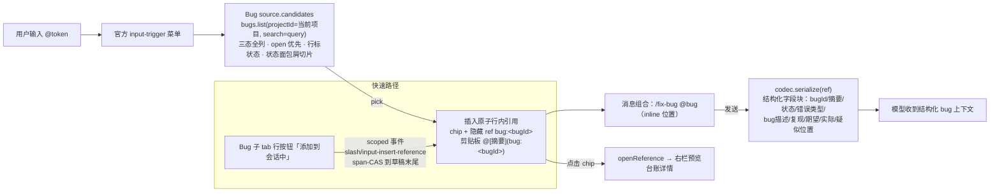

# 提案：会话 @ 补全菜单 Bug 引用组

## 问题

Bug 台账（fix-bug 域）目前只有一个查找入口：Overview 的 Bug 子 tab。在会话里想提到某个 bug（典型用法 `/fix-bug @某bug`），只能人肉到 Bug 子 tab 搜出条目、拷 bugId 再贴进消息——引用断链、模型拿不到结构化上下文。

证据：`forge:bugs/list` RPC 已通（服务端 search/status/sort），BugCard 为单表行全量投影；官方 @ 补全是公开可扩展缝（`ctx.inputTriggers.registerSource`，`dsh-client-ui-reference` 的 @文件/@会话 即注册上去的 source）。缝都在，只缺产品注册行。

## 方案

目标形态：@ 补全菜单新增 **Bug 组**——与 @文件/@会话 同构的第三个候选组。



行为约束：

- **候选 = 当前会话所属项目的 bug**（projectId 限定；项目的解析沿用现有会话↔项目绑定事实，不新设绑定机制）。
- **候选行语言（与文件/会话组的区分面）**：独立组标题行（source name，唯一性由注册口 duplicate throw 硬守卫）+ bug 专属行图标（契约 icon 组件位）+ 行内四件套——name = bugId（id 直搜键）/ label = 摘要（搜索主键）/ description = 状态·错误类型 / hint = 登记相对时间；台账行为叶子节点 pick 即插入。
- **快速过滤**：主路径 = 摘要关键词，查询串服务端透传 `bugs.list.search`（summary 匹配，非前端全量筛）——用户按内容找 bug，uuid 主键不需被记忆（不引入短号，2026-10-14 裁决；如后续口头/文档引用需求变真再单独提案扩 core）；辅路径 = bugId 前缀（照着 Bug 子 tab/预览显示的 id 敲，查询同打 name）。候选组上方发布**状态面包屑**（全部/open/fixed/unresolved，官方 header crumb + drill 缝）——默认「全部 + open 优先」，点击 crumb 切换 `status` 入参取数口径；与文件组 drill 的语义区分 = 目录下钻 vs 状态切片。
- **喂模型内容结构化**：serialize 输出键值明确的字段块（字段边界清晰），非自然语言段落；字段集 = bugId/summary/bugStatus/errorType/bugDesc/triggerDesc/expected/actual/suspected（不含证据/人员/会话 id）。
- **喂模型内容示例**（serialize 对一个引用出现处的输出示意；字段名 = BugCard 投影键，可空字段缺席不出键）：

  ```text
  <bug bugId="b-42">
    summary: 修复后段一目录选取双开对话框
    bugStatus: open
    errorType: concurrency
    bugDesc: NativePick 在途态守卫缺失，双击「浏览…」连开两个系统对话框。
    triggerDesc: 段一表单点「浏览…」，对话框在途时再次快速单击同钮。
    expected: 在途态内后续单击被吞，恒至多一个对话框。
    actual: 连开两个对话框，后开者选中结果覆盖先开者。
    suspected: apps/web/src/flows/add-project/browser-actions.ts:120
  </bug>
  ```
- **快速路径：Bug 子 tab 行「添加到会话中」按钮**：点击把该 bug 的**同一原子引用**（同 hidden ref、同 serializer 路由）插入当前会话 composer 草稿末尾——官方 scoped 事件 `slash/input-insert-reference`（契约内业务包变更动词，span-CAS 基于 `InputState.draftRev`）+ `SessionInput.focus()` 还焦；效果等同手输 @ 选中，仅省菜单步骤。**无活跃会话时经既有 open-session 编排器打开新会话，首条草稿预填该 bug 引用**（缝为产品自建编排器，非官方缺缝）。不引入 bug 短号（2026-10-14 二审裁决：uuid 主键零记忆负担，按钮解决入口问题）。
- **与 slash 命令组合**：@ bug 引用走 inline token 位置，`/fix-bug @bug` 一行成句。
- 官方件复用零自绘：菜单/原子引用/预览右栏全走官方缝（input-trigger source 契约 + openReference + 右栏 pane），产品只写 source 本体与预览内容件。
- **与既有 @ 功能共存约束**（契约核验 2026-10-14）：① source 对 `quoted=true`（`@"` 带空格路径态）一律返回空候选——引号态是文件路径专属语义；② 不实现 lexicon——引用只以原子 chip 形态存在，避免 `@<name>` 纯文本装饰与文件路径 token 撞车；③ serialize 在 pick 时缓存 BugCard 快照、发送时快照优先——规避官方「serialize 失败阻断发送」语义在 bug 已 resolve、查询落空时的误伤。

跨模块交互面：产品 client-plugin（浏览器）↔ forge `bugs.list` RPC（已有，零后端改动）↔ 官方 input-trigger / conversation / sidebar-right 服务面；无 DB 变更、无 core/host 改动。

## 改动范围

- `apps/web/src/client-plugin/`——新增 bug 引用 source 模块（纯模型 + 注册行）：
  - source 注册（candidates/onPick/codec/openReference），plugin.ts 登记行；
  - 结构化 serialize 编解码 + 剪贴板投影；
  - 右栏 bug 详情预览件（复用 BugCard 全量投影渲染）。
- `apps/web/src/views/overview/bug-tab/`——Bug 子 tab 列表行增「添加到会话中」按钮：有活跃会话经 scoped 事件 `slash/input-insert-reference`（span-CAS）向草稿末尾插入原子引用 + 还焦；无活跃会话经既有 open-session 编排器开新会话并预填该引用。
- `apps/web/src/client-plugin/plugin.test.ts`——注册行 pin 与 source 契约测试；bug-tab 行按钮测试。

排除边界：无 core/host/packages 改动；无新增 RPC 通道；不引入 bug 短号；recordBug/resolveBug 写动词不涉本提案；Slash 命令本身（/fix-bug）不改动。

## 影响范围

- 用户可感知：@ 菜单多一组 Bug 候选（状态面包屑可切片）；选中插入原子 chip；发送后模型获得结构化 bug 上下文；点击 chip 右栏预览；Bug 子 tab 行一键把引用送进当前会话。
- 不受影响：既有 @文件/@会话 组（新组独立 name，duplicate 触发即抛由官方管线守卫）；Bug 子 tab 原有行语言与证据区（按钮为纯增行内控件）；fix-bug 工具链。
- fail-soft 口径沿产品插件既有先例：`bugs.list` 或 inputTriggers 服务缺席时 Bug 组静默不出行，其余组不受累。

## 验收

1. 会话输入 `@` + 摘要关键词，菜单出现 Bug 组候选，仅含当前项目条目，open 优先排序且行标状态；搜索命中 summary（服务端 search 透传）；照台账显示敲 bugId 前缀可辅助定位对应条目。
2. Bug 组上方呈现状态面包屑（全部/open/fixed/unresolved）；默认「全部」态下 open 优先；点击状态 crumb 后候选切换为该状态子集（`bugs.list` status 入参变化），查询继续生效。
3. 选中候选，composer 插入原子行内引用 chip；复制该引用得到 `@[摘要](bug:<bugId>)`（粘贴回 composer 为纯文本——官方 paste 语义，降级不损坏）。
4. 发送含 bug 引用的消息，模型可见内容为该 bug 的结构化字段块，含九字段且键名明确；字段值与台账行一致。
5. `/fix-bug @bug` 组合可行：@ token 在 slash 命令后的 inline 位置正常触发菜单与插入。
6. 点击消息中的 bug chip，右栏呈现该 bug 台账详情（五字段 + 状态 + 证据区按 fixed/unresolved 分支）。
7. `bugs.list` 不可用或项目未绑定时：Bug 组不出现、不报错、其余候选组正常。
8. `@"` 引号路径态下 Bug 组零候选；bug 引用在 bug 已 resolve 后仍可发送（serialize 走 pick 时快照，不阻断发送）。
9. Bug 子 tab 行点「添加到会话中」：有活跃会话时该会话 composer 草稿末尾出现该 bug 的原子 chip（与 @ 菜单 pick 产物同构，发送走同一 serialize），焦点回 composer；无活跃会话时打开新会话且首条草稿预填该 bug 引用。

## 一致性检查

- 验收 1←候选组+快速过滤；2←状态面包屑；3←原子引用；4←结构化 serialize；5←inline 组合；6←预览面；7←fail-soft；8←quoted 规避+快照缓解；9←按钮快速路径。每条验收均有纳入项承接，无互相矛盾条目。
