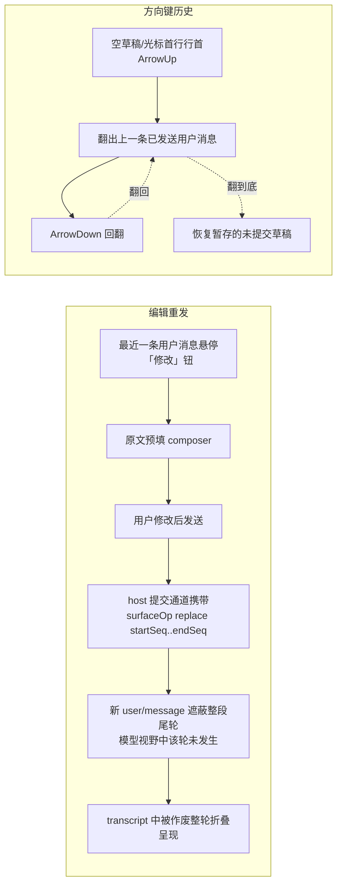
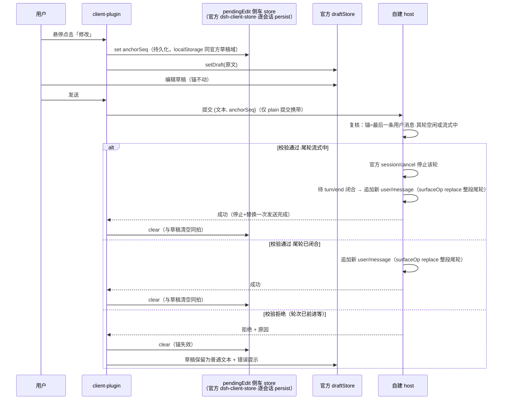

# 输入纠错与复用：编辑重发 + 方向键历史

```yaml
created: 2026-02-14
author: panda
status: Accepted
intent: new-feature
mode: blitz
```

## 需求

聊天 composer 缺两块基础纠错能力（本 GUI 实测 + 官方包核实）：

1. **已发送消息无法撤回/修改**。官方 `dsh-session` 日志 append-only，`session/prompt` RPC 不透传作废语义；唯一近邻是 QueueDock 的排队消息 Edit/Remove（仅限未被模型消费的消息）。用户发错内容后没有纠错路径。
2. **无输入历史翻阅**。官方 `dsh-client-ui-conversation` composer（Lexical）没有方向键翻阅历史输入的能力，重复/近似输入需每次重打。

## 方案



**编辑重发**：最近一条用户消息悬停出现「修改」动作（空闲或流式响应中均可；消息仍在队列未被消费时走官方 QueueDock Edit/Remove）；点击后原文进 composer 预填；发送时：

- **尾轮已闭合（空闲）**：新 `user/message` 携带 `surfaceOp: replace (startSeq..endSeq)`，作废范围 = 该消息所在整段尾轮（含其触发的助手回复）——模型从下一轮起如同该轮未发生。
- **尾轮流式响应中**（用户裁决追补）：host 先经官方 `session/cancel` 停止该轮，待其落 `turn/end` 闭合后，同径追加携带 replace 的新消息作废整轮——「停掉 + 替代」一次发送原子完成；取消与追加之间由 host 单点编排，客户端不竞速。

append-only 日志保留原文；UI 上被作废的整轮消息折叠呈现（可展开查看）。

**方向键历史**：当前会话内已发送用户消息文本按发送序构成历史；readline 习惯——仅当草稿为空或光标在首行行首时 ArrowUp 翻上一条，ArrowDown 回翻，翻历史前的未提交草稿暂存并在翻回时恢复。会话切换即切换历史源。

**术语定义**：
- 作废（void）= surface replace 遮蔽：事件保留于日志与模型视野之外，非删除。
- 尾轮（trailing turn）= 最后一条用户消息所归属的完整轮次（该消息 + 其触发的全部助手回复与工具事件区间）。

### 编辑重发时序（锚点生命周期）



持久化裁决（用户裁决）：anchorSeq 不驻内存——与官方草稿同款机械（`dsh-client-store` `defineStore({ persist, scopeKey: sessionId })`）持久化到 localStorage，与官方草稿同域同粒度、同拍清除；进程重启后草稿与锚一起恢复，host 复核仍是唯一闸门（复核不过 = 宁可不作废，不可错作废）。

### 跨模块交互面

| 交互面 | 参与方 | 边界 |
|---|---|---|
| composer 草稿读写 + 键位 | client-plugin ↔ 官方 conversation 服务 | 官方 keymap 已保留 Enter 族之外按键；ArrowUp/Down 经应用快捷键缝接入 |
| 作废提交通道 | web client ↔ 自建 host | 官方 `session/prompt` RPC 不透传 surfaceOp；host 层补一条窄面（在作废区间起点处携带 replace 标记的提交），通道形态采用官方 `dsh-typert`（FaceModel → host/remote-client 双面生成，与官方 RPC 同构） |
| 锚点持久化 | client-plugin ↔ 官方 dsh-client-store | 侧车 store（persist + scopeKey=sessionId）与官方草稿同域同拍，重启同恢复 |
| transcript 折叠呈现 | client-plugin ↔ 官方 Chat 渲染 | 作废轮折叠为摘要行，展开保留原文 |
| 流式停止 | host ↔ 官方 session/cancel | 被修改消息流式中：host 先 cancel 停轮、待 turn/end 后再 replace——取消与追加在 host 单点编排，客户端不竞速 |
| 排队消息编辑 | 官方 QueueDock | 已有 Edit/Remove/Steer，本提案不触碰 |

## UI Mockup

涉及 UI 改造共三处：①用户消息行悬停动作；②transcript 被作废整轮的折叠态；③方向键翻历史的草稿态（无新增可见元素，仅草稿内容变化）。

### ① 最近一条用户消息悬停「修改」（空闲或流式中）

```text
┌─ transcript ──────────────────────────────────────────┐
│  (历史轮次…)                                           │
│                                                        │
│  ┌ 用户 · 你 ──────────────────────── [✏️ 修改] ──┐    │
│  │ 帮我重构 apps/web/src/client-plugin/plugin.ts  │    │
│  └────────────────────────────────────────────────┘    │
│  ┌ 助手 ┐                                               │
│  │ 好的，我先读取该文件…（回复正文）              │    │
│  └──────┘                                              │
├─ composer ────────────────────────────────────────────┤
│  [输入框…（空）                          ] [发送] │
└────────────────────────────────────────────────────────┘
   悬停出现动作钮；非最近消息不出现；流式响应中同样可用；消息仍在队列时走官方 QueueDock
```

### ② 发送替换后：被作废整轮折叠（可展开）

```text
┌─ transcript ──────────────────────────────────────────┐
│  (历史轮次…)                                           │
│                                                        │
│  ▸ 已作废（1 轮）                                      │  ← 点击展开原文
│                                                        │
│  ┌ 用户 · 你 ─────────────────────────────────┐       │
│  │ 帮我重构 client-plugin 下的 plugin.ts，只保留 │       │
│  │ composer 相关接线（修改后新消息）            │       │
│  └─────────────────────────────────────────────┘       │
│  ┌ 助手 ┐                                               │
│  │ （对新消息的回复…）                            │    │
│  └──────┘                                              │
└────────────────────────────────────────────────────────┘
   展开态：原用户消息 + 原助手回复按原文只读呈现
```

可交互 HTML mockup（折叠/展开切换、hover、令牌全对齐 DESIGN.md）：[mockup/voided-style.html](mockup/voided-style.html)（浏览器打开；样式要点——折叠行 Caption 级 tertiary 纯文字 + hover 淡底，展开块整层 60% 透明度、行结构复用官方 Chat 形态、零删除线）。

### ③ 方向键历史（readline 习惯，无新增控件）

```text
  空草稿 + ArrowUp          再按 ArrowUp            ArrowDown 回翻到底
┌───────────────────┐   ┌───────────────────┐   ┌───────────────────┐
│ 跑一下测试 ▏      │   │ 先读一下 AGENTS ▏ │   │ (恢复暂存草稿) ▏  │
└───────────────────┘   └───────────────────┘   └───────────────────┘
  草稿 = 上一条已发送      再上一条                 翻阅前的未提交草稿
```

## 改动影响范围

```text
apps/web/src/client-plugin/     ← 编辑重发编排 + 方向键历史（client 侧全部）
apps/host/src/ipc/              ← 作废提交通道窄面 + host 复核（单点闸门）
官方包（@deepseek-ai/*）        ← 零改动，只消费其机械与缝
```

### 改动点清单（file 粒度）

| 层 | 位置 | 改动 | 性质 |
|---|---|---|---|
| client-plugin | `apps/web/src/client-plugin/edit-resend.ts`（新） | 锚点编排：悬停动作接线、pendingEdit 侧车 store（官方 dsh-client-store persist 机械）、提交携带 anchorSeq、失败恢复 | 新增 |
| client-plugin | `apps/web/src/client-plugin/input-history.ts`（新） | 会话内历史源（订阅 user/message 事件）、readline 键位判定（空草稿/首行行首）、草稿暂存恢复 | 新增 |
| client-plugin | `apps/web/src/client-plugin/plugin.ts`（改） | 装配接线：两项特性挂入既有插件域；快捷键注册走官方缝 | 修改 |
| transcript 呈现 | client-plugin 内新模块 | ①用户消息行「修改」动作注入；②被作废整轮折叠行——两处注入点须先核销官方 Chat 留出的合法缝（槽位影子/inject face），无合法缝则回到 tech-design 重议呈现方案 | 新增 |
| host | `apps/host/src/ipc/edit-resend-rpc.ts`（新，命名裁决：名词域-rpc 对齐仓内 11 个兄弟通道 + client 侧 edit-resend.ts 对称） | 作废提交通道窄面：接收 {文本, anchorSeq}，复核（锚=最后一条用户消息·其轮空闲或流式中·区间完整），流式中先经官方 `session/cancel` 停止并待 `turn/end` 闭合，组装 surfaceOp replace 交官方 session 机械追加；**通道形态 = 官方 `dsh-typert`**（FaceModel 声明 face `editResend` + method `submit`，id 形如 `dsh-forge#editResend/submit`——face 名词/method camelCase 动词对齐官方 `#session/fork` 同构；typert.host 生成 host 面 / typert.remote-client 生成 client 面，schema 校验由 typert 机械承担）。注：本仓 apps/host 现有通道均 ForgeIpc+rpcEnvelope，此为首例 typert 通道（用户裁决 2026-02-14） | 新增 |
| host | `apps/host/src/ipc/bindings.ts` / `forge-channels.ts`（改） | 新通道注册 wiring | 修改 |
| 官方机械消费 | 不落盘改动 | `dsh-client-store`（persist 侧车）、`dsh-session` surface（replace 语义）、官方 keymap/快捷键缝——import 消费，零 vendor 零改制 | 只读 |

### 影响点与边界

- **承重假设待核销**（落 tech-design 首项）：官方 Chat 用户消息行动作注入缝、transcript 折叠渲染缝是否存在且合法——这是唯一可能反噬呈现方案的点。
- **不触碰**：官方 QueueDock（排队编辑走官方原生）、fork 链路、会话日志单写者路径（新消息仍经官方追加机械，本提案不直写日志）。
- **排除项**：跨会话全局历史；非最近消息作废；原地改写日志；批量作废。
- **非介入面零差异**：不点「修改」、不用方向键时，composer 与 transcript 行为与现状逐位一致（分流装配期，不挂运行时判断税）。

## 验收

1. 最近一条用户消息悬停出现「修改」钮（空闲与流式响应中均可）；点击后 composer 预填原文。
2. 修改后发送：新消息进入对话；被作废的整段尾轮（原消息 + 其回复）在 transcript 中折叠，可展开查看原文；模型后续请求不含被作废区间（surface 投影核实）。
3. 被修改消息正处于流式响应时，发送替代消息的同时停止该轮——停止与替换一次发送原子完成（host 单点编排），流式输出中止、整轮折叠、新消息进入对话。
4. 排队中的消息仍走官方 QueueDock Edit/Remove，两路互不干扰。
5. 空草稿或光标在首行行首时 ArrowUp 依次翻出本会话此前已发送的用户消息；ArrowDown 回翻；翻回起点恢复翻阅前的未提交草稿；多行草稿编辑中 ArrowUp/Down 保持原生光标移动。
6. 会话切换后，历史源随会话切换（翻出的是新会话的消息）。

## 一致性检查

- 验收 1–3 ↔ 纳入项「编辑重发」（含流式停止分支）；验收 4 ↔ 排除项「排队编辑走官方」；验收 5–6 ↔ 纳入项「方向键历史」。每个纳入项均有对应验收覆盖，无互相矛盾。
- 用户裁决记录：7 条访谈裁决 + 复述审核通过；方案 A 采纳；UI 呈现更正为「整轮折叠」；追补裁决——流式响应中的被修改消息在发送替代消息时同步停止（host 经官方 session/cancel 单点编排）。
