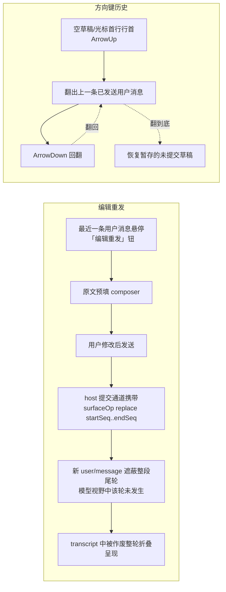

# 输入纠错与复用：编辑重发 + 方向键历史

```yaml
created: 2026-02-14
author: panda
status: Draft
intent: new-feature
mode: blitz
```

## 需求

聊天 composer 缺两块基础纠错能力（本 GUI 实测 + 官方包核实）：

1. **已发送消息无法撤回/修改**。官方 `dsh-session` 日志 append-only，`session/prompt` RPC 不透传作废语义；唯一近邻是 QueueDock 的排队消息 Edit/Remove（仅限未被模型消费的消息）。用户发错内容后没有纠错路径。
2. **无输入历史翻阅**。官方 `dsh-client-ui-conversation` composer（Lexical）没有方向键翻阅历史输入的能力，重复/近似输入需每次重打。

## 方案



**编辑重发**：会话空闲（尾轮已结束）时，最近一条用户消息悬停出现「编辑重发」动作；点击后原文进 composer 预填；发送时新 `user/message` 携带 `surfaceOp: replace (startSeq..endSeq)`，作废范围 = 该消息所在整段尾轮（含其触发的助手回复）——模型从下一轮起如同该轮未发生；append-only 日志保留原文。UI 上被作废的整轮消息折叠呈现（可展开查看）。

**方向键历史**：当前会话内已发送用户消息文本按发送序构成历史；readline 习惯——仅当草稿为空或光标在首行行首时 ArrowUp 翻上一条，ArrowDown 回翻，翻历史前的未提交草稿暂存并在翻回时恢复。会话切换即切换历史源。

**术语定义**：
- 作废（void）= surface replace 遮蔽：事件保留于日志与模型视野之外，非删除。
- 尾轮（trailing turn）= 最后一条用户消息所归属的完整轮次（该消息 + 其触发的全部助手回复与工具事件区间）。

### 跨模块交互面

| 交互面 | 参与方 | 边界 |
|---|---|---|
| composer 草稿读写 + 键位 | client-plugin ↔ 官方 conversation 服务 | 官方 keymap 已保留 Enter 族之外按键；ArrowUp/Down 经应用快捷键缝接入 |
| 作废提交通道 | web client ↔ 自建 host | 官方 `session/prompt` RPC 不透传 surfaceOp；host 层补一条窄面（在作废区间起点处携带 replace 标记的提交） |
| transcript 折叠呈现 | client-plugin ↔ 官方 Chat 渲染 | 作废轮折叠为摘要行，展开保留原文 |
| 排队消息编辑 | 官方 QueueDock | 已有 Edit/Remove/Steer，本提案不触碰 |

## UI Mockup

涉及 UI 改造共三处：①用户消息行悬停动作；②transcript 被作废整轮的折叠态；③方向键翻历史的草稿态（无新增可见元素，仅草稿内容变化）。

### ① 最近一条用户消息悬停「编辑重发」（仅空闲会话）

```text
┌─ transcript ──────────────────────────────────────────┐
│  (历史轮次…)                                           │
│                                                        │
│  ┌ 用户 · 你 ──────────────────── [✏️ 编辑重发] ──┐    │
│  │ 帮我重构 apps/web/src/client-plugin/plugin.ts  │    │
│  └────────────────────────────────────────────────┘    │
│  ┌ 助手 ┐                                               │
│  │ 好的，我先读取该文件…（回复正文）              │    │
│  └──────┘                                              │
├─ composer ────────────────────────────────────────────┤
│  [输入框…（空）                          ] [发送] │
└────────────────────────────────────────────────────────┘
   悬停出现动作钮；非最近消息/运行中会话不出现
```

### ② 发送替换后：被作废整轮折叠（可展开）

```text
┌─ transcript ──────────────────────────────────────────┐
│  (历史轮次…)                                           │
│                                                        │
│  ▸ [已作废 · 本轮已由编辑重发替换] ──────────── 1 轮   │  ← 点击展开原文
│                                                        │
│  ┌ 用户 · 你 ─────────────────────────────────┐       │
│  │ 帮我重构 client-plugin 下的 plugin.ts，只保留 │       │
│  │ composer 相关接线（修改后新消息）            │       │
│  └─────────────────────────────────────────────┘       │
│  ┌ 助手 ┐                                               │
│  │ （对新消息的回复…）                            │    │
│  └──────┘                                              │
└────────────────────────────────────────────────────────┘
   展开态：原用户消息 + 原助手回复按原文只读呈现
```

### ③ 方向键历史（readline 习惯，无新增控件）

```text
  空草稿 + ArrowUp          再按 ArrowUp            ArrowDown 回翻到底
┌───────────────────┐   ┌───────────────────┐   ┌───────────────────┐
│ 跑一下测试 ▏      │   │ 先读一下 AGENTS ▏ │   │ (恢复暂存草稿) ▏  │
└───────────────────┘   └───────────────────┘   └───────────────────┘
  草稿 = 上一条已发送      再上一条                 翻阅前的未提交草稿
```

## 改动影响范围

- client-plugin 层（`apps/web/src/client-plugin/`）：编辑重发入口 + 作废提交编排 + 方向键历史（会话内历史源、键位接入、草稿暂存）。
- 自建 host 层：作废提交通道窄面（surfaceOp replace 语义组装）。
- Chat transcript 呈现：作废整轮折叠。
- 不改动官方包本体；不触碰 QueueDock；不做跨会话全局历史；不做非最近消息作废与原地改写日志。

## 验收

1. 空闲会话中，最近一条用户消息悬停出现「编辑重发」钮；点击后 composer 预填原文。
2. 修改后发送：新消息进入对话；被作废的整段尾轮（原消息 + 其回复）在 transcript 中折叠，可展开查看原文；模型后续请求不含被作废区间（surface 投影核实）。
3. 排队中的消息仍走官方 QueueDock Edit/Remove，两路互不干扰。
4. 空草稿或光标在首行行首时 ArrowUp 依次翻出本会话此前已发送的用户消息；ArrowDown 回翻；翻回起点恢复翻阅前的未提交草稿；多行草稿编辑中 ArrowUp/Down 保持原生光标移动。
5. 会话切换后，历史源随会话切换（翻出的是新会话的消息）。

## 一致性检查

- 验收 1–2 ↔ 纳入项「编辑重发」；验收 3 ↔ 排除项「排队编辑走官方」；验收 4–5 ↔ 纳入项「方向键历史」。每个纳入项均有对应验收覆盖，无互相矛盾。
- 用户裁决记录：7 条访谈裁决 + 复述审核通过；方案 A 采纳；UI 呈现更正为「整轮折叠」。
