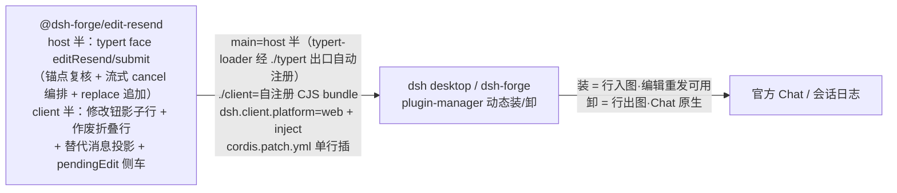

# edit-resend 独立插件：编辑重发与作废折叠可动态安装（双插件拆分·第二份）

```yaml
created: 2026-10-20
author: faner
status: Draft
intent: enhancement
mode: blitz
```

## 需求

编辑重发（含作废折叠呈现）现以 dsh-forge 仓内硬接线交付且默认禁用（features 常量），装不进官方 dsh desktop。需求（用户裁决 2026-10-19/20，双插件拆分的**后实现份**，依赖第一份 `composer-input-history-plugin` 建立的装载范式）：

1. 建为独立插件包 `@dsh-forge/edit-resend`，可经 plugin-manager 动态装/卸进 dsh desktop——装/卸即功能开关（替代现行「默认禁用」常量语义：不装 = 禁用）。
2. 与 input-history 插件零依赖、可独立装卸；双装互不干扰。

## 方案



- **host 面五缝判例直用**（参考分支 `composer-correction` 已真机核销结论，代码按本包结构重落）：`./typert` 包出口（string default 形态）、descriptor session lookup 正门、`bindTypertRemote` 可见绑定、replace 端点 = 区间内最后 surface 节点、经官方 Session.append 追加。
- **client 半**：keyed 槽影子（user 键 priority -1 影子官方 0 级——lowest renders 语义）、fiber 级单例登记、折叠行/替代消息定义、渲染组件随包（react/官方 ui 种子表外置）。
- **装载范式复用**：client bundle 官方配方（自注册 CJS + 种子表外置 + 间接 eval 四断言守卫）、dsh 清单、cordis.patch.yml——由第一份提案建立，本包按范式落地。
- **开关退役（本包范围）**：features 常量/env 覆写缝/页内 global/config 门控中 editResend 相关全量移除；dsh-forge 壳缺省**不装**本包（对齐现状「edit-resend 默认禁用」语义）。
- **共享逻辑内联**：user/message 判定、eventSource 适配各包自持（与 input-history 包重复几十行，零包间依赖裁决）。
- **真机验证循环**同第一份（annotutor 手册配方）。

### 跨模块交互面

| 交互面 | 参与方 | 边界 |
|---|---|---|
| 插件装卸 | 本包 ↔ dsh desktop / dsh-forge plugin-manager | CLI add/remove + bundles 对账 |
| host 面装配 | 本包 ↔ typert-loader / Typert Gateway | `./typert` 出口自动注册；服务挂 bindTypertRemote（五缝判例） |
| 会话日志追加 | host 半 ↔ 官方 Session.append | surfaceOp replace 整段尾轮；append-only 单写者纪律不破 |
| client 面渲染 | 折叠行/修改钮 ↔ 官方 Chat keyed 槽 | priority -1 影子；fiber 单例登记（多会话撞车判例） |
| 双包并存 | 本包 ↔ input-history 插件 | 零依赖零交互面；双装组合 e2e 取证 |

## 改动影响范围

```text
packages/plugins/edit-resend/       ← 新包（host 面 + client 面 + 打包脚本 + 守卫测试 + dsh 清单 + cordis.patch.yml）
apps/web/src/client-plugin/ 等     ← edit-resend 相关 wiring/features 痕迹清理（硬接线退役）
apps/host/src/boot/                ← composer-correction 注行门/features config 痕迹清理
e2e/specs/blitz/edit-resend*.spec.ts ← 按包 spec（播种代位全径沿参考分支配方）+ 装卸真机取证 + 双装组合
```

- **纳入**：本包全量交付物、dsh-forge 侧 edit-resend 痕迹清理、按包 e2e（含双装组合）、上游缺口留痕迁移（bug a0fcfb78 助手回复遮蔽——诉求与建议帖文案随本包延续）。
- **排除**：input-history 插件（第一份提案）；npm 公发；运行时设置面开关；助手回复遮蔽的客户端实现（上游 `processGroupDefinition` 导出前不可达，维持留痕）。

## 参考

**参考实现**：未合入分支 `composer-correction`（host 面五缝判例 + keyed 影子/折叠呈现配方）。

**annotutor 文档**（`Z:\project\dsh\annotutor\docs`，装载/验证判例基准——dsh 升级时复核）：lessons 双 gotcha（激活链逐环真机重验 / client bundle 自注册 CJS 契约）+ reference 真机验证手册（add→boot→探针配方）——条目同第一份提案所列目录。

**本仓经验目录**（`docs/lessons/`——仅立目录与概要，条目随实现增补，不预写内容；本包预期沉淀：host 面五缝判例文档化、装卸组合验证经验）。

## 验收

1. 本包经 plugin-manager CLI `add link:` 安装进官方 dsh desktop profile，boot 零 `did not activate` 告警且 typert host 面可达（探针：gateway 路由 401/调用链通）；`remove` 卸载后修改钮消失、Chat 原生。
2. 装载态真机（播种代位零真实模型，沿参考分支 e2e 配方）：修改钮悬停可见、预填 + 锚持久化、发送作废整轮（replace 落盘 + 用户消息退出投影 + 折叠行呈现 + 新消息入列）。
3. 流式停替编排逻辑单测覆盖（复核→cancel→待 turn/end→二次复核→replace）；真机全项归人工核对清单（沿参考分支留痕口径）。
4. 与 input-history 插件双装：互不干扰（双装组合 e2e 取证）；各自独立装卸零牵连。
5. dsh-forge 壳缺省不装本包（默认禁用语义保持）；editResend 开关痕迹零残留。
6. client bundle 守卫测试四断言全绿。

## 一致性检查

- 验收 1 ↔ 装卸取证 + host 面判例复用；2 ↔ 核心功能（沿参考分支已真机验证配方）；3 ↔ 流式编排（人工核对口径延续）；4 ↔ 双包独立性裁决；5 ↔ 缺省不装 + 开关退役；6 ↔ 装载范式复用。每条验收有纳入项对应，无互相矛盾。
- 用户裁决记录：同双插件拆分系列（根本需求 + 8 项分支裁决 + 逐个实现、input-history 先行）+ 本包特定：缺省不装 = 默认禁用语义、上游缺口留痕随包延续。
- 依赖关系：本提案在 `composer-input-history-plugin` 建立装载范式后实施。
