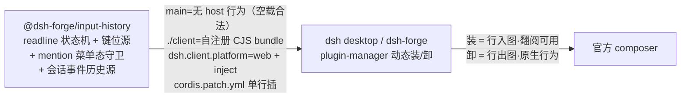

# input-history 独立插件：方向键输入历史可动态安装（双插件拆分·第一份）

```yaml
created: 2026-10-20
author: faner
status: Draft
intent: enhancement
mode: blitz
```

## 需求

输入历史功能现仅存在于**未合入分支 `composer-correction`**（apps/web 壳内硬接线 wiring + features 开关形态；main 基线经 git grep 核实零痕迹——评审 2026-10-20），该形态装不进官方 dsh desktop。需求（用户裁决 2026-10-19/20，双插件拆分的**先实现份**）：

1. 建为独立插件包 `@dsh-forge/input-history`，**可经 plugin-manager 动态装/卸进 dsh desktop**——装/卸即功能开关。
2. 本包为**纯 client 包**（无 host 行为），并承担**首次建立双面包装载范式**：client bundle 官方配方、dsh 清单、dsh-forge 壳装载径切换——为后续 edit-resend 插件（第二份提案）铺路。
3. 基线 = main 拉新分支；未合入分支 `composer-correction` 作参考实现（判例来源；归宿用户自理）。

## 方案



- **client 半完整 cordis 插件（含组合 apply）**——直接跨过 annotutor 未竟遗留（DI 库件无 apply → 真机 `invalid plugin`）。
- **client bundle 装载契约**（annotutor gotcha#2 判例，官方 `tsdown.client.ts` 配方基准）：classic script 自注册 CJS（`__ModuleLoader__.load` 头尾包裹）；react/cordis/ui 基线经装载器种子表外置（react 永不内联）；种子表外依赖内联；间接 eval 四断言守卫测试。
- **壳装载径（本包范围）**：dsh-forge 壳不引入硬接线 wiring/features 开关（main 基线本无既有痕迹，参考分支的 wiring 形态不随本包合入），改**官方装载器**入图（boot.ts `__ModuleLoader__` 同机制；不可复用回退壳内薄适配）。
- **tech-design 首项核销**：① 官方装载器可否直接复用（不可则壳内薄适配）；② desktop 组合是否注入 sessions/binding 事件缝——`binding.eventSource` 在插件 client 面的获取径（参考分支系宿主 wiring 注入，插件化后须独立核销）。
- **事件历史源**：binding.eventSource 解包适配内联本包（参考分支判例）。
- **真机验证循环**（annotutor 手册配方）：构建 → `plugin --profile web add link:<path> --store-dir …` → boot 读告警 → 探针——修一环必须真机重验。

### 跨模块交互面

| 交互面 | 参与方 | 边界 |
|---|---|---|
| 插件装卸 | 本包 ↔ dsh desktop / dsh-forge plugin-manager | CLI add/remove + bundles 对账；装卸动线入 e2e 取证（desktop 侧动态装/卸；dsh-forge 壳侧缺省固定装载——两侧「装/卸即开关」语义不同，e2e 口径分别取证） |
| client bundle 装载 | `./client` ↔ 官方 dsh-client-modules | classic script 自注册 CJS；种子表外置平台基线 |
| dsh-forge 壳装载 | 本包 ↔ apps/web boot.ts | `__ModuleLoader__` 入图同机制；缺省装本包（对齐现状默认态） |
| 会话事件消费 | client 面 ↔ binding.eventSource | 包内解包适配（参考分支判例） |

## 改动影响范围

```text
packages/plugins/input-history/     ← 新包（client 面 + 键位/守卫/历史源逻辑 + 打包脚本 + 守卫测试 + dsh 清单 + cordis.patch.yml）
apps/web/src/shell/boot.ts 等      ← 装载径切换（官方装载器入图；缺省装本包）
e2e/specs/blitz/input-history*.spec.ts ← 按包 spec + plugin-manager CLI 真机装卸取证
```

- **纳入**：本包全量交付物、装载范式首建（bundle 配方脚本/守卫/dsh 清单——后续插件复用）、dsh-forge 壳装载径切换（官方装载器入图、缺省装本包，不引入硬接线 wiring/开关门控）、按包 e2e + 装卸真机取证。
- **排除**：edit-resend 包（第二份提案 `composer-edit-resend-plugin`）；npm 公发（另起提案）；运行时设置面开关；annotutor 自身遗留。

## 参考

**参考实现**：未合入分支 `composer-correction`（判例来源，非代码基线）。

**annotutor 文档**（`Z:\project\dsh\annotutor\docs`，装载/验证判例基准——dsh 升级时复核）：

```text
docs/
├─ lessons/
│  ├─ gotcha-dsh-plugin-host-activation-chain.md   # 「1 entry did not activate」只暴露链上第一环——修一环必须真机重验
│  └─ gotcha-web-boot-loaded-without-registering.md # client bundle 装载契约（自注册 CJS/种子表/react 永不内联）
└─ reference/
   └─ dsh-real-host-verification.md               # 真机验证手册（add→boot→探针配方、错误判读表）
```

**本仓经验目录**（`docs/lessons/`——仅立目录与概要，条目随实现增补，不预写内容）：

```text
docs/lessons/
└─ （双插件装载/装卸验证经验——实现期按 gotcha 逐条沉淀，命名沿 annotutor gotcha-* 惯例）
```

## 验收

1. 本包经 plugin-manager CLI `add link:` 安装进官方 dsh desktop profile，boot 零 `did not activate` 告警；`remove` 卸载后翻阅功能消失、composer 原生行为不变（装卸真机取证）。
2. 装载态真机：空草稿/行首 ArrowUp 依次翻出本会话已发送用户消息、ArrowDown 回翻、恢复暂存草稿、多行草稿原生光标、会话切换切源。
3. mention 菜单开时（/ 或 @ 唤醒）方向键归菜单不抢键（真机）。
4. dsh-forge 壳（新分支）：缺省装载本包即历史功能可用；壳内无 inputHistory 开关门控、无硬接线 wiring 引入（参考分支 wiring 形态不随包合入）。
5. client bundle 守卫测试四断言全绿（自注册/种子 require 物化/ESM 语句禁入/react 无副本）。

## 一致性检查

- 验收 1 ↔ 装卸取证纳入项（desktop 动态与壳缺省两侧口径分列）；2/3 ↔ 本包功能交付（readline + 守卫——沿参考分支既有真机判例口径）；4 ↔ 装载径切换（壳不引入硬接线/开关）；5 ↔ bundle 契约守卫。每条验收有纳入项对应，无互相矛盾。
- 用户裁决记录：双包独立动态装（根本需求）+ 分支裁决（组件随包/本地安装先行/复用官方装载器/共享逻辑各自内联/缺省装本包/e2e 按包拆+装卸取证/一步到位包内交付）+ **逐个实现、本包先行**（2026-10-20 追补）+ 基线变更（main 起新分支、旧分支用户自删）。
