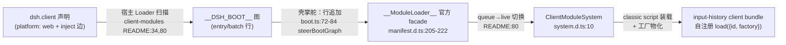
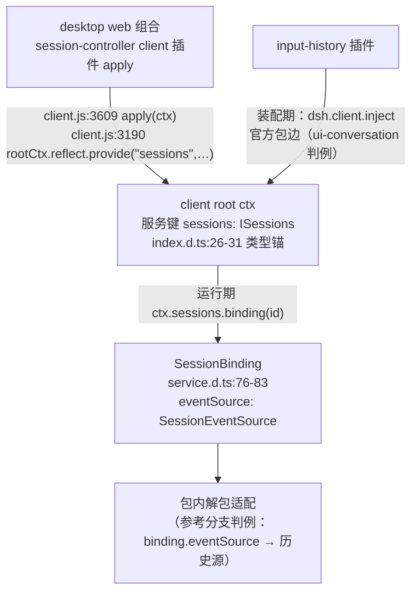

# tech-design 首项核销：装载器复用径 + desktop sessions/binding 注入缝

```yaml
created: 2026-10-20
status: Verified
source: proposal.md:30 tech-design 首项核销
evidence: logs/composer-input-history-plugin/1.1/001-loader-binding-verify/evidence.md
```

官方包本地基线 = node_modules 发布产物（`0.2.0-rc.2` 系）；官方仓源码无本地 checkout，官方源码证据以发布包内 `lib/`（dist JS + .d.ts）文件:行号锚定。

## 核销结论总览

| # | 议题 | 裁定 |
|---|---|---|
| ① | 官方 `__ModuleLoader__` 装载器可否直接复用于 dsh-forge 壳装载径 | **直接复用**（壳内零装载器适配；唯一缝 = 既有 `steerBootGraph` boot-graph 行追加） |
| ② | desktop web 组合是否把 sessions 注入动态安装插件的 ctx | **可行**——服务键 `sessions`，由 session-controller client 插件 `apply` 在 client root ctx 提供；插件经 `dsh.client.inject` 官方包 + `ctx.sessions.binding(id).eventSource` 获取 |
| N2 | `tsdown.client.ts` 配方对照 | **判例配方核销成立**（官方发布产物逐位形状与 annotutor 判例配方逐条对齐，零漂移）；配方源文件本体对照留探针（见下） |

## ① 装载器复用径：直接复用，无需壳内薄适配



**官方证据**：

- 页面级注册面契约：`@deepseek-ai/dsh-client-modules/lib/types/client/manifest.d.ts:205-222`——`ClientModuleLoaderTarget`（`mode: 'queue' | 'live'` + `load(registration)` + `create(options)`）即 `window.__ModuleLoader__`；`DshWindow.__DSH_BOOT__`（:217-222）同面。
- 自注册契约：manifest.d.ts:176-188——`ClientBundleRegistration`（`{id, factory: (require) => …}`）；:9-16——lazy CJS 模型「执行 bundle 仅注册工厂，模块体副作用在物化时运行」。
- 装载器本体：`lib/types/client/system.d.ts:10`——`ClientModuleSystem implements ClientModuleLoader`；HTML bootstrap 队列态由 `create()` 切 live（client-modules `README.md:80`）。
- dsh-forge 壳即官方机械消费方：`apps/web/src/shell/boot.ts:72-84`（`steerBootGraph` 向 `__DSH_BOOT__` 图追加 entry/batch 行）、`boot.ts:102`；壳内核 `packages/dsh-client-web` `lib/index.js:504-512`（`AppWebEntry.run`：`__DSH_BOOT_READY__` 门后 `win.__ModuleLoader__.create({boot: win.__DSH_BOOT__, …})` 建 ClientModuleSystem）。

**裁定**：直接复用。装载器（facade + ClientModuleSystem）为页面级官方单例，壳与插件都不建、不包、不改形；input-history 的壳装载 = 按 `ProductClientEntry` 同形状（id/url/rev/inject/immediately）追加一条 boot-graph 行——这正是既有 `steerBootGraph` 机制本身，属「boot-graph 掌舵」而非「装载器适配」。「壳内薄适配」回退方案不触发。

## ② desktop sessions/binding 注入缝：可行，服务键 `sessions`



**官方证据**：

- **服务键**：`@deepseek-ai/dsh-api-session-controller/lib/types/client/index.d.ts:26-31`——`declare module '@deepseek-ai/cordis' { interface Context { sessions: ISessions } }`（全量类型化具名服务取法成立）。
- **注入点**：`lib/client.js:3609` `apply(ctx)` → `new ClientSessions(ctx, remotes)`；`lib/client.js:3190` ClientSessions 构造内 `rootCtx.reflect.provide("sessions", this, void 0)`——提供在 **client root ctx**，故同根的动态安装插件 ctx 均可达（cordis 树寻址语义）。
- **binding/eventSource 锚点**：`lib/types/client/sessions/service.d.ts:76-83`——`SessionBinding { sessionId, session: SessionFace, eventSource: SessionEventSource, ctx }`；`:239` `ClientSessions.binding(id): SessionBinding | undefined`（不延长保留期）。`SessionEventSource = ObservableSnapshot<SessionEventWindow>`（`lib/types/client/contract/events.d.ts:63`），窗口含 durable + transient 条目（:56-61）。
- **官方消费判例（装配期注入边）**：`dsh-client-ui-conversation/package.json` `dsh.client` = `{"inject":["@deepseek-ai/dsh-api-session-controller", …], "platform":"web"}`——官方 ui 插件不直挂宿主 wiring，而是声明包级 inject 边由 Loader 排序组合；session-controller 自身声明（`dsh.client.inject: ["@deepseek-ai/dsh-api-gateway","@deepseek-ai/dsh-client-file-upload"]`）与运行期服务依赖（`client.js:3596` `inject = ["connection","fileUpload","typert","remote",…]`）由 desktop 组合常态供给。
- **参考分支差异核销**：composer-correction 系宿主 wiring 注入（硬接线）；官方正门 = 装配期 `dsh.client.inject` 包边 + 运行期 `ctx.sessions` 具名服务，两者在 desktop 组合均由官方机械保证，插件化后无需宿主参与。

**裁定**：注入缝可行且全走官方缝——插件 `package.json` 声明 `dsh.client.inject: ["@deepseek-ai/dsh-api-session-controller"]` + `platform: "web"`；client 面以 type-only import 取 `ISessions`/`SessionBinding` 类型（保留 `ctx.sessions` 类型安全，AGENTS.md §1.5 配方），运行期 `ctx.sessions.binding(id)?.eventSource` 解包适配内联本包。注意点：`binding(id)` 对未保留代返回 `undefined`，插件需 fail-soft 空态。

## N2：tsdown.client.ts 配方对照

官方仓 `packages/client/tsdown.client.ts` 源文件不在本地（profile 发布包仅含产物与 README）。改以**官方发布产物逐位形状**为对照基准（强于配方文本对照——产物即配方输出），实测 `@deepseek-ai/dsh-api-session-controller/lib/client.js`（len=144334）及同族 gateway/remotes/connection/job-controller 五包：

| annotutor 判例配方（gotcha#2） | 官方产物实测 | 对齐 |
|---|---|---|
| 头 = 注册头 + `var module = { exports: {} }; var exports = module.exports;` | HEAD 逐字符：`window.__ModuleLoader__.load({\n\tid: "…",\n\tfactory: (require) => {\n\t\tvar module = { exports: {} };\n\t\tvar exports = module.exports;` | ✓ |
| 尾 = `return module.exports; } });` | TAIL 逐字符命中（含 `//# sourceMappingURL` 尾注） | ✓ |
| `format: "cjs"`（无顶层 ESM 语句） | `import.meta` 不在场；`export{` 不在场 | ✓ |
| 种子表外依赖走 `require("…")`、react/平台基线不内联 | `require("@deepseek-ai/cordis")` / `require("@deepseek-ai/dsh-api-gateway/client")` / `require("@deepseek-ai/dsh-client-store")` 等种子词在场；`"react.element"` 不在场 | ✓ |
| classic script 自注册形状（间接 eval 四断言可验） | 形状与判例守卫四断言一一对应 | ✓ |

文档面佐证：client-modules `README.md:66-72`「Lazy-CJS model」（执行仅注册工厂/物化 memoized/require 环致命/`require.async` chunk）、`:34`（`dsh.client` 声明 → `/plugins` 下有序 bundle）、`:46`（PLATFORM_MODULES 冻结种子表）与判例配方同口径。

**结论**：判例配方 = 官方配方，零漂移；input-history 打包脚本按判例配方交付即可，附间接 eval 四断言守卫。**保留探针**（不阻塞本项）：如需对 `tsdown.client.ts` 本体逐位 diff（如官方升级引入配方变更），需官方仓 checkout 后对照——本地 `Z:\project\dsh` 无官方仓源码，属环境缺口而非证据缺口（发布产物形状已是配方输出的一手证据）。
