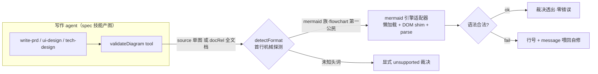

# Proposal: 文档图语法校验工具 validateDiagram——单 tool 类型分派，mermaid 全图型·flowchart 第一公民（diagram-syntax-validator）

> **定位**：spec 包工具面扩员（new-feature）。**单 tool** `validateDiagram`，内部按图类型机械分派校验函数；首引擎 = mermaid（`parse()` 一条路径覆盖其全部注册图型——flowchart/sequenceDiagram/stateDiagram-v2/erDiagram/classDiagram/gantt/pie/mindmap…），**flowchart 为第一公民**（GUI 文档 tab 渲染主型 + 本提案实证事故主型）。仅限主 agent；worker / triage 面零波及。

## Problem

2026-10-13 实证事故（main-agent-task-tools 提案评审时发现，全部经 mermaid 12.1.0 `parse()` 复现）：

- **agent 写文档带 mermaid → 源非法 → GUI 回退卡，定位成本落在人身上**。当日四处带病 fence：①`A[addTask] / SB[submitTask]`（一行双节点 `/` 分隔——非法语句，flowchart）；②③sequenceDiagram 消息文本内 `;` 是语句分隔符，截断消息致解析错 ×2；④flowchart 标签「`·` 紧邻 `@path`」组合文法不可组合（单独各自合法，组合即败——二分实证）。修复需自制脚本 + Node DOM shim + sourcemap 考古。
- **写作面无自检能力**：write-prd / ui-design / tech-design 三技能是产图大户，产出直入 `upsertFeatureDoc`，错误直到人类在 GUI 回退卡处才暴露。
- **mermaid 的 parse 错误信息质量高**（行号 + 出错上下文 + `Expecting X, got Y`），可直接喂回 agent 自修——缺的只是暴露面。

**紧迫性**：GUI 文档 tab mermaid 渲染（1.8）已运转数月，带病图随文档量线性累积（当日扫荡 66 fence 即中 4 处）。

## Solution



### ① 单 tool 面：validateDiagram（唯一新 tool）

- **入参双模**（二选一）：`source` = 单图源（fence 体，严格单枚——多图走 docRel）；`docRel` = 文档相对路径（扫全部 mermaid fence 逐枚裁决，行号 = fence 起始行）。`format?` 显式覆盖，缺省 `auto`。
- **分派是机械判断，不经 LLM**：auto = 首行头词探测（mermaid 自身 `detectType()` 的提升）。分派缝 = 引擎注册表 `Record<format, adapter>`——**tool 面终身一枚，扩展走注册表不加面**（对齐 dispatchTask 复合动词内聚、taskStats 一次八态的先例）。
- **裁决归一形状**（引擎间统一，agent 拿到即可修）：
  - source 模式：`{ ok, format, line?, message? }`
  - docRel 模式：`{ fences: [{ line, format, ok, message? }] }`
- **边界钉死**：空源/纯空白快速失败；未知头词显式 `{ ok:false, reason:'unsupported', format:'<猜测名>' }`（识别出 `@startuml` 等头词但无引擎时如实报「为何不能验」，不假失败）；残缺 mermaid 头喂 mermaid 自报「no diagram type detected」。
- **命名**：`validateDiagram`（动词+名词，对齐 `validateFeatureTasks` 先例；不名 `validateMermaid`——面已图型中立，扩展不改名）。

### ② 引擎注册表：首引擎 mermaid 适配器

- **本包新文件** `src/diagram/mermaid-engine.ts`：懒加载引擎 + DOM shim + `parse()` 归一。**结构预留多引擎缝，本期只装 mermaid**——消费面诚实：GUI 只渲染 mermaid fence，校验 GUI 不渲染的图型 = 校验产品不存在的能力；**结构预留、依赖不预支**（新引擎 = 注册表一行 + 一个适配器，契约/矩阵/技能文案零改动）。
- **懒加载纪律**（镜像 GUI `loadMermaidEngine` Hard Rule）：动态 import 是产品内该引擎唯一引用径，模块级 promise 缓存单次装载 + 单次 initialize（`startOnLoad:false` + `securityLevel:'loose'`）；**不调用零装载**，不进插件主装载径。
- **Node DOM shim**（~6 行，2026-10-13 实证）：`window = globalThis` + `Element` 桩 + `document = {nodeType:9, createElement:() => ({})}` + `addEventListener` 桩——满足 DOMPurify 模块级装配与 mermaid init 的 load 监听；Electron main 无真 window，桩设置局限适配器内一次性执行并代码注记。
- **'loose' 与 GUI 'strict' 同维论证**：strict/loose 只差标签净化（sanitizeText 径），不差语法门（parse 抛错路径同一）——66 fence 混型扫荡与 GUI 回退行为完全一致（2026-10-13 实证）。
- **依赖**：`package.json` 增 `mermaid: "12.1.0"`——与 apps/web **同版本字面量锁死**（pnpm store 去重共享；双面同步升级，真引擎集成测试 = 升级漂移警报）。mermaid 为自包含第三方库，不破本包「零 dsh 运行时包」Hard Rule。

### ③ flowchart 第一公民（专项保障）

- 实证四处失败中两处是 flowchart（`/` 分隔双节点行；`·`+`@` 标签组合），且 flowchart 是规格文档与 GUI 渲染的主型——**测试矩阵打头**：
  - 合法集：`graph` 旧语法与 `flowchart` v2 同过；中文 id/subgraph（`主agent` 形）；`<br/>` 标签；引号标签；`/` 普通字符位（`DB[(tasks / edges / records)]` 形）；`<br/>` 多段标签；边标签中文。
  - 非法集：`A[x] / B[y]` 一行双节点；未引号 `·` 紧邻 `@` 标签组合；缺头残源。逐条断言错误含行号。

### ④ 消费闭环：技能回写一行

- write-prd / ui-design / tech-design 三 SKILL.md 增一行纪律：「图写完 → `validateDiagram` 自检 → 再 `upsertFeatureDoc`」；`forge:spec` 系统提示段同步一句。

### 仅限主 agent 的达成

spec 包本就仅远征组合装载（主 agent 面）；验收以断言钉死：worker 与 triage 的派生 toolFilter 面**均不含 validateDiagram**（随 `deriveWorkerToolFilter` 实现现实——若 spec 名单对 worker 注册视图可见则 FORGE_DENY_IN_WORKER 族同步扩员；不可见则以「面不含」断言守护，单测 fail-loud）。

### 跨模块交互面

- plugin-forge-spec：`src/tools/validate-diagram.ts`（tool 壳：schema/formatOk/事件发射）+ `src/diagram/mermaid-engine.ts`（引擎适配器）+ `src/tools/args.ts` fence 提取（`/```mermaid\r?\n([\s\S]*?)```/g` 正则单源）；`FORGE_SPEC_TOOL_NAMES` 三员 → 四员；`plugin index.ts` 注册块 + 契约 pin（tests/contract/pin-10）同步。
- 事件缝（3.4 同构）：typed error → tool-error 发射（verb=validateDiagram）。
- 无 contracts 改动（tool 输入输出形状落 plugin 包 schema——三 tool 现行模式）；无 core 改动；无 GUI 改动（回退卡保留为最后防线——工具是预防，回退是兜底）。

## Scope

**纳入**
- plugin-forge-spec：validateDiagram tool 壳 + mermaid 引擎适配器（懒加载/shim/parse 归一/fence 提取）+ FORGE_SPEC_TOOL_NAMES 扩员 + `mermaid: "12.1.0"` 依赖 + 注册/契约 pin 同步。
- 单测：tool 壳路由与渲染；适配器**真引擎集成测试**（合法混型集 + 2026-10-13 四处实证非法源回归 + flowchart 专项矩阵 + unsupported/空源边界）；worker/triage 面不含断言。
- 技能回写一行 + forge:spec 提示段一句。

**排除**
- 多引擎实装（plantuml/graphviz——注册表缝预留；复活触发 = GUI 支持新图型）。
- 渲染级校验（出 SVG——需真 DOM，非语法判定所需）。
- 写入门（upsertFeatureDoc 写入时拒写）与 CI 全库 fence 扫荡测试（复活触发 = 仓库再现带病入仓的图）。
- worker 面放行（维持恰两员不变；复活触发 = doc 型任务实测高频需要）。
- GUI 任何改动。

## Risks

1. **DOM shim 对 mermaid 版本升级脆弱**（模块 init DOM 面变化即碎）：12.1.0 与 apps/web 双面版本锁死同步升级；真引擎集成测试 = 漂移警报（shim 失效即红）。
2. **mermaid 依赖入 spec 包**（包现状极薄——纯透传壳）：懒加载隔离（不调用零装载，不进主径）+ 版本与 web 一致避免双份 store；包 description 同步改写如实记账。
3. **globalThis 污染**（shim 设 window/document）：Electron main 无真 window，桩局限适配器内一次性；mermaid 持引用不回收（引擎本就单例长存，可接受——代码注记）。
4. **auto 探测误判**（非图文本喂入）：显式 format 覆盖缝 + 未知格式显式 unsupported（不假失败）。
5. **'loose' 判定与 GUI 'strict' 渲染差异错觉**：Solution ② 同维论证注记 + 集成测试含 GUI 实渲染图型样本对齐。

## Acceptance

1. source 模式：合法源（flowchart/sequence/state 混型）返回 `ok:true`；非法源返回 `line + message`——2026-10-13 四处实证源全部命中复现（含 flowchart 两坑）。
2. docRel 模式：多 fence 文档逐枚裁决（行号 = 文档内 fence 起始行）；空 fence/纯空白快速失败；未知头词显式 unsupported。
3. flowchart 专项矩阵（Solution ③ 合法/非法集）逐条通过，非法集错误均含行号。
4. 仅主 agent：worker 与 triage 派生面不含 validateDiagram（单测断言 fail-loud）。
5. 质量门：plugin-forge-spec（及牵连契约 pin）测试全绿。

**一致性检查**：验收 1/2/3 ↔ 纳入第 1/2 条（tool 壳 + 适配器）；验收 4 ↔ 纳入第 2 条断言面；验收 5 ↔ 纳入第 2/4 条。每条纳入均服务至少一条验收，无验收无纳入支撑，两条验收间无矛盾（source/docRel 双模裁决形状同源）。核对通过。

## Challenge Log

- 需求闸门：无更简替代——GUI 回退卡是兜底非预防；让 agent「自己看语法」不可机械保证；写入门/CI 扫荡被裁剪出本期（用户裁决 2026-10-13 收窄为单 tool），排除项已留复活触发。
- 设计树裁决（用户）：**单 tool + 类型内部分派**（否决多 tool 与单图型命名二选一——分派是机械判断不外包给模型，2026-10-13）；注册表首引擎仅 mermaid（结构预留、依赖不预支）；**flowchart 支持点名**（2026-10-13）→ 第一公民专项矩阵。
