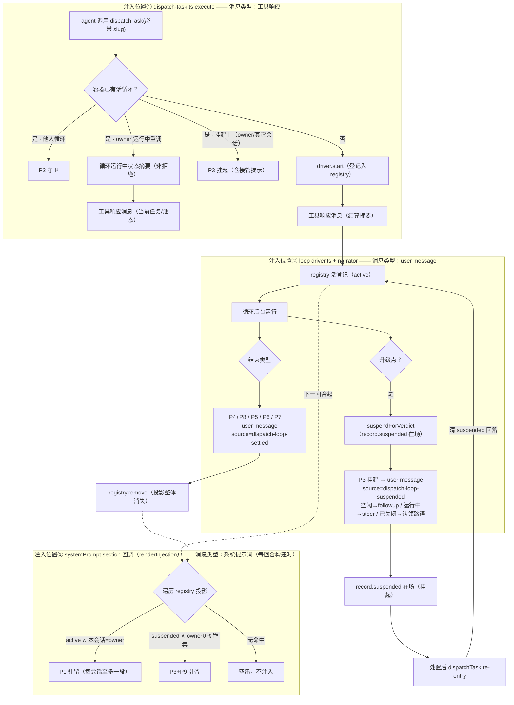
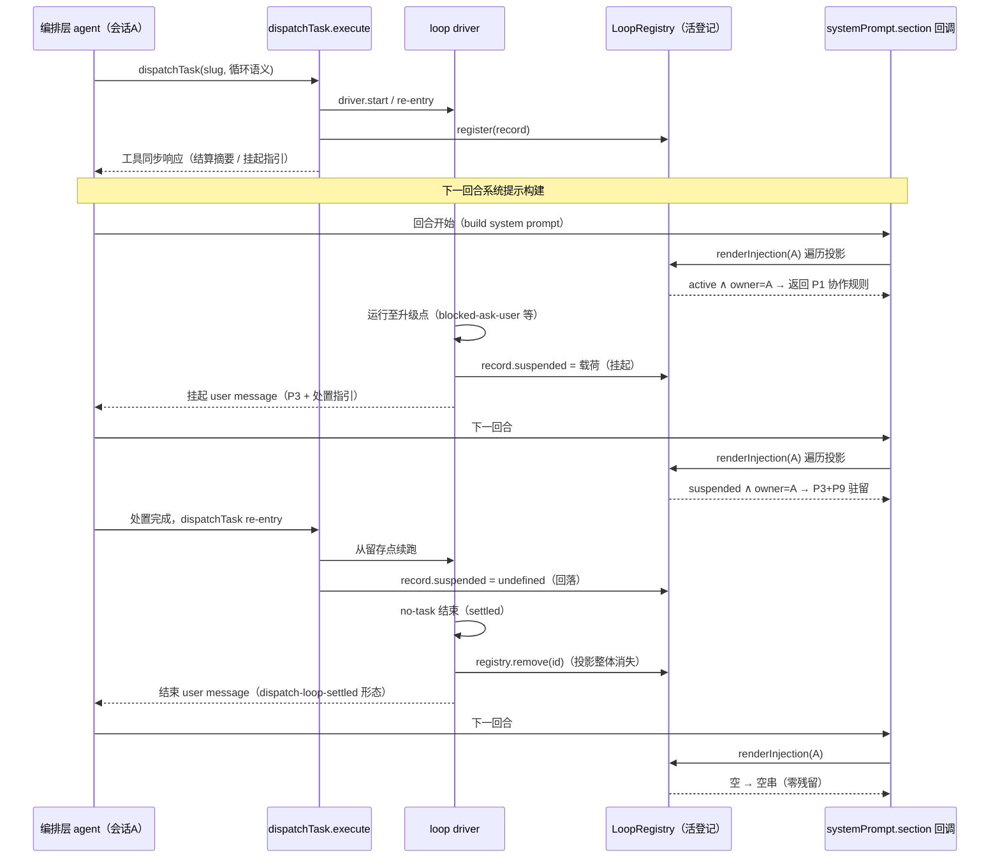

# dispatchTask 动态注入规格（改进 3b）

> 模板实际文本（P1–P9 逐字草案 + 渲染组合规则 + 效果示例）见同目录 `injection-templates.md`；本文件管机制、落点与改动点。
> 2026-10-17 重建：并入红队评审修补（registry 投影替代影子状态、P3 丢失兜底、前置核销清单）与 stop 作用域裁决（仅挂起态可他停）。

## 注入什么

只注入**协作面**（外部如何与循环发起/读态/处置/退出），循环内部机制零注入。模板 P1–P9、载体分配、占位符纪律均见 `injection-templates.md`；编号映射：协作发起协议=P1、事件响应文本=P2–P8、挂起处理指引=P9。

## 以什么方式注入（机制）

复用 plan 指令形态（section 条件回调），但**无状态置位**——注入是 registry 的纯投影：回调每回合遍历活登记现算文本，登记状态变即输出变，登记删除即不注入（对齐 plan 的进入注入/退出无残留，且清除零代码）。

```
每回合系统提示词构建（无置位、无状态机）
  → ctx.systemPrompt.section 回调（name='forge:dispatch-loop'）调 renderInjection(agentId, registry)
  → 遍历 registry 活登记，按「归属 / 挂起 / 接管集」投影渲染
  → 命中 → 该回合请求含对应模板文本；无命中 → 返回空串（零噪音）
```

**registry 投影（用户裁决 2026-10-17：弃影子状态 Map，注入为 registry 纯投影）**：phase 与 payload 全部读自登记表——有活循环=active、`record.suspended` 在场=挂起、登记删除=清除；渲染资格：运行中仅 owner（P1），挂起时仅 owner（P3——P9 已砍；其它会话触达经工具响应获挂起摘要，无驻留）。**会话级单活（用户裁决 2026-10-17）：一会话一循环、循环间串行——投影每会话至多一段，无多段拼接。门控只卡 start（新登记）：挂起中的循环也占名额（处置是 owner 职责，占名额形成处置压力；逃生=处置后 re-entry / stopTaskLoop 放弃 / 换会话发起）；re-entry 与其它会话触达不产生新登记，不占名额**。**零影子状态 → 误清/泄漏/生命周期错位类故障结构性消失**；写动作仅两个且全挂 record：`suspendForVerdict` 写 `record.suspended`、处置回流清 `suspended`；终局 `registry.remove` 即整体蒸发（其它会话可达经工具响应挂起摘要，无写点）。

**进入与退出（对齐 plan 生命周期，投影语义）**：

| 时机 | registry 事实 | 注入效果 |
|---|---|---|
| 进入 | owner 启动循环（登记在场） | 下回合起该 owner 获 P1 驻留 |
| 运行中 | 登记 active | 每回合 P1（会话级单活：每会话至多一段） |
| 挂起 | `record.suspended` 在场 | owner 与接管集获 P3+P9 驻留；处置完成清 `suspended` 回落 P1 |
| 退出（终局） | `registry.remove`（终态即删） | 该循环所有投影消失——系统提示词与「从未装过此插件」逐字节一致（官方 section 空文本行为须先核销，见前置核销清单） |
| 其它会话接管 | `takeoverSessions.add` | 该会话获 P3+P9 驻留；登记删除随之蒸发（不可能泄漏） |
| 重启进程 | registry 进程内存、重启即空（decisions #12/#18 有意设计） | 零渲染；已投递消息仍在持久会话日志（人可读）；挂起事实由任务域承载（blocked 卡 + 执行记录），重开循环经 triage 重新上浮。**不重建 LoopRecord**——复活旧实例破坏 guard 复位与 S3 对账纪律 |
| 整体摘除 | `section()` 返回的 `dispose()` | 插件卸载级清除（非会话级，不常用） |

- **双通道分工**：工具同步响应（当回合可见）承载操作回执与事件段（P2/P3 即时指引）；systemPrompt 段（协作期内驻留）承载 P1/P9。
- **P3 丢失兜底（红队修补）**：挂起通知渲染失败 fail-soft 返回空串时，循环悬挂不可无人知晓——下次该容器任何 dispatchTask 调用（含 owner 重调、其它会话触达）的响应必带挂起摘要；系统提示词槽保留 suspended 相位（渲染成功即恢复 P3+P9 驻留）。
- **模板渲染**：纯函数 `renderInjection(agentId)`，与 `prompt/index.ts` section 渲染同构；注入前占位符完整性校验（残留 `<...>` = 渲染失败，fail-soft 空串 + 落盘告警）。

## 提示词生命周期

**系统提示词段不持久化**：system prompt 是每回合的临时拼装产物（逐 section 现调 text 回调），只存在于本次模型请求的上下文，**不写入会话日志**（会话日志持久化对话消息：user/assistant/tool result）——「注入」不是写一次文本，是每次请求现算。

| 通道 | 内容 | 生 | 灭 | 持久化 | 清除动作 |
|---|---|---|---|---|---|
| **系统提示词段** | P1 / P3+P9（驻留段） | 每回合现算：registry 投影命中即出现在本回合请求 | 同左——下回合重算时 registry 状态变了即不再出现 | **否**（请求结束即逝） | **零清除代码**——`suspended` 清空 → P3+P9 自动消失；`registry.remove` → 全部消失 |
| **工具响应** | P2 / P3 / P4+P8 / P5 / P6 / P7（事件段，调用面前径） | execute 返回即出现在当回合 | 当回合结束即成历史 | **是**（tool result 记入会话日志） | 不可清除也不应清除（单写者追加的事实记录） |
| **user message** | P3 / P4+P8 / P5 / P6 / P7（事件段，后台径） | driver 投递即入会话 | 同上 | **是**（settlement 形态 + source 元数据，同 subagent 结算通知） | 同上 |

**要点**：

- **驻留段靠重算天然过期**：不存在「清除」操作——旧回合请求里的文本已随请求消亡，无处可清；现行状态永远由本回合重算结果承担（处置完成 → 回落 P1；终局 → 零渲染，系统提示词与「从未装过此插件」逐字节一致）。
- **消息段靠日志天然留痕**：历史 P3/结束消息是「当时发生过」的事实证据，不误导后续回合——现行指引由重算的驻留段承担，历史消息只作证据（compact 可能压缩它们，但投影不依赖日志，无影响）。
- **重启行为**：registry 进程内存、重启即空 → 驻留段零渲染（无循环可投影）；已投递的消息段仍在持久会话日志中（人可读）；挂起现场的事实侧由任务域（blocked 卡 + 执行记录）承载——重开循环后经 triage 重新上浮，从「挂起直达」退化为「常规 blocked 处置径」。不重建 LoopRecord（守 decisions #12/#18：重启即空 = S3 对账判据，复活旧实例破坏 guard 复位语义）。

## 注入时机总图（P1–P9）

> 图中按**三个注入执行位置**分框：工具 execute（工具响应）、loop driver+narrator（user message）、systemPrompt.section 回调（系统提示词）；连线标注消息类型。



读法：三个框 = 三个注入执行位置；实线框内 = 事件即时发出；框 ③ = 每回合系统提示词构建时逐槽按 phase 决定驻留段，全部清除后零输出不注入。事件段（P2–P8）由事件类型决定「发哪段」、由事件发生位置决定「走工具响应还是 user message」。

## 注入关键逻辑：时序图 · 伪代码 · 改动点

### 时序图



### 伪代码

```ts
// ── registry 扩展（src/loop/registry.ts——3b 增两字段，生命周期与登记绑定）─────
interface SuspendedPayload {
  escalation: LoopEscalation   // 升级载荷全文（kind/reason/history/taskKey）
  since: number                // 挂起时刻（叙述用）
}
interface LoopRecord {
  // …现状字段不变（id/source/ownerSessionId/projectId/inFlight）…
  suspended?: SuspendedPayload          // 在场即挂起态；处置回流清除
  readonly takeoverSessions: Set<string> // 接管会话集（P3+P9 渲染资格）；registry.remove 随之蒸发
}

// ── src/loop/injection.ts（新增：模板正本 + 纯投影渲染，零状态）──────────────
/** 类型化载荷——读自 record（渲染复用 notify/templates.ts 的 renderNarrative(kind, payload)
 *  同款插值机制，dsh 既有能力，不新造占位符语法；counts 仅事件段需要，驻留段不含） */
function payloadOf(record: LoopRecord): InjectionPayload { /* slug/ownerSessionId/taskKey/reason/history ← record */ }

/** section 回调体：遍历 registry 活登记，按「归属/挂起/接管集」投影渲染 */
export function renderInjection(agentId: string, registry: LoopRegistry): string {
  const parts: string[] = []
  for (const record of registry.all()) {
    const payload = payloadOf(record)
    if (record.suspended !== undefined) {
      // 挂起循环：owner 与接管会话获 P3+P9 驻留
      if (record.ownerSessionId === agentId || record.takeoverSessions.has(agentId)) {
        parts.push(check(renderP3(payload) + renderP9(payload)))
      }
    } else if (record.ownerSessionId === agentId) {
      parts.push(check(renderP1(payload)))                   // 运行中循环：仅 owner 获 P1
    }
  }
  return parts.length === 0 ? '' : parts.join('\n\n')        // 无命中 = 空串（零固定税；会话级单活下 parts ≤1）
  function check(text: string): string {                     // 占位符完整性校验：残留 <...> → 告警并跳过该段
    return assertNoPlaceholders(text) ?? ''
  }
}

// ── src/index.ts（装配，disposePipeline 旁；registry 单例闭包注入）───────────
ctx.systemPrompt.section({
  name: 'forge:dispatch-loop',
  order: FORGE_SECTION_ORDER + 1,
  text: (context) =>                                        // plan 同款条件回调，同步纯读 registry
    context?.agent?.id === undefined ? '' : renderInjection(context.agent.id, loopRegistry),
})

// ── src/tools/dispatch-task.ts execute（事件段渲染 + 唯一写点：接管集）────────
async function execute(input, rt) {                          // input 必带 source_kind + source_slug
  const r = await dispatchCore(...)                          // 内联结算（无 job 径）
  const agentId = rt.agent.id
  const record = registry.bySource(r.source)                 // 守卫径的活循环登记
  if (r.kind === 'guard-denied') renderP2(record)            // 响应体带 P2 守卫行（活循环归属+正确入口）
  if (r.kind === 'owner-active') statusSummary(record)        // owner 运行中重调：非拒绝——「循环运行中」状态摘要；
                                                             // 挂起中（含 P3 丢失兜底）响应必带挂起摘要
  if (record?.suspended !== undefined && agentId !== record.ownerSessionId) {
    record.takeoverSessions.add(agentId)                     // 唯一工具侧写点：其它会话接管资格（响应同步带 P3 摘要）
  }
  return renderToolResponse(r)                               // 工具同步响应（自解释，事件段在此渲染）
}

// ── src/loop/driver.ts（循环侧两个写点）──────────────────────
// 升级点改挂起（3b 语义反转处，原 escalate→terminal）：
async function suspendForVerdict(loop, escalation) {
  loop.record.suspended = { escalation, since: Date.now() }  // 写点①：挂起即投影挂起
  return 'suspend'                                           // 新 RoundOutcome，不再 terminal
}
// 处置回流 re-entry：
loop.record.suspended = undefined                            // 写点②：回落 active
// 终局（既有机械，零新增）：
finally {
  loop.registry.remove(record.id)                            // suspended/takeoverSessions 随登记整体蒸发——
  clearExclusiveLoopSource(record.source, record.id)         // 注入面零清除代码
}
```

### 改动点（函数级）

| 文件 | 函数/位置 | 动作 |
|---|---|---|
| `src/loop/registry.ts` | `LoopRecord` | 增 `suspended?: SuspendedPayload` + `takeoverSessions: Set<string>`（生命周期与登记绑定） |
| `src/loop/injection.ts`（**新**） | `renderInjection(agentId, registry)` + `renderP1..P9` + `payloadOf` | 模板正本 + 纯投影渲染（零状态） |
| `src/index.ts` | 装配体（`disposePipeline` 之后） | 新增 `ctx.systemPrompt.section('forge:dispatch-loop')` 注册（registry 单例闭包注入），disposers 收录 |
| `src/tools/dispatch-task.ts` | `execute` | 事件段渲染（P2 守卫 / owner-active 状态摘要 / 挂起摘要兜底）+ 接管集写点（`takeoverSessions.add`） |
| `src/tools/stop-task-loop.ts`（**新**） | 工具定义 + 注册（index.ts tools 列表） | `stopTaskLoop`：入参容器 slug 或循环实例；**作用域（用户裁决 2026-10-17）：运行中循环仅 owner 会话可停（维持 decisions #20 隔离）；挂起态（awaiting-verdict）任意会话可停**——支撑其它会话接管；停止走统一结束处理并产出结束通知；无权限/无活循环时拒绝并自解释 |
| `src/loop/driver.ts` | 升级点（blocked-ask-user 径 :775/:823/:859/:913、onNoTask deadlock 分支 :953） | escalate→terminal 改 `suspendForVerdict`（写 `record.suspended`）。**拆解时逐处核销清单（全量 7 处 escalate：:720 worker-abort-over-limit / :775 无进展 / :823 triage 超限 / :859 fix 链到顶 / :913 ask-user / :953 deadlock / :996 halted）——每处裁决挂起或保持结束（halted 建议：spawn 连败属环境问题，挂起等待无益，保持结束 + P6）** |
| `src/loop/driver.ts` | re-entry 续接段 | 处置回流清 `record.suspended`（回落 active） |
| `src/notify/templates.ts` | 结束叙述模板（含 finished-all settled 结束） | 结算形态对齐（摘要行+正文+`dispatch-loop-settled` source）；settled 结束追加 subagent 评审指示段（见 injection-templates.md P8） |
| `tests/contract/`（**新 pin**） | pin-dispatch-injection | description 关键句 ↔ injection 模板关键句同源断言 |

## 前置核销清单（红队修补：承重假设须到源码核销，工作区硬约束）

实现 3b 前必须核销的四项假设，核销结论回写本节（2026-10-17 核销，源码 = `apps/host/profile.dev/node_modules/@deepseek-ai/`）：

1. **官方 section 空文本行为**：✅ 已核销——`dsh-system-prompt/lib/index.js` `renderPrompt()`（:113-115）：`sections.map(...).filter((text) => text.length > 0).join("\n\n")`——text 返回空串的 section 被整体过滤，无名字头、无痕迹，与「从未注册」逐字节一致；`section()` 注册（:240-243）返回的即 Cordis effect disposer，退出路径零额外摘除代码。**结论：空串即零注入，`dispose()` 仅插件卸载级使用。**
2. **工具调用超时边界**：✅ 已核销——`dsh-tool-call-timeout-policy/lib/index.js` `apply()`（:115-142）：仅当工具声明 `timeoutMs` 才武装 deadline（:123-124 无 `timeoutMs` 直接 `next()` 透传）；且超时是**协作式**——包装器 `await next()` 不放弃工具 promise，到期只置换结果（:130），**无 turn 级强杀**。dispatchTask 未声明 `timeoutMs`（已核销 `src/tools/dispatch-task.ts`），循环不会被腰斩于工具边界；内联长阻塞无宿主超时约束，停止语义走 `exec.signal`。
3. **ownerSessionId 存活判定**：✅ 已核销——`dsh-agent`（README :32 / lib/index.js `AgentRegistry`）：`ctx.agents.get(id)` 命中活 agent 返回裸 `Agent`、未活返回 undefined；事件词汇 `agent/created`/`agent/disposed`/`session/disposed` 在场（`lib/types/index.d.ts` :161/:289-290），挂起/结束投递的 owner 失活降级（认领路径）以 `ctx.agents.get(ownerSessionId) === undefined` 判定，事件仅作观察辅助。
4. **agentId 与 ownerSessionId 同轴性**：✅ 已核销——`dsh-agent/lib/index.js` `assembleContextFor()`（:291-297）将**活 Agent 句柄**整体作为 `context.agent` 传入 `assemble()`；`dsh-agent-loop/lib/index.js`（:1772-1776）：agent 与 session 在**同一 caller-supplied identity 下创建**（"@param id - shared agent/session identity"）——`context.agent.id` ≡ `session.id` ≡ `ctx.sessionId`（本仓 `run-dag-tasks.ts` :384 即以 `ctx.sessionId` 作 ownerSessionId）。**同一标识空间，注入槽键零映射。**

## 触发点矩阵

| 触发点 | 触发者 | 注入 | 通道 |
|---|---|---|---|
| 首次循环语义调用 | dispatch-task execute | P1 | systemPrompt（下回合） |
| 守卫拒绝（他人循环） | dispatch-task execute | P2 | 工具响应（同步） |
| owner 运行中重调 | dispatch-task execute | 状态摘要 | 工具响应（同步，非拒绝） |
| 升级挂起（awaiting-verdict） | loop driver | P3 | 工具响应（同步）+ systemPrompt 驻留 |
| 其它会话接管（触达挂起循环） | dispatch-task execute | P3 摘要（守卫响应附挂起摘要，无驻留） | 工具响应 |
| re-entry 续接 | dispatch-task execute（检测留存态） | P9 | systemPrompt + 工具响应摘要 |
| 结束（no-task/halted/timeout） | dispatch-task execute / driver | P4+P8 / P5 / P6 / P7 | 双径（调用面前→工具响应；后台→user message） |

## 循环结束通知对齐 subagent 结算机制（用户裁决）

循环最终结果采用官方 subagent 同款通知机制（`dsh-subagent/continuation-messages.js` createSettlementMessage 形态）：

- **载体**：持久 user message（纯文本块，非文本块就地过滤）；
- **格式**：结束摘要行（settled/halted/timeout/stopped 各一分支文案）+ 结算正文（completed/blocked 计数、挂起原因等）；
- **source 元数据**：`{ kind: 'dispatch-loop-settled', form: 'notice', senderSessionId: ownerSessionId }`——UI/投影可识别（GUI 对该 source 补投影渲染）；
- **投递语义**：空闲→followup（排队新回合）/ 运行中→steer（注入编排层当前回合）/ 已关闭→inject；owner 失活时不投死信——降级为认领路径（任意会话凭 slug 触达即获挂起/结束摘要）；
- **必达**：投递失败告警不丢（对齐官方 notifySettlement）；
- 与 awaiting-verdict 同构：挂起返回与结束通知同为「循环给外部的 user message + source」，处理均模型驱动，harness 不解析。
