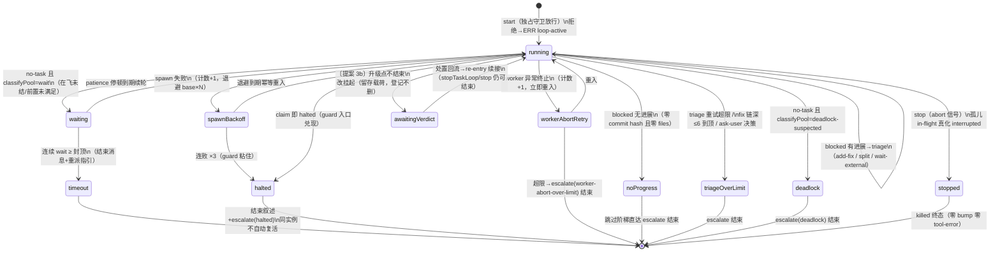
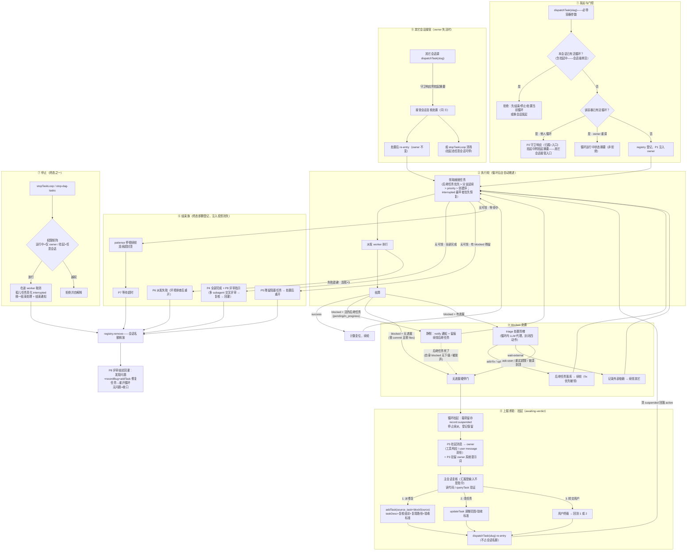

# 派发循环状态流转（现状机制 + awaiting-verdict 增改）

## 状态全集

| 状态 | 载体 | 含义 |
|---|---|---|
| **无实例** | registry 无登记 | 初始/结束后；新 start = 新实例新 guard 计数 |
| **running** | registry 活登记 | runRound 轮转：恢复→领取→spawn→结算→判定 |
| **waiting**（running 子态） | `waitRounds` 计数 | 池无任务可领但在飞/前置未满足——patience 停顿后续轮 |
| **awaiting-verdict**（本提案新增） | registry 活登记 + 挂起标记 | 遇裁决升级点：停止续派、留存升级载荷，处置后 re-entry 续接 |
| **终态**（登记即删，五径） | registry 删除 | settled / halted / stopped(killed) / timeout / 异常兜底 |

## 状态图

## 事件 → 状态 → 处置明细

| # | 事件 | 状态迁移 | 处置（通知/问询/落库） |
|---|---|---|---|
| 1 | `start`（指令/工具） | 无实例→running | 独占守卫拒绝则 `loop-active`（报活循环归属）；启动对账（S3：有 in-flight 续叙述，否则 from-scratch） |
| 2 | claim 成功 | running 内轮转 | 领取 notice（S4）+ 进度事件；interrupted 任务走 adopt 定向恢复径 |
| 3 | claim 返回 no-task | →classifyPool 三态 | `done`→settled 结束（finished-all 叙述）；`deadlock-suspected`→escalate+结束（blocked-pool 叙述）；`wait`→waiting |
| 4 | spawn 失败 | running→spawnBackoff | spawn-failed-retry notice，退避 base×N；×3→haltLoop（结束叙述+escalate(halted)，同实例不复活） |
| 5 | 结算 success | 计数复位，续轮 | completed notice + 进度事件；处置簿清账 |
| 6 | 结算 blocked+followUp | 续轮（不升级） | blocked-with-fix 留痕——fix 就绪自然被领 |
| 7 | blocked 无 followUp·无进展 | →结束 | 无进展硬停门：跳过 triage 阶梯，直达 escalate(blocked-ask-user) |
| 8 | blocked 无 followUp·有进展 | →triage 阶梯 | add-fix（blockSource，链深≤6）/ split-remainder（disc-N）/ wait-external→续轮；ask-user 或重试超限→escalate 结束 |
| 9 | worker 异常终止 | →workerAbortRetry | 立即重入同任务（不退避）；超 LOOP_WORKER_ABORT_MAX_RETRIES→escalate 结束 |
| 10 | stop | →stopped | abort 信号；stop 面接管在飞真化 interrupted；killed 终态零 bump |
| 11 | 宿主重启 | 全部→无实例 | registry 进程内存——重启即空（S3 启动对账兜底） |
| 12 | 〔提案〕升级点 | running→awaitingVerdict | 不再 escalate+结束：载荷留存登记、工具响应带挂起返回；处置回流→re-entry 续跑；stopTaskLoop/stop 仍可结束 |

## 提案增改点（相对现状）

- **升级点语义反转**：现状 #7/#8-ask-user/#9-超限/#4-halted/#3-deadlock 一律「escalate→结束（登记删除）」；3b 起升级点改为 **awaiting-verdict 挂起**（登记保留、可 re-entry 续接）——死锁根源（工具内循环撞 ask-user）随之消除；
- `halted` 保持结束不变（guard 粘住语义，decisions #18 不动）；`settled`/`stopped`/`timeout` 结束不变；
- waiting 的 patience 封顶（timeout）与 3c 宽限窗（wait-for-quiescence）为两个不同机制：前者=池无任务可领的重试上限，后者=结束前等编排层新派任务的静默宽限。

## 全景路径图（提案落地后形态）

任务循环从发起到收口的全部路径——派发、blocked 处置、上报求助（挂起）、其它会话接管、停止、各类结束：

路径要点：

- **上报求助的唯一形态是挂起**（④）——现状的「问询+终局」在 3b 后统一为挂起等待处置，处置入口（主会话复核三选一）与续接（re-entry 不占名额）闭环；
- **静默与挂起的分界**（③）：活的后继任务在场 = 循环自愈（静默）；后继死了或根本没有 = 升级挂起找人；
- **所有终态同汇 registry.remove**（⑥⑦）——名额释放、注入投影消失、guard 计数复位一次完成。
