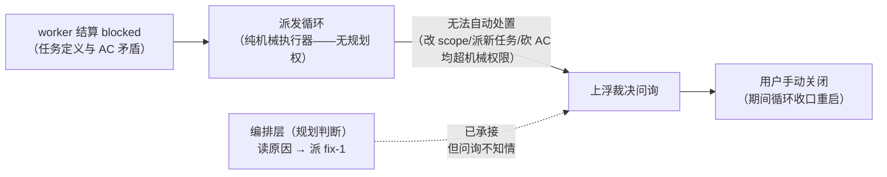

# dispatch-loop-hardening：任务派发循环处置优化

## 问题

worktree-branch-management 管线执行中暴露三个循环级痛点（均有实锤时序）：

1. **blocked 结算必问询，即使已自动承接**：1.6 以 `result=blocked` 结算（AC3 越界 scope——规划缺口），循环按机制上浮裁决问询；随后编排层派发 fix-1 承接（block_source），但问询不知情，仍挂在用户处直到手动关闭——期间循环收口重启，纯噪音打断。
2. **就绪选择无解阻优先**：fix-1（挡 1.6→1.7→1.8 三卡链）与 1.3（叶子任务）同时就绪，循环先领 1.3——关键路径被旁支拖延。
3. **派发机制三源不同构**：编排层派 fix-2 后循环已收口——新任务就绪但无人派发，须等用户重开指令。现状三源：`run-tasks` skill（循环协议正本，靠 loop 会话 agent 逐条遵守提示词铁律）、`/run-dag-tasks` 指令（开一个跑该 skill 的会话）、`dispatchTask` 工具（单次派发原语，后台模式经 job 回执）。协议承载在提示词而非机制里——agent 遵守有漂移面，且循环生命周期与会话绑死（收口即断）。

根因（机制设计事实，非故障）：

- blocked 处置三选一（扩 scope / 派承接任务 / 砍 AC）都需要规划判断，循环守机械纪律一律上浮——保守但正确；
- 噪音出在问询与承接动作**互不知情**，以及就绪选择**无关键路径意识**。

## 方案

三项改进（1/2 直击痛点；3 为机制统一，量级独立可分期）：

- **改进 1 · 承接感知问询（静默策略）**：blocked 结算时若已存在 block_source 承接任务（fix-chain 在场），**抑制自动裁决问询**——标准收口已机械发生，改为日志留痕（可追溯）；无承接的 blocked 仍照旧问询（那才是需要人的场景）。
- **改进 2 · fix-chain 优先调度**：就绪选择加稳定排序键——`block_source` 任务优先于普通就绪任务（同级按创建时间兜底）。理由：fix 任务每滞留一轮，其 source 及整条下游链全堵；解阻价值恒大于推进旁支叶子。
- **改进 3 · 派发机制统一（run-tasks skill 退役）**：循环协议从提示词下沉为**机制**——派发核心原生具备循环能力（领取就绪 → 派 worker → 收结算 → 池裁决 → 续派直至 no-task），`/run-dag-tasks` 指令与 `dispatchTask` 工具成为同一核心的两个入口（指令 = 绑定容器的循环入口，工具 = 单次/编程入口）；skill 的协议正本（铁律/池裁决/fix-chain/模式守卫）随之退役，仅留薄文档。目标形态约束：
  - 循环生命周期与**会话解耦**——编排层新派的任务（如 fix-2）在循环存活期内自动续派，不再要求用户重开指令；
  - 池裁决中需要人的分支（死锁、外部容器等待）转为通知/问询机制，不再依赖 loop agent 的判断力；
  - 「不造工作、一任务一 worker、halted 守卫」等铁律成为核心行为而非提示词约定。
- **暂不做（记录裁决）**：关键路径优先（下游解锁数/最长链排序）——改进 2 落地后边际收益小；「从头执行」文案与增量恢复语义出入——纯文案不影响行为。两项留观察。

## 改动范围

- 改进 1/2：`@dsh-forge/plugin-forge` 派发器——blocked 结算路径加「fix-chain 在场则静默」分支 + 日志留痕；就绪选择函数加 fix 优先稳定排序。
- 改进 3：派发核心循环化（派发器 + 指令/工具入口归一）+ `run-tasks` skill 退役（协议正本迁入核心，skill 降级为薄说明或删除）。
- **排除**：关键路径调度、任务模型/表结构变更、blocked 处置权下放给循环（三权分立不变：循环机械执行、编排层规划、用户终裁）。

## 影响范围

- blocked 问询频次显著下降（仅无承接场景上浮）；用户裁决负担减到真需要人的场合。
- 就绪兄弟任务的派发顺序变化（fix 先行）——不改并发语义，不改收敛结果，只改路径效率。
- 既有 fix-chain 协议（block_source、完成自动解阻）零变化。
- 改进 3 落地后：`/run-dag-tasks` 与 `dispatchTask` 行为同源（同一循环核心）；循环收口不再导致「就绪任务无人派发」；run-tasks skill 退出技能目录，依赖该 skill 的既有用法迁移到指令/工具入口。

## 验收

1. blocked 结算且已有 block_source 承接任务时：无问询发出，日志留痕含 blocked 原因摘要与承接任务键。
2. blocked 结算且无承接任务时：照旧上浮问询（行为不变）。
3. fix 任务与普通任务同时就绪时，fix 先被领取。
4. 既有派发循环回归（正常结算/fix 解阻/池快照口径）全绿。
5. （改进 3）循环存活期内编排层新派的任务被自动续派，无需用户重开指令。
6. （改进 3）`/run-dag-tasks` 与 `dispatchTask` 后台模式产出同构回执与结算语义；run-tasks skill 已退役且协议正本可在派发核心文档中溯源。
