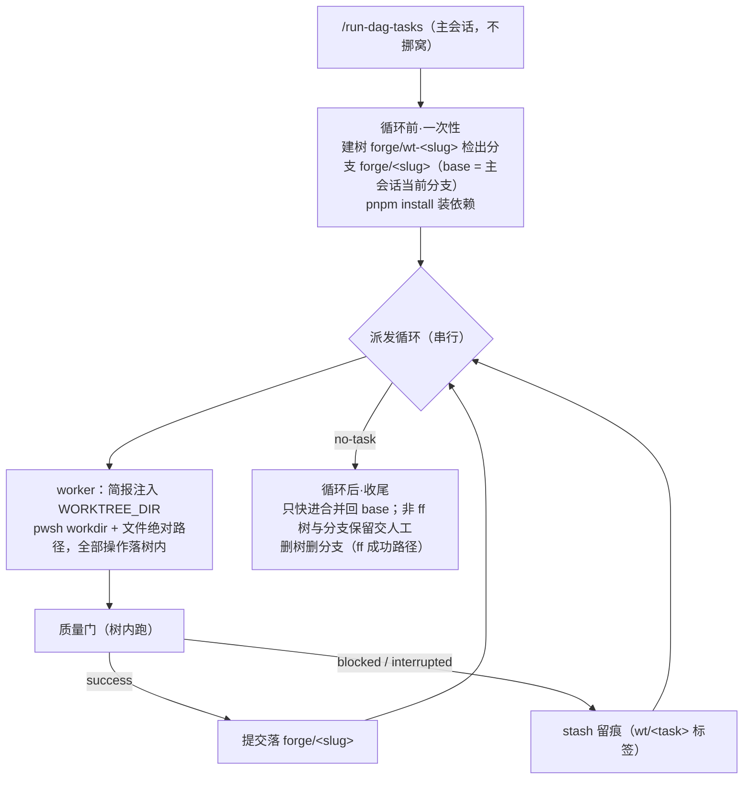

# dispatch-worktree-isolation：派发 worker 文件树隔离（模式 A）

## 问题

`/run-dag-tasks` 派发的 worker 直接在主会话工作树里干活：任务执行期间的脏文件、质量门产物与主会话的编排/提交动作同盘竞争；主会话想保持「不挪窝」就无法获得干净的执行隔离。worktree-branch-management 已交付 worktree 基建（`worktree-ops.ts`、identity 按 common-dir 合并、bindings `worktree_dir` 列），但仅服务于人起会话，未覆盖指令派发路径。

## 方案：模式 A —— 池共用一树，串行

主会话不离开当前工作树；指令派发循环的一次完整运行（同容器）共用一个新建 worktree，任务串行执行，提交累积在临时分支上，收尾合并回 base。

### 关键裁决（用户裁决 2026-10-16）

| 裁决点 | 决定 |
|---|---|
| 依赖装配 | **pnpm install**（store 硬链接，分钟级；不用 junction 复用——vite 缓存/bin shim 路径敏感有翻车面） |
| 未提交残留 | **stash 留痕**（`wt/<task-id>` 标签；fix 任务可恢复上下文，盘上可追溯） |
| 收尾合并 | **只快进**：base 未动 → 自动 ff + 删树删分支；非 ff（循环期间 base 被改）→ 树与分支保留，合并交人工，循环如实上报 |
| 落地形态 | **独立提案**（不挂 dispatch-loop-hardening 改进 3；实现挂点仍复用其三个切面：循环前后钩子、简报 vars 注入、结算后钩子） |
| 模式 B（一任务一树） | 记录待研于 dispatch-loop-hardening 提案，本提案不含 |

### 设计要点

- **状态层零改动**：任务池/结算/bug 台账全在主会话 forge 服务，worker 经工具打服务不碰文件；树内只做代码与质量门。commit_hash 取证天然成立（同 common dir）。
- **脏树纪律**：每任务结算时树必须干净——success 自带提交，非 success 走 stash；杜绝 worker N 的残留污染下游链。
- **死亡恢复**：主会话崩溃树仍在（提交不丢）。同容器重开指令时检测存活 `forge/wt-<slug>` → 询问「续用（脏树先 stash）/ 弃用（人工处置）」，与 seal-guard 同思路。
- **refs 竞争规避**：一树一分支（`forge/<slug>`），主会话不在此分支上操作。

## 改动范围

- 派发循环面（`@dsh-forge/plugin-forge` 派发器）：循环前建树+装依赖钩子、简报 vars 注入 `WORKTREE_DIR`、结算后脏树 stash 钩子、收尾 ff 合并/删树钩子、死亡恢复检测。
- 复用 `packages/plugins/git-worktree` 的 `worktree-ops.ts`（建/删/锚定），零新 git 机械。
- 排除：模式 B、并行派发、主会话冻结、任务模型变更。

## 影响范围

- worker 全部文件操作移入树内；主会话工作树在循环期间保持干净可自由使用。
- 收尾非 ff 时树上留人工合并工作（如实上报，不静默合并）。
- 循环总时长增加：建树 + pnpm install（分钟级一次性）。

## 验收

1. 指令发起循环后主工作树全程零文件变更（`git status` 干净），worker 改动全部落在 `forge/wt-<slug>` 树内。
2. 串行多任务（含依赖链）的提交按序累积在 `forge/<slug>` 分支，task DAG 语义不变。
3. blocked/interrupted 结算后树干净，stash 以 `wt/<task-id>` 标签可追溯；后续任务不被残留污染。
4. base 未动时收尾自动 ff 合并回 base 并删树删分支；base 被动过时树与分支保留且循环上报。
5. 主会话中途崩溃后重开同容器指令：检测存活树并给出续用/弃用问询，无静默丢弃。
6. 循环期间主会话在 base 上的独立提交与树内工作互不干扰（refs/索引无锁冲突）。
