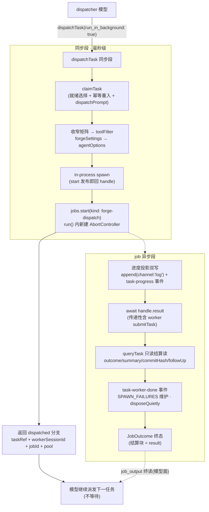
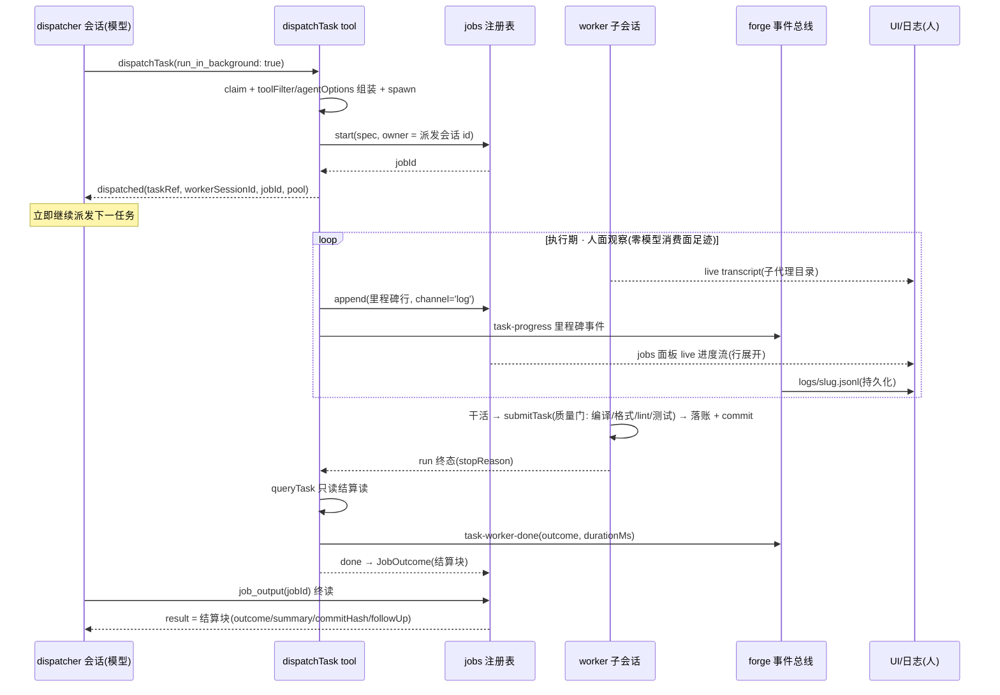
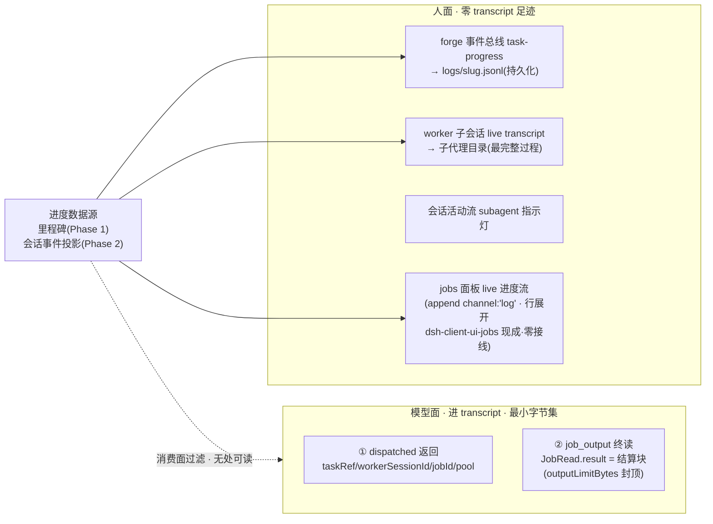

# 提案：dispatchTask 异步派发与进度观察（dispatch-and-watch）

> **术语定名**：dispatched 分支（立即返回面）· 结算后置（settlement-deferred——结算字段随 job 终读交付）·
> 进度双面隔离（模型面 / 人面）· 无处可读保证（nowhere-readable——进度不进入任何模型**消费面**的结构性质）·
> 负向 pin（negative pin——断言"读不到"的常驻测试）。
> 本提案是对 M2「run-tasks 阻塞派发循环」裁决的修订提案，非就地变更。

---

## 0. 背景与诉求

**现状**：`dispatchTask` = 阻塞派发（`packages/plugin-forge/src/tools/dispatch-task.ts:520-547` 的
`await handle.result`（:523）+ 结算读）——一次调用 = claim + spawn + **等待 worker 终态** + 结算读，dispatcher 串行循环。

**核心诉求（用户裁决）**：

1. dispatchTask **立即返回**被派发任务的消息（调用即得任务标识与状态）；
2. **可观察**任务的执行过程及进度。

**硬约束（用户裁决）**：进度消息是给人看的，**不得进入 LLM 的消息历史**（dispatcher 模型上下文）。

**前置方案筛选结论**（四方案对比，见 §11）：

- 方案 D（上游模型面 `subagent` 工具后台/continuable 模式）**不可行**——per-spawn `toolFilter`
  模型面调用参数不可达（已源码核实的负结论），收窄矩阵没有携带通道；
- 选定 **方案 B 精修版**：上游 `subagent` 工具的后台 job 配方（`dsh-tool-subagent/lib/index.js:534-556`）
  移植到 dispatchTask 派发面，叠加进度双面隔离。

---

## 1. 目标 / 非目标

| # | 内容 |
|---|---|
| G1 | `dispatchTask` 后台形态在 spawn 发布后**毫秒级返回** dispatched 分支 |
| G2 | 执行过程与进度对**人**实时可见（jobs 面板 log 流 + 子会话 transcript + jsonl 持久化） |
| G3 | 进度对**模型**结构性不可读（无处可读保证 + 负向 pin） |
| G4 | 结算语义零损失（无结算防线 / halt / followUp / 事件全保留，仅时机后移） |
| G5 | 前台路径逐字节等价（`run_in_background` 缺省 false，现有调用方零破坏） |

**非目标**：continuable 续话（与「匿名 executor、行为规格唯一来自 dispatchPrompt」的 M2/M3 裁决冲突）；
worker 权限模型变更（沙箱继承 + 审批钉 `never` 不动）；自动并行调度器（并发仍由 dispatcher 循环驱动）；
收窄矩阵 / worker 全局 deny 集变更。

---

## 2. 机制核实结论（事实基础）

全部经本仓 + 上游 0.2.0-rc.2 包源码逐项核实：

| # | 机制 | 出处 | 对本方案的意义 |
|---|---|---|---|
| F1 | `SpawnWorkerHandle` 两段式：start 发布即回 / `result` Promise / `dispose` | `dispatch-task.ts:156-164`（+ 真绑定 `in-process-driver.ts:39-65`） | 异步化的地基已存在，阻塞只在 execute 第 4 步 |
| F2 | 工具契约无执行中输出通道：`deferContext` 随终值交付 | `@deepseek-ai/dsh-tools` ToolRunContext（types/index.d.ts:305-322） | 「往消息框写进度」无正门——进度必须走旁路 |
| F3 | jobs 契约：`JobSpec{kind,label,owner,run(job)→JobHooks}`；`JobHandle{append,updateProgress}`；`JobHooks{cancel,done}` | `@deepseek-ai/dsh-jobs` types（:79-149） | job = 结果等待 + 结算 continuation 的容器 |
| F4 | **泄露路径①**：默认通道 `append` → 输出环 → `job_output` 增量读 = 模型上下文。**通道矩阵**（renderModelDelta）：无 channel / `'stdout'` / `'stderr'`（`[stderr]` 段）均喂模型，**未知名 channel 视同缺席亦喂**（拼错即静默泄露）；唯 `'log'` 被结构性滤除（观察者专属） | dsh-jobs JobChunk/JobChannel + dsh-tool-jobs `index.js:61-70` | append 收窄为**仅 `channel:'log'`**（2026-10-10 裁决；类型面 `appendLog` 收窄——channel 值单点硬编码于实现，调用面不可达，杜绝拼错通道静默入模型） |
| F5 | **泄露路径②**：`updateProgress` → `JobView.progress` → `job_list` **公共投影**（publicJob 将 `progress ?? detail` 折叠为单一 `detail` 字段——无 progress 字段名，但进度值仍可达模型） | view.d.ts:72 + dsh-tool-jobs `index.js:20-39,361-363` | updateProgress 弃用（负向 pin 断言公共投影无进度内容） |
| F6 | 上游后台配方：`jobs.start` + `run()` 内**新建 AbortController**（弃 exec.signal）+ owner=父会话 + settleStart 错误分类（aborted→killed / 其他→failed；**AggregateError 即使 aborted 也归 failed**） | `dsh-tool-subagent/lib/index.js:276-285,534-556` | 直接移植的模板，含 kill taxonomy（细枝入 §5） |
| F7 | `maxConcurrentJobsPerOwner` 默认 10（running+stopping 计数）；owner Agent 销毁自动取消其 job | dsh-jobs-local Config / resolveOwner | 直驱路径绕过 `maxActiveSubagents` 的并发缺口由 jobs 补位 |
| F8 | worker = 真实子会话（裸 UUID、Agent 注册表在场）；`SessionActivityKindMap.subagent` = 后代会话回合内指示 | `dsh-subagent` archive-admission | 人面过程观察零建设成本 |
| F9 | forge 事件总线已实时广播 task-claimed/spawned/worker-done | `dispatch-task.ts:472/481/513/555`（+ no-ready-task） | 事件的现成管道（→ `logs/<slug>.jsonl` 落盘；apps/web **不消费本总线**——UI 面见 §4.3/C4） |
| F10 | 结算 happens-before 链闭合：worker submitTask 落账 → 回合结束 → `result` settle → queryTask 读 | 回合内工具调用先于回合结束（现行 :520-547 已依赖同序） | 结算读放 job 内无竞态（结构保证） |
| F11 | 无结算防线 / halt 3 连败粘住 / 幂等重入径 | `dispatch-task.ts:168-181, 429-445/455-458, 538-547` | 原样搬进 job continuation，恢复语义不变 |
| F12 | per-spawn `toolFilter` 模型面调用参数不可达（负结论） | 源码级：dsh-tool-subagent config(:252-268) vs parameters(:401-429)；本仓记档 m3.5 proposal:117/:195 | 方案 D 不可行的根因；派发面仍是唯一收窄通道 |
| F13 | 子代理目录 = worker live transcript 的官方 UI（`TurnProcessSpec.subagentCount` + 委派识别） | p1-mvp s2 spike | 人面最完整过程记录，L0 免建设 |

---

## 3. 方案总览

### 3.1 总流程



### 3.2 端到端时序



### 3.3 进度双面隔离（本提案的核心约束落位）



**无处可读保证**（2026-10-10 评估裁决修订：进度承载利用 `append(channel:'log')`）：进度不进入
任何模型**消费**面——

- `append` 仅走 `channel:'log'`（log = 上游为 "producer narration (a workflow's phase lines)"
  设计的观察者专属通道，view.d.ts:33-38）→ 模型消费读（`job_output` 的 renderModelDelta）
  结构性过滤 log 块，中途读只得 `(no new output)` + 状态行；观察者读（`readAt` / UI jobs 面板）
  全程可见且不受 `outputLimitBytes` 截留（"bounds the consuming model surface, never observers"）；
- 不调 `updateProgress` → `job_list` 公共投影（publicJob）无进度内容（不进 `progress ?? detail` 折叠）；
- 不声明 `JobSpec.output` 拉取源 → 输出环无第二灌注通道；
- forge 事件总线不在工具面 → 模型无工具触达。

即使技能文本丢失、模型行为漂移、中途乱调 `job_list`/`job_output`，**读到的只有生命周期态与终值结算，
进度字节不存在于任何模型消费面**（raw `JobRead.chunks` 中的 log 块被工具渲染层结构性滤除）。架构保证优先于提示词约定。

---

## 4. 详细设计

### 4.1 同步段（毫秒级）

claim → toolFilter/agentOptions 组装 → spawn → `jobs.start` → 返回。全部是既有快操作：

- claim/spawn 保持同步的理由：halt 计数时机、`task-spawned` 事件、`in_progress` 落账的即时性全部不动；
- `jobs.start` 的 `owner` = 派发会话 id——job 落进 dispatcher 的 job 列表，**owner Agent 销毁自动取消其 job**
  （F7 生命周期耦合免费获得）；
- `run(job)` 内**新建 AbortController**（F6）：工具调用返回后 `exec.signal` 失效，job 存活期内必须自有信号；
  `job_kill` → cancel → abort → 驱动器取消 worker 剩余回合工作。

### 4.2 job 生命周期与结算 continuation

```
done continuation（job 异步段，原 execute 第 4~5 步原样搬迁）：
  ① 进度投影：里程碑 → log 通道 append + forge 事件总线双写（§4.3）
  ② await handle.result          // 传递性含 worker 自调 submitTask + 落账（F10 无竞态）
  ③ queryTask 只读结算读          // outcome / summary / commitHash / followUp(findFixTaskRef)
  ④ task-worker-done 事件 + SPAWN_FAILURES 防线回灌（spawn 失败/无结算自 job 内计数，「连续」= 结算序 streak）+ disposeQuietly
  ⑤ JobOutcome：正常 = 结算块；无结算 = failed + 诊断进 detail；kill = killed（不进 halt 计数；
     AggregateError 即使 aborted 也归 failed——F6 taxonomy 细枝）
```

**结算后置**语义：`summary/commitHash/reason/followUp` 等结算字段的产生时间本就在 worker 终态之后
（数据来源 = worker 的 submit 落账），本提案只改变其**交付时间与通道**——从工具返回值改为
`job_output` 终读（`JobRead.result`，结算后首次读交付）。后置的是成品，不是半成品。

### 4.3 进度事件面（人面）

- **进度承载（2026-10-10 裁决）**：里程碑行经 `append(line, { channel: 'log' })` 进输出环——
  人面 = UI jobs 面板行展开的 live 输出流（`dsh-client-ui-jobs` 已挂载，**零新接线**）；
  模型面 = renderModelDelta 结构性过滤；
- **两通道分工**（裁决后 task-progress 的存在理由）：log 通道管**实时看**（内存态、按 jobId 挂
  dispatcher 会话、无容器语义）；事件总线管**留档**（`logs/<slug>.jsonl` 耐久、信封带 slug 按容器
  归档、与 jobs 契约解耦——上游演进/环裁剪/可见集移除均不损耐久记录）。数据同源双写，消费者各异；
  砍掉事件则 spawned→worker-done 之间耐久记录静默空洞——保留（log-listener 零新代码落盘，边际
  成本 = 联合成员 + emit 一行）；
- contracts 事件联合新增 `task-progress`：载荷 `{ taskKey, phase, ts }`（职责收缩为**持久化记录**：
  输出环是进程内存态、冷重启即失，`logs/<slug>.jsonl` 是耐久面）；
- Phase 1 phase 词表（closed set）：`claimed → spawned → running → settled:reading → done:success | done:blocked`——
  全部为 dispatchTask 自知里程碑，零新依赖；
- Phase 2（可选）：worker 会话事件投影（经 `SubagentRun.localAgent` 结构子面订阅轮次边界/工具调用摘要），
  投递目的地 = **log 通道 append + 事件总线双写**（进度粒度从里程碑到逐动作，模型面仍结构性过滤）；
- 消费者：UI jobs 面板（log 通道 live 流——`dsh-client-ui-jobs` 现成，零接线）+ log-listener
  （`logs/<slug>.jsonl`）；任务列表进度标签 = Phase 3 接线项（apps/web 不消费 ForgePluginEvent，
  见 feasibility-review C4）。

### 4.4 模型面（最小字节集）

每任务两条工具面 transcript 记录 + 一条结构性完成通知（2026-10-10 修订：完成通知不可避免——
quiet 档也只是不唤醒空闲回合，`owner.inject` 照发；载荷 = kind/label/status/detail 有界摘要，
无 ring 内容、无进度字节）：

1. dispatched 返回（派发回执）：`{ kind: 'dispatched', taskRef, title, type, workerSessionId, jobId, pool }`；
2. `job_output` 终读（结算回执）：结算块字段面 = 现 `spawned` 分支的
   `outcome/summary/reason/commitHash/followUp/pool` 原样投影，`outputLimitBytes` 封顶。

渲染文案（render）：`▸ dispatched <taskKey> — job <jobId>`（收结算用 job_output、中止用 job_kill 的指引行）。

### 4.5 契约变更

| 面 | 变更 |
|---|---|
| `DispatchTaskResult` | oneOf 增 `dispatched` 分支（前台 `spawned` 原样保留） |
| `DISPATCH_TASK_OUTPUT_SCHEMA` | oneOf 增一支 + render 四态变五态 |
| 参数面 | `run_in_background?: boolean`（缺省 false） |
| contracts 事件 | 增 `task-progress`（纯类型，不碰收窄矩阵 / deny 集） |
| run-tasks 技能 | 循环改写：「派发至 no-task(wait) → 逐任务 job_output 终读结算 → 继续派发」；明示中途无需读 job（第二道防线）。改写面**六处**（同步结算假设遍布）：description(:3) / 总述(:8-12) / Iron Laws(:44) / 出口① spawned(:55-58) / 出口④ halted·spawn-failure(:84-97) / Dispatch Summary(:136-149) |
| G1 pin / e2e | dispatched 分支 pin + **负向 pin**（§6）随迁 |

---

## 5. 边界与恢复

| 场景 | 处置 | 兜底语义 |
|---|---|---|
| `job_kill` / owner 销毁 | abort → worker 回合中止；job = killed（AggregateError 例外归 failed）；**不进 halt 计数**（F6 taxonomy） | 账本与 job 状态可能分叉（已 submit 的任务 completed + job killed）；**结算读可能不发生**（dispatcher 会话结束 → owner Agent dispose → job 被杀）→ 任务留 in_progress 走幂等重入径 |
| worker 跑完但没结算（refusal / max-tokens / 漏 submit） | 防线在 job 内触发（F11 原样）：job = failed + 诊断进 detail | 任务留 in_progress → 幂等重入（简报重合成、digest 新值） |
| 3 连败 halt | 入口检查不变；「连续」按**结算顺序**计 streak，成功清零（现有语义兼容并行） | 粘住无自解锁，新会话复位 |
| 冷重启 | jobs 是进程内注册表，job 丢失 | 任务留 in_progress → 幂等重入径（与现状等价；进度观察窗口丢失是唯一代价） |
| 并发上限 | `maxConcurrentJobsPerOwner` 默认 10（F7） | 直驱路径绕过的 `maxActiveSubagents` 由 jobs 补位 |
| `no-task` 分支 | 不建 job；`wait` 判词（在途/前置未满足）天然兼容并行派发 | 池态三分（收工/等待/疑似死锁）不变 |

---

## 6. 架构性保证与负向 pin

**负向 pin（新增验收项，常驻）**：

> 后台运行期间任意时点调用 `job_list` / `job_output`，断言模型**消费面**不含任何进度内容——
> `job_output` 渲染体 = `(no new output)` + 状态行（ring 中块全部 `channel:'log'`——断言块级
> channel 值域）、`job_list` 公共投影（publicJob）无进度内容（无 progress 字段名、`detail` 不含进度）；
> 且该任务在 dispatcher transcript 中仅有 dispatched 返回、一条有界完成通知（结构性注入，无进度字节）
> 与一次 `job_output` 终读。

守护对象（2026-10-10 修订）：F4′ log 通道过滤（renderModelDelta 持续过滤 log 块）与 F5′ publicJob
进度折叠路径的持续关闭。上游若演进 jobs 契约（如 log 并入模型消费读、progress 并入 JobRead 公共投影），
pin 红 → 本提案随迁裁决。

---

## 7. 改动清单

| 层 | 文件 | 改动 |
|---|---|---|
| contracts | 事件类型联合 | 增 `task-progress`（纯类型） |
| plugin-forge | `src/faces.ts` | 增本地结构化 `DispatchJobsFace`（`start(spec): { jobId }` + **`appendLog(line)` 收窄面**——默认通道 append / updateProgress 结构性不可达，2026-10-10 裁决）；`ForgeToolDefinition` 增可选 `isConcurrencySafe` |
| plugin-forge | `src/tools/index.ts` | `ForgeToolDeps` 增 `jobs?`（缺席 = 拒绝后台调用并提示，沿用 events/settings 可选降级模式） |
| plugin-forge | `src/tools/dispatch-task.ts` | `run_in_background` 参数 + dispatched 分支 + job 包装（§4.1/4.2）；防线/计数/followUp 搬进 done continuation |
| plugin-forge | `src/spawn/in-process-driver.ts` | Phase 2：`SpawnWorkerHandle` 增可选 `agent` 投影面（`localAgent` 结构子面） |
| 装配 | apps/host / plugin-forge | jobs 依赖注入（宿主 LocalJobRegistry 已在进程内——dsh-base cordis.patch `jobs` 行；plugin-forge 可走 `ctx.reflect?.get('jobs')` 现成先例，apps/host 侧可能零改动） |
| web | jobs 面板 / 任务列表 | Phase 1 零接线：`dsh-client-ui-jobs` 行展开即 log 通道 live 进度流；Phase 3：任务列表进度标签（apps/web 不消费 ForgePluginEvent，需独立接线——feasibility-review C4） |
| skills | run-tasks | 循环文本改写（§4.5） |
| 纪律 | — | Interface 2 契约 + G1 pin + e2e 随迁；boundaries pin 不动（jobs 面为本地结构化接口，零上游类型 import） |

核心代码量级：~百行（dispatch-task.ts 分支与包装）+ 契约/技能/pin/e2e 连带。

---

## 8. 分期实施

| 期 | 内容 | 出口 |
|---|---|---|
| Phase 1 | dispatched 分支 + job 包装 + log 通道进度流（appendLog）+ task-progress 事件（jsonl 持久化）+ 负向 pin | 核心诉求闭环（立即返回 + 人面进度[jobs 面板/子代理目录/jsonl] + 模型面隔离） |
| Phase 2 | worker 会话事件投影 → 事件总线（进度粒度从里程碑到逐动作） | 子代理目录之外的轻量过程流 |
| Phase 3（可选） | UI 任务面板进度渲染增强 | 体验项 |

---

## 9. 验收标准（SC）

1. **SC-A 立即返回**：dispatched 返回时延 ≈ claim+spawn（不含 worker 执行；秒级内）；
   返回面含 taskRef/workerSessionId/jobId/pool 四键。
2. **SC-B 结算后置交付**：`job_output` 终读得到完整结算块，字段面与前台 `spawned` 分支一致；
   结算块内容与任务账本 `task_records` 终态对账一致。
3. **SC-C 前台零破坏**：不传 `run_in_background` 的调用行为与现状逐字节等价（既有测试全绿）。
4. **SC-D 进度隔离（负向 pin）**：§6 断言全过——执行期间 `job_list`/`job_output` 模型消费面
   无进度字节（log 通道块被结构性过滤），transcript 每任务 = dispatched 返回 + 有界完成通知 + 终读。
5. **SC-E 人面观察**：执行期 UI jobs 面板行展开可见 log 通道进度流（零新接线）；子代理目录可见
   worker live transcript；事件序列 `task-claimed → task-spawned → task-progress* → task-worker-done`
   完整落 `logs/<slug>.jsonl`。（任务列表进度标签 = Phase 3 接线项，不在本 SC。）
6. **SC-F 边界**：kill 后任务可幂等重入且不进 halt 计数；无结算径 job=failed + 任务留 in_progress；
   3 连败 halt 粘住、新会话复位；并发派发受 `maxConcurrentJobsPerOwner` 封顶。

---

## 10. 风险与缓解

| 风险 | 等级 | 缓解 |
|---|---|---|
| 结算信息后置改变 dispatcher 决策回路（忘记收集） | M | **机制兜底：完成通知结构性注入**（默认 wakeup 档唤醒空闲 dispatcher 收集；`maxConsecutiveWakes` 可防唤醒风暴）+ run-tasks 技能文本 + 池快照补偿（taskStats 恒可查）+ `wait` 判词引导 |
| jobs 契约上游演进（log 并入模型消费读 / progress 并入公共投影） | M | 负向 pin 常驻（块级 channel 值域 + publicJob 折叠路径），红即随迁 |
| 冷重启丢 job（进度窗口消失） | L | 幂等重入径语义等价于现状 |
| 并行下 halt「连续」语义争议 | L | 结算序 streak + 文档记档（§5） |
| 模型上下文节省不及预期（终读结算块偏大） | L | `outputLimitBytes` 封顶 + 结算块字段面裁剪 |

---

## 11. 备选方案与放弃原因

| 方案 | 机制 | 放弃原因 |
|---|---|---|
| A 句柄表 + continuation | 内存 Map 持 handle，void continuation 结算 | `spawned` 契约破坏（返回面变型）；无 job 的收集/取消/并发基建 |
| C 纯账本驱动 + reaper | 无人等待，账本为准 + 回收器 | 需全新 reaper 基建；丢失 stopReason 分诊遥测 |
| D 上游模型面 `subagent` 后台/continuable | 换 `dsh-tool-subagent` 通道 | **per-spawn toolFilter 无携带通道（F12 负结论）**；worker deny 集/dispatchPrompt 双记全重做 |
| B′（本提案前身）job + 进度行/输出环 | `updateProgress`/**默认通道** `append` 承载进度 | **F4/F5 泄露路径**——默认通道 append 与 updateProgress 的进度经 `job_list`/`job_output` 进入模型历史，违反硬约束 → 裁两刀成本案。**界定**：2026-10-10 裁决采纳的 `append(channel:'log')` 走观察者专属通道（renderModelDelta 结构性过滤），与本行放弃理由不冲突 |

---

## 12. 演进记录

- 2026-10-08：初版。四方案筛选（D 负结论出局 → B 精修）；进度双面隔离定稿（裁 F4/F5 两条泄露路径，
  「无处可读保证」替代提示词约定）；结算后置语义（happens-before 链闭合论证）；SC 六项含负向 pin。
- 2026-10-10：可行性评估通过（见同目录 feasibility-review.md，F1–F13 逐项源码核实）+ 用户裁决修订：
  ① 进度承载改用 `append(channel:'log')`（上游原生 "workflow's phase lines" 观察者通道；模型消费读
  renderModelDelta 结构性过滤；UI jobs 面板零接线消费）——「不调 append」保证升级为「log 通道专属 +
  类型面 appendLog 收窄」；② 负向 pin 断言对象改块级 channel 值域 + publicJob 折叠路径；③ SC-D 修正
  为三件记录（完成通知为结构性注入，quiet 档不免 inject）；④ 显式禁声明 `JobSpec.output` 拉取源；
  ⑤ 任务列表进度标签移 Phase 3（apps/web 不消费 ForgePluginEvent）；⑥ 行号漂移按 HEAD 重锚
  （阻塞点 :520-547 / 事件 :472-555 / 防线 :429-458）。
- 2026-10-10（同日二修）：feasibility-review 修正全量落位——F5 机制措辞修正（publicJob `progress ??
  detail` 折叠，负向 pin 断言对象随改）；F1/F9/F11 行号重锚 + F12 出处修正（源码级 config vs
  parameters）；三幅图式改 log 通道双写；run-tasks 技能改写面扩全（六处，原估「循环一段」不足）；
  防线回灌（结算序 streak）与 AggregateError taxonomy 例外明示；§5 补「结算读可能不发生」窗口；
  §10 风险表更新（完成通知 wakeup 机制兜底 / 守护对象改块级 channel 值域）；§11 B′ 放弃原因界定
  （默认通道 append/updateProgress——log 通道采纳不冲突）。
