# M3.1 D37 自释功能钮 tooltip 清零 + 全量排查台账——任务 1.24 · SC-4 扩展 + SC-8 终验输入

> **任务**：`dsh-forge-m3.1-ui-alignment/1.24`——[D37 差异行](../proposal.md)（2026-10-10 用户追加裁决：「项目概览 tab 展开、派发、状态筛选控件等功能直观按钮不要添加 tooltip，全面排查一下」）。
> **规则（裁决口径）**：**控件自释（图标/文案自明）→ tooltip 整体退役（含 Esc/双击复位等后缀提示）；非自释把手与增量信息承载 → 保留记账**。D30 的机械化全量包裹（title= → Tooltip）在自释控件位构成噪声残差——本轮收口。ViewDropdown 位归 1.23 ⑤ 已载（D36 ⑤），本轮避双做。
> **消费方**：SC-4 概览卡片语言对照 + SC-8 人工终验（D37 行：自释钮零气泡 + 保留面气泡正常走查——动线见文末）。
> **证据口径**：源码全量 grep（改动前基线 `apps/web/src/views/overview/` 匹配 `Tooltip` **141 处含测试注释面** = 产品面 117 行 + 测试断言/注释面 24 行）逐位判定；退役位 DOM 断言 + `tests/structure/d30` 结构 pin 联动更替；保留面双主题实机截图归档（Electron 捕获，§5）。

## 1. 退役面（点名三类 + 同族清零——14 悬停位 · 9 产品文件）

| 族 | 位（文件:改动前行） | 原气泡文案 | 自释承载（判定依据） |
|---|---|---|---|
| 展开族 | `ov-head.tsx:40` 同位翻转钮 | 「展开/收起位置详情」 | 钮面「展开↔收起」文案 + chevron 旋转 + `aria-expanded`（D20 同位钮） |
| 展开族 | `drawer/index.tsx:458` ⤢ 翻转钮 | 「收起为简要信息/展开完整信息」 | `aria-pressed` 两态 + 图标翻转（D22 形态语义） |
| 派发钮 | `DispatchButton.tsx:94`（三态 label 常量 ×3） | 亮起 DAG 顺序领取 / 置灰「全部任务已处于终态…」/ 装载中 | 「派发」label 自明；置灰 = 深灰实底 `is-off` 自释（D18）；置灰不可点已闭环（零死代码：三常量随之退役） |
| chips 七态 | `status-chips.tsx:51` | enabled zh（en）复读 / disabled「无此状态任务」 | zh 标签已在 chip 面；disabled = 0 计数淡化 `is-zero` 自释 |
| chips 五态 | `proposal-tab/ProposalStatusChips.tsx:78` | 同上（「无此状态提案」） | 同上 |
| chips 阶段 | `feature-tab/PhaseChips.tsx:79` | 同上（「无此阶段 feature」） | 同上 |
| ✕ 关闭族 | `drawer/index.tsx:470`（简要态） | 「关闭（Esc）」 | ✕ 通用关闭惯例 + Esc 层序机制自释 |
| ✕ 关闭族 | `drawer/index.tsx:873`（错误态头） | 「关闭（Esc）」 | 同上 |
| ✕ 关闭族 | `drawer/index.tsx:911`（装载态头） | 「关闭（Esc）」 | 同上 |
| ✕ 关闭族 | `transition-dialog.tsx:275`（取消钮） | 「关闭（Esc）」 | 「取消」文案自明（按钮带字面） |
| ⋯ 行操作族 | `task-tab/list-view.tsx:138` | 「行操作」 | ⋯ 通用行菜单惯例；`aria-label="行操作"` + `aria-haspopup` 在场 |
| ⋯ 行操作族 | `proposal-tab.tsx:326` | 「行操作」 | 同上（`aria-label="提案行操作"`） |
| 粘滞条 | `sticky-bar.tsx:79` ✕ 清除 | 「清除（Esc）」 | ✕ 通用关闭惯例 + `aria-label="清除搜索"` + Esc 清词机制自释 |
| 粘滞条 | `sticky-bar.tsx:96` ⇅ 排序 | 「切换排序方式」 | 当前模式标签（`⇅ 活跃优先/最新创建`）直出 |

**机械面口径**：退役 = Tooltip 整体退役（含 tipwrap 禁用锚定包裹 span 随之退役——chips 三族/派发钮）；`data-*` 锚零弱化（`data-dswf-ov-head-toggle` / `data-dswf-ov-stchip` / `data-dswf-ov-pschip` / `data-dswf-ov-phchip` / `data-dswf-tt-dispatch` / `data-dswf-td-expand` / `data-dswf-td-close` / `data-dswf-tt-more` / `data-dswf-ov-more` / `data-dswf-ov-searchclear` / `data-dswf-ov-sort` / `data-dswf-td-tr-cancel` 全数原样在场）；`aria-label`/`aria-expanded`/`aria-pressed` 可达性承载全数保留（**气泡位 ≠ 可达名位**——D37 退役的是悬停气泡，非语义标注）。

## 2. 保留记账面（增量信息/非自释——28 悬停位 · 判定依据）

| 族 | 位 | 保留依据 |
|---|---|---|
| 截断兜底 | `ov-head.tsx:36` projectName、`:63` row.value（4 行） | 长名截断时唯一完整出口 |
| 截断兜底 | `feature-tab.tsx:140` feature title、`proposal-tab.tsx:270` proposal title、`drawer/index.tsx:482` detail.title | 同上 |
| 截断兜底 | `proposal-tab.tsx:357` slug、`:377` createdAt、`proposal-tab.tsx:165` relPath、`DocGroupList.tsx:97` relPath、`coding.tsx:26,54` file、`parts.tsx:96` docRel、`timeline.tsx:333` createdAt | 同上 |
| 截断兜底 | `drawer/index.tsx:451` taskKey、`transition-dialog.tsx:214` taskKey | slug/localId 自然键全形出口 |
| 截断兜底 | `dag-view.tsx:106`「键 · 全名」 | DAG 节点两行截断兜底（D29 形态保持） |
| 截断兜底（S3 扩记） | `drawer/index.tsx` 前置引用编号 chip / 会话 chip / 弹窗头编号 chip（悬停补 `{编号} {title}` 全名） | 编号化呈现的全形唯一出口（截断兜底同族；台账余额 4→6 对位扩记） |
| 副作用说明 | `feature-tab.tsx:161` 打开新会话、`proposal-tab.tsx:296` 打开新会话 | 「预填·不发送」= 非可见行为预告（×2 全保留） |
| 诊断说明 | `task-tab.tsx:380`「诊断——validateFeatureTasks…五类检查」 | 诊断语义非自释 |
| 容器 pill 计数注 | `task-tab.tsx:348` | 正文零计数注的**唯一承载位**（D18 形态——撤则信息丢失） |
| 1.23 ⑥ 增量悬停 | `list-view.tsx:103,106,160`、`swimlane-view.tsx:48` 行卡 taskHoverLabel | 非可见位增量注（状态全称/优先级/估时——D36 ⑥ 交付面） |
| 边界位 | `timeline.tsx:104` ⟞ 跳转会话、`drawer/index.tsx:306` 拖宽柄「拖动调宽 · 双击复位」 | 非自释把手（图标语义不直明 / 隐藏交互公约）——裁决默认保留 |
| 边界位（S5 扩记） | `list-view.tsx` ⟞ 执行子会话钮「打开执行子会话（worker）：键」 | 图标钮非自释把手 + 副作用说明（S5 task-ui-info-density-blitz 新增位——D37 口径同族保留；d30 台账 list-view 余额 3→4 对位扩记） |
| 呈现面非钮 | `swimlane-view.tsx:84` 列头（空列「无此状态任务」/ 非空 zh（en）） | 列头为呈现面非操作控件，不在点名清单；空列说明 + en 名 = 增量信息 |

**域外同型位记账（不动）**：知识面 `EntryDrawer.tsx:274`「关闭（Esc）」、`KnowledgeToolbar.tsx:148`「清除（Esc）」——D37 点名域 = 概览 tab；同型位是否随裁决外推 = 后续用户裁决项，本轮零改动（零未记账项口径）。

## 3. 断言更替台账（更替非删除——计数不减）

| 断言面 | 更替 |
|---|---|
| `tests/structure/d30` | TOOLTIP_FILES 28 → **23**（5 个零 Tooltip 整迁面迁出）；TOOLTIP_RETIRED_FILES 1 → **6**（+status-chips/ProposalStatusChips/PhaseChips/DispatchButton/sticky-bar）；**it.each walk 位 29 恒数**（23+6）；新增 `TOOLTIP_REMAINING_COUNTS` 部分退役面余额冻结 pin（ov-head=2/proposal-tab=5/list-view=3/drawer index=4/transition-dialog=1——增量保留位对位冻结，新增 Tooltip 须显式扩记）；总用例数 34 恒数 |
| status-chips.test / PhaseChips.test / ProposalStatusChips.test | 「悬停说明（官方 Tooltip label）」→「零 Tooltip 退役锚」：`title=` 反断言保留 + **零载注 copy pin**（`not.toContain('无此状态任务/无此状态提案/无此阶段 feature')`） |
| DispatchButton.test | describe/it 名随裁决更替；新增零气泡结构 pin（`not.toContain('role="tooltip"')`）+ 三态载注 copy 退役 pin（终态/装载中文案零在场） |
| drawer/index.test | 翻转钮组：`title=` 反断言保留 + `not.toContain('收起为简要信息')` + `not.toContain('关闭（Esc）')` |
| sticky-bar.test | 清除钮/排序 pill 组：+ `not.toContain('清除（Esc）')` / `not.toContain('切换排序方式')` |
| transition-dialog.test | 取消钮组：+ `not.toContain('关闭（Esc）')` |
| e2e `m3/uf3-dispatch-entry.spec.ts` | ③ 全终态置灰：原 D30 fix-7「悬停出泡载注」断言随裁决更替 → `title=` 反断言保留 + **悬停零气泡**（`role="tooltip"` toHaveCount(0)）——置灰自释口径入 spec 头注 |

## 4. 全量 141 位判定总账（改动前基线）

- **产品面 117 grep 行 = 42 悬停位**（import/闭合标签/D30 注记行随位计入）：退役 14 位（§1）+ 保留 28 位（§2）= 42 ✓ **零未记账项**。
- **测试注释面 24 grep 行 · 12 测试文件**：随 §3 更替（退役位断言/注释 18 行改写为退役锚口径；保留位注释原样——DocGroupList/dag-view/list-view/task-tab/D36 ViewDropdown 面）。
- **域外**（§2 末行）：知识面 2 位零改动，显式记账。

## 5. 保留面走查（双主题实机截图——Electron 捕获）

夹具 = 注册工作区 + feature（2 任务，coding/doc）+ blitz 提案；悬停出泡经 `body > span[role="tooltip"]` 在场断言后截屏；退役位悬停 400ms 窗口零气泡断言后截屏。

| 面 | 亮 | 暗 |
|---|---|---|
| ① ov-head 项目名（截断兜底） |  |  |
| ② 提案行 打开新会话（副作用说明） |  |  |
| ③ feature 行 打开新会话（副作用说明 ×2） |  | 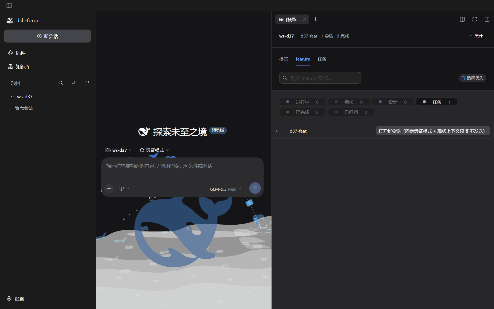 |
| ④ 行卡增量悬停（1.23 ⑥） | 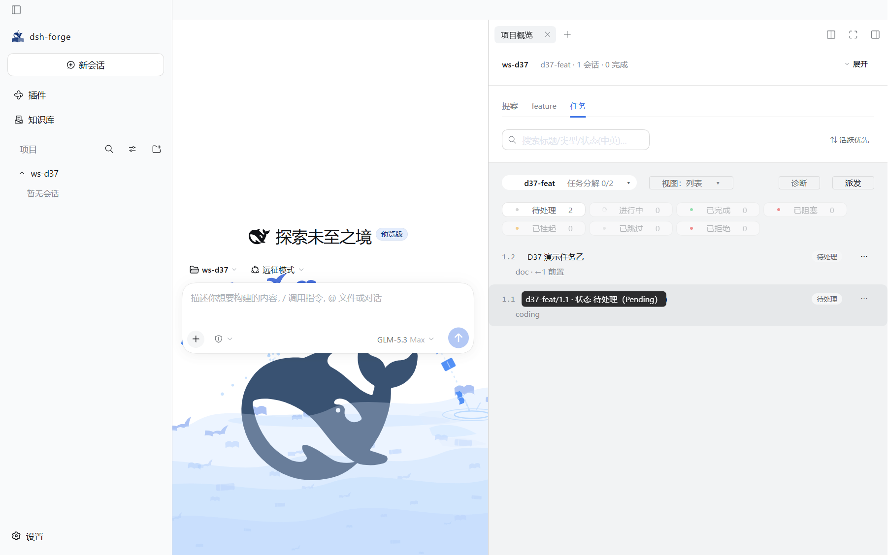 |  |
| ⑤ 容器 pill 计数注（D18 承载位） | 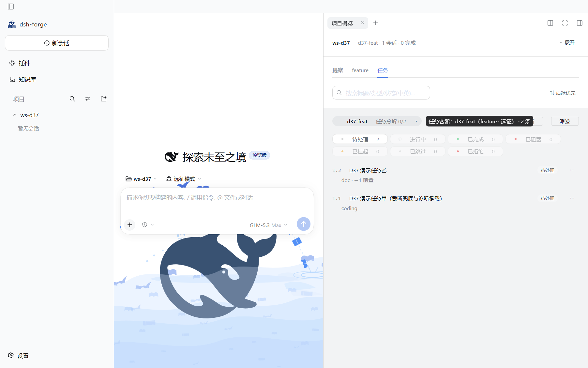 |  |
| ⑥ 诊断说明 |  | 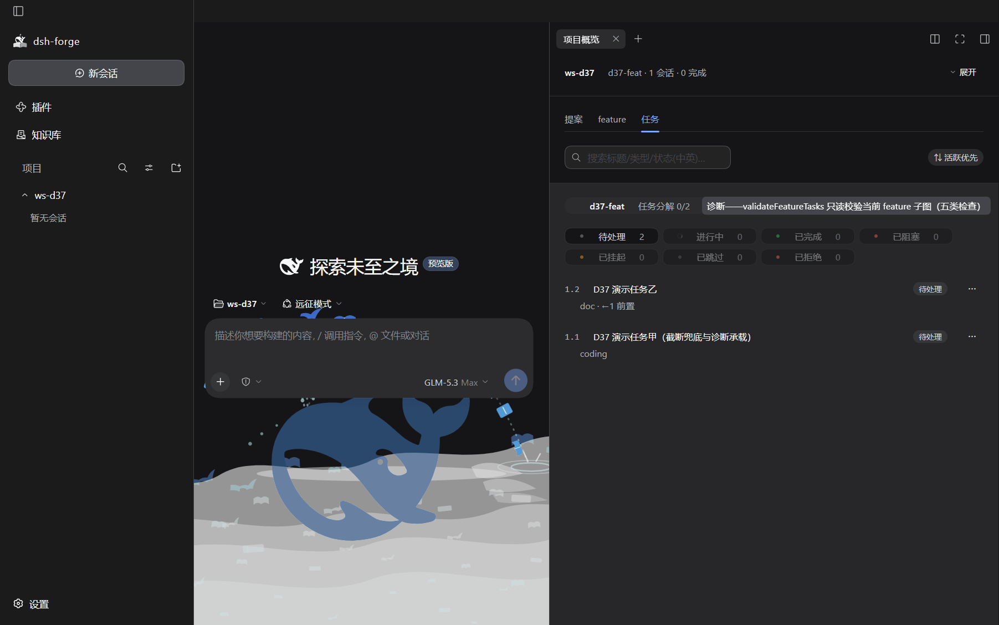 |
| ⑦ 抽屉 taskKey（截断兜底；同镜 ⤢/✕ 已零气泡） | 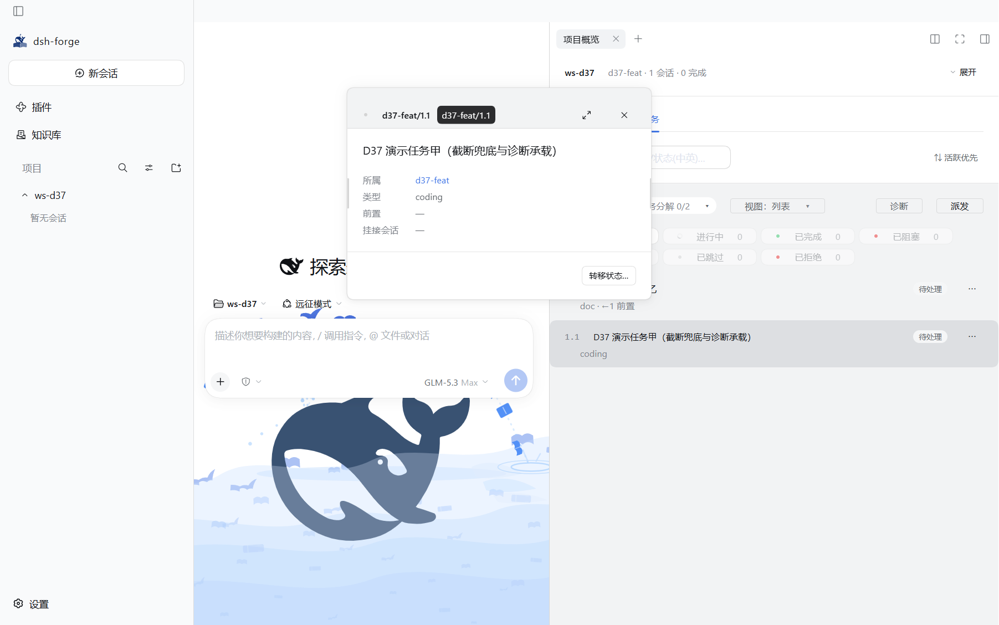 | 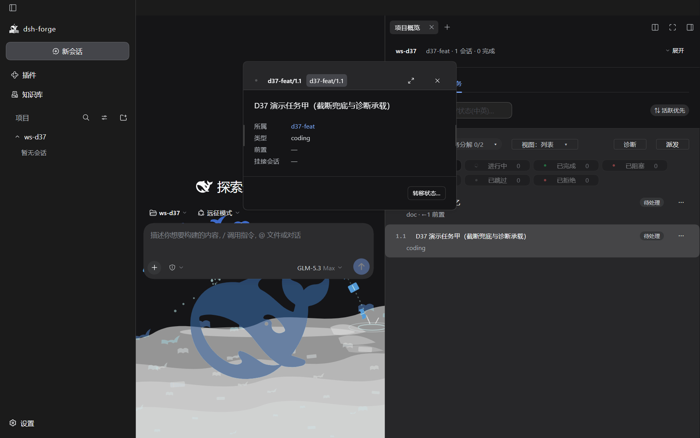 |
| ⑧ 退役位：七态 chip 零气泡 | 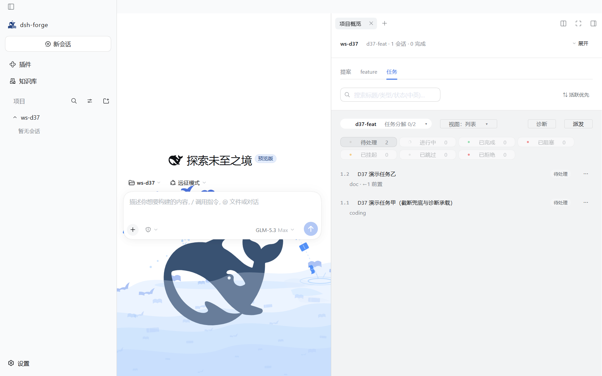 | 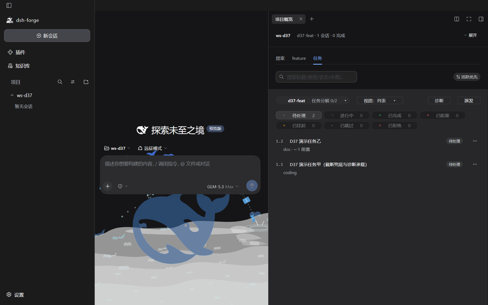 |
| ⑨ 退役位：派发钮零气泡 |  | 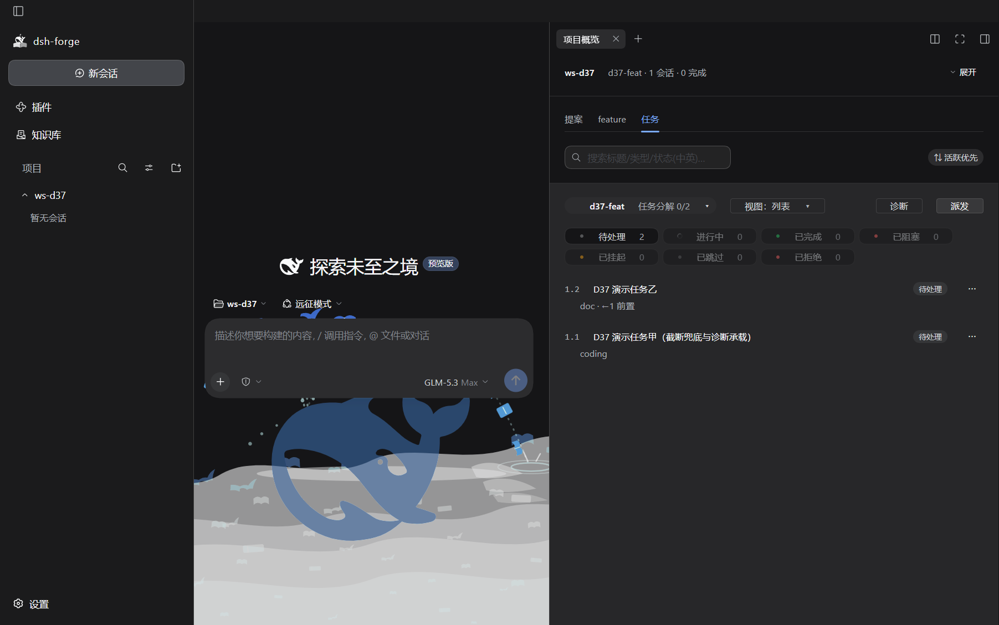 |
| ⑩ 退役位：排序 pill 零气泡 |  | 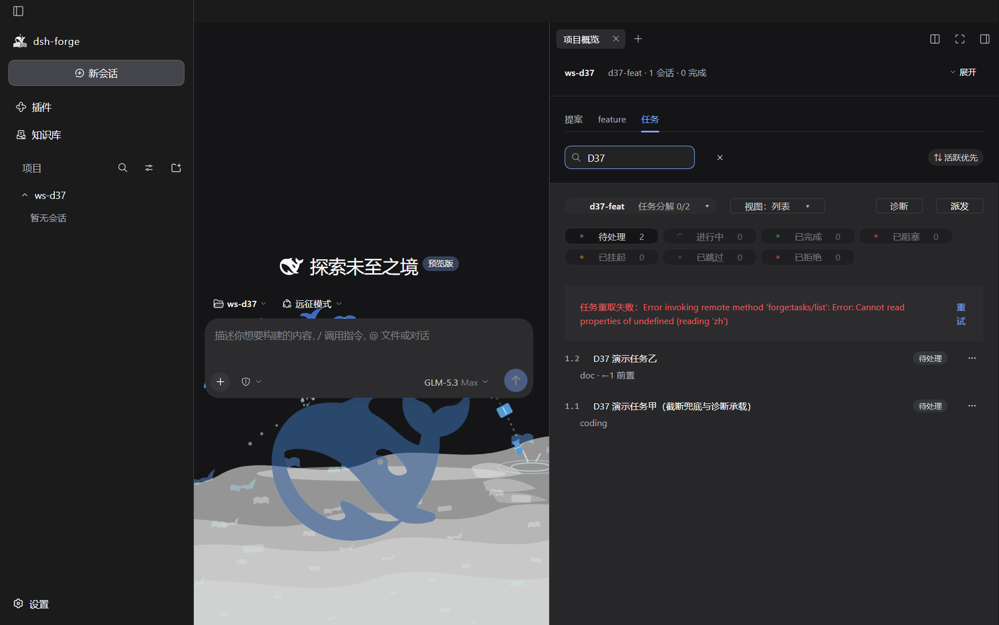 |
| ⑪ 退役位：清除钮零气泡 | 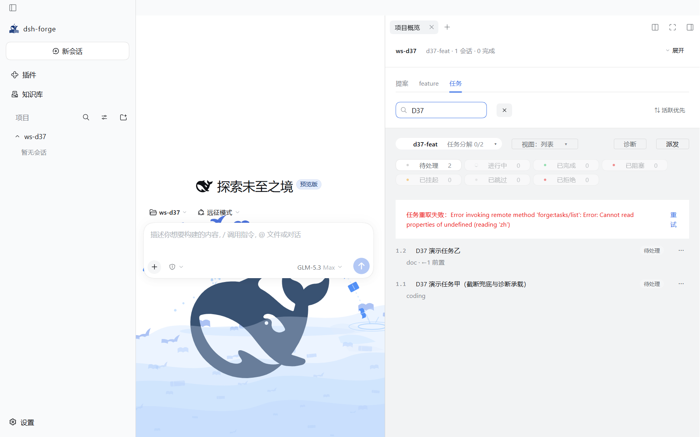 | 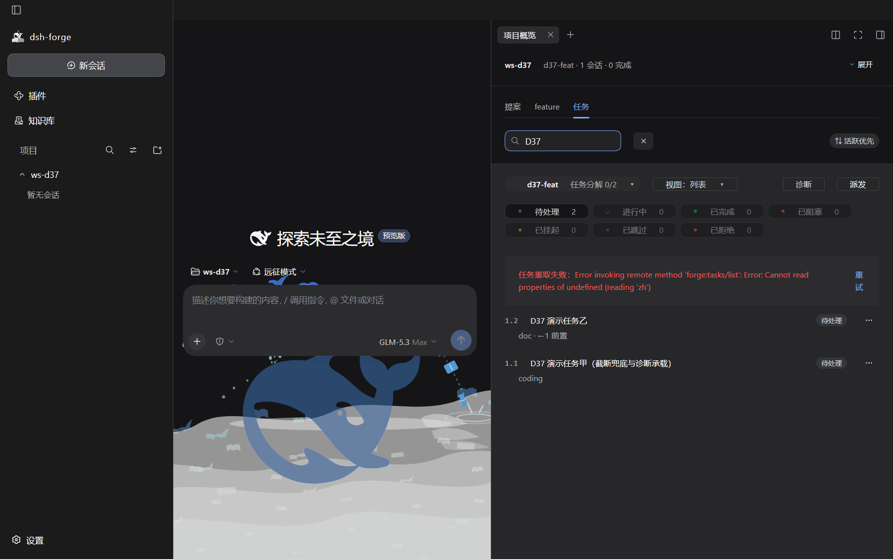 |
| ⑫ 退役位：抽屉 ⤢ 零气泡 | 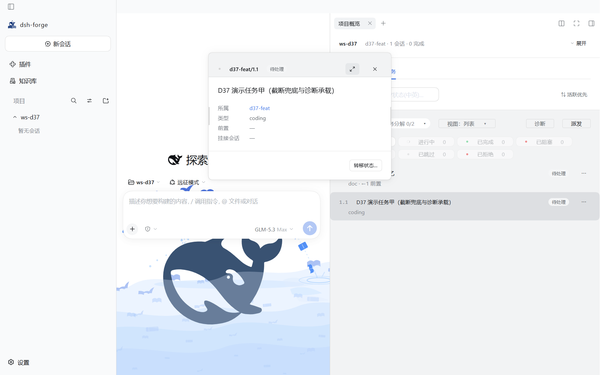 | 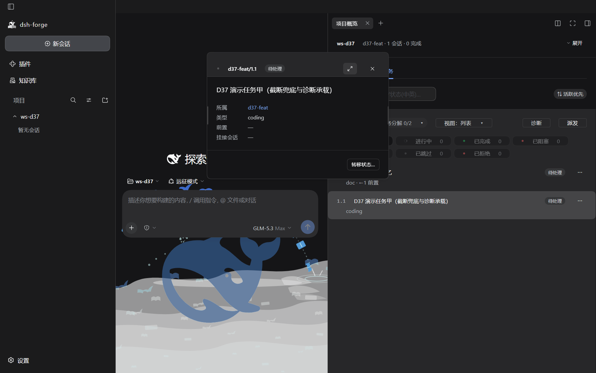 |
| ⑬ 退役位：抽屉 ✕ 零气泡 |  |  |

## 6. 机械面证据（本任务实跑）

- `pnpm build`（tsc -b + copy-preset-assets + vite build）exit 0；
- `pnpm lint` 六门（ox/imports/tokens/selftest/types/test-types）exit 0；
- 定向 vitest（apps/web/src/views/overview + tests/structure/d30）**35 文件 / 723 用例绿**（d30 34 用例恒数——更替非删除）；
- 纯 UI 轮：数据面/RPC 零变化（零 contracts/schema 触碰）。

## 7. 证据口径与限制（诚实声明）

- 双主题 = `body[data-ds-dark-theme]` 同位属性翻转（CSS 解析等价——D33 口径）；每张截图截取前均有目标锚在场/气泡在场（或退役位零气泡）断言——非空壳取证。
- 取证 tmp spec（`e2e/specs/tmp-d37-capture.spec.ts`）用后即删（D33/D35 同径）——e2e 池零 tmp 残留；池内既有 `uf3-dispatch-entry` 断言已随裁决更替（§3 末行）。
- 生成环境：2026-10-10；node 24 + @playwright/test `_electron` 实跑产品壳；dist 为 D37 改动后重建产物。

## 8. 实机走查清单（SC-8 用户动线）

1. **切换口径**：官方主题亮/暗各过一遍（对照 §5 基线）。
2. **点名三类**：概览任务子 tab——悬停展开/收起翻转钮、派发钮（亮/置灰两态）、七态 chips（含 0 计数禁用 chip）→ **零气泡**；提案/feature 子 tab 悬停五态/阶段 chips → 零气泡。
3. **同族**：任务弹窗 ⤢/✕、评审流转「取消」、列表/提案行 ⋯、检索 ✕ 清除、⇅ 排序 pill → 零气泡；Esc 关弹窗/清词机制正常。
4. **保留面**：悬停长项目名/任务标题/slug/relPath/createdAt → 气泡正常（完整内容出口）；悬停「打开新会话」×2 → 预填·不发送说明正常；悬停诊断钮 → 五类检查说明正常；悬停容器 pill → 计数注正常；行卡悬停 → 状态全称/优先级/估时增量注正常；⟞ 跳转会话、拖宽柄「拖动调宽 · 双击复位」气泡正常。
5. **回填**：实机观感以「零气泡位清点 + 保留气泡位清点」回填本记录即可（截图已归档）。
