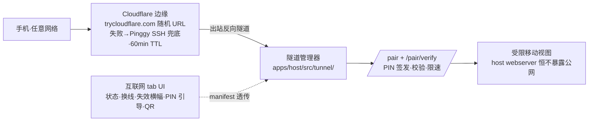

# dsh-mobile-tunnel：手机远程·互联网连接模式（隧道）

## 需求

手机与宿主不在同一 WiFi 时无法接入（现状仅 LAN `/pair` WiFi token 面，已落地于 `apps/host/src/boot/`）。官方 DSH Desktop 0.10.0 的第二种连接模式经公网隧道接入（证据 = 官方 `app.asar` bundle 反解，见 `probes/mobile-internet-tunnel.md`）：公网随机 URL + 6 位 PIN，宿主零入站端口、零账号、零配置。本提案对齐该模式，复用既有 `/pair` 缝（fix-6 路线 B）。

## 方案

隧道管理器 = 新模块，负责 cloudflared 快速隧道（首选）与 Pinggy SSH 反向隧道（兜底）的进程生命周期与 URL 捕获；隧道 URL 拼 `${tunnelUrl}/pair?token=<token>`（与 LAN 同一 `/pair` 协议）；PIN 层挂 `/pair/verify`（6 位、TTL 5 分钟、失败限速）。

跨模块交互面：

- 隧道管理器 ↔ `/pair` 缝（`boot/child.ts` / `pairing.ts`）：URL 拼接与握手复用；
- 隧道管理器 ↔ PIN 端点（`/pair/verify` 同位扩展）：签名/限速/TTL；
- 隧道管理器 ↔ UI：manifest 透传隧道状态/TTL/换线事件；
- 隧道进程 ↔ 外部：GitHub 下载 cloudflared（pin 版本 + sha256 校验 + 缓存）；Cloudflare/Pinggy 边缘出站反向连接。

## 改动影响范围

1. 隧道管理器（新 `apps/host/src/tunnel/`）：cloudflared 下载/校验/缓存/进程生命周期 + URL 捕获重试 + Pinggy 兜底切换——外部依赖面全在此层；
2. PIN 认证（`apps/host/src/boot/pairing.ts` 同位扩展）：6 位 PIN 签发/校验/限速/TTL；
3. UI：互联网 tab 真实启用（替换占位）——隧道状态/换线/失效横幅/PIN 输入引导/隧道 URL QR，按 `DESIGN.md` 令牌与官方实机逐位对照；
4. 测试：隧道层 fake server 契约测试（不起真隧道）；journeys 补互联网模式旅程。

排除：长效密码、下载镜像源配置、付费隧道、host webserver 公网暴露（恒不暴露）。

## 验收

1. 手机在非同 WiFi 网络扫码隧道 URL → 经 PIN 校验后进入受限移动视图，全程零账号零配置；
2. cloudflared 失败（下载或启动）→ 自动切 Pinggy，UI 呈现换线过程与「约 N 分钟后失效」横幅（TTL 读数准确）；
3. `/pair/verify`：PIN 5 分钟内有效、超时失效、连续失败触发限速；
4. 隧道全程只暴露配对面（`/pair` + `/pair/verify`），host webserver 端口不可经隧道触达；
5. 互联网 tab UI 与官方实机逐位对照（布局/交互词汇/状态语义/刷新与超时机制），走查截图归档本提案 `walkthrough/`（不进 git）；
6. 隧道层契约测试（fake server）与互联网模式 journey 全绿，CI 通过。

一致性检查：验收 1–5 逐项对应纳入项 1–3 + UI 对齐判据，验收 6 对应纳入项 4；每条纳入项均有验收覆盖；验收间无矛盾（TTL 横幅与换线共存于验收 2，无冲突语义）。
