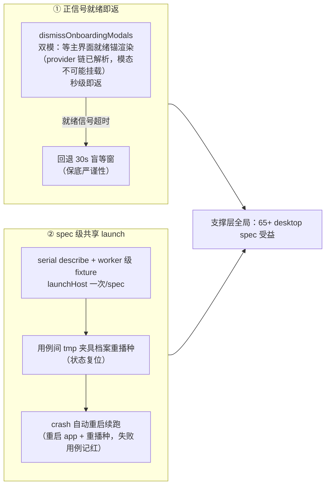

# e2e 基座提速：正信号就绪 + spec 级共享 launch

## 需求

- 真机 e2e 批次慢得有结构：20 用例 spec 总时长 ~15 分钟（每用例 ~45s），且起跑前还有 apps/web 全量构建 ~10 分钟（已由 076c825e 按需新鲜度修复，不在本提案范围）。
- 用例时长实锤分解（expert-squad-panel-detail.spec 20 例）：①`dismissOnboardingModals` 每用例 30s 盲等窗（等「稍后配置」按钮挂载，凭据在场确定形态下模态恒不挂载，纯盲等——152/164 用例「窗口期内无」留痕实证）≈ 10 分钟；②每用例 `launchHost` + `closeApp` 全量冷启动（electron 拉起 → 宿主 boot → 插件装载 → 工作区注册）≈ 4 分钟；③动作与收敛断言 ~5s（真实行为断言，不动）。
- 目标：取证严谨性不丢（真实行为断言、失败即红、失败用例记红）的前提下，把单 spec 批次压到 ~5 分钟级。

## 方案

- **正信号就绪即返**（B1）：`dismissOnboardingModals` 改双模——先等主界面就绪锚渲染（稳定元素在场 = provider 叠层链已解析、onboarding 模态不可能再挂载，立即返回）；就绪信号超时（异常形态）回退既有 30s 盲等窗。信号锚选型沿用「data 锚单源」纪律（面板 data 锚先例）。
- **spec 级共享 launch**（B2）：launch 层提供共享 launch fixture 模式——`launchHost` 整份 spec 一次；用例间状态复位 = tmp 夹具档案**重播种**（专家档案 tmp 目录重建）而非整 app 冷启；单用例 crash（面板炸/宿主崩）= 自动重启 app + 重播种夹具后续跑，失败用例本身照记红。
- **存量全量改造**：支撑层就绪后，存量 65+ desktop spec 逐个迁移共享 launch 形态（试点先行：panel-detail spec 为改造样本，其余按此复制）。
- **用例价值审计**：迁移时逐用例裁定去留——**纯文案/label 断言类用例退役**（验证按钮文案、label 措辞、静态渲染文本之类——语义等价覆盖已由 unit 渲染测试持有，如 panel-view.test.ts 的 aria/文案断言；真机再验一遍文案无增量价值）；**行为/语义/写径断言用例保留**（保存落盘、来源翻转、启停语义、失败路径等真机才有增量的断言）。退役用例若有断言 unit 层未覆盖者，先补 unit 再退役（覆盖不出真空）。
- **用例价值准则升格为项目工作规范**：上述准则沉淀进 `docs/conventions/testing/core.md`（e2e 用例价值准则节）——**e2e 只保留行为/语义/写径断言用例；纯文案/label/静态渲染断言类用例一律不入 e2e，转入单元测试**；新写 e2e 用例按此准则准入，存量按审计节奏迁移。规范为主、审计为翼：准则先行落文档，存量迁移按本提案审计节奏执行。用例数预期显著精简，进一步压总时长。
- **执行分层工作规范**：开发迭代期只跑指定用例（`pnpm test:e2e -- e2e/specs/<路径>.spec.ts --grep <用例名>`，Playwright 原生能力，无新机械）；回归收口才执行整个 `*.spec.ts`。规范随 AC6 落 `docs/conventions/testing/core.md`。共享 launch 与用例级 run 兼容：子集运行时 fixture 照样只启动一次；配套硬门槛——每个保留用例必须可单跑独立通过（防共享 launch 引入用例顺序耦合，见 AC8）。
- **不做**：用例分层预算（裁决：暂不做）；多 profile 并行（Electron 单实例约束，workers ≤ 2 硬约束不变）。

## 改动影响范围

| 工件 | 改动 |
|---|---|
| e2e/support/modals.ts | `dismissOnboardingModals` 双模改造：正信号就绪锚（主界面稳定渲染元素，选型实施期定并记录 file:line）优先 + 30s 窗回退 |
| e2e/support/launch.ts（或新 fixture 模块） | 共享 launch fixture：spec 级启动、夹具重播种 API、crash 检测与自动重启续跑 |
| docs/conventions/testing/core.md | 增两节（项目工作规范）：①「e2e 用例价值准则」——e2e 只保留行为/语义/写径断言用例；纯文案/label/静态渲染断言类用例转入单元测试；新用例按此准入。②「e2e 执行分层」——开发迭代期只跑指定用例（file + `--grep`），回归收口才跑整个 `*.spec.ts` |
| e2e/specs/*.ts（65+ desktop specs） | 迁移共享 launch 形态（试点 = expert-squad-panel-detail.spec）+ 用例价值审计（纯文案/label 断言用例退役；unit 覆盖缺口先补 unit） |
| 复用核销 | 正信号锚 = 产品自有渲染元素（非官方机械，e2e 基座自属——无官方 test fixture 机械可复用，自建 fixture 记录「官方无此面」）；就绪锚不引入新机械，纯观察既有渲染产物 |

## 验收

| # | 标准 | 取证方式 |
|---|---|---|
| AC1 | 试点 spec（panel-detail，审计后保留用例集）改造后总时长 ≤ 8 分钟（基线 ~15 分钟）且全绿零回归 | 计时对账（基线值取改造前最近一次全绿 run） |
| AC2 | 凭据在场 profile 下：`dismiss-onboarding` 留痕不再出现「30s 窗口期内无」满窗等待（秒级即返留痕）；无凭据 profile 下模态真实出现仍被收起 | 两种 profile 各跑一轮整个 spec 留痕对账 |
| AC3 | crash 注入：用例中途 kill app → 自动重启 + 夹具重播种 + 后续用例继续执行（≥1 用例续绿），失败用例本身记红 | 注入用例演示 + run.log |
| AC4 | 存量 65+ desktop spec 全部迁移共享 launch 形态；全量 e2e 批总时长对比基线下降并留档对比值 | 批次计时对账 |
| AC5 | 用例价值审计对账表：逐用例去留裁定（退役 = 纯文案/label 断言；保留 = 行为/语义/写径断言）；退役用例的断言若有 unit 层未覆盖者已先补 unit（覆盖无真空） | 审计对账表（逐用例去留 + 归属层） |
| AC6 | 「e2e 用例价值准则」+「e2e 执行分层」两节落 `docs/conventions/testing/core.md` 并生效（新 e2e 用例准入与执行口径依据） | 文档走查 |
| AC7 | lint:types + 定向 vitest 绿 | 质量门 |
| AC8 | 试点 spec 每个保留用例可单跑独立通过：`--grep` 隔离 run（共享 launch 下 fixture 单次启动照常适用）逐用例全绿，证无用例顺序耦合 | 逐用例隔离 run 留痕 |
