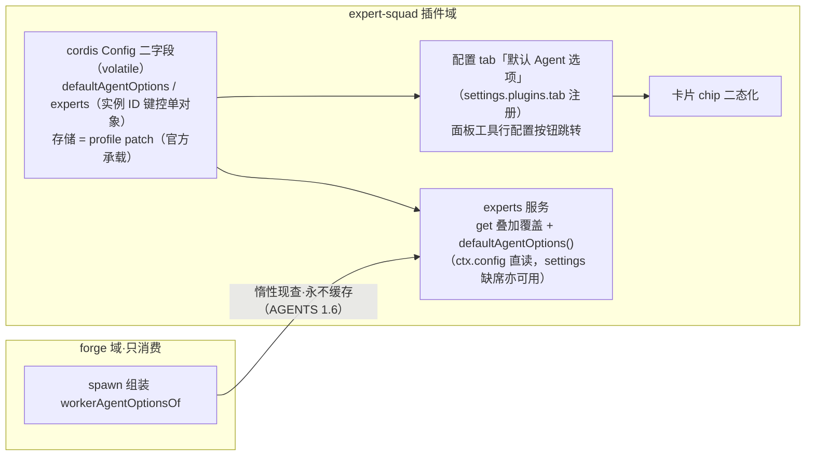

# 专家团派发选项：配置主权归 expert-squad

## 背景

- 专家团化后，worker 的 provider/model 优先级链 = 档案显式路由 > Forge设置 worker 段 > 父会话继承（`workerAgentOptionsOf`）。
- 痛点一（显示失真）：档案未配置且 Forge设置 worker 段已配时，面板卡片显示「继承父Agent」——实际生效的是默认路由，违反所见即所得。
- 痛点二（配置割裂）：默认路由的 UX 入口在「设置→Forge设置」，专家路由的入口在专家团面板——同域配置两处入口。
- 方向裁决（用户）：配置主权归 expert-squad，不依赖 forgeSettings；Forge设置 worker 小节硬切退役。
- **承载裁决（核销 dsh 官方规范后修正）**：插件自身配置不落自持 json——正门 = 插件 cordis Config 字段（`.volatile()`）+ dsh-settings 服务（存储 = 活动 profile 的 Cordis patch、revisioned 读写、schema 校验、volatile 变更通知热刷新）。原「expert-squad-settings.json 自持文件」方案废弃（自造机械，撞复用优先纪律；`~/.dsh` 布局实证：home 根无插件散文件）。
- 命名裁决：字段名对齐官方术语 `agentOptions`（`defaultAgentOptions`），不自造词；单专家覆盖沿用配置通行模式 `overrides`。

## 方案



### 优先级链（改造后）

```text
experts.<实例ID>.agentOptions > 档案 provider+model 成对 > defaultAgentOptions > 父会话继承
reasoning 同构：experts > 档案 frontmatter > defaultAgentOptions > 不下发 effort
tools 覆写同构：experts.<实例ID>.tools > 档案 tools（过滤语义——管线必备用具集恒保底并集）
```

条目级语义（形式化验证 V1 收口，报告 `verification.md`）：

- **整组同给同缺**：`experts.*.agentOptions` 与档案成对语义对齐——provider/model 要么都给要么都不给；仅配 model 时①不整组命中，model 位并入③的基座（与既有「仅 model 覆盖 model 位」语义一致）。
- **同层同键多份定序**：两个插件注册同键内置专家时，生效份 = root 注册序优先（registerRoot 先序），作为稳定契约透出（listLayered 承载）。

### 覆写字段甄别规则

结构化标量是**配置**（进插件 Config 字段覆写）；自由文本是**内容**（走 project 层档案遮蔽，不进配置——避免全文双份维护漂移）：

| 档案字段 | 覆写 | 说明 |
|---|---|---|
| provider / model / reasoning | ✅ | 路由三元组 |
| tools | ✅ | 纯过滤语义，spawn allow 集换源，管线必备恒保底 |
| skills | ✅ | 展示标签，零机械风险 |
| title / description / personaMd | ❌ | 内容字段，走既有 project 层档案遮蔽（upsert） |
| name | ❌ | 身份键 |
| enabled 启用/禁用 | ✅ 统一为 `experts.<实例ID>.disabled` | profile 级配置（声明式偏好）；单专家配置对象内的布尔位，寻址 = **专家实例 ID 键**（`插件名#专家键`，如 `@dsh-forge/plugin-forge#code-reviewer`；user/project 层档案用保留命名空间前缀 `layer:user#` / `layer:project#`——npm 包名不含 `:`，结构性杜绝插件名 `user` 与层前缀碰撞（验证 V2 收口））。**按来源（实例）启停，无工作区维度**——禁用对所有工作区生效；精确命中单实例，不波及其它来源同名专家 |
| enabled 工作区启停（旧机械） | ❌ 不迁、不呈现 | **裁决：UI 只按来源启用与禁用**——插件 Config 数据结构无工作区维度，不支持按工作区启停；既有 ctx.storage per-workspace 启停机械（f9410209/44e70a5f 判例）不在本提案 UI 面呈现，随本提案详情 Dialog 改造一并退出口（不迁移存量启停状态） |

- 单专家路由调整**不改写档案**：记录到插件 Config 的 `experts.<实例ID>` 单对象——内置档案保持只读原样（内置层只读硬闸语义不受触碰），不产生 project 层影子文件。同一专家的路由覆写与禁用位收敛在一个对象内，编辑/清除/悬空对账均为单键操作。
- 寻址裁决（D6/D7）：`experts` 映射的键 = **专家实例 ID**（扁平字符串 `插件名#专家键`，如 `@dsh-forge/plugin-forge#code-reviewer`；user/project 层档案以 `layer:user#` / `layer:project#` 保留命名空间前缀同构（npm 包名不含 `:`，与插件名结构性无碰撞））。registry 装载时一次性生成（来源由装载路径已知），list/get 应答直接透出，UI 与配置写侧只回显/提交现成 ID——零手拼；判重/悬空对账/徽标命中全是字符串等值。理由：内置专家可来自不同插件（expert-squad 样例 + plugin-forge 34 档案已实证），同名同键跨层/跨插件并存是既有遮蔽语义（面板「来源 / 隐藏同名」），纯键寻址会把「禁用 plugin-forge 的 code-reviewer」误伤 expert-squad 的同名专家。专家键为 recruit 契约钉死的小写英文（无 `#`），拼接无歧义。
- `experts.get()` 返回前在插件内部叠加 `experts` 单对象配置——plugin-forge 既有消费面（entry 的 provider/model）零改动即得最终生效路由。
- `forgeSettings.worker` 硬切退役：UI 小节删除，机械不再读取；旧值残留文件但失效。
- expert-squad 缺席 = 无 defaultAgentOptions 取用面 → 回落父继承，语义完整（可移植性）。

### 数据面

- 承载：expert-squad 插件 cordis Config 声明二字段（`.volatile()`）——存储与持久化归官方（活动 profile 的 Cordis patch），插件零文件 IO、零写并发自担；settings 服务缺席时 `ctx.config` 直读照常（可选 inject 不阻载）。
- 二字段取值（各字段/子字段均可缺省 = 该层不生效；reasoning 取值 `low|medium|high`，缺省 = 不下发；`experts` 条目的 `disabled` 布尔 = 禁用位（来源级，对所有工作区生效），生效判据即该位本身、无工作区维度）：

```json
{
  "defaultAgentOptions": { "provider": "deepseek-official", "model": "deepseek-flash", "reasoning": "high" },
  "experts": {
    "@dsh-forge/plugin-forge#bug-hunter": {
      "agentOptions": { "provider": "deepseek-official", "model": "deepseek-reasoner" },
      "tools": ["read", "grep", "glob", "pwsh"],
      "disabled": false
    },
    "@dsh-forge/expert-squad#code-reviewer": {
      "disabled": true
    }
  }
}
```

- reasoning 取值面：固定四选——`默认`（= 不下发 effort，落模型缺省档）/ `低` / `中` / `高`；不做 per-provider 档位目录枚举。兼容收口沿用既有 `reconcileWorkerReasoning`（目录已知不支持 → 剥离 effort），零新增机械。
- reasoning 生效位三级：experts（单专家）> 档案 frontmatter（随包出厂值，可选）> defaultAgentOptions（全局默认）；UI = 默认编辑器与专家详情各一个四选下拉（详情写 experts 条目，不改档案）。
- profile 层理收益：配置随 profile 走（home patch > profile 覆盖 > schema 默认）——不同 profile 可有不同专家团配置，语义与 profile = 配置单元对齐；volatile 变更通知 = 热刷新天然成立。
- 持久化实证锚点：`ctx.config` 用户改动落 `~/.dsh/profiles/<profile>/cordis.patch.yml`（id 定向 patch 条目；本机 web/headless 双 profile 各一份实证）。写径 = config-editor/settings 服务——完整候选 schema 校验（无效值/被高层覆盖拒写盘）→ 写 patch → Loader 应用 + volatile 通知即生效，无重启。「所有 profile 共享一份」= home patch 层既有位置，非新机械。
- 服务缝：`ExpertsService` 契约面**不另设 `defaultAgentOptions()`**——默认路由由 `get()` 折叠承载（应答就地解析 ①experts 条目 > ②档案 frontmatter > ③defaultAgentOptions > 父继承，叠加 experts 条目[agentOptions + tools + skills + disabled]，消费侧零解析负担；defaultAgentOptions 仅作插件内 Config 现读面[ExpertsConfigFace]，非服务契约方法）；registry `list/get` 生效判定并入全局禁用位（`get()` 对全局禁用实例按既有 disabled fail-loud 语义）；plugin-forge 装配期经既有 `experts` 服务惰性现查——零新依赖方向、零新跨插件机械。
- 键对齐保障（experts 键 ↔ 档案实例）：① 写侧键从档案来——配置编辑唯一入口 = 详情 Dialog（候选 = registry 现有专家实例 ID），零手输；② 键不可变——recruit 契约钉死创建后不可改名，同键跨层遮蔽不影响对齐（配置作用于实例 ID，ID 恒唯一）；③ 消费侧悬空处置——registry 叠加时未命中任何档案的 experts 键 = 悬空；**悬空 = bug（配置存在而档案消失，理论不应发生），处置 = `emitDiag` 记录诊断日志（error 级，点名键），无 UI 警示面**（裁决：不做警示 UI、不做一键清除；原 V4 前置门条文随之作废）。
- 写径：配置 tab 表单与详情 Dialog 编辑均经 settings 服务 revisioned 读写（stale 写拒绝/schema 校验官方承担）。热刷新接线：registry 不缓存 Config 值——experts/defaultAgentOptions 在 `get()`/`list()` 时现读 `ctx.config`，volatile 变更无需额外接线即生效。

### UI 面

- **配置页 = 自带 client 半注册官方 Plugins 配置页 tab「默认 Agent 选项」**（核销：dsh-client-ui-settings-plugins `PluginsSettingsSection.d.ts`——`settings.plugins.tab` render slot，section 只拥有导航与 tab chrome，页面内容 = feature-owned tab；dsh-settings README 实证 autoGenerate「no shipped client does so yet」，auto form 不存在）——expert-squad 自带 client 半（面板同源）注册配置 tab，表单体按 DESIGN.md 令牌自绘。
- 面板工具行增配置跳转按钮（召唤按钮右侧，齿轮/滑杆类官方图标字形），快速跳转本插件配置 tab。
- 卡片路由 chip 二态：模型名（experts / 档案 / defaultAgentOptions 任一解析出路由——chip 只呈最终生效的模型名，provider 与档位悬停 tooltip 展开，不标来源与层级）/ `继承父Agent`（皆缺）。
- 配置页即「默认 Agent 选项」单面板（无基础信息/其它 tab 导航、无悬空警示块；未配置时 Provider/Model 占位「继承父Agent」、Reasoning 占位「默认」）。
- 专家详情 Dialog = **查看/编辑双模式**（对齐现状实机形态）：查看模式——头部按钮行（对比/编辑/禁用/关闭）下方右侧展示 Provider 与 Model chip（现状位置逐位对照），**不显示 Agent选项控件**，只读内容不变；编辑模式——「保存 + 关闭」头部、无 chip，表单 = 岗位/简介/人设（现状字段，仍走档案编辑径）+ **Agent选项**（Provider/Model/Reasoning 4:4:1，插在人设与工具之间）+ 工具/技能，保存 = 写 `experts.<实例ID>` 条目（Agent选项与工具，经 settings 服务 revisioned 写径；内容字段不混写）。reasoning 编辑 = 四选下拉（默认/低/中/高）；无「清除覆盖」按钮（逐项清空字段即回退档案值）。
- 专家卡片禁用 = 置灰（0.55 降透明），不加徽标、**不设启停按钮**（卡片移除禁用/启用按钮）；启停唯一入口 = Dialog 头部文字按钮。
- Forge设置分区保留（remoteApproval 等），仅删 worker 小节。

## 改动面

| 工件 | 改动 |
|---|---|
| packages/plugins/expert-squad | cordis Config 二字段（volatile：defaultAgentOptions / experts 实例 ID 键控单对象，条目含 agentOptions、tools、skills、disabled）+ client 半注册配置 tab「默认 Agent 选项」（settings.plugins.tab，表单自绘）+ experts 服务取用面（get 叠加条目 + 禁用生效判定 + 悬空键 emitDiag 日志）+ 面板工具行配置跳转按钮与二态 chip + 档案 frontmatter 增可选 reasoning 字段 |
| packages/plugin-forge | `workerAgentOptionsOf` 默认位改经 experts 服务取用（含 reasoning 三级合成）；forgeSettings.worker 读取退役；`reconcileWorkerReasoning` 兼容收口保留 |
| apps/web | ForgeSettingsSection 删 worker 小节 |
| packages/contracts | ForgeSettings.worker 类型保留 + JSDoc 标记 deprecated（机械读取径删除，类型面不破坏既有引用） |

## 验收标准（AC）

| # | 标准 | 取证方式 |
|---|---|---|
| AC1 | 优先级链生效：spawn 组装按 experts > 档案成对 > defaultAgentOptions > 父继承取 agentOptions；reasoning 三级合成 + reconcile 兼容收口 | 单元（assemble.test 扩展）+ **真机取证**：dev 宿主真实 dispatchTask 派发，worker 会话 dump 的 agentOptions 逐字段对账（环境 = 本仓 e2e 基座，Playwright + readinessGate） |
| AC2 | Config 读写闭环：配置 tab / 详情 Dialog 写 → cordis.patch.yml 落盘（id 定向条目）→ volatile 生效无重启 | **真机取证**：写后读 profile patch 文件实况 + 改完即派发对账（环境同上） |
| AC3 | 面板面：卡片二态 chip 与禁用置灰、详情 Dialog 编辑（Agent选项 + 工具）、头部禁用文字按钮与标题栏「已禁用」徽标 | UI 走查截图归档（`.forge/docs/proposals/<slug>/walkthrough/`，不入 git）+ 契约测试（list 应答字段） |
| AC4 | Forge设置 worker 小节退役：UI 删除 + forgeSettings.worker 机械读取径清零 | 代码审计断言（零 `settings.worker` 读取）+ e2e 回归 |
| AC5 | 降级两态：expert-squad 缺席 → 回落父继承；settings 服务缺席 → ctx.config 直读照常 | 单元（fail-soft 路径覆盖） |

## 裁决台账（用户已定）

| # | 决策点 | 裁决 |
|---|---|---|
| Q2 | forgeSettings.worker 硬切后果 | 确认硬切：存量 worker 路由与 reasoning 配置静默失效，不迁移 |
| D1 | 卡片 chip 字形 | 只显模型名；provider 与档位悬停 tooltip 展开 |
| D2 | 配置跳转按钮落位 | 面板工具行，召唤按钮右侧（图标实施期按官方图标库选齿轮/滑杆类字形） |
| D3 | 启用状态形态 | **Dialog 头部文字按钮**（修订）：「禁用/启用」沿用面板既有启停文字按钮形态，落位头部「编辑」旁；标题栏专家名右侧禁用时显「已禁用」徽标；来源级、对所有工作区生效；无工作区启停维度；**专家卡片不设启停按钮**（启停唯一入口 = Dialog） |
| D4 | 悬空处置 | **无 UI 警示**（修订）：配置存在而档案消失 = bug，理论不应发生；处置 = `emitDiag` 记录诊断日志（点名键），不设警示面、不做一键清除 |
| D5 | 微文案定稿 | 见下表 |
| D6 | 禁用寻址粒度 | 实例 ID（`插件名#专家键`，如 `@dsh-forge/plugin-forge#code-reviewer`）——精确命中单实例，禁 plugin-forge 的 code-reviewer 不波及 expert-squad 同名专家；**UI 按来源启用与禁用，无工作区维度**（修订，Config 数据结构不支持按工作区启停） |
| D7 | Config 字段收敛 | overrides 与 disabled 两字段合并为单一 `experts` 映射（键 = 专家实例 ID，值 = 单专家配置对象：agentOptions / tools / skills / disabled）——同一专家的全部配置收敛一对象，编辑/清除/悬空对账均为单键操作 |

### 微文案定稿（D5）

| 面 | 文案 |
|---|---|
| 配置 tab 名 | 默认 Agent 选项（DefaultAgentOptions 直译） |
| 配置 tab 分区标题 | 单面板「默认 Agent 选项」（单专家配置唯一入口 = 详情 Dialog；无悬空警示） |
| 默认路由分区行标签 | Provider / Model / Reasoning |
| reasoning 四选 | 默认 / 低 / 中 / 高 |
| Dialog 分区标题 | 编辑模式表单：「Agent选项」（原「路由覆写」位）；「工具」（原「Tools」） |
| 查看/编辑模式 | 查看模式显 Provider/Model chip（按钮行下方右侧，现状位置）、无 Agent选项控件；编辑模式无 chip、显 Agent选项控件 |
| 详情 Dialog 按钮 | 禁用/启用（文字按钮，头部「编辑」旁） |
| 表单行布局 | Provider / Model / Reasoning 同行，宽度比 4:4:1（配置 tab 与详情 Dialog 一致；未配置占位「继承父Agent」/「默认」，无独立空态） |
| 卡片 chip 空态 | 继承父Agent |
| 禁用徽标 | 已禁用（仅 Dialog 标题栏专家名右侧；卡片只置灰不加徽标） |

## 边界

- 不动档案级显式路由语义（成对覆盖、a599db30/14984d4f 判例不变）。
- 不做 forgeSettings 数据迁移（硬切，无存量负担）。
- triage spawn 与 worker 同径消费 defaultAgentOptions。
- 启停 = 来源级 `experts.<实例ID>.disabled` 单层判定（对所有工作区生效），无工作区维度；既有 per-workspace 启停机械不迁、不在本提案 UI 呈现（见甄别表）。
- 悬空配置（键存在而档案消失）= bug：`emitDiag` 记录诊断日志（error 级，点名键），无 UI 警示面（见 D4）——诊断日志遵循 AGENTS §7（新增错误源 = 新增 emit 点）。
