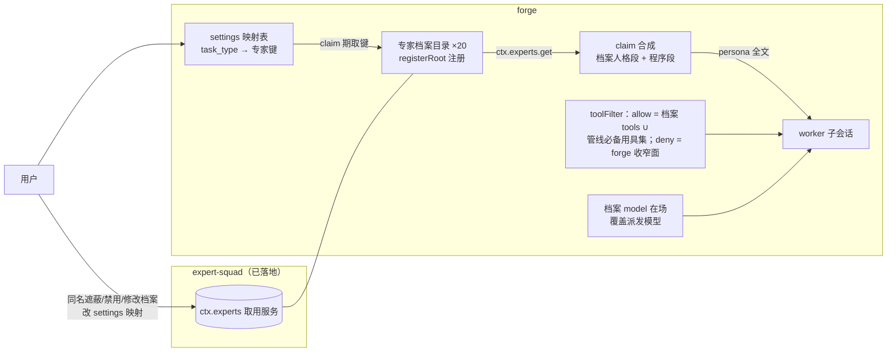

# forge 接入专家团：20 类任务预设专家化与强制面保持

> **修正注记（2026-10-27）**：正文中「20 档案与 20 类型一一映射」的断言已由 1.12/1.13 轮裁决取代——13 类任务类型携带随包预设专家档案（人格化键），7 个未用类型排除预设（两段缺键 → resolver 返回 undefined，persona 仅程序段形态兼容）。原文裁决文句保留不改。

> 前置依赖：[expert-squad](../expert-squad/proposal.md)（专家团插件，基础能力层）。本提案为消费方改造，须在前者 accepted 后实施。
## 1. 需求

**现状证据**：worker 角色由 `packages/core/src/forge/tasks/prompt/persona.ts` 的 `PERSONA_VARIANTS` 硬编码矩阵合成——20 个任务类型 × 3 复杂度，claim 瞬间 `composePersona` 拼装、经 `SpawnWorkerRequest.persona` 落子会话 system 面。任何角色调整都要改 core 源码、过全量质量门、随版本发版。

**具体需求**：
1. 20 类任务类型的 worker persona 外置为专家档案：forge 随包分发预设档案，用户可覆盖（同名遮蔽）、禁用、修改，无需改源码。
2. 任务类型 → 专家档案的映射表入 forge settings：默认映射随包，用户可改。
3. forge 程序强制面（submitTask 质量门、AC 证据门、fix 链/DAG 机械、工具 deny 底座）不因档案可编辑而松动。
4. 派发消费档案的工具白名单与模型偏好：不同 worker 可用不同工具集与派发模型。

**紧迫性**：persona 矩阵每加一种任务类型就在 core 里长一圈；角色调优（话术、履历、工具搭配）与源码发版节奏强耦合，迭代成本最高的一环恰是最常调的一环。

## 2. 方案

### 2.1 术语定义

- **预设专家** = forge 随包分发的 20 个专家档案，与 20 类任务类型一一对应；存放于 forge 侧 experts 目录，运行期经 `ctx.experts.registerRoot` 注册为 plugin 内置层（三层遮蔽定序 project > user > plugin，用户以同名档案遮蔽改造预设、禁用可恢复）。
- **映射表** = 任务类型 → 专家档案键的对应关系，存于 forge settings；随包默认映射，用户可改。
- **可编辑边界** = 档案全量内容（frontmatter + 正文）用户全权编辑；forge 的程序段（复杂度门禁、结算纪律、任务目录锚点节）在 claim 期合成时点追加、不入档案。
- **合成** = claim 领取瞬间组装 persona 全文字符串：档案人格段（身份头 + personaMd）+ forge 程序段（复杂度差异段、结算纪律、任务目录锚点节），经官方 `SubagentStartRequest.persona` 正门注入（上游落 scoped `deployment:persona-prefix` 段）——这是 forge worker 派发路径上 persona 的唯一通道，expert-squad 组装内核同构。

### 2.2 架构与交互面

### 2.3 用户可感知行为

1. **管线内（无感）**：派发任务时按映射表取专家档案合成 persona——行为与现状一致，但档案内容可被用户改过。
2. **档案管理**：用户在 project/user 层放同名 `.md` 即遮蔽 forge 预设；经面板或对话禁用预设并随时恢复；直接编辑档案热刷新生效。
3. **映射管理**：用户在 forge settings 中把某任务类型改指向自己的专家键，下次派发即取新档案。
4. **工具与模型差异化**：档案 tools 白名单生效（白名单外且非管线必备的工具在子会话不可见且调用被拒；claim/submitTask 等管线必备工具经组装期并集恒可用）；档案 model 在场时覆盖默认派发模型。

### 2.4 强制面保持（程序保证，不依赖提示词）

| 强制面 | 保证机制 | 是否受档案编辑影响 |
|---|---|---|
| submitTask 质量门 / AC 证据门 / fix 链 / DAG 守卫 | 管线状态机，本提案零触碰 | 否 |
| 结算纪律、保底质量门禁（复杂度分级）、任务目录锚点节 | forge claim 期程序段追加，不入档案（类型级 gate 指引归档案可编辑面） | 否 |
| 管线必备用具集（claim/submitTask 等结算链工具恒可用） | 组装期 `allow = 档案 tools ∪ 管线必备用具集`（官方 allow=keep-only 语义下并集保底），deny 收窄面照旧 | 否（并集保底） |
| 复杂度门禁差异（×3 复杂度松紧） | forge 程序段按任务复杂度渲染 | 否 |

### 2.5 跨模块/服务交互面

- forge ↔ expert-squad：plugin-forge inject `experts` 具名服务键；启动期 `registerRoot(ctx, <forge experts 目录>)` 后主动触发一次 `refresh()`——`registerRoot` 只追加 root 不触发重扫（registry.ts:182-184），预设目录注册后即立即可见；claim 期 `get(key)` 取档案（缺失/禁用 fail-loud 抛 `ExpertNotFoundError`/`ExpertDisabledError`）。
- 合成点改造：`composePersona(task_type, complexity)` 纯函数保留程序段渲染职责，档案取用面经 plugin-forge 注入（core 零 IO 纪律不变）。
- toolFilter：`SpawnWorkerRequest.toolFilter` 从 `{deny}` 放宽为官方完整 `ToolRestriction {allow?, deny?}`，driver 原样透传。官方语义 = allow（keep-only，仅保留名单）→ deny（remove，再移除名单），故组装公式为 **`allow = 档案 tools ∪ 管线必备用具集`、`deny = 既有 WORKER_TOOL_MATRIX 收窄面`**——并集保证管线工具不被档案白名单滤除，deny 收窄不回退。

### 2.6 技能面（现状维持）

官方 `SubagentStartRequest` 与持久 descriptor 均无 skills 字段——worker 技能 = 继承父会话 cwd 目录自动发现，与父会话同一套。档案 skills 标签不机械注入/过滤，仅作面板展示与选人元信息；技能搭配指引（如有）写在档案正文人格段，属可编辑面。

### 2.7 官方机械源码核销结论

| 引用面 | 出处（精确 pin @deepseek-ai/* 0.2.0-rc.2） | 结论 |
|---|---|---|
| persona 唯一注入通道 | `dsh-subagent/lib/types/types.d.ts:136-192`（SubagentStartRequest.persona） | 子会话人格经 persona 字符串注入，上游落 scoped `deployment:persona-prefix` 段；无 per-child section 注册缝 |
| toolFilter 落地机制 | `dsh-subagent/lib/types/child-agent.js:171-172`（childCtx.tools.restrict） | 子代理创建窗口 fail-closed restrict，可见性与执行同拒、未知名 loud 校验 |
| ToolRestriction 语义 | `dsh-tools/lib/types/index.d.ts:641`、`lib/index.js:2642` | allow = keep-only、deny = remove；同体叠加即「allow 并集保底 + deny 收窄」 |
| skills 无注入缝 | `dsh-subagent/lib/types/types.d.ts:136-192`、`descriptor.d.ts:70-78` | start 面与持久 descriptor 均无 skills 字段 |
| experts 取用服务 | `packages/plugins/expert-squad/src/registry.ts:22-94`（已落地） | `ctx.experts` get/list/registerRoot/setEnabled；registerRoot 仅追加 root、下次 refresh 生效 |

## 3. 改动影响范围

**纳入**：
1. `packages/plugin-forge/experts/`（新目录）：20 个预设专家档案。来源分层——有实战历史的类型从 `PERSONA_VARIANTS` 既有文本迁移改写为档案规范（frontmatter + 三段正文）；dsh-forge 从未使用过的类型按档案规范新撰、经评审入库。
2. `packages/core/src/forge/tasks/prompt/persona.ts`：`PERSONA_VARIANTS` 矩阵拆解，边界一刀切清——**每类型的 title/creed/gate 指引/workflow 叙述文本 = 类型级人格内容，全部迁出到档案可编辑面**；复杂度门禁差异（×3 松紧）、结算纪律、反搅动锚、任务目录锚点节 = forge 程序段，保留在本文件渲染（不入档案）。
3. `packages/core/src/forge/tasks/claim.ts`：persona 合成点改为「档案人格段（注入的取用面）+ 程序段」组装。
4. `packages/plugin-forge/src/dispatch-core/spawn.ts` + `src/spawn/in-process-driver.ts`：toolFilter 放宽为完整 `ToolRestriction` 并透传（组装公式见 2.5：allow = 档案 tools ∪ 管线必备用具集）；档案 model → `agentOptions.model` 条件携带。
5. plugin-forge 装配面：inject `experts` 服务键、`registerRoot` 注册预设目录、档案取用面注入 claim 链。
6. forge settings：任务类型 → 专家键映射表 schema（默认值 + 用户可改）。

**排除**：
- 主会话协调者 persona 升级、前段知识工作确认式接力——另立提案。
- 项目级专家管理（不同项目用不同专家）——展望项，UI/管理方式未定。
- 管线状态机强制面的任何改动——本提案零触碰。
- 子会话技能注入/过滤——官方无此缝，现状维持。

## 4. 风险

1. **用户编辑冲掉 forge 语义约束**：错误把人格写弱导致 worker 行为漂移。缓解：结算纪律/复杂度段由程序合成追加、不入可编辑区（架构性排除）；机器门状态机侧不变（验收 5 负向用例）。
2. **20 类预设迁移行为回归**：迁移后合成产物与旧矩阵产物文本不逐字节等价（结构已变），worker 行为可能漂移。缓解：逐类型内容核对留痕 + 首次实派观察收口（不做逐字节基线）。
3. **fail-loud 阻断派发的可用性代价**：禁用/删档/映射指向空键 → 对应任务类型派发阻断、任务留 pending。缓解：错误信息含专家键名（插件既有语义），用户可自行恢复。
4. **工具并集误伤/漏配**：管线必备用具集若漏配某结算链工具，或档案 tools 含未知名触发 loud 校验。缓解：必备用具集由现有 deny 矩阵派生面单源维护并加单测穷举；未知名校验在子代理创建窗口 fail-closed 报错（官方语义），负向用例进验收。

## 5. 验收

1. 默认映射下 20 类任务类型派发各取对应预设档案，合成 persona 两段齐全（档案人格段 + forge 程序段——复杂度门禁、结算纪律、任务目录锚点节）。
2. 用户在 project/user 层放同名档案遮蔽预设后，下次派发取遮蔽档案；删除遮蔽档回落预设；禁用预设后可恢复，恢复即回落。
3. 禁用/删除预设且无遮蔽、或映射指向不存在键时：派发 fail-loud 阻断（错误含专家键名）、任务留 pending、不产生空 persona。
4. 预设档案来源分层可核对：有实战历史类型逐类型内容核对留痕（对照旧 `PERSONA_VARIANTS` 文本）；未用过类型档案为新撰文本且经评审留痕。
5. 强制面负向：任意编辑档案后，submitTask 质量门/AC 证据门仍按原机制拒绝不达标结算；worker 无法经编辑把管线必备用具滤出可见面。
6. 工具面端到端（**真机取证**）：dsh-forge 宿主真机派发一单——档案 tools 白名单生效：白名单外且非管线必备的工具在子会话 prompt schema 不可见、调用被拒（负向）；claim/submitTask 等管线必备用具不受白名单影响恒可见可用。取证 = 子会话工具清单实测记录 + 拒绝调用报错截图，归档提案目录 walkthrough/。
7. 模型消费（**真机取证**）：档案 model 在场时子会话按该模型派发（子会话会话记录/面板模型字段实测），缺席回落 forgeSettings 默认；取证同 6 归档。
8. settings 映射覆盖：用户改某任务类型指向自己的专家键后，下次派发取新键档案；恢复默认映射后回落预设。

## 6. 一致性检查

- 验收 1 ↔ 纳入 1/2/3（预设档案 + 合成点改造）；验收 2 ↔ 纳入 1 + 2.5（registerRoot 三层遮蔽）；验收 3 ↔ 风险 3（fail-loud 裁决）；验收 4 ↔ 纳入 1（来源分层）；验收 5 ↔ 2.4 强制面表；验收 6 ↔ 纳入 4（toolFilter 并集公式）；验收 7 ↔ 纳入 4（model 消费）；验收 8 ↔ 纳入 6（映射表）；验收 6/7 的真机取证 ↔ 2.7 源码核销（运行期装配面结算门）。
- 逐条反向核对：纳入 1-6 各服务于验收 1-8 之一，无孤儿交付物；验收间无矛盾（验收 2 的「用户可改」与验收 4 的「迁移核对」分层不冲突——核对针对预设初始态）。
- 结论：双向核对通过，无冲突。
