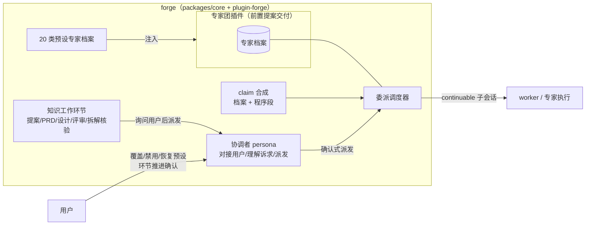

# forge 接入专家团：预设专家、协调者与知识工作委派

> 前置依赖：[expert-squad](../expert-squad/proposal.md)（专家团插件，基础能力层）。本提案为消费方改造，须在前者 accepted 后实施。

## 1. 需求

**现状证据**：worker 角色由 `packages/core/src/forge/tasks/prompt/persona.ts` 的 `PERSONA_VARIANTS` 硬编码矩阵合成——20 个任务类型各一份 `{title, creed, gate, workflow}`，claim 瞬间拼 persona 经 spawn 链落子会话。任何角色调整都要改 core 源码、过全量质量门、随版本发布；主会话亲自承担全部前段知识工作（提案/PRD/设计撰写、评审），上下文全压主会话。

**具体需求**：
1. forge 依赖专家团插件，把 20 类任务类型预设为专家；管线内按 task_type 自动取用；用户可覆盖/禁用/恢复预设。
2. forge 的程序强制面（submitTask 质量门、AC 证据门、fix 链/DAG 机械）不因人格可编辑而松动。
3. 预设主会话 persona 升级为**协调者**：对接用户、理解诉求、把知识工作环节派给专家执行；推进到下一环节时主动询问用户是否派发（不自动接力）。

**紧迫性**：persona 矩阵每加一种任务类型就在 core 里长一圈；前段知识工作没有委派通道，主会话上下文成为瓶颈。

## 2. 方案

### 2.1 术语定义

- **预设专家** = forge 随包提供的 20 个专家档案，与 20 类任务类型一一映射；用户可覆盖同键预设或禁用预设（预设本体保留、可恢复）。来源分层：**有实战历史的类型**从既有 persona 迁移；**dsh-forge 从未使用过的类型**不沿用旧文本，按档案规范新撰并经评审入库。
- **协调者** = 突击/远征模式预设的主会话 persona：对接用户、理解诉求、拆解委派——协调者不亲自执行专家可承担的工作，负责把环节派给专家并汇合结果向用户回报。
- **确认式接力链** = 协调者按环节顺序派发专家的执行序列：**不自动接力**——每次推进到下一环节，协调者主动询问用户「是否派发 subagent」，用户确认后才派发；前序专家产出作为后序专家输入自动传递。编排权在协调者程序面 + 用户逐环确认。
- **可编辑边界** = 专家档案人格面（title/信条/履历/技能标签）+ 扩展能力搭配，用户全权编辑（载体与规则见 expert-squad 提案）；结算纪律与门禁指引段由 forge 在 claim 期合成时点程序追加、不入档案编辑面——「不可编辑」由两段各自注册架构性达成。

### 2.2 架构与交互面

### 2.3 用户可感知行为

1. **管线内（无感）**：派发任务时按 task_type 经映射表取用专家档案合成 persona——行为与现状一致，但档案内容可被用户改过。
2. **管线内（前段）**：主会话以协调者身份对接用户——把提案/PRD/设计撰写、评审、拆解核验等环节派给专家执行。**每次推进到下一环节，协调者主动询问用户「是否派发 subagent」**，确认后才派发；前序产出自动作为后序输入（确认式接力）。产物落文档域，协调者向用户汇合回报。
3. **预设管理**：用户可覆盖同键预设（修改 20 类专家的话术/履历/白名单）或禁用预设并随时恢复；禁用后管线确定性降级。

### 2.4 强制面保持（程序保证，不依赖提示词）

| 强制面 | 保证机制 | 是否受专家编辑影响 |
|---|---|---|
| submitTask 质量门（compile/fmt/lint/test + coverage） | 管线状态机结算校验 | 否 |
| AC 证据门（ac_criteria 逐条核对） | 管线状态机结构化校验 | 否 |
| fix 链阻断/恢复、DAG 依赖守卫 | 管线状态机 | 否 |
| 结算纪律、门禁指引段 | forge 在 claim 期经官方 section 机械注册追加，不入档案 | 否 |

留 forge 的业务规则本体（承接 expert-squad 提案 2.5 裁决）：task_type → 档案键映射表；结算纪律/门禁程序段内容；工具白名单下限（deny 底座，子 scope 创建窗口内 fail-closed）；接力编排语义（协调者程序面）。

### 2.5 跨模块/服务交互面

- forge ↔ 专家团插件：plugin-forge inject 专家团服务键；claim 期经字符串键取档案；预设注入档案目录；前段知识工作经通用委派 API 派发。
- 协调者 ↔ 主会话：协调者 persona 承载委派与确认式接力的发起，结果汇合回主会话。
- forge ↔ 管线状态机：强制面全部留状态机侧，与插件无交互。

### 2.6 合成合规（源码核销硬约束）

- **两段式合成走官方机械**：人格段（档案）与程序段（forge 纪律段）经 scoped section 组合注册，forge **不得**对档案原文做字符串拼接/裁剪（无单点的「文本手术」，官方零先例）。
- **persona 唯一注入面**：钉死单一注入路径，避免 `preset/persona` 与 `composition.persona` 并存触发 `deployment:persona-*` 二次注册抛错。
- **白名单下限**：deny 底座（如 ask-user/queryTask）在子 scope 创建窗口内 fail-closed 落地，与档案白名单叠加取交集，禁派发后裁剪。

## 3. 改动影响范围

**纳入**：
1. `packages/core`：persona 合成改为「档案取用 + 程序段追加」两段式；`PERSONA_VARIANTS` 矩阵按来源分层建预设专家——有实战历史的类型从既有 persona 迁移；dsh-forge 从未使用过的类型按档案规范新撰（信条/履历/门禁指引对照类型语义重新起草，经 review 后入库）。
2. `packages/plugin-forge`：claim 链接专家团服务取档案（经类型映射表）；预设主会话 persona 升级为协调者（对接用户 + 环节推进询问 + 派发与确认式接力编排）；前段知识工作委派入口。
3. 预设专家随 forge 分发，含默认工具白名单与技能标签。

**排除**：
- 协调者询问话术细节——归 tech-design。
- 多专家并行竞争、绩效评估——展望项，本轮不做。
- 管线状态机强制面的任何改动——本提案零触碰。

## 4. 风险

1. **接力失控/上下文污染**：专家间自由互找会放大偏差。缓解：编排权收归协调者——派发必须显式、每环节推进经用户确认（不自动接力）、每步产物落盘可审计、用户持有逐步否决点。
2. **用户编辑冲掉 forge 语义约束**：错误把结算纪律改弱导致 worker 错用结算面。缓解：结算纪律/门禁段由程序合成追加、不入可编辑区（架构性排除，非提示词约束）；机器门状态机侧不变。
3. **20 类预设迁移行为回归**：有实战历史的 persona 迁移后合成产物漂移，worker 行为改变。缓解：该部分以「合成产物逐字节等价」为迁移验收基线，diff 即回归信号；新撰部分不做等价基线，但需经评审走查 + 首次实派观察后收口。
4. **前置依赖风险**：expert-squad 插案未落地则本提案阻塞。缓解：本提案在其 accepted 后实施；接口面（字符串键取用 + 通用委派 API）已在前者验收中钉死。

## 5. 验收

1. 删除/禁用任一预设专家后，对应任务类型派发时管线给出确定性降级（回落预设或明确报错），不产生空 persona。
2. 用户经对话或 UI 修改某预设专家的履历后，下一次派发对应任务类型，子会话 system 面包含修改后内容 + forge 程序合成的结算纪律/门禁段（两段式齐全）。
3. 确认式接力端到端跑通（≥3 环节，含评审步）：每环节推进前协调者均先询问用户、未确认不派发；确认后每步产物落盘、后步输入含前步产物、协调者收到汇合结果。
4. 预设专家落地后来源分层可核对：有实战历史的类型，`composePersona` 等价产物基线测试全绿（逐字节对比）；dsh-forge 从未使用过的类型，档案为新撰文本且经评审留痕。
5. submitTask 质量门/AC 证据门在专家被任意编辑后仍然按原机制拒绝不达标结算（负向用例）。
6. 用户覆盖同键预设后派发取用的是覆盖档案；恢复预设后回落预设档案。

## 6. 一致性检查

- 验收 1/6 ↔ 纳入 2 + 2.3 行为 3（预设管理）；验收 2 ↔ 纳入 1（两段式合成）+ 2.6 合成合规；验收 3 ↔ 纳入 2（协调者 + 接力编排）；验收 4 ↔ 纳入 1（来源分层迁移）；验收 5 ↔ 强制面表（2.4）。
- 逐条反向核对：每个纳入项均服务于至少一条验收，无孤儿交付物；验收间无矛盾（验收 4 的「等价基线」与验收 2 的「用户可改」分层不冲突——基线针对预设初始态）。
- 结论：双向核对通过，无冲突。
