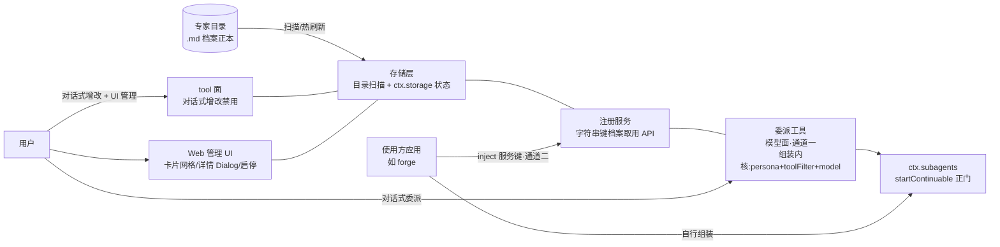

# 专家团插件：专家档案与注册取用的 dsh 基础能力

> 本提案为基础能力层；上层消费提案见 [expert-squad-forge](../expert-squad-forge/proposal.md)（forge 接入）。

## 1. 需求

**现状证据**：dsh 生态没有「专家/角色」的基础设施——角色 prompt 硬编码在各应用源码里（forge 的 `PERSONA_VARIANTS` 矩阵即一例），无法独立迭代；用户没有创建、管理、委派人格化子代理的通道；dsh 也没有「目录 `.md` 文件 → 可派发子代理」的机制（agent preset 是 YAML 组成行、静态装载、面向部署者，非用户目录形态）。

**具体需求**：
1. 专家档案独立于任何上层应用演进——用户可创建、修改、禁用专家，无需改应用源码。
2. 任何 dsh 应用可经插件服务键取用专家档案，供使用方自行组装派发。
3. 可被 dsh desktop 经 plugin-manager 安装使用，作为独立插件发布。

**紧迫性**：消费方（如 dsh-forge）的用户调优诉求（话术、履历、工具搭配）与源码发版节奏强耦合，迭代成本最高的一环恰是最常调的一环。

## 2. 方案

### 2.1 术语定义

- **专家团插件** = 独立 dsh 插件包（bundle + client 面），可被 dsh desktop 经 plugin-manager 安装启用；提供专家档案的持久化存储、运行期注册取用、**委派**三类基础能力——委派为**双通道**：**主会话对话式**（插件模型面委派工具，纯 dsh 环境即可用）与**使用方代码式**（使用方 inject 服务键取档案自行组装派发，如 forge）；两条通道共用同一取用与组装内核；面向一切满足 dsh 规范的应用，不感知任何上层业务语义（源码零上层业务词汇）。
- **专家档案** = 人格化专家的结构化描述，**载体 = 专家目录下的 `.md` 文件**（字段制定参考 claude code agent md 先例，`Z:\project\ai\forge\plugins\forge\agents\task-executor.md`）：frontmatter（**`name` = 见名知义的英文标识，即字符串键正本**——取用/派发/同名遮蔽均按它；`description` 一句话能力概述，模型选人依据；`title` 岗位；`tools` 工具白名单；`skills` 技能标签；**`model` 派发模型偏好**——使用方组装 `SubagentStartRequest` 时取用；`SKILL` 引用弃选——官方无 per-expert 技能注入缝，技能搭配指引归使用方 systemPrompt.section，弃选记录见 tech-design §8）+ 正文（**人设（Persona）**——Markdown 自由输入，做什么/不做什么与执行原则合一）——用户可直接编辑、git 可版本化。**履历（工作记录：执行过的任务、委派的主/子会话，作为迭代优化事实依据）不在本提案**——它是派发链产物，归独立提案（专家履历档案）。**派发映射（双通道共用同一组装内核）**：组装内核 = 字符串键取档案 → 合成 `SubagentStartRequest`（人设合成 `persona` 全文、`tools` 映射 `toolFilter`、`model` → 派发模型）→ `ctx.subagents.startContinuable()` 正门。**通道一（模型面）**：插件委派工具承载，主会话对专家说任务即触发——纯 dsh 环境开箱可用；**通道二（程序面）**：使用方 inject 服务键经取用 API 拿档案自行组装——使用方的业务规范经官方 systemPrompt.section 独立成段组合。persona 是子会话 system prompt 的**人格前缀段**（`deployment:persona-prefix`），**非完整系统提示词**：业务规范/host 保证段由官方机械组合，互不顶掉（preset/persona 的 `complete` 整段替换缝不采用）；人设随 descriptor 持久化、续聊 reapplied；英文标识 `name` 作为字符串键，不注入内容。frontmatter 的 `tools` 数组为插件自有字段，映射为 `toolFilter`（scoped `tools.restrict` 正门）生效；技能搭配粒度受官方限制——技能面整体开关（deny `skill` 工具）+ 人设指引，无 per-skill 白名单。
- **可编辑边界** = 档案全量内容（frontmatter + 正文）用户全权编辑；上层应用的程序段（如有）由上层在合成时点经官方 section 机械注册，不入档案编辑面——插件无保留段/锁字段机制。

### 2.2 架构

### 2.3 用户可感知行为

1. **对话式管理**：用户对主会话说「招募一个专家 / 把某专家的信条改掉 / 禁用某专家」，主会话经插件 tool 面完成增改禁用；**HR 预设**（部署侧 dsh-forge 装配层，插件不感知）绑定专家团管理工具，专职代办招聘与管理。
2. **文件直编**：用户在专家目录直接编辑/新增 `.md`，热刷新生效（含模型经 edit/write 工具修改）。
3. **Web 管理 UI**：大卡片网格专家管理面板——搜索/过滤/状态灯、卡片直读人设摘要/技能/白名单、详情 Dialog（查看/编辑双模式：岗位/简介/人设/白名单编辑，不暴露技术细节）、启停切换；**[召唤] 按钮打开 HR 预设招聘对话**；无入职向导、无委派按钮——修改、委派一律走会话对话。视觉对齐 DESIGN.md 与官方组件。
4. **委派执行（双通道）**：**主会话对话式**——向专家说任务，插件委派工具组装派发（接受点返回 childId，成果经子会话记录可见，追问经 send_message 同上下文续聊）；**使用方代码式**——使用方应用经取用 API 拿到人设与工具白名单自行组装派发，自有规范经 systemPrompt.section 独立成段。

### 2.4 官方机制合规（源码核销，Z:\project\github\deepseek-harness）

- **包形态**：npm 包 + `dsh.bundle.patch`（cordis.patch.yml 插行 `{id, name}`）+ `dsh.client` 声明（浏览器面走 `exports["./client"]`）；入口导出 `name/inject/Config/apply`，`apply` 写成 async function。
- **服务依赖**：全走 `inject` 具名服务键（`tools`/`systemPrompt`/`subagents`/`storage`），禁反射绕行；服务未就绪 = 合法 PENDING。
- **持久化（分层）**：档案正本 = 专家目录 `.md`——插件**自建目录扫描**，语义照抄官方 skill-filesystem（roots 约定、frontmatter 解析、坏文件 warn+ignore 单文件跳过、chokidar + `fs/observed` 双通道热刷新）；插件状态（启用/禁用、UI 偏好）经官方 `ctx.storage` 栈。不用官方 agent-presets 装载机制，也不给 dsh 打「agents 目录」补丁。
- **子代理（双通道共用）**：组装内核 = 档案 → `SubagentStartRequest`（persona/toolFilter/model）→ `ctx.subagents.startContinuable()` 官方正门（与 dsh-tool-subagent 内部同缝）；**仅 in-process provider（spawn/fork）支持 toolFilter**，进程外硬拒——派发钉死 in-process 路线。tools 控制链 = 档案白名单 → `SubagentStartRequest.toolFilter` → 子代理创建窗口 scoped `tools.restrict`（被滤工具不进 prompt schema 且拒执行，随 descriptor 持久化、续聊 reapplied）。追问/中断依赖官方 `dsh-tool-subagent-control`（`send_message`/`interrupt_agent`）。
- **委派分工（复用裁定 · 双通道版）**：不改装 `@deepseek-ai/dsh-tool-subagent` 派发——其 `persona`/`toolFilter` 为装载期静态 Config，一实例一份固定值，表达不了「运行期字符串键 → N 份热刷新档案」的动态选择。通道一的委派工具为薄自建层（字符串键 → 取档案 → 组装 → 正门），承重机械全官方；通道二零插件代码（使用方直接消费取用 API）。
- **Web 面板**：组件经 `ui-slots` 槽位 register 注入，bundle 由 Host `/plugins/` 路由伺服；纯 UI 插件 host 半空 apply 占位。
- **安装/启停**：一律走 plugin-manager（`installBundle`/`setBundleEnabled`，pnpm 装进 profile）；peer DSH 版本精确声明，否则被兼容门拒装。**发布边界（Q5 裁决）**：包住本仓 `packages/plugins/expert-squad`，发布为独立 npm 包（与 git-worktree 插件同形）；开发期 plugin-manager `link:` 安装，正式安装走 npm 精确 pin——验收 4 的安装源口径以此为准。
- **宿主保证不绕**：会话日志 append-only、header 创建时定型；模型可见输入必须落成可重放 SessionEvent；不碰 protectedModules；工具名/段名不撞注册面。

### 2.5 通用缝（对抗式架构评估裁决）

**裁决：conditional——中立的是词汇与规则内容，内置的仅限零上层业务词汇的通用强制面机制。** 上层业务规则（映射表、程序段内容、白名单下限数值、编排语义）一律留上层。

进插件的通用缝（三条，全部官方同构）：
1. **注册期通用 schema 校验**：禁裸 `{{`、撞名检测，fail-loud，写入口统一拦截——裸 `{{` 拦截为**插件自定更严策略**（官方 systemPrompt 对孤立无闭合的 `{{` 按字面 prose 放行，仅 malformed 组/未知变量/缺值抛错，`system-prompt/src/index.ts:271-274`）；撞名检测有官方同构先例（lsp 注册前全量校验、skill 保留名撞名即抛）；
2. **通用档案取用与委派通道**：字符串键取用 API（返回 name/title/简介/人设/工具白名单/技能标签/model）+ 模型面委派工具（通道一，组装内核见 §2.1 派发映射）；**档案来源三层化**——plugin 内置（上层插件随包 `experts/` 目录，经通用 root 注册 API 声明，同构 annotutor 内置技能 customSkillDirs 形态）/ user（profile 下）/ project（工作区下）三层 root 合并扫描，同名遮蔽定序 project > user > plugin 内置（用户以同名档案遮蔽改造内置专家，不改上层包），禁用状态按 origin + 档案键隔离存储（升级不洗掉用户选择）；
3. **合成走官方既有机械**：scoped section 组合 + composition.persona 单写者，**不发明**保留段/锁字段/合成钩子新机械；上层程序段由上层经此机械自行注册，插件不代管。

**tech-design 强制钉死项**（源码核销硬约束）：
- **persona 注入 scope 唯一**：派发钉死单一注入路径——人设经子 scope 注册（`composition.persona` 正门），**禁止在 registry 全局 scope 二次注册 `deployment:persona-prefix`**（与 preset/persona 全局注册同 scope 撞名即抛错；子 scope 遮蔽全局为官方合法语义，非错误状态）；使用方自有规范段走 systemPrompt.section 独立成段，与人格前缀段由官方机械组合——组合窗口与段序归 tech-design 钉死；
- **白名单落地时点**：子 scope 创建窗口内 fail-closed，禁派发后裁剪。

### 2.6 跨模块/服务交互面

- 插件 ↔ dsh 官方：bundle patch 层进入 Loader 组合；`ctx.storage` 持久化；`ctx.tools` 注册面；`subagents` 服务官方 continuable provider 面（通道一派发正门）；UI 经 `ui-slots` 槽位 + `/plugins/` 路由伺服；安装启停经 plugin-manager。
- 插件 ↔ 宿主应用（使用方）：应用 inject 专家团服务键（官方正门，同构先例 tool-agent-team → agentTeams）；通道二经字符串键取档案自行组装派发（人设 → persona，白名单 → toolFilter，自有规范 → systemPrompt.section）。
- 插件 ↔ Web：管理 UI 为客户端插件，经槽位注入独立面板；UI ↔ 插件数据通道走 `ctx.connection.fetch.register` 精确 `/api/<plugin>/<endpoint>` 路由 + 路由面 zod 门（rpc.handle/intercept("/api") 不可用，见 2.7）；双向联动（对话创建 ↔ UI 向导弹出）。

### 2.7 前车之鉴（annotutor 插件真机实证）

独立 dsh 插件 `@annotutor/annotutor` 真机启用全程实证：官方激活链的错误文案只暴露第一环，单测全绿 ≠ 真机可启用；官方缝须按实测语义选（数据通道正门 = `ctx.connection.fetch.register`，rpc.handle/webServer 有不可达面）；客户端产物有严格装载契约（自注册 cjs、react 永不内联、client face 须组合 `apply`）。本提案 tool 面、Web 交互面、UI 构建与验收 4 取证均受其约束，配方细节以经验目录正本为准（经验持续增加，不随提案更新）：

> **经验目录**：`Z:\project\dsh\annotutor\docs\README.md`（lessons/ + reference/ 索引；正本为 dsh-plugin-dev-guide 完整实装指南，另有真机验证手册与两篇 gotcha）

## 3. 改动影响范围

**纳入**：
1. 新插件包 `packages/plugins/expert-squad`：按 dsh 插件规范（bundle + client 面）实现存储/注册/委派三模块——存储 = 专家目录 `.md` 扫描（语义照抄 skill-filesystem）+ `ctx.storage` 状态层；注册 = 2.5 通用缝（字符串键取用 API + 三层来源）；委派 = 模型面委派工具（通道一，组装内核见 §2.1 派发映射）。
2. tool 面（对话式增改禁用 + 委派）与客户端 UI 插件（卡片管理面）。

**排除**：
- 存储选型细节、UI 视觉细节——归 tech-design。
- 多专家并行竞争、专家绩效评估、执行日志分析——展望项，本轮不做。
- 官方 agent-presets / skill 装载机制的改制——只走官方合法缝，不改制。

## 4. 风险

1. **插件可移植性漂移**：插件被写成某上层应用专属。缓解：装配缝归属插件域（AGENTS 1.3），源码零上层业务词汇；走查以「插件能否脱离任何特定应用独立服务其他 dsh 环境」为判据（验收 6）。
2. **官方机械合规漂移**：peer 版本声明不当被兼容门拒装；绕官方缝自造注入/存储被桌面包容错路径清除；persona 注入面撞名双写即崩。缓解：以 2.4 源码核销清单为装配正本；2.5 钉死项进 tech-design 强制门槛；桌面端安装/启停/面板走查为交付前强制取证（外部依赖装配面结算门 = 真机端到端取证）。
3. **坏档案静默落库**：用户写入含裸 `{{` 或撞名键的档案，失败在派发链末端爆开、远离编辑点。缓解：2.5 注册期校验在写入口 fail-loud 拦截（负向用例验收）。

## 5. 验收

1. 对话式增改禁用端到端可用（含经 HR 预设代办招募）；**通道一委派端到端可用**（主会话向专家说任务 → 子会话按人设与白名单执行，委派即返回 childId、成果经子会话记录可见；白名单外工具在子会话 prompt schema 不可见且调用被拒为负向用例；追问经 send_message 同上下文续聊）。
2. 取用 API 契约（通道二）：使用方 inject 服务键后，字符串键取用返回完整档案（name/简介/人设/工具白名单/技能标签/model），可据此组装 `SubagentStartRequest` 完成一次派发（其编排细节归消费方提案）；被禁用专家取用 fail-loud（降级契约）。
3. Web 管理面三能力（卡片网格检索 / 详情 Dialog 查看 / 编辑模式保存并热刷新）可用；无入职向导、无委派按钮。视觉走查对齐 DESIGN.md，取证归档提案目录。
4. 插件可在 dsh desktop 经 plugin-manager 安装、启用、禁用：安装走 `installBundle`，卡片管理面板经 `/plugins/` 路由加载可用（真机端到端取证）。
5. 专家目录热刷新：直接编辑/新增 `.md`（含模型经 edit/write 工具修改），不重启即在下一次取用/派发生效；坏文件（缺 frontmatter/坏 YAML/含裸 `{{`）被拒且不影响其余专家。
6. 插件在无任何特定上层应用的 dsh 环境可独立装载并**经通道一完成一次通用派发**（纯 dsh 环境开箱委派即证基础能力）；插件源码与档案 schema 零上层业务词汇。
7. persona 经子 scope 注入（不在 registry 全局 scope 二次注册 `deployment:persona-prefix`），两通道派发全程无撞名异常；通道二契约附派发前置约束（persona scope 唯一、白名单创建窗口 fail-closed），契约文档与 API 同交付。
8. 三层档案来源：上层插件经通用 root 注册 API 声明随包内置专家目录可被取用；同名遮蔽按 project > user > 内置生效；禁用内置专家后升级该上层包，禁用状态保持。

## 6. 一致性检查

- 验收 1 ↔ 纳入 2（tool 面 + UI）与纳入 1（委派模块）；验收 2 ↔ 纳入 1（取用 API，§2.1 派发映射通道二）；验收 3 ↔ 纳入 2（UI 模块）；验收 4 ↔ 2.4 安装合规；验收 5 ↔ 纳入 1（存储模块热刷新）；验收 6 ↔ 风险 1 可移植性判据 + 通道一开箱性；验收 7 ↔ 2.5 钉死项；验收 8 ↔ 2.5 通用缝 2（三层档案来源）；HR 预设 ↔ 2.3 行为 1（部署侧装配，插件零感知）。
- 逐条反向核对：每个纳入项均服务于至少一条验收，无孤儿交付物；验收间无矛盾。
- 结论：双向核对通过，无冲突。
