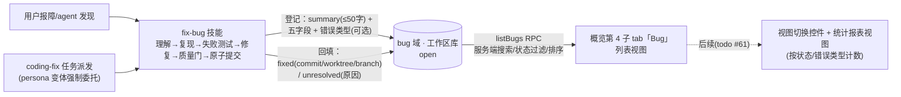

# 提案：fix-bug

## 问题（Problem）

老 forge 的 `/fix-bug`（`Z:\project\ai\forge\plugins\forge\commands\fix-bug.md`）——TDD 修缺陷工作流
（**理解 → 复现 → 失败测试先行 → 最小修复 → 质量门 → 原子提交**）——在新系统零承接：

- `packages/plugin-forge/skills/` 五技能无 fix-bug；`coding-fix` 派发模板无「失败测试证明 bug 在场
  之前禁改产品码」纪律；
- 即便迁技能，老 fix-bug 的 Bug Summary（Bug/Trigger/Expected/Actual/Suspected location 五字段）
  只存在于会话文本：不可检索、不可沉淀、UI 不可呈现；
- 任务内失败有 fix-N 修复任务链，但无结构化 bug 台账；任务外发现（人工测试、用户报告）无承载。

紧迫性：修缺陷是日常高频路径；不可复现 bug 的排查过程不留痕 = 重复排查成本持续发生。

本提案取代 2026-10-09 草案 `migrate-fix-bug-skill`（其范围 = 本提案技能条目的子集；其 Knowledge
Review 迁移块与 justfile 质量门假设经本次裁决不再成立——本仓无 justfile，知识提取待知识库重构
todo #39 后再议；其「coding-fix 模板不回填」排除项经 2026-10-13 裁决反转为派发委托 fix-bug 流程）。

## 方案（Solution）



**技能**（`skills/fix-bug/SKILL.md`，独立用户直调）：六步核心循环保留；三处适配——① Step 1
**必须搜集项目规范/惯例**（手段不限——知识库、docs/、AGENTS.md 等，不强制特定 skill 或工具）；
② 质量门保留 **compile→fmt→lint→unit-test 四门序列**，具体命令由 agent 自行决策（本仓无
justfile，禁机械套用固定配方——与派发简报保底门同哲学）；③ 示例用工具语义/直接命令，不假设
bash（Windows 兼容）。不可复现即停（HARD-GATE）时仍回填 unresolved 记录。Knowledge Review 不迁。

**coding-fix 派发委托**：`coding-fix` 类型任务的派发简报（persona 工作流变体）强制委托 fix-bug
技能——worker 走同一 TDD 流程并两阶段落库（先例：`test-run` 变体强制 run-tests）；由此产出的
bug 记录携带来源任务链接，台账与任务池双向可溯。

**Bug 台账**（两阶段落库，单表）：诊断阶段登记 open 记录（一句话摘要 summary ≤50 字 + 五字段 +
可选错误类型 + 发现会话 report_session_id + 发现者 reporter）；终态回填 fixed（commit_hash/
worktree/branch 三证据 + 修复会话 fix_session_id + 修复者 fixer）或 unresolved（原因
unresolved_reason）。会话与身份字段由工具自行解析；commit_hash 由 agent 在原子提交后立即捕获
（并发安全），worktree/branch 由工具以 hash 为锚反查——不依赖 agent 提供仓库态。不可改史：
无编辑/删除面，unresolved 回填代替删除。错误类型为自由标注（枚举归统计视图落地时裁决），
本期入库备统计维度。

**Bug 子 tab**（概览第 4 子 tab：提案 | feature | 任务 | Bug）：本期仅列表视图——搜索 + 状态
chips（open/fixed/unresolved）+ 排序（活跃优先/最新创建）；列表行 = summary 主行 + 状态 +
错误类型 + 时间，**点击行开 Bug 详情弹框**（详情文字长，行内不展开）——任务详情弹窗同款
**可拖动弹框**：居中初始位 + 标题栏拖移 + 视口钳制（`drawerPositionFromDrag` 同刻度）；
会话 pill 命中 title 可点击跳转。形态零新交互模式。

**跨模块交互面**：

| # | 交互面 | 对齐先例 |
|---|---|---|
| 1 | 技能 ↔ agent 工具（登记/回填两写径） | brainstorm ↔ createProposal |
| 2 | plugin-forge 工具 ↔ core bug 域服务（装配注入） | addTask ↔ tasks 域 |
| 3 | core ↔ web：listBugs RPC（服务端过滤承载） | 三既有子 tab 同构 |
| 4 | bug 写后事件 → 子 tab 刷新 | 四域 emitTasksChanged |
| 5 | contracts：BugStatus/BugCard/listBugs 查询参 | TaskStatus/TaskCard 同构 |
| 6 | coding-fix persona 变体 ↔ fix-bug 技能（强制委托） | test-run ↔ run-tests |
| 7 | worker 工具过滤面 ↔ bug 写径工具（coding-fix worker 放行） | deriveWorkerToolFilter 类型映射 |

## 技术细节（突击内联——无 tech-design 阶段）

**持久化**：工作区库 `forge.db` 新增 **bugs 单表**——`WORKSPACE_MIGRATIONS` **v1 直改**（沿仓规：
产品未上线、存量开发库废弃重扫，先例 M3/S3）。生命周期最多两次写（登记/回填），终态行自身即
全史，不设审计表与触发器：

```sql
CREATE TABLE bugs (
    id               TEXT PRIMARY KEY,
    summary          TEXT NOT NULL,   -- 一句话摘要（≤50 字，登记时生成——列表主行 + search 命中面）
    bug_desc         TEXT NOT NULL,   -- Bug：完整描述
    trigger_desc     TEXT NOT NULL,   -- Trigger：复现步骤/输入
    expected         TEXT NOT NULL,   -- Expected：正确行为
    actual           TEXT NOT NULL,   -- Actual：观察到的行为
    suspected        TEXT,            -- Suspected location（file:line——open 态续修线索，可空）
    error_type       TEXT,            -- 错误类型（自由标注——统计维度备料，可空）
    bug_status       TEXT NOT NULL DEFAULT 'open'
                     CONSTRAINT ck_bugs_status
                     CHECK (bug_status IN ('open', 'fixed', 'unresolved')),
    commit_hash      TEXT,            -- ┐
    worktree         TEXT,            -- ├ fixed 证据（回填时写）
    branch           TEXT,            -- ┘
    unresolved_reason TEXT,           -- unresolved 原因（回填时写）
    source_task_id   TEXT REFERENCES tasks(id),  -- coding-fix 委托来源任务（可空）
    report_session_id TEXT,          -- 发现会话（登记时写——工具执行会话自动携带）
    fix_session_id   TEXT,           -- 修复会话（fixed 回填时写——同前）
    reporter         TEXT NOT NULL,   -- 发现者（git user.name，缺席回退 user.email——登记时解析）
    fixer            TEXT,            -- 修复者（同解析规则——fixed 回填时写）
    created_at       TEXT NOT NULL,   -- 登记时刻
    updated_at       TEXT NOT NULL    -- 回填时刻（未回填 = created_at）
);
CREATE INDEX idx_bugs_status ON bugs(bug_status, created_at);
```

**工具面**（plugin-forge 新增两工具，落位 `tools/`，会话绑定同 addTask 径；**仓库态与身份字段
工具自取、不依赖 agent 解析**——唯 commit_hash 例外由 agent 捕获（并发安全）；core 侧 git
访问先例 `forge/tasks/git-lookup.ts`）：

`recordBug`（登记 → open，返回 bug_id；agent 只提交语义字段）：

| 参数 | 获取方式 | 来源 |
|---|---|---|
| summary | agent 拟写（≤50 字） | 技能 Step 1 诊断结论一句话 |
| bug_desc/trigger_desc/expected/actual | agent 拟写 | Step 1 Bug Summary 五字段（诊断产出） |
| suspected | agent 拟写（可空） | Step 1 grep/glob/read 定位 |
| error_type | agent 标注（可空） | 诊断分类 |
| source_task_id | **工具注入**——派发上下文 | worker 派发简报携带的任务身份；standalone 路径缺席 |
| report_session_id | **工具自取** | 执行会话上下文（ToolSessionContext） |
| reporter | **工具自取** | `git config user.name`，缺席回退 `git config user.email` |

`resolveBug`（回填终态；agent 只提交 bug_id + commit_hash + 终态选择 + unresolved_reason）：

| 参数 | 获取方式 | 来源 |
|---|---|---|
| bug_id | agent 引用 | recordBug 返回值 |
| commit_hash | **agent 捕获** | fix+tests 原子提交后立即 `git rev-parse HEAD` 记录（技能 Step 6 提交→捕获→回填，零并发窗口；并发提交下工具自取 HEAD 不可信） |
| worktree | **工具自取** | 以 commit_hash 为锚 `git worktree list --porcelain` 匹配 HEAD==hash（未命中——提交后分支又推进——回退 branch --contains，worktree 留空） |
| branch | **工具自取** | 同锚同源：porcelain 的 branch 字段（回退 `git branch --contains <hash>`） |
| fixer | **工具自取** | git user.name，缺席回退 user.email |
| fix_session_id | **工具自取** | 执行会话上下文 |
| unresolved_reason | agent 拟写 | Step 2 复现失败排查结论（HARD-GATE 停机原因） |

**落点清单**（file 粒度）：

| 层 | 落点 | 改动 |
|---|---|---|
| core | `forge/workspace/migrations.ts` | v1 直改 +bugs 单表与状态索引 |
| core | `forge/small-domains/bugs.ts`（新） | 第五小域：registerBug/resolveBug/listBugs + 写后事件 |
| contracts | Bug 状态/卡片/ListBugsQuery | search/status/sort 参（三既有子 tab 同构）+ bugs.list RPC 面 |
| plugin-forge | `tools/record-bug.ts`、`tools/resolve-bug.ts`（新） | 两写径工具；工具名册 + worker 工具过滤放行 coding-fix |
| plugin-forge | `skills/fix-bug/SKILL.md`（新）+ `skills/README.md` | 六步 TDD 技能 + 两阶段落库指令 + 清单 |
| core | `tasks/prompt/persona.ts` | coding-fix variant workflow 改单行委托 fix-bug（test-run 先例） |
| web | `views/overview/` | OVERVIEW_SUBTABS +bug；overview-data bugs 装载分支；bug 列表行组件 + BugDialog 可拖动详情弹框（sessionTitleOf/openSession 注入） |

**Bug 子 tab 形态**（列表视图 + 详情弹框；任务详情弹窗同款可拖动弹框——标题栏拖移 +
视口钳制 4px 边距、标题栏恒可见）：

```text
列表（行不展开——点击整行开弹窗）：
│ [提案][feature][任务][Bug]                ← 第 4 子 tab
│ 🔍 搜索___  (open 3)(fixed 12)(unresolved 1)  ⇅ 活跃优先
│ ● 登录接口 500                    open   api   10-13   ← 主行 = summary(≤50字)
│ ● 空分页游标越界                   fixed  paging 10-12

详情弹框（BugDialog——可拖动弹框布局线框，⠿ 标题栏 = 拖移把手）：
┌─ ⠿ Bug 详情 ──────────────────────────────── ✕ ┐
│ ● open   ·  api   ·  10-13 14:02              │  ← 状态点 + 错误类型 + 时间
│ 登录接口 500                                   │  ← summary 大字
│──────────────────────────────────────────────│
│ Bug        登录接口偶发 500，空 body 时必现     │  ← 五字段 kv 区
│ Trigger    POST /login 空 body                │
│ Expected   400 参数错误                        │
│ Actual     500 内部错误                        │
│ Suspected  apps/host/…/auth.ts:88             │
│──────────────────────────────────────────────│
│ 修复证据（fixed 时呈现；open/unresolved 隐藏）   │
│ commit a1b2c3d · worktree wt-x · branch fix/x │
│──────────────────────────────────────────────│
│ 发现  faner · [⟞ 会话标题]                     │  ← 会话 pill：命中 title
│ 修复  faner · [⟞ 会话标题]                     │     = 可点击跳转（openSession）
│ 未修原因  仅 release 构建出现（unresolved 时呈现）│  ← unresolved_reason
│ 来源  任务 fix-1（coding-fix 委托路径）         │
└───────────────────────────────────────────────┘
```

会话解析与跳转复用既有缝：`sessionTitleOf`（dsh 账本快照）命中 = 可点击 title +
`uiWorkspace.openSession` 跳转；缺席 = fail-soft 回退 sessionId 不可点击。

## 改动影响范围（Scope）

**In-scope：**

1. `packages/plugin-forge/skills/fix-bug/SKILL.md` 新建（六步循环 + 两阶段落库指令 + 三适配）；
   `skills/README.md` 清单 +fix-bug。
2. core bug 域：登记/回填/listBugs 服务 + 状态机（open→fixed｜unresolved）；工作区库 bugs 单表
   承载（WORKSPACE_MIGRATIONS v1 直改——存量开发库废弃重扫）。
3. agent 工具：登记 + 回填（plugin-forge tools 面；agent 只提交语义字段——summary≤50 字/五
   字段/错误类型/commit_hash/终态选择/unresolved_reason；reporter·fixer·worktree·branch·
   两会话列由工具自取（hash 锚定反查）；登记面超长摘要拒写）。
4. contracts：BugStatus / BugCard / listBugs 查询参类型。
5. web：概览第 4 子 tab「Bug」列表视图 + Bug 详情弹框（BugDialog——可拖动，任务弹窗同款
   拖移/钳制模型；sessionTitleOf/openSession 注入）+ 写后事件刷新接线。
6. coding-fix 派发委托：persona 工作流变体改为强制 fix-bug 技能（TDD 流程 + 两阶段落库）；
   worker 工具过滤面放行 bug 写径工具；bug 记录携带来源任务链接。
7. 单测（core 域服务 + persona 变体 + web 视图）；旧草案文件标记 superseded 指向本提案。

**Out-of-scope：**

- Knowledge Review 自动提取（待知识库重构 todo #39 后再议）；
- 统计报表视图与视图切换控件（已记 todo #61；错误类型字段本期入库备维度）；
- bug ↔ 任务的更多联动 UI（任务弹窗反向跳 bug 列表等——本期仅 bug 详情展示来源任务标识）；
- bug 编辑/删除（不可改史；unresolved 回填代替删除）；
- git-commit/git-checkout 等其余老技能迁移。

## 风险（Risks）

| # | 风险 | 缓解 |
|---|---|---|
| 1 | 技能文本与工具参数双源漂移（SKILL.md 描述字段 ≠ 工具 schema） | 字段单源 contracts；技能文本只引用工具调用不自造格式；验收含文本零自造字段断言 |
| 2 | v1 直改后存量开发 forge.db 版本门拒绝打开（仓规代价） | 手工废弃重扫为既定纪律；提交说明注明处置路径；schema.test pin 防漂移 |
| 3 | 概览子 tab 三→四波及面宽（OVERVIEW_SUBTABS/装载分派/聚焦语义/既有测试） | 零新交互模式；改点以技术细节落点清单为准；回归 = web 视图单测全量 + e2e 冒烟 |
| 4 | 会话中断 bug 永停 open（两阶段落库固有态） | open 记录含 suspected 续修线索可检索；不自动回收、不引入新机械 |
| 5 | coding-fix 简报膨胀 + worker 工具过滤面遗漏 bug 写径（流程断裂） | persona 变体单行委托（先例 test-run 形态），不内联技能全文；工具放行清单入落点清单并加单测钉住 |

## 验收标准（Success Criteria）

1. `skills/fix-bug/SKILL.md` 在场（frontmatter 合发现约定），含四硬语义：复现失败即停、失败测试
   先行禁令、质量门 compile→fmt→lint→unit-test 四门序列（命令 agent 自选）、fix+tests 原子提交 +
   Root cause 注记；另含项目规范/惯例搜集义务（不强制特定工具）；`skills/README.md` 六技能
   清单一致。
2. 登记工具产生 open 记录（summary ≤50 字——超长拒写 + 五字段 + 可选错误类型 + 发现会话 +
   发现者 reporter）；回填工具写终态（fixed 携 commit_hash（agent 提交后捕获）+ 工具 hash 锚定
   反查的 worktree/branch + 修复会话 + 修复者 fixer / unresolved 携 unresolved_reason）；
   不可复现停机路径产出 unresolved 记录。身份/会话/仓库态解析径有单测钉住（agent 不手填）。
3. bug 记录持久化于工作区库 bugs 单表（v1 直改 + schema pin 单测）；listBugs 支持搜索/状态
   过滤/排序（服务端承载）。
4. 概览第 4 子 tab「Bug」在场：列表视图 = 搜索框 + 状态 chips（计数 disabled 语义同任务 chips）+
   排序 + summary 主行；点击行开 Bug 详情弹框（BugDialog 可拖动——五字段 kv + 证据 + 人员 +
   会话 pill + 来源任务标识；会话命中 title 可点击跳转，缺席 fail-soft 回退 id）；bug 写事件
   触发子 tab 刷新。
5. coding-fix 派发简报含 fix-bug 强制委托（TDD 流程 + 两阶段落库指令）；其执行产出的 bug 记录挂
   来源任务；worker 工具面含 bug 写径工具。
6. 旧草案 `migrate-fix-bug-skill` 标记 superseded 指向本提案；本提案注册进提案域。
7. 质量门绿：`pnpm lint` + `pnpm test`（新增 core/web 单测全过）。

**一致性检查**：SC1↔条目1；SC2↔条目1+3（技能指令与工具写径互证）；SC3↔条目2；SC4↔条目5；
SC5↔条目6；SC6↔条目6；SC7↔全范围回归。每个 in-scope 条目均喂给至少一条 SC（条目1→SC1/SC2，
条目2→SC3，条目3→SC2/SC5，条目4→SC3（类型面），条目5→SC4，条目6→SC5，条目7→SC6/SC7）；
无互相矛盾（out-of-scope 清单与 SC 禁引一致）。检查通过，2026-10-13。
