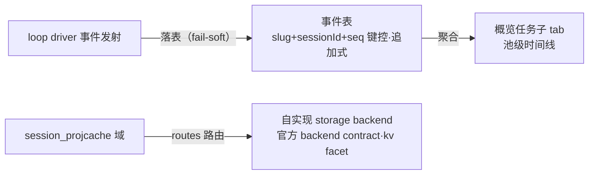

# forge-event-table：池级事件表 + 投影缓存存储介质（初始想法）

## 需求界定

从 loop-event-delivery 分出（用户裁决 2026-10-18）：

1. **池级事件表**：任务循环全部事件（十八场景含 ⑰ 中断）独立落表——slug 键控、跨会话、追加式；供概览任务子 tab 的 slug 调度时间线聚合（循环事件 + 任务事件）。
2. **投影缓存存储介质**：自实现 storage backend（官方 backend contract），经 `storage-domain.routes` 路由 `session_projcache` 域——cache API/协议不变，仅换持久介质（集中存储）。

两项同提案的原因：同一取证面（storage-domain / backend contract），介质实现与表落地共享装配工作。

## 初始方向（未深挖）

- 事件表：官方 `ctx.storageDomain` schema 校验记录域；行形状初始想法 `{ projectId, sourceSlug, taskKey, sessionId, seq, scenario, taskLabel, time, workerSessionId, status }`。
- incident-log 维持异常族长文全文落盘，不扩场景；事件表只存事件行，长文仍指向 incident 子文件夹。
- 自实现后端：实现官方 backend contract（kv facet）+ cordis.patch `routes` 路由；真机 e2e 取证门（external-dependency-verification）。

## 已核销的缝

- `storage-domain` 后端路由 = 官方配置缝（`backend` 默认 + `routes` 按域覆盖；cordis.patch.yml:173-176 现路由 `json`）。
- 官方 KV 后端现仅 storage-json——自实现后端是插官方孔，非平行机械。
- cache API 形状约束：每会话整文档存取——DB 后端不改变此形状，收益为存储集中。

## 开放问题（深挖时解决）

- 表 schema 定稿（⑰ 中断事件载荷、worker 会话 id 来源）。
- 池时间线读面（概览任务子 tab 经何种通道读表：RPC 形态/分页/过滤）。
- 与 loop-event-delivery 投影键的关系（面板仍只走投影机制，互不耦合）。
- backend 介质选型（SQLite/其它）与取证程序。
