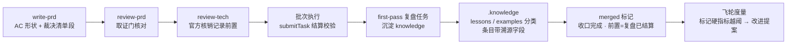
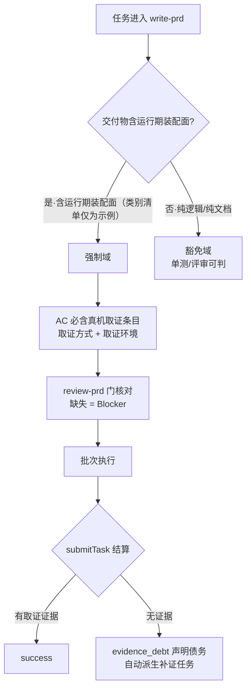
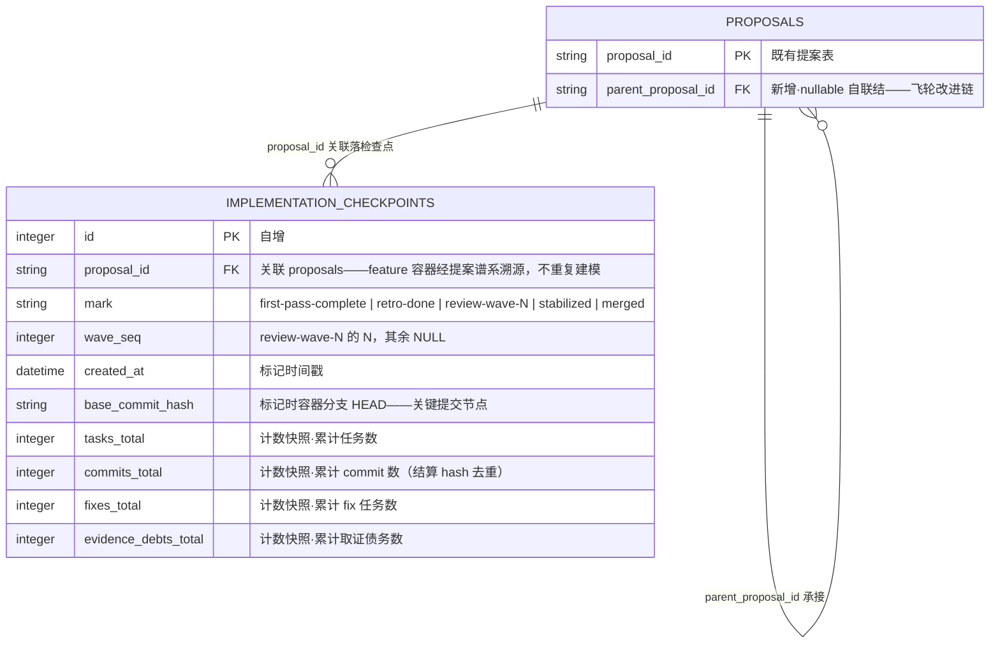
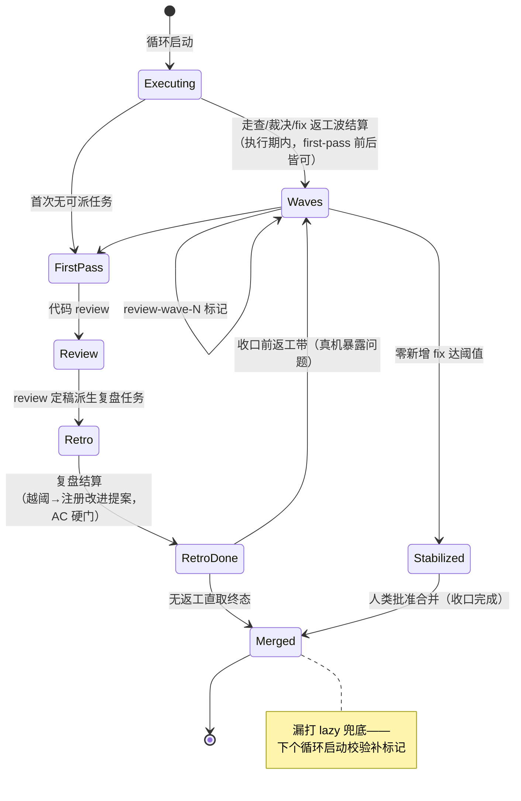
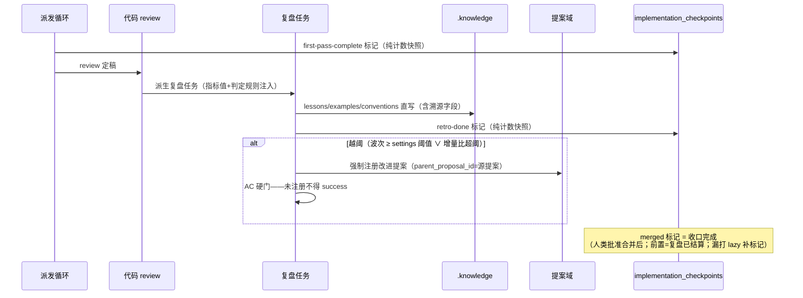
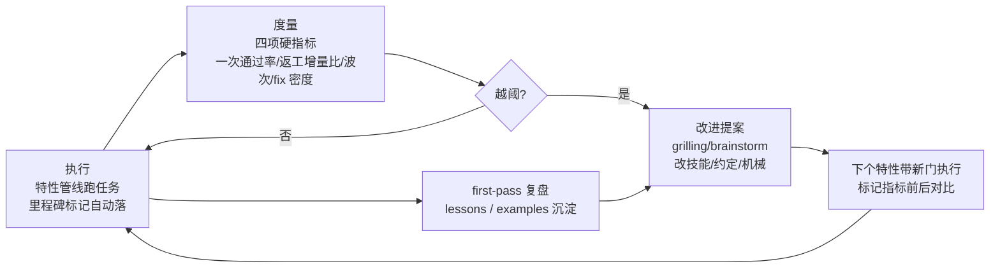
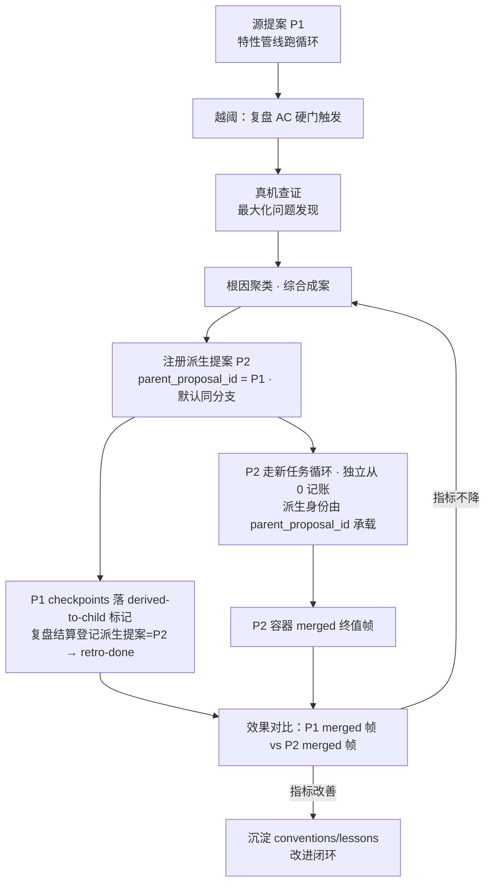
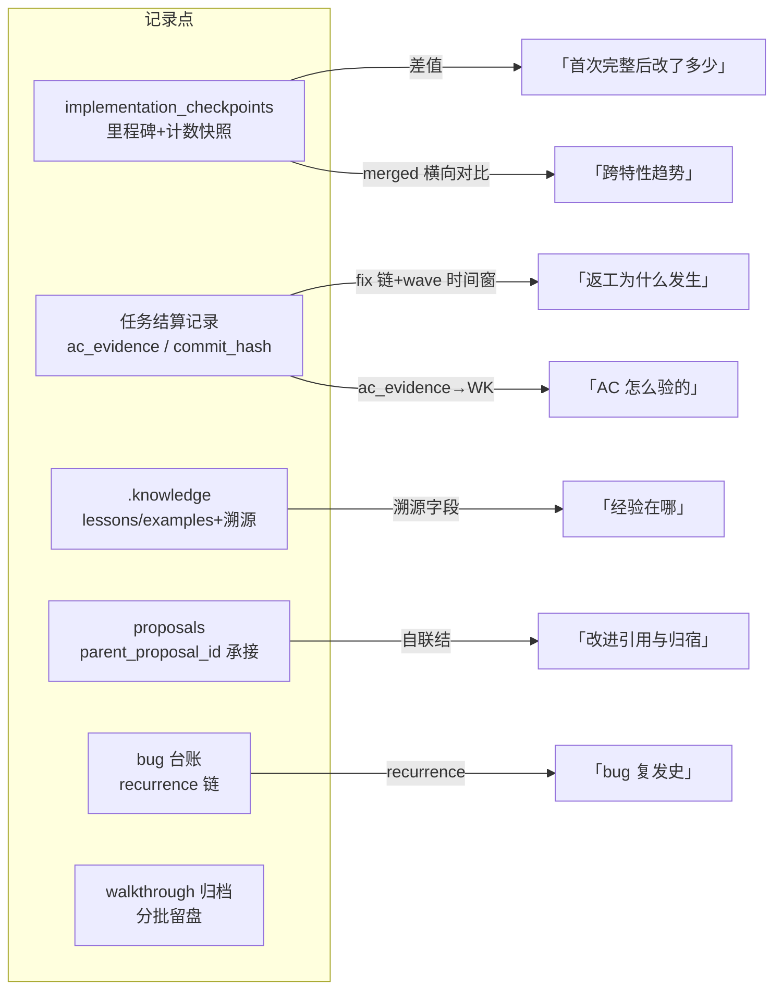

# forge-verification-hardening — 取证前置与经验沉淀硬化（mobile-ui 复盘落地）

## 1. 背景与需求

mobile-ui 特性复盘（211 commits）结论：合并后返工带占 66%（约 130+ commits 含用户裁决/根治），初始实现达标的是「文档口径下的特性」而非「真机可用的交付物」。四条结构性根因：

1. **验收门缺真机环节**：G5 把 UI 验收定为 Chrome 设备模拟 + fake rpc，环境/隧道/流式时序问题积压到合并后由用户首跑引爆。
2. **视觉 AC 判定者错位**：「逐位一致」以 agent 自产 mockup 为基准、agent 走查自证；用户判据是官方实机形态，每条微交互都变成合并后逐条裁决。
3. **官方机械取证不足**：契约靠录制 fixtures 与探针推断、未穷尽读源码，裸 this / 必填字段 / allowlist 成批「能跑但不对」。
4. **经验不回灌**：验收判据事后才成文（acceptance.md），学费只对该特性有效。

需求 = 把四条根因固化为 forge 管线的强制机制，让不确定性在批次内由流程消化。**所有新增门按任务面分档条件触发**——非涉面任务不背。

**适用范围**：多批次、长周期、有用户验收的特性管线（存在「任务循环 first-pass」时点的工作流）。**短平快场景不适用**——单轮对话/小任务无 first-pass 时点，标记/复盘/飞轮开销占比过高，全套机制不启用。

判例参照 = super-composer 提案（分支）：已实践真机取证结算门（AC12）、提案内用户裁决台账段、walkthrough 分批归档，本文将其制度化。

## 2. 方案（目标形态）



### M1 真机取证门（按任务类型强制）

取证门判定流程：



- **强制域**（交付物含运行期装配面的常见编程任务类型）：UI、API、CLI、TUI、Desktop、Web server、MQ 事件发布/订阅——单测全绿不算完成，AC 必须含真机端到端取证条目。
- **豁免域**：纯逻辑（纯模型/算法/状态机，单测可判）、纯文档/规格（评审可判）。
- 触发判据 = **交付物性质**，不随 AC 文案是否「提到 UI」漂移。
- **清单非穷尽**：上述七类是常见示例，不是判定白名单。唯一判据 = 交付物含运行期装配面（进程、网络端点、真实调度/时钟、对外部系统/硬件的真实副作用）；清单外类型命中判据同样入强制域，例如：浏览器扩展、移动端 App、定时任务/批处理、数据库迁移/存储过程、RPA 脚本自动化。
- **SDK/库边界**：库本体无自有运行期装配面（装配由消费方承担）→ 豁免域；但库自带子进程/网络/线程等真实副作用时回到强制域。
- **多类交叉判定规则**：同一交付物落入多类时，强制义务不变；取证环境按**主交付面**（最终消费者直接感知行为的运行面）选取，就高不就低——如 Web server∩API 按完整真实服务端到端取证，MQ∩API 按真实 broker + 真实端点闭环取证。
- **取证方式的确定顺序**（agent 自主递进，不轻易问人）：① 优先查项目 `AGENTS.md` 与知识文档（含 `.knowledge/` 沉淀）——项目既定取证程序/判例直接复用；② 无既定程序 → 自主检索与核销相关知识确定取证方式；③ **当且仅当不确定**时才询问用户。取证执行前必须**检测取证环境可用性**：所需软件是否安装、环境是否允许（网络/权限/凭据）——不可用时显式报告环境缺口并以 blocked 结算，禁止静默降级为模拟取证。
- 落点：write-prd 的 AC 形状规则（强制域 AC 必须写明取证方式与取证环境）+ submit-task 结算校验（强制域任务结算时无取证证据 = 不得 result=success，只得以 evidence_debt 声明债务）。技能判据为正、结算校验为兜底——若结算面校验实现成本超突击量级，技能判据单独成立仍满足本项（评审时定）。
- 依据正本：`docs/conventions/external-dependency-verification.md`（AGENTS 1.4）——本项是它的批次级承接，不新增规则。

### M2 视觉/交互 AC：官方实机对照 + 待裁决清单前置

- 视觉 AC 基准 = **目标产品的既定视觉基准**（该产品自身的设计系统与实机形态）。mockup 只当布局草图，不充当验收基准。
- write-prd 新增**条件强制段「待用户裁决清单」**：涉 UI/交互面的 PRD 必须列出微文案、布局终态、触屏交互词汇等规格中不存在、只有用户能判的决策点（无则写「无」）；非 UI 面不要求。
- 批次末设**真机走查会**：agent 备好对照截图清单，用户一次性批量裁决，结果即时回写规格——替代合并后逐条裁决。走查会 = 批次末显式任务（任务拆解时建，独立于编码任务），不依赖临场发挥。

### M3 官方核销记录前置

- 装配代码落笔前，任务必须携带**官方同语义机械核销记录**：源码位置、声明方式、生命周期、并发/持久化语义（AGENTS 1.2 口径）。
- review-tech 检查项承接：设计文档中每个官方包 API 引用无源码出处 = Blocker。
- 录制 fixtures 降级为回归锚点，不充当契约来源。

### M4 规格转向显式收口 + 批次末文档门

- 通道级/方案级裁决转向时，**同一提交内**收口：旧口径文档回改 + 已建代码处置决定（弃/改/留）清单；禁止「先实现后裁决」悬置。
- doc-review 从收尾环节改为**批次末强制门**：规格文档 / 实现口径 / 摘要三方一致性在批次内清零，不积压。

### M5 first-pass 自动复盘 → knowledge 沉淀（不回灌技能）

- 任务循环到达 **first-pass**（首次无可派任务）且**代码 review 结束**后，才派生 **doc 复盘任务**——先 review 再复盘，复盘消化的是 review 定稿后的稳定事实。派生位置 = 派发循环 no-task 分流处（`packages/plugin-forge/src/loop/driver.ts`；「结算时自动派生依赖任务」的先例由 submitTask evidence_debt 提供，位于结算时点，本项机械与其同构但挂接在 first-pass 时点）。复盘任务由**多个 agent 交叉核验**：各 agent 独立提取本特性验收经验/判例/翻车点，交叉比对后取共识入沉淀，分歧记录待裁决——单视角结论不直接入库。
- **收口**：容器到达 `merged` 终态即收口完成——`merged` 标记行（implementation_checkpoints，纯计数快照）就是收口凭证；收口前置条件 = 复盘任务已结算（含越阈注册改进提案的 AC 硬门）。复盘产物引用（knowledge entry_id 清单）落复盘任务结算记录（ac_evidence），不入标记表。术语约定：「收口」只指容器 merged 终态；任务循环首次无可派任务用「first-pass」指称，不混用。

#### 标记体系：里程碑快照与质量硬指标

标记 = 容器里程碑事件，每次标记时快照计数器（累计任务数 / 累计 commit 数 / 累计 fix 任务数 / 累计 evidence_debt 数）；**相邻标记差值 = 该阶段增量**。标记体系回答「首次完整后改动有多大」——改动越多，forge 流程的任务完成质量越低。commit 口径 = 任务结算 commit_hash 去重集合；`merged` 标记时以 git 区间（上容器基线…合并提交）复核校正，squash/改写不漂移。

**存储**：工作区 forge.db（既有单库）新增 `implementation_checkpoints` 表——**实现检查点流水**（append-only：容器实现过程的关键节点序列），经 `proposal_id` 关联 proposals（feature 容器经提案谱系溯源）/ 标记 / 时间戳 / base_commit_hash（标记时容器分支 HEAD）/ 计数快照（独立列），零业务引用字段；承接关系归提案域（见 M7）。只追加不可改写；`merged` 漏标记走 lazy 兜底——下个容器循环启动时校验补标记（与 stabilized lazy 判定同构），趋势链不断点。

| # | 标记 | 标记时机 | 记录快照 | 度量用途 |
|---|---|---|---|---|
| 1 | `first-pass-complete` | 任务循环**首次**无可派任务（全部任务完成） | 全量计数器基线 | 首次完整基线；其后一切增量 = 流程未一次做对的账单 |
| 2 | `retro-done` | 复盘任务结算（knowledge 沉淀完成） | 计数器快照 | 经验沉淀闭环时点；knowledge entry_id 清单落复盘任务结算记录（ac_evidence），不入检查点表——纯净表无例外 |
| 3 | `review-wave-N` | 每轮 review/走查修正波结算（用户裁决批、Blocker 返工批、fix 链收口） | 该波增量计数器 | 改进波次次数与幅度——波次多/幅度大 = 规格与验收门失效 |
| 4 | `stabilized` | 连续无新 fix 任务进入稳定期（阈值首例复盘后定，如 48h 零新增；标记机械自动判定。判定顺位：差值异常强制专项复盘未完结前 stabilized 不判定——先查证后收敛） | 计数器 | 质量收敛点；`review-wave-N` 之后的尾部增量 |
| 5 | `merged` | 合入 main（AGENTS 5.1 人类批准后，由执行合并的会话经管线工具标记） | 全量累计终值 | 交付总账 |

**关系标记**（checkpoint mark 枚举扩展，承载提案派生关系、便于追溯）：

| 标记 | 落在哪方 | 时机 | 度量用途 |
|---|---|---|---|
| `derived-to-child` | 源提案 checkpoints | 派生提案注册时 | 源侧追溯锚：该提案曾派生改进（方向 = derived-to-child，派生出去）；配合 `parent_proposal_id` 反查子提案 |

改进提案侧**不落关系标记**——其派生身份由自身 `parent_proposal_id` 承载，checkpoints 只记实现过程。关系标记仍零业务引用字段——派生关系本体在 `proposals.parent_proposal_id`，checkpoint 只是源侧时序锚点；追溯链 = 源 checkpoints `derived-to-child` → 自联结 → 子提案 → 子 checkpoints 独立流水。

派生硬指标（可由标记快照直接计算，无需人工统计）：

- **一次通过率** = `first-pass-complete` 时任务数 / `merged` 时任务数——越低 = 派发前置质量（规格/AC/核销）越差
- **返工增量比** = (`first-pass-complete` 后 commit 数) / 全量 commit 数——mobile-ui 判例值 66%，即本提案要压低的分母项
- **修正波次** = `review-wave-N` 计数——≥ 阈值（settings 可配，默认 6）视为流程级 Blocker，强制触发 M5 复盘并回写规格
- **fix 密度** = fix 任务数 / 任务总数

标记为**只追加事件**（append-only，不可改写删除），随容器状态持久化，供跨特性横向对比与长期趋势统计。

#### 实体设计



- `implementation_checkpoints`：唯一约束 `(proposal_id, mark, wave_seq)` **仅作用于五类里程碑标记**；关系标记 `derived-to-child` 不受此约束——每派生一个改进提案落一行（行序 = 派生序，子提案标识由复盘任务结算记录 ac_evidence 承载）；索引 `(proposal_id, created_at)`——时序查询主径；append-only，无 UPDATE/DELETE 路径。
- **计数快照展开为列**（不用 JSON）：`tasks_total / commits_total / fixes_total / evidence_debts_total` 各自独立可聚合可索引；未来新增计数 = 迁移加列，不动既有行。
- **`base_commit_hash`（关键提交节点）**：标记时容器分支 HEAD 的 commit hash。commit hash **独立于分支**——它是 git 提交对象的全局唯一标识，同一提交在任何分支上下文中 hash 不变；分支切换/合并后仍可解析，跨容器对比无歧义。`merged` 标记时另以 git 区间复核 commit 总数（防 squash/改写漂移，口径见 M5）。
- **计数基准与起点**：四列计数器均**从 0 起算**，作用域 = 该 `proposal_id` 的任务域全集（tasks/task_records 中 source 指向本提案的全部任务，含 fix 链），首个标记（first-pass-complete）标记时落第一份快照即**基线**；此后每个标记存标记时刻的**累计值**，相邻标记差值 = 阶段增量，`merged` 行 = 终值。各列统计口径：
  - `tasks_total`：任务结算成功（completed）数
  - `commits_total`：上述任务结算记录 commit_hash 的**去重集合**大小
  - `fixes_total`：fix 类任务（coding-fix / fix-N 派生）结算数
  - `evidence_debts_total`：evidence_debt 声明次数
  - 四列只在标记时写入、只增不减；跨容器对比统一用「first-pass 基线 vs merged 终值」两帧，不受中途标记疏密影响。
- `proposals.parent_proposal_id`：nullable，指向源提案；自联结查询 = 改进链正反两向；FK 校验指向存在提案。
- 复盘产物引用（knowledge entry_id 清单）不在本设计内——归任务结算记录 ac_evidence（M5 口径）。

标记生命周期与标记时序：




- **产物沉淀进 knowledge 目录格式**：复盘产物以 markdown 条目**直写 workspace `.knowledge` 目录**，经验存 **lessons**、示例存 **examples**，按类别（domainPath 目录路径）分类存储；条目字段与 knowledge 插件格式同构（title/summary/keywords/domainPath），带溯源字段（来源容器 slug / 来源任务 / bug id）。knowledge 插件未在本仓激活（无服务注入），search/read-abstract 检索能力待激活后另评；直写格式保证激活后零迁移。
- **三类沉淀严格区分**（统一落 `.knowledge/`，职责单一）：

  | 类别 | 性质 | 落点 | 晋级路径 |
  |---|---|---|---|
  | conventions | 硬约束规则（提炼态） | `.knowledge/conventions/` | 反复验证成立的规则 → 经提案管线晋升为正本（docs/conventions/*.md），裁决后全工作区强制 |
  | lessons | 情境化实战经验（何时/为何翻车、如何避免） | `.knowledge/lessons/` | 反复出现的同因 lesson → 触发抽取为 conventions 候选 |
  | examples | 可复用正例产物（AC 形状、验收程序、格式样例） | `.knowledge/examples/` | 被 write-prd 等技能引用为判例参照 |

  复盘时按性质分流，不混装；`.knowledge/` = 统一知识层（提炼态），`docs/conventions/` = 正本层（强制态）——提炼在知识层积累，晋升经裁决一次到位。
- **不回灌技能检查项**。
- **沉淀执行载体 = `learn` 技能（统一机制）**（参照老 forge learn skill 概念，适配新环境重建）：知识提取/沉淀的**唯一入口**——任何场景（特性复盘、bug 修复收口、会话中的经验捕获）都经 `learn` 提取与落盘，不另设平行机制。输入 = 场景材料（复盘对账表/fix 链/走查裁决/会话经验），职责 = 三类全量经 learn：conventions/lessons/examples 均由 learn 提取并落 `.knowledge/` 对应目录（conventions 为提炼态，晋升 docs/conventions 正本仍走提案管线裁决），输出 = 同构条目（title/summary/keywords/domainPath + 溯源字段）。与老 learn 的差异两点：①文档格式适配新 `.knowledge` 条目格式（非旧知识库格式）；②使用环境适配 forge 管线（特性复盘为标准触发场景——复盘任务内嵌调用、以多 agent 交叉核验结论为输入；其余场景按同一技能同一格式随手触发）。
- **依赖演进（沉淀机制归属）**：沉淀机制长远归属 knowledge 插件，forge 依赖它——正确的依赖方向 = forge 消费 `forgeKnowledge` 服务，格式契约由 knowledge 侧单源。三阶段演进：
  1. **现在（本提案）**：直写 `.knowledge/` 目录 markdown，字段与 knowledge 条目格式同构——forge 对 knowledge 只有**目录格式契约**耦合，零代码依赖（插件未激活也能沉淀）；
  2. **激活后**：forge 写入径换 `forgeKnowledge` 服务调用——因字段同构，存量条目零迁移，只换写入口；
  3. **终态**：格式契约单源 knowledge 插件（contracts 级导出），forge 与其它消费方共同依赖——禁止 forge 反向定义 knowledge 格式。
  本提案执行阶段 1，并在 write-prd/review-prd 检查项中引用格式正例（非自定义格式）。

### M6 super-composer 判例制度化

写入 write-prd / review-prd 检查项的正例形状：

- 真机取证结算门 AC 形状（super-composer AC12：真实宿主 + 真实 dist 驱动走查、样式逐项自检、截图归档 walkthrough/）。
- 提案/PRD 内**用户裁决台账段**：裁决逐条落档、可追溯（super-composer §6-§8 形态）。
- walkthrough **分批归档**：按批次/场景子目录留盘，验收记录与实现同步产出。

### M7 持续复盘迭代飞轮

标记与复盘不是终点——闭环为飞轮：**执行 → 度量 → 复盘 → 改进 → 再执行**，每转一圈由标记硬指标验证改进是否生效。



- **触发机制**：修正波次 ≥ 阈值或返工增量比超阈（阈值经 settings 域配置，默认 6，暂不实现 UI）→ 强制发起改进提案。落地 = 复盘任务 AC 硬门：派生复盘任务时机械注入指标计算值与越阈判定规则；越阈则「已注册改进提案」成为结算 AC——未注册 = ac_met=false = 复盘任务不得 success，容器不满足收口前置（无法打 merged 标记）。注册通道随预设：突击 createProposal 直挂、远征 brainstorm 技能；注册后用户裁决，符合「裁决只在用户明示后记录」铁律。
- **提案承接关系（提案域改造，职责单一）**：proposals 表新增 `parent_proposal_id`（nullable 自联结）——飞轮提案注册时指向源提案，改进链全程结构化：提案表自联结即可答「该提案触发过哪些改进、改进归宿如何」；createProposal / transitionProposal 扩透传该字段。标记表不承载承接关系，保持纯净。裁决台账段同步落突击提案模板（grilling 产出骨架含该段），双模式口径一致。
- **新提案的任务循环串联**（改进提案走自己的新循环，四点结构化衔接）：
  1. **前向承接**：新提案 `parent_proposal_id` = 源提案 id（提案表自联结即可查「源提案触发的全部改进提案」）；
  2. **后向登记**：源容器复盘任务的结算记录（ac_evidence）登记派生提案 id 清单——双向可查，checkpoints 不承载；
  3. **独立记账·默认同分支**：新提案 → 新容器 → 新任务循环，**默认不另开分支**——派生提案直接跑在源容器当前分支（改进与本就是同一交付线的延续）；`implementation_checkpoints` 从 0 起算独立记账（first-pass 基线帧独立落），不与源容器混账；
  4. **效果对比锚**：源容器 merged 终值帧 vs 新容器 checkpoints 终值帧——「改进前后指标对比」即这两帧的差值（M7 效果验证的数据来源）。
  查询链全程结构化：源提案 → 反向自联结 → 新提案 → 新容器 checkpoints，无一处靠记忆。

初始提案与派生提案串联流程：



- **报表与 agent tools 展望（实体设计已预留）**：本提案的实体设计（implementation_checkpoints 结构化列 / proposals 自联结 / knowledge 溯源字段）面向未来的两类消费面——**统计报表**（跨容器一次通过率趋势、返工增量比分布、改进链 ROI——全部可由表聚合直出）与 **agent tools**（如 `proposal_chain` 链查询工具——结构化表上薄封装）；本提案已落 **checkpoint 记录/查看基础工具**（⑥ record_impl_checkpoint / query_impl_checkpoint / list_impl_checkpoints），统计报表与链查询消费面后续走独立提案。
- **真机查证前置（先发现问题，再提方案）**：强制注册前，先针对指标异常域做一轮**真机查证**（真实宿主/真实环境走查与探测，目标 = 最大化问题发现）——复盘记录点的已知问题只是线索，不是问题清单的终态；查证收敛后**综合成案**：按根因聚类，一个提案覆盖一族问题，产出综合性解决方案——**拒绝头痛医头的逐症状碎片提案**。这是走提案管线的意义：方案在充分事实之上裁决一次，而不是问题驱动地反复打补丁。
- **覆盖对账（防漏机制）**：改进提案注册时不得凭记忆列问题——必须对账本轮全部结构化记录点：① checkpoints 相邻标记差值（哪段增量异常）；② fix 链全清单；③ bug 台账 recurrence 链；④ 走查裁决台账；⑤ 复盘交叉核验的分歧记录（待裁决项）；⑥ 真机查证新发现。对账表进提案背景段，逐项标注处置归属（本提案 / 另立 / 显式不处置+理由）——**覆盖的是「已发现问题的全集」，不是「问题的全集」**。
- **未发现问题的结构性出口**：原理上不可判定，靠飞轮迭代逼近而非一次穷尽——checkpoints 差值异常（某阶段增量显著超基线）→ stabilized 不标记、强制追加专项复盘；指标不降 → 改进提案回炉。未发现问题会在下一轮以指标形式暴露，飞轮保证它不被静默吞掉。
- **周期复盘**：单特性级 = first-pass 复盘任务（M5）；跨特性级 = `merged` 标记横向对比（一次通过率趋势），归档为 knowledge lessons。
- **效果验证**：每项流程改进上线后，以其前后的特性标记指标对比为唯一判据——指标不降 = 改进无效，提案回炉。前后指标对比表固化为**改进提案模板附录段**（归提案域，符合职责切分）：提案注册时填基线（源容器标记指标），效果验证时填对比值并留档于提案正文。
- **标准查询链（回溯口径）**：「某波返工为什么发生」= wave 标记时间窗 + 任务域 fix 链过滤；「经验被哪些改进引用」= knowledge 溯源字段 + 提案承接链自联结——全部走结构化查询，不靠全文搜索与记忆。

全体系回溯路径总图（记录点 × 查询链）：


- **沉淀不回灌技能**（M5 口径不变）：飞轮的「改进」走提案管线改文档/机械，不直改技能检查项；改了什么由提案文档与 git 历史承载。
- 双模式适用：远征/突击容器各自落标记、各自入飞轮，指标分模式统计（突击天然短周期，阈值独立定）。

### 突击模式同步

grilling / quick-tasks / review-proposal 同步加条件化检查项（涉 UI/外部装配面才触发）：真机取证 AC、待裁决清单、官方核销结论——双模式一致。

## 3. 改动影响范围

```text
# ── 技能层（doc）──────────────────────────────
packages/plugin-forge-spec/skills/write-prd/SKILL.md    # M1 AC 形状 + M2 裁决清单段 + M6 判例
packages/plugin-forge-spec/skills/review-prd/SKILL.md   # M1/M2/M4 门核对 + M6 判例（M4 批次末文档一致性核对落此处检查项）
packages/plugin-forge-spec/skills/review-tech/SKILL.md  # M3 核销记录 Blocker 项
packages/plugin-forge-spec/skills/tech-design/SKILL.md  # M3 核销记录产出要求
packages/plugin-forge/skills/learn/SKILL.md             # M5 沉淀技能：提取分流 + .knowledge 新格式落盘（双模式共用，参照老 learn 适配重建）
packages/plugin-forge/skills/submit-task/SKILL.md       # M1 强制域结算校验口径
packages/plugin-forge/skills/quick-tasks/SKILL.md       # 突击同步：任务拆解取证分档 + M2 走查会显式建任务
packages/plugin-forge/skills-blitz/grilling/SKILL.md    # 突击同步：取证/裁决清单决策点 + 提案模板含裁决台账段/指标对比附录段
packages/plugin-forge/skills/review-proposal/SKILL.md   # 突击同步：评审核对项

# ── 机械层（代码，全部具体落点已源码核销）──────
packages/core/src/forge/workspace/migrations.ts          # ① implementation_checkpoints 表 DDL + ② proposals 表 parent_proposal_id 列（迁移）
packages/core/src/forge/small-domains/implementation-checkpoints.ts    # ① 检查点域：append 标记 / lazy 补标记 / 按 proposal_id 查询（新增）
packages/core/src/forge/small-domains/implementation-checkpoints.test.ts   # ① 单测（新增）
packages/plugin-forge/src/tools/impl-checkpoint.ts              # ⑥ record_impl_checkpoint / query_impl_checkpoint / list_impl_checkpoints 工具面（agent 记录与查看检查点——① 的薄封装，业务定位；命名=动词+名词）
packages/plugin-forge/src/tools/impl-checkpoint.test.ts         # ⑥ 单测
packages/core/src/forge/settings/…                              # ⑦ 飞轮阈值 settings 键（默认 6，无 UI——现有 settings 域加键）
packages/core/src/forge/small-domains/proposals.ts       # ② createProposal/transitionProposal 透传 parentProposalId
packages/core/src/forge/small-domains/proposals.test.ts  # ② 承接字段单测
packages/core/src/forge/registry.ts                      # ①② 服务装配接线（标记域注册）
packages/core/src/forge/service-assembly.test.ts         # ①② 装配断言
packages/plugin-forge/src/loop/driver.ts                 # ③ no-task 分流：first-pass-complete 标记 + 复盘任务派生 + merged lazy 校验补标记
packages/plugin-forge/src/loop/driver.test.ts            # ③ first-pass 派生单测
packages/plugin-forge/src/dispatch-core/settle.ts        # ④ review-wave-N 标记（fix 链收口/返工批结算处）
packages/plugin-forge/src/dispatch-core/settle.test.ts   # ④ 结算单测
packages/core/src/forge/tasks/submit.ts                  # ⑤ submitTask 强制域取证声明校验（AC 形状承重；成本超限时降级为技能判据）
packages/core/src/forge/tasks/submit.test.ts             # ⑤ 结算校验单测
packages/plugin-forge/src/tools/create-proposal.ts       # ② parent_proposal_id 工具参数透传
packages/plugin-forge/src/tools/transition-proposal.ts   # ② 同上
packages/plugin-forge/src/tools/submit-task.ts           # ⑤ 取证声明参数（evidence 口径扩展）
```

复用核销结论：

| 能力 | 结论 | 证据 |
|---|---|---|
| 知识沉淀与检索 | **复用 knowledge 目录格式，直写不激活**：knowledge 插件机制存在（`forgeKnowledge` 服务 + `knowledge_search` / `knowledge_read_abstract` 工具 + 条目字段 title/summary/keywords/domainPath），但本仓未激活（无 `.knowledge` 目录、plugin-forge 不 provide 服务）——复盘产物以同构 markdown 条目直写 `.knowledge`，激活后零迁移；插件服务激活另行评估 | `packages/knowledge/src/`（plugin.test.ts、tools/、prompt/index.ts、integration-core.test.ts 条目格式正例）；`.forge/docs/features/dsh-forge-m3.5-knowledge-consolidation/` |
| first-pass 自动派生任务 | 挂接点已核销：dispatch 循环 no-task 分流（driver.ts）；「结算时自动派生依赖任务」先例 = submitTask evidence_debt（settle 路径）——同构机械、时点不同 | packages/plugin-forge 派发循环源码 |
| 真机取证规则 | 正本已在：AGENTS 1.4 + `docs/conventions/external-dependency-verification.md`，本提案只做承接不另立 | 同左 |
| 官方核销要求 | 正本已在：AGENTS 1.2 + `docs/conventions/reuse-official-mechanisms.md`，缺的是技能层检查项承接 | 同左 |

## 4. 验收标准

1. 强制域（UI/API/CLI/TUI/Desktop/Web server/MQ）任务经 write-prd 产出的 AC 含真机取证条目（取证方式 + 取证环境）；纯逻辑/纯文档任务无此要求——双路径各有正例。
2. 涉 UI/交互面的 PRD 含「待用户裁决清单」段；非 UI 面 PRD 无此段不判缺陷；涉 UI 批次的任务拆解含批次末真机走查会显式任务，走查会产出对照裁决记录留档。
3. review-prd / review-tech 按新检查项可产出 Blocker：AC 不可取证、官方 API 引用无源码出处各给一条判定正例。
4. 规格转向场景：裁决提交内含旧口径文档回改与代码处置清单（判例化验收）；批次末文档门（规格/实现/摘要三方一致性核对）作为 review-prd 检查项可执行且每批次触发。
5. 任务循环 first-pass 且代码 review 结束后产生复盘任务（多 agent 交叉核验），三类沉淀全量经 `learn` 技能提取落盘 `.knowledge/`（conventions/lessons/examples 分目录，markdown 同构字段+溯源字段）；提炼态 conventions 晋升 docs/conventions 正本仍走提案管线裁决——三类不混装。
6. 五类里程碑标记（first-pass-complete / retro-done / review-wave-N / stabilized / merged）+ 关系标记（derived-to-child，落源提案侧）经容器 append-only 实现检查点流水（implementation_checkpoints，零业务引用字段）自动落、只追加不可改写；由标记快照可计算一次通过率、返工增量比、修正波次、fix 密度四项硬指标；派生提案默认与源提案同分支。
7. super-composer 三判例（取证 AC / 裁决台账 / walkthrough 分批归档）以正例形状出现在 write-prd / review-prd 检查项中。
8. 突击模式三技能含条件化检查项，与远征链口径一致。
9. 飞轮闭环判例路径：修正波次越阈 → 复盘任务 AC 硬门强制注册改进提案（proposals 表 parent_proposal_id 指向源提案，承接链自联结可查）；改进上线前后各一个特性的标记指标对比留档，指标不降即提案回炉。
10. 质量门：compile / lint / 针对性 vitest 全绿（涉 plugin-forge src 评估点落地时）。
11. agent 工具面：`record_impl_checkpoint`（落标记行，参数 = proposal_id / mark / wave_seq / base_commit_hash）/ `query_impl_checkpoint`（按 proposal_id 时序查、标记过滤、四项硬指标计算）/ `list_impl_checkpoints`（跨容器清单）可被 agent 调用完成检查点的记录与查看——各给一条调用正例。
12. 飞轮波次阈值经 settings 域可配置（默认 6），无 UI；settings 键缺席 = 默认值生效。
13. 强制域任务的取证方式确定走三级顺序（项目 AGENTS.md/知识文档 → 自主检索核销 → 仅不确定时问用户），取证前完成环境可用性检测（软件安装/网络/权限/凭据），不可用 = 显式环境缺口并以 blocked 结算；越阈注册改进提案前有真机查证记录，提案按根因聚类综合成案（非逐症状碎片）——各给一条判定正例。
14. 改进提案背景段含覆盖对账表：checkpoints 相邻标记差值 / fix 链全清单 / bug 台账 recurrence 链 / 走查裁决台账 / 复盘交叉核验分歧 / 真机查证新发现，六项逐项标注处置归属（本提案 / 另立 / 显式不处置+理由）。
15. 视觉 AC 基准判定 = 目标产品既定视觉基准（该产品自身设计系统与实机形态）有判定正例；`learn` 在非复盘场景（如 bug 修复收口）有一条沉淀正例——统一入口双场景可走。

## 5. 意图推断

**enhancement**：不改既有管线语义，只增强——技能检查项与 AC 形状规则（doc 层为主）+ 七处最小机械（① implementation_checkpoints 实现检查点流水、② proposals 承接字段、③ first-pass 复盘任务派生、④ review-wave-N 标记、⑤ submitTask 取证校验兜底、⑥ record/query/list_impl_checkpoint(s) agent 工具面、⑦ 飞轮阈值 settings 键），各司一职：①④ 标记域管度量、② 提案域管承接、③⑤ 派发域管强制、⑥ 工具域管 agent 读写面、⑦ 设置域管阈值。零新机制自建：知识库、取证规则、核销要求全部复用既有正本与官方缝。
