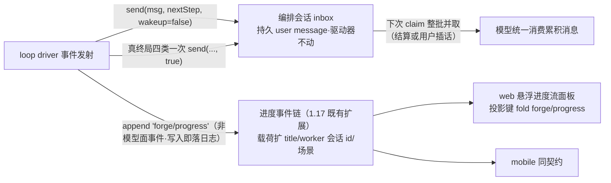
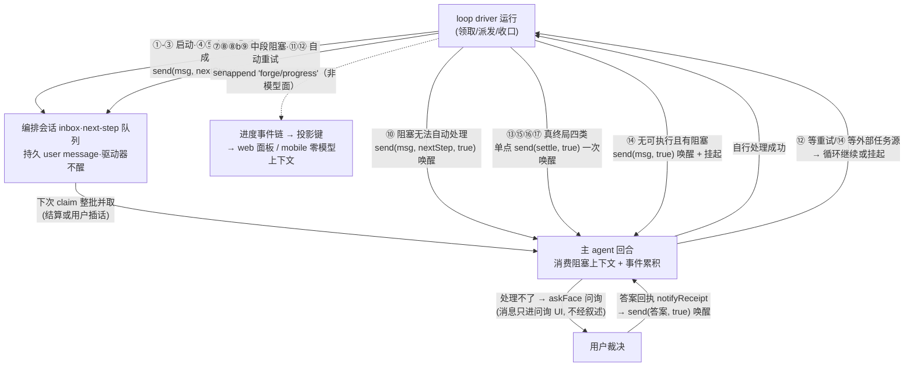

# loop-event-delivery：事件 send(wakeup=false) 不唤醒 + 进度投影独立渲染 + 结算单点唤醒

## 需求界定

用户需求（2026-10-18）：

1. 任务进度事件（领取/完成/阻塞等）由人类在 GUI **独立渲染查看**（含任务 title），web 与 mobile 两端可达；不逐事件烧模型回合。
2. 事件消息维持 `send(message, target, wakeup=false)` 官方形态——持久留痕、驱动器不被唤醒；消息内容与现状逐字一致。
3. 结算单点唤醒：循环真终局一次 `send(..., wakeup=true)`，统一处理累积。

意图推断：**enhancement**——既有循环叙述面（notify 三径）的投递方式收敛重构 + GUI 新增进度流渲染，无新业务域。

## 官方机械核销（主检出实查 2026-10-18）

`@deepseek-ai/dsh-agent/lib/types/runtime-types.d.ts`：

| API | 行号 | 语义 |
|---|---|---|
| `send(message, target, wakeup)` | :186 | 路由到 inbox 边界，可选唤醒——`wakeup=false` 即「写入不唤醒」，官方一等参数；与 `inject/followup/steer` 同在 agent 把手上，现有鸭子面可达 |
| `followup` | :192 | 排队普通回合并唤醒 |
| `steer` | :200 | 就近步间注入 |
| `inject` | :209 | pre-step 上下文，不唤醒但下请求即被消费，且不留持久历史 |
| `InboxTarget` nextTurn/nextStep | :43-45 | send 消费边界两值 |

**inbox claim 语义（承重核销，dsh-agent-loop lib/index.js）**：

- `claim(target, turn)`（:103-111）：**next-step 队列整批并取**（`mutate("next-step", 0, this.nextStep.length)`）；target=next-turn 时额外**只取 1 条** next-turn 消息（`mutate("next-turn", 0, 1)`）。
- 回合结束 `hasPending` 续新回合（:1035-1039）——next-turn 积压 N 条 = 唤醒后连排 N+1 个回合逐条消费。
- **结论：事件径与结算径统一 target=nextStep**——积压消息在下次 claim 时整批进入同一步请求，「一次唤醒统一消费累积」成立。

**既有进度链核销（1.17，decisions #34——提案必须扩展而非另起）**：

- `forge/progress` 会话事件已在位（`src/progress/index.ts`）：declare-module 合并进官方 SessionEventMap；**非模型面**（不在 SurfaceEventType 五元集，零回合唤醒）；driver 在 claim/claim-resume/settle/stop 点发射（driver.ts:604-629）；载荷 `{ sourceSlug, verb, status, taskKey, counts, at }`——**缺 task title、worker 会话 id、场景叙述**。
- web 流内渲染已在位：`ForgeProgressNode`（DisclosureRow 同族折叠行）+ Chat 节点定义 events.register（apps/web/src/client-plugin/progress-node.ts、views/session/ForgeProgressNode.tsx）。
- 写入时即落日志（`session.append`）——fold 该事件类型即得运行期实时驱动。

投影缝核销：

- plugin-forge 已持有官方 session-projection 自有 fold unit 先例（`src/projection/dispatch-loop.ts`，key/stateVersion/stateSchema/init/apply/wire 六字段）。
- web 侧栏经账本行 `projectionValues['forge-dispatch-loop']` 窄读消费——进度投影键走同一合法缝。
- 官方 `inboxProjectionDefinition`（dsh-agent-loop lib/index.js:26-55）证明 fold 会话事件为标准模式。

## 事件清单（①-⑰ 常规十八场景 + ⑮-㉑ 挂起径四场景，共 22 × 目标形态路由）

场景编码格式（用户裁决 2026-10-24）：`{major}/{minor}`——纯英文 + 中划线；major = 场景族（startup/claim/task/blocked/retry/loop/suspend），minor = 具体场景。编码为正式标识（载荷 scenario 字段值域、路由表键、GUI 场景章映射的单一来源）；圈号为文档速记。

| # | 场景码 | 场景 | 目标径 | wakeup | 唤醒/消费时点 | incident-log 现状 |
|---|---|---|---|---|---|---|
| ① | startup/from-scratch | 启动·从头执行 | send(nextStep) | false | 不唤醒；next-step 队列整批并取 | ✗ |
| ② | startup/resume-stopped | 启动·接续（上次未完成） | send(nextStep) | false | 同上 | ✗ |
| ③ | startup/resume-inflight | 启动·接续（在飞任务） | send(nextStep) | false | 同上 | ✗ |
| ④ | claim/new | 领取 | send(nextStep) | false | 同上 | ✗ |
| ⑤ | claim/interrupted | 领取（恢复中断） | send(nextStep) | false | 同上 | ✗ |
| ⑥ | task/complete | 完成 | send(nextStep) | false | 同上 | ✗ |
| ⑦ | blocked/with-fix | 阻塞（已带修复任务） | send(nextStep) | false | 同上（循环自续 fix 链） | ✅ blocked |
| ⑧ | blocked/auto-fixed | 阻塞（已自动分析建修复） | send(nextStep) | false | 同上（循环自续 fix 链） | ✅ blocked |
| ⑧b | blocked/split | 阻塞（已分割剩余范围） | send(nextStep) | false | 同上（循环转继任任务） | ✅ blocked |
| ⑨ | blocked/wait-external | 阻塞（原因在其它任务源） | send(nextStep) | false | 同上（循环先执行别的） | ✅ blocked |
| ⑩ | blocked/ask-user | 阻塞（循环无法自行处理） | send(nextStep) | **true** | 即时唤醒主 agent；阻塞上下文随下次 claim 整批进入 | ✅ blocked |
| ⑪ | retry/spawn-failed | 启动子代理失败（自动重试） | send(nextStep) | false | 不唤醒；循环自行延迟重试 | △ 仅限流子径（spawn-rate-limited） |
| ⑫ | retry/worker-aborted | 子代理异常退出（自动重试） | send(nextStep) | false | 不唤醒；循环自行重新执行 | ✅ worker-aborted |
| ⑬ | loop/halt | 连续失败——已停止 | send（结算单点） | **true** | 即时唤醒；与积压事件同批消费 | ✗（settle-landing-rejected 为结算落点被拒径，非 ⑬ 伴生） |
| ⑭ | loop/blocked-pool | 无可执行任务且有阻塞 | send | **true** | 即时唤醒主 agent **分析阻塞可解除性**（解除→继续；无法解除→挂起） | ✗ |
| ⑮ | loop/timeout | 结束（等待超时） | send（结算单点） | **true** | 同 ⑬ | ✗ |
| ⑯ | loop/finish-all | 结束（全部完成） | send（结算单点） | **true** | 同 ⑬ | ✗ |
| ⑰ | loop/stopped | 停止（/stop-dag-tasks，中断） | send（结算单点） | **true** | 同 ⑬ | ✗（事件表提案补 `loop/stopped` 载明 inFlightTaskKey） |
| ⑱ | suspend/spawn-rate-limited | 挂起·启动限流 | send(nextStep) | **true** + 挂起 | 即时唤醒；挂起原因可见 | ✅ spawn-rate-limited |
| ⑲ | suspend/worker-rate-limited | 挂起·执行限流 | send(nextStep) | **true** + 挂起 | 同 ⑱ | ✅ worker-rate-limited |
| ⑳ | suspend/abort-over-limit | 挂起·中止超限 | send(nextStep) | **true** + 挂起 | 同 ⑱ | ✅ worker-aborted（超限） |
| ㉑ | suspend/landing-rejected | 挂起·结算落点被拒 | send(nextStep) | **true** + 挂起 | 同 ⑱ | ✅ settle-landing-rejected |

要点：

- **⑦⑧⑧b⑨ 已有修复任务/已自动处理的阻塞永不问询用户**——循环机械自处理（fix 链自续/分割承接/外部等待），用户零打扰；⑩ 只针对循环无法自行处理的情况。
- **⑭ 唤醒主 agent 分析阻塞可解除性**（用户裁决）：解除 → 循环继续；无法解除 → 保持挂起。
- **⑰ 中断事件双面落会话日志**：结算消息 + progress stopped 事件（均载 inFlightTaskKey）。
- **⑱-㉑ 挂起径四场景，各自独立、不合并（用户裁决 2026-10-24）**：四径语义各异（spawn 限流零重试挂起 ≠ ⑪ 退避自动重试；worker 限流挂起 ≠ ⑫ 立即重入）——补录后各发一条 `send(nextStep, true)` 唤醒 + `forge/progress` 事件；**每个场景的叙述必须给用户/agent 清晰的理由/原因**（挂起为何发生、原因全文指向 incident 子文件夹）。
- ⑬ 的 escalation 问询维持现状（去留不变）。

- 全部场景统一 `send` 出口、统一 target=nextStep——用户消息与循环消息以 source.kind 分流，循环消息内部只以 wakeup 参数区分唤醒与否。
- **nextStep 是承重选择**：claim 时 next-step 队列整批并取（dsh-agent-loop :104）——`send(nextTurn)` 每回合只取 1 条且回合尾 hasPending 续回合（:105/:1035），N 条积压会连烧 N+1 回合，被否决。
- `false` 组（①-⑨、⑪⑫）= 写入不唤醒：消息持久留痕，编排会话下次 claim（结算唤醒 / 用户插话 / ⑩ 唤醒后的下一步）整批进入同一请求；人类实时查看走进度面板。
- ⑪⑫ 循环自动重试不依赖模型决策，false 不损失能力。
- `true` 组（⑩⑬⑭⑮⑯⑰）= 即时唤醒；被唤醒后的 claim 同时整批消费 next-step 积压。
- incident-log 现状覆盖异常/受阻族；①-⑥ 与终局族不落（边界 8/9——独立事件表提案的扩展清单）。

## 方案（目标形态）

### 事件径（消息面——模型视角留痕）

- 全部进行中事件（①-⑫ 及中段阻塞 ⑦-⑨）改 `send(nextStep, wakeup=false)`。
- source 打 forge 事件 kind 供 GUI 折叠消息面条目。

### 进度链（人类视角——扩展 1.17 forge/progress 既有链，不另起）

**扩展载荷**（progress/index.ts，向后兼容追加可选字段）：

- `scenario`——场景码 `{major}/{minor}`（**major 分组 / minor 细分**，值域 = 事件清单表场景码列单源）；GUI 消费口径：面板/折叠条目按 major 分组渲染，minor 为组内细分行。
- `taskTitle`（需求 1 的「含任务 title」）、`workerSessionId`（行点击跳转）、`note`（阻塞/挂起原因摘要等叙述，可选）。
- 既有 `{ sourceSlug, verb, status, taskKey, counts, at }` 不变（verb 保留向后兼容，旧事件流可读；新消费面以 scenario 为准）；isForgeProgressData 守卫同步扩。

**扩展发射点**（driver，现 claim/claim-resume/settle/stop 四动词）：

- 补齐全场景覆盖：启动族 ①②③（verb 扩 startup）、重试族 ⑪⑫（verb 扩 retry）、终局族 ⑬⑮⑯⑰（verb 扩 halt/timeout/finish-all/stopped——⑰ 载 inFlightTaskKey）、静默挂起族 ⑱-㉑（verb 扩 suspend，挂起原因入 note）。

**悬浮进度流面板**（替代原任务面板）：

- 新投影键 `forge-dispatch-events`：fold unit 六字段（同 `forge-dispatch-loop` 先例），**fold 输入 = `'forge/progress'` 会话事件**（写入即落日志——运行期 registry 逐事件驱动 fold，面板实时更新；非模型面事件天然不进模型上下文）。
- wire view 承载本会话事件窗口切片（segment 分组 + 最近 N=200 条）；面板/侧栏/mobile 统一走官方注册表读面：snapshot 同步窄读 + `onChanged` 实时推送（不新增读取 API）；web 账本行 `projectionValues` 同源。
- fold 缓存 = 官方 `session_projcache`（宿主 base 已挂载，零改动）；版本失配自动重折，日志恒为权威。
- web 流内 `ForgeProgressNode` 折叠行保留（既有），面板为聚合主面。

**展示形态与交互规格**：

- 行派生当前状态章：执行中 / 已完成 / 阻塞 / **已中断**（中断态数据源 = ⑰ stopped 事件载明的 inFlightTaskKey，语义与原任务面板中断章对齐）。
  1. 可折叠为半透明悬浮球 / 展开，两态切换（悬浮球态不遮挡对话内容）。
  2. 展开态宽度充足（长 title/摘要不换行挤压）。
  3. 可拖动（位置用户可控）。
  4. 条目行可点击，跳转打开对应的 worker 子会话（workerSessionId 载荷）。
  5. **可见性随所属会话**：仅当所属循环会话为当前打开会话时显示——切到新会话/其它会话、插件打开未进任何会话，一律隐藏。

### 结算径

- 真终局四类（finished-all / finished-timeout / spawn-failed-halted / stopped）单点 `send(nextStep, wakeup=true)`——结算消息与 next-step 积压在唤醒后的 claim 整批消费。
- 取消运行中 steer 插队（结算排下一回合边界）。

### ⑩ blocked-ask-user：保持即时唤醒，升级问询后置

- **⑩ 只针对任务循环无法自行处理的情况**（修复链 ⑦⑧、分割 ⑧b、外部等待 ⑨ 均不适用）——⑦⑧⑧b⑨ 永不升级问询，用户零打扰。
- 阻塞发生即 `send(nextStep, true)` 唤醒主 agent 结合阻塞上下文分析并自行处理。
- 仅当主 agent 处理不了时才升级问询用户（askFace），用户裁决答案到达随回执带回结果。

### ⑭ blocked-pool（deadlock）：唤醒主 agent 分析阻塞可解除性

- `send(nextStep, wakeup=true)` 即时唤醒主 agent——**让主 agent 分析现状：阻塞清单中之前的阻塞是否可以解除**（如解除依赖、调整任务状态等）。
- 主 agent 解除阻塞 → 循环继续；无法解除 → 循环保持挂起。
- 与全部循环消息一样走 send 统一出口。

### ⑰ stopped：中断事件补写会话日志

- 停止时 in-flight 任务标记中断，**中断事件双面落会话日志**：结算消息 `send(nextStep, true)`（载 inFlightTaskKey）+ `forge/progress` stopped 事件（status=interrupted、载 inFlightTaskKey）——模型与人类两面对中断事实均有持久记录。

### 接口收窄

`NarrationChannel` 的 notice/followup/settle 三方法收敛到 send 统一出口（消息铸造、fail-soft、会话解析的适配层保留）。

## 全路径 UML（目标形态）

各路径要点：

- 任务循环发出的消息一律走 `send` 统一出口、统一 target=nextStep——用户消息与循环消息以 source.kind 分流，循环消息内部只以 wakeup 参数区分唤醒与否。
- ①-⑫ 全部进行中事件 = `send(..., false)` 写入不唤醒（人类看进度面板，模型下次 claim 整批消费）。
- ⑩ = `send(..., true)` 先唤醒主 agent 自处理（仅限循环无法自行处理的阻塞；⑦⑧⑧b⑨ 永不问询），处理不了才升级问询，答案随回执唤醒。
- ⑬⑮⑯⑰ = 真终局单点 `send(..., true)` 一次唤醒，claim 时与积压事件整批消费；⑰ 中断事件双面落会话日志。
- ⑭ = `send(..., true)` 唤醒主 agent **分析阻塞可解除性**——解除 → 循环继续；无法解除 → 保持挂起（与 ⑩ 同为即时唤醒成员——挂起无结算可发）。

## 边界与取舍

1. **target=nextStep 的注入时点**：next-step 消息会在**任何活动回合的下一步**被消费（含用户正在进行的对话回合）——用户插话时其回合顺带消费积压事件（用户询问进度时主 agent 恰有最新上下文）；主 agent 空闲时消息静默积压至下次唤醒。接受该语义。
2. **send(false) 的消息最终仍被消费进模型上下文**（官方无「写入但模型永不消费」形态）：
   - 该税经用户裁决接受——模型保留结算前进度感知。
   - 人类的进度查看走 forge/progress 事件链，不依赖消息面。
3. **⑩ 升级问询后置的边界（⑩ 仅限循环无法自行处理）**：
   - ⑦⑧⑧b⑨（已有修复任务/已自动处理/已分割/等待外部）永不升级问询——循环机械自处理，用户零打扰。
   - 主 agent 唤醒后自行处理成功 → 循环继续，不问询。
   - 主 agent 处理不了 → 才走 askFace 问询；用户关闭问询（cancelled）→ 循环保持挂起（与现状挂起语义一致）。
   - 回执径故障 → fail-soft 告警，不拖垮收口。
   - askFace 缺席宿主 → 无问询亦无回执，保留唤醒径保证主 agent 至少感知阻塞。
4. **模型对进度的消费时点不确定**（攒到下次 claim 一次性整批消费）：非实时，属接受项。
5. **进度链复用 1.17 forge/progress（不另起）**：
   - 载荷向后兼容扩展（可选字段追加），既有 web 流内折叠行零回归。
   - 投影键 fold 输入 = `'forge/progress'` 事件（写入即落日志）——**不锚 `user/message`**（它是消费时点事件，dsh-agent-loop :1061，循环运行期 fold 零更新）。
   - 消息面折叠条目（source.kind 分组）与进度面板（forge/progress fold）为两个独立渲染面：前者按用户插话分组（插话后新开折叠组、前段折叠收起），后者按事件时序聚合。
6. **事件存储不做第二份（用户裁决 2026-10-18）**：
   - 消息面事件在 `send` commit 时落会话日志；进度面事件 `'forge/progress'` 同落会话日志——同一日志两种事件类型，各服务各面，互不重复。
   - fold 缓存 = 官方 `session_projcache`（宿主 base 已挂载，零改动）；缓存丢失或过期无害，重折即得。
   - fold state 规模上界：只保留当前 segment 窗口 + 最近 N 条（N=200），view 携带窗口 + 总数；更早历史本次不做回看。
7. **独立事件表与自实现存储后端介质 = 另立提案**（`forge-event-table`，draft）：
   - slug 键控池级事件表（全场景原文、跨会话聚合，供概览任务子 tab 池级时间线）与「自实现 storage backend 更换 session_projcache 介质」（官方 backend contract + `storage-domain.routes` 配置缝）两项移出本提案。
   - 本提案面板读路径与之无耦合——独立提案落地不影响本提案任何验收。
8. **池级时间线随独立提案走**：概览任务子 tab 的 slug 调度时间线（循环事件 + 任务事件跨会话聚合）以事件表立项为前置；incident-log 维持现状（异常族长文全文落盘），不扩场景。
9. **templates.ts 路由表已与实际路由漂移**（⑩ 表标 notice、实走 followup）：收敛重构以路由表为单源，迁移前先修表。
10. **跨宿主可读性限制（probe-2 实测既有事实，提案记账）**：`'forge/progress'` 事件 append 无 ignorable 设置口——未注册词汇的宿主（官方无 forge 插件的 dsh）读含该类型的日志**整本拒读**；1.17 已在产，本提案扩发射点覆盖会放大该日志面。接受现状（forge 宿主自读自洽），不新增出口义务。
11. **mobile 实时面需一次镜像接线**：官方投影变更帧走 control 流、未镜像进 forge-stream——mobile 实时刷新需把投影变更帧源接进 forge-stream 镜像订阅-扇出（subscribeOfficialEvents 同径，零新物理通道）；未接线前 mobile 走 RPC 全量键读取（新键自动到达 values，传输层零改动）。

## 改动影响范围（file 粒度）

- `packages/plugin-forge/src/faces.ts`——`adaptAgentNarrationChannel` 收敛为 send 面适配（target=nextStep）；事件 source kind 铸造；回执唤醒径。
- `packages/plugin-forge/src/notify/channel.ts`、`narrator.ts`、`templates.ts` 及各自 test——三径收敛、⑩ 路由改、路由表随迁。
- `packages/plugin-forge/src/loop/driver.ts`——事件投递点改 `send(nextStep, false)`；结算改单点 `send(nextStep, true)`；⑩ 回执唤醒接线。
- `packages/plugin-forge/src/loop/escalation.ts`、`src/index.ts`（notifyReceipt 装配，:302-306）——回执 notice → 唤醒径。
- `packages/plugin-forge/src/progress/index.ts`——载荷扩展（taskTitle/workerSessionId/scenario/note）+ 守卫随迁 + 发射点扩 verb 覆盖（driver 内全场景）。
- `packages/plugin-forge/src/projection/`（新 fold unit `forge-dispatch-events`，fold `forge/progress` 事件）+ 插件注册处。
- `apps/web/src/views/session/forge-progress-data.ts`——web 流内折叠行数据守卫随 verb 扩展同步（硬编码 verb 四值不随迁则新场景事件被静默吞）；`ForgeProgressNode.tsx` 等既有进度渲染面——扩展字段呈现零回归；新悬浮进度流面板（views/ 下）。
- `apps/mobile`——同投影键消费渲染（RPC 全量键读取零传输改动 + forge-stream 投影变更帧镜像接线做实时刷新；形态随探针②结论）。
- `packages/plugin-forge/e2e/dispatch-loop-settlement.test.ts` 及 narration 契约断言随迁。

## 验收

**验收总纲（用户裁决 2026-10-24）：UI&UX 交付以 [prototype.html](prototype.html) 为参照、真机验收（web + mobile 实机走查，截图归档 walkthrough/）——交互规格逐项对照、视觉令牌对齐 DESIGN.md，交付质量要求高，不以「功能可用」为满足。**

- 事件投递改 `send(msg, nextStep, wakeup=false)`：驱动器不被逐事件唤醒；消息内容与现状逐字一致；next-step 整批消费形态探针取证。
- 结算单点 `send(msg, nextStep, wakeup=true)`：真终局四类一次唤醒，claim 整批消费积压，运行中不再 steer 插队。
- ⑩ blocked-ask-user（仅限循环无法自行处理）：⑦⑧⑧b⑨ 永不问询；阻塞即时唤醒主 agent 分析自处理；处理不了才升级 askFace 问询；cancelled → 保持挂起；askFace 缺席宿主保留唤醒径。
- ⑭ blocked-pool 改 `send(..., true)` 即时唤醒主 agent 分析阻塞可解除性（解除→继续；无法解除→挂起）。
- ⑰ stopped：中断事件双面落会话日志（结算消息 + progress stopped 事件，均载 inFlightTaskKey）。
- 静默挂起径 ⑱-㉑ 补录：各发一条 `send(nextStep, true)` 唤醒 + `forge/progress` suspend 事件（挂起原因两端可见）；⑬ escalation 问询维持现状。
- `forge/progress` 载荷扩展（taskTitle/workerSessionId/scenario）+ 发射点全场景覆盖（含 ⑱-㉑ suspend）；既有 web 流内折叠行零回归（forge-progress-data.ts 守卫随 verb 同步扩展）。
- 新投影键 fold unit（fold `forge/progress` 事件，载荷含 task title）注册；web 悬浮进度流面板（替代原任务面板：半透明悬浮球折叠/展开、宽度充足、可拖动、行点击跳 worker 子会话、仅所属会话打开时显示）；mobile 消费同一契约。
- narrator 通道收敛：`NarrationChannel` 对外仅 send 统一出口。
- 真机探针先行落盘（`.forge/docs/probes/`）：不唤醒语义、next-step 整批消费形态、投影 fold 与两端渲染。

## 一致性检查

- 验收 1/2/3/4 ↔ driver.ts + faces.ts；验收 5 ↔ progress/ + driver 发射点；验收 6 ↔ projection/ + apps/web + apps/mobile；验收 7 ↔ notify/ 接口收窄；验收 8 ↔ 推进路径。
- 每条纳入项均服务某条验收；事件不唤醒（模型消息面）与 forge/progress 进度链（人类事件面）互补不矛盾；⑩ 即时唤醒与 ⑭ 唤醒挂起为挂起族封闭清单的两值。

## 推进路径

UI 原型：`prototype.html`（同目录）——web 消息面事件折叠条目 + 进度流面板 + mobile 窄幅三形态，令牌对齐 DESIGN.md；实装以官方组件组合复刻，原型仅定信息结构。

探针证据（已落盘，`.forge/docs/probes/loop-event-delivery/`）：

- **probe-1 inbox/claim 语义（四场景全实证，@deepseek-ai/dsh-agent-loop 0.2.0-rc.2 真机）**：
  - A：3× `send(next-step, false)` idle 会话——零新回合零请求，仅落 `agent/inbox/spliced` ×3。
  - B：承 A 积压 `send(next-turn, true)`——恰 1 新回合，next-step 全量 3 + next-turn 1 **整批进同一请求**（nextStep 承重决策实证）。
  - C 对照：3× `send(next-turn, false)` + 唤醒——连续 drain 4 回合、每回合新增 `user/message` 恰 1 条（nextTurn 逐条 drain 实证，否决依据成立）。
  - D：活动回合请求流式中 `send(next-step, false)`——不打断请求，注入消息被本回合自动续出的下一步消费。
  - **引用口径**：模型请求内 user 条数含派生历史（累积口径）；claim 消费数一律按**每回合新增 `user/message`** 读。
- **probe-2 投影 fold（24/24 断言 PASS，官方包 0.2.0-rc.2 真机直构）**：
  - fold 可行：registry 六字段 plain object 鸭子消费成立；append `'forge/progress'` ×3 → onChanged 恰 3 次、state 累积 3 条；非自有类型 apply 同引用返回、onChanged 零触发——给既有事件类型加投影键纯增量，零新增前置义务。
  - snapshot 实测：`snapshot(session, keys?) → {asOfSeq, values}` 同步一致切口窄读成立；`onChanged(session, key, value, seq)` 每 committed event 每变更 unit 一次；checkpoint/冷读链全通（viewCheckpoint → restoreFloor → restore → Session.fromRestore 接受含 forge/progress 日志 + 冷 registry lazy fold 还原 + 新 append 冷驱动）。
  - mobile 可行性：RPC `session-projections` 已在（mobile ask 视图已调）——官方方法 request 仅 `{sessionId}` 无 keys 参，返回**全量已注册 client-visible 键**，新键自动到达 values、mobile 传输层零改动即可读到；**实时推送不达 mobile**（官方投影变更走 control 流帧，未镜像进 forge-stream）——最短装配缝 = 把投影变更帧源接进 forge-stream 镜像的订阅-扇出（subscribeOfficialEvents 同径），零新物理通道。

探针证据齐备，quick-tasks 拆解实施。
