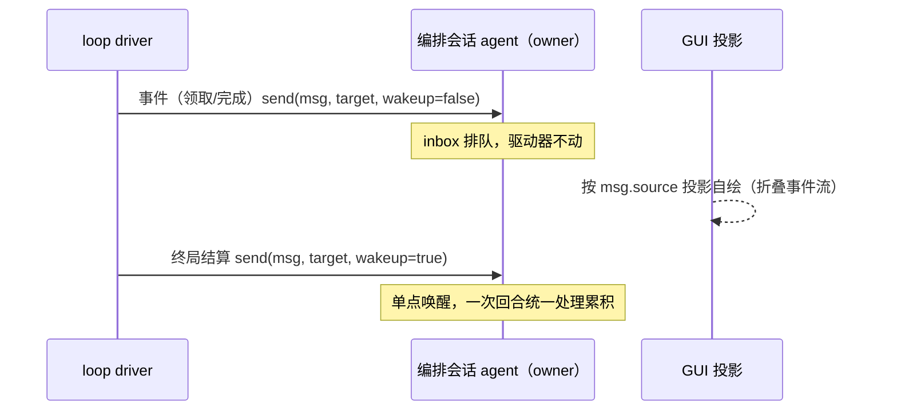

# loop-event-delivery：循环事件消息不唤醒 + 结算单点唤醒

## 现状

任务循环的事件投递（`[forge·领取/完成/结束]`）经 plugin-forge 自有 narrator 通道（notice/followup/settle 三径）写为持久 user message；每条事件都可能成为编排会话的一个回合输入。系统提示词协作面（P1/P3+P9）经 `ctx.systemPrompt.section` 纯投影注入，与事件投递是两条独立通道。

痛点：逐事件投递 → 编排会话被打断/上下文被逐条消费；事件与结算的投递节奏无差别。

## 方案（用户设想 2026-10-18）

- **事件消息**（领取/汇报结果）：`agent.send` 发送自定义 user message，**不立马 wakeup agent**，渲染样式自行决定（GUI 投影）。
- **结算消息**：同样 `agent.send`，**wakeup agent**，统一结算所有累积。

## 官方机械核销（2026-10-18，主检出 node_modules 实查）

`@deepseek-ai/dsh-agent/lib/types/runtime-types.d.ts`：

| API | 行号 | 语义 |
|---|---|---|
| `send(message, target, wakeup: boolean)` | :186 | 路由到 inbox 边界，**可选唤醒**（"optionally wake the driver"）——`wakeup=false` 即「写入不唤醒」，官方一等参数 |
| `followup(message)` | :192 | 排队普通回合并唤醒 |
| `steer(message)` | :199 | 就近步间注入（idle 则开回合） |
| `inject(message)` | :209 | 面向模型的 pre-step 上下文，不唤醒——**但下一请求即被消费进上下文**，非「仅渲染」 |

结论：方案两段均落在官方缝上；单写者铁律无虞（`agent.send` 即官方写径）。

## 映射

## 边界与取舍（三项）

1. **「不唤醒」≠「模型永不见」**：`send(...,false)` 的消息排在 turn 边界，下一个任何唤醒（结算或用户插话）会把累积消息全部吃进上下文。官方无「写日志但模型永不消费」的 user message 形态（2026-10-18 核销：`consumed-work` 是日志核算 API——fold 消费记账，非投递形态；`archive-admission` 是归档取消语义，均不提供「写入不消费」）。**裁决（2026-10-18）：事件消息内容保持现状不变，仅改投递方式为 `send(..., wakeup=false)`；不采用 inject 上下文路径**——被下一个唤醒吃进上下文的税按现状内容接受。
2. **渲染缝**：`UserMessage.source` 元数据 → GUI 按 source kind 投影自绘（先例：`dispatch-loop-settled` source 已走通），扩枚举即可，产品层允许面。
3. **与现有 narrator 三径关系**：followup/steer 本质是 send 的唤醒组合包装；本方案 = 把自有 narration channel 收敛到官方 send 面 + 事件路径降级不唤醒——符合「复用优先、砍平行机械」裁决（顺带消灭 1.1 自建的 notice 通道）。

## 改动面（初判）

- `plugin-forge/src/notify/`（narrator/channel/templates：三径收敛到 send 面）
- `plugin-forge/src/loop/driver.ts`（事件投递点改 `send(...,false)`；结算改单点 `send(...,true)`）
- `apps/web`（source 枚举扩展 + 事件折叠渲染）
- 契约 pin（narration 相关断言随迁）

## 验收

- 事件投递改 `send(msg, target, wakeup=false)`：驱动器不被逐事件唤醒；消息内容与现状逐字一致。
- 结算投递单点 `send(msg, target, wakeup=true)`：循环终局一次唤醒，统一处理累积。
- narrator 自有通道（notice/followup/settle 三径中与 send 语义重叠的部分）收敛到官方 send 面。
- GUI 按 source kind 投影事件消息（折叠渲染），先例 `dispatch-loop-settled` 枚举扩展。
- 真机证据：`send(...,false)` 不唤醒语义、下回合消费形态、source 投影——探针先行落盘（`.forge/docs/probes/`）。

## 一致性检查

- 验收 1/2 ↔ 改动面 driver.ts；验收 3 ↔ notify/；验收 4 ↔ apps/web；验收 5 ↔ 推进路径裁决（先探针后立项）。
- 每条纳入项均服务某条验收，无互相矛盾（事件不唤醒 vs 结算唤醒为互补语义）。

## 推进路径（裁决 2026-10-18）

先派探针卡实测 `send(msg, target, false)` 真机行为（不唤醒语义、下回合消费形态、source 渲染投影），证据落盘后再 quick-tasks 拆解实施。
