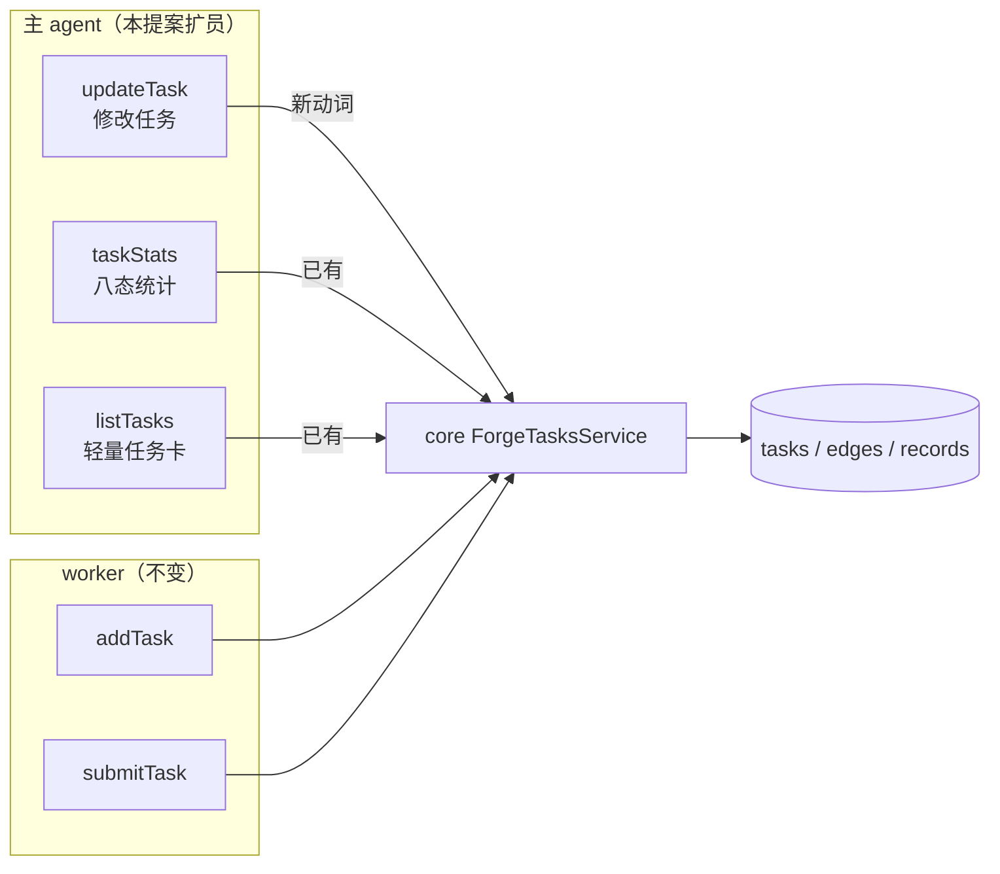

# Proposal: 主 agent 任务域工具三员——updateTask + taskStats + listTasks（main-agent-task-tools）

> **定位**：forge 任务域工具面扩员（new-feature）。三员均**仅限主 agent**：修改任务（updateTask，全链路新动词）与查询任务统计/列表（taskStats / listTasks，core 服务已有、agent 面缺席）。worker 工具面恒只给 submitTask + addTask 恰两员，不变。

## Problem

主 agent 是派发循环的驾驶者，但当前工具面（终态六员）存在两处能力缺口：

- **任务建错后无处修正**：全链路（contracts 服务面 11 法 / 工具面六员 / GUI）无任何"修改任务内容"动词，亦无删除。AC 写错、depends_on 加错、优先级失当时，主 agent 只能将错就错或另建任务留脏行——错误简报直接流入 worker 执行。
- **全局池况感知只有 O(N) 或绑动作两条路**：core `taskStats`/`listTasks` 已实现且被 GUI chips 与 triage 内部消费，但 agent 面没有对应工具。主 agent 想看"还剩几个 pending / 多少 blocked"，要么逐任务 queryTask（O(N) 次调用），要么等 dispatchTask 附带的池快照（绑在派发动作上——为看进度白派任务不可接受）。

**紧迫性**：run-tasks 派发循环已实际运转（run-tasks-host-command 已落），两个缺口在日常使用中反复暴露。

## Solution

### ① updateTask（新工具 + core 新服务动词）

- **定位**：`slug + local_id`（同 queryTask/submitTask 口径），返回更新后任务快照。
- **字段面（宽面）**：title / type / priority / estimated_time / complexity / task_desc / acceptance_criteria / vars / surface_key / surface_type / depends_on 全可改；未给字段不动（partial 语义）。
- **状态门**：`pending / blocked / suspended` 可改（统一判据：无 worker 持有 ∧ 未落结算审计）；`in_progress / interrupted`（简报已被 worker 消费，改写致重入不一致）与 `completed / skipped / rejected`（已落结算，改写 = 历史失真）拒绝，typed error。
- **depends_on 改写护栏**：复用 addTask 增量环校验（引环即拒）；仅作用于 `manual` 边——`fix-chain` / `autoconfig` 派生边拒绝改写（链机械持有）。
- **审计**：records 表 append update 行（actor = 'plugin-tool'，verb = updateTask）。

### ② taskStats（新工具壳，core 服务直透）

- **参数**：source 可选作用域（source_kind + source_slug 成对，同 addTask 口径；缺省 = 全库）。
- **返回**：total + 八态分布 + unmetPending——与 GUI chips 同源同口径。

### ③ listTasks（新工具壳，core 服务直透）

- **参数**：search（中英双语）/ statusFilter / sort / source 直透。
- **返回**：TaskCard 轻量卡（自然键、标题、状态、优先级、前置、会话计数、fix 源标）——**不含 task_desc / AC / vars 等具体内容**（TaskCard 现形状即如此，零新投影）；其中**前置 = 前置任务 localId 数组**（tool 壳渲染投影——同容器 slug 恒等服务不变量下 localId 即足定位；core TaskCard 三字段摘要形状不动，GUI 无波及）。

### 仅限主 agent 的达成（零新机械）

三员入 `FORGE_TOOL_NAMES`（六员 → 九员），同步入 `FORGE_DENY_IN_WORKER` deny 名单；worker / triage 派生 toolFilter 单测守护既有，扩员即断言。

### 跨模块交互面

- plugin-forge tools（三新壳）→ core ForgeTasksService（updateTask 新动词；taskStats/listTasks 已有）→ 状态库三表。
- assemble.ts `deriveWorkerToolFilter` deny 名单扩员 + 契约单测（名单 = FORGE_TOOL_NAMES ∪ dispatchTask − worker 允许面）同步。
- events 缝（3.4）：updateTask 发射点（成功 + typed error → tool-error）。
- addTask 环校验 / 两级去重逻辑被 updateTask 复用（depends_on 改写重校验）。

## Scope

**纳入**
- contracts：ForgeTasksService 增 updateTask；UpdateTaskInput/Result DTO。
- core：updateTask 服务实现（状态门 + 环校验复用 + manual 边护栏 + records 审计）。
- plugin-forge：三 tool 壳（参数 schema / formatOk / 事件发射）；FORGE_TOOL_NAMES 扩员 + FORGE_DENY_IN_WORKER 同步。
- 单测：三包断言面（plugin.test 工具名清单、deny 名单守护、core updateTask 行为、tool 壳渲染/路由）。

**排除**
- GUI 任务编辑面（web 端不做编辑 UI）。
- 任务删除工具。
- transitionTask 的 agent 注册（维持人类通道专属）。
- plugin-forge-spec 任何改动。

## Risks

1. **updateTask 与 claim 的竞态**（改写瞬间任务被领取 → 门校验失效）：状态门校验入同一事务（单事务全成全败），与 claimTask 串行化。
2. **depends_on 改写破坏 DAG**（引环 / 拆 fix 链）：复用增量环校验拒环；fix-chain/autoconfig 边结构性不可改。
3. **工具名扩员破坏 worker 名单守护**（新名漏入 deny → worker 越权）：FORGE_DENY_IN_WORKER 同步单测既 fail-loud，扩员漏同步即红。
4. **listTasks 大库返回体膨胀**：返回恒轻卡 + search/statusFilter/sort 直透收敛；无分页面（主 agent 侧按需过滤，GUI 已承载全量浏览）。

## Acceptance

1. updateTask：pending/blocked/suspended 任务全字段可改、落库、返回更新后快照；六种锁定态改写被拒（typed error）；depends_on 引环被拒；fix-chain/autoconfig 边改写被拒；records 留 update 审计行。
2. taskStats：无 source = 全库、有 source = 容器作用域；返回 total + 八态 + unmetPending 与 GUI 同源一致。
3. listTasks：返回 TaskCard 轻卡（无 task_desc/AC/vars；前置渲染为 localId 数组）；search/statusFilter/sort/source 生效。
4. 仅主 agent：worker 与 triage 的 toolFilter.deny 均含三员（单测断言）。
5. 质量门：contracts / core / plugin-forge 三包测试全绿。

**一致性检查**：验收 1 ↔ 纳入第 1/2/4 条（updateTask 全链路）；验收 2/3 ↔ 纳入第 3 条（plugin-forge 壳，core 服务已有）；验收 4 ↔ 纳入第 3 条 deny 同步 + 第 4 条断言面；验收 5 ↔ 纳入第 4 条。每条纳入均服务至少一条验收，无验收无纳入支撑，两条验收间无矛盾（状态门与八态口径同源自 contracts）。核对通过。

## Challenge Log

- 需求闸门：两需求均无更简替代（修改无删除/重建路径；统计替代绑派发动作或 O(N)），通过，无 override。
- 设计树裁决（用户）：updateTask 取宽面（pending+blocked+suspended 全字段，in_progress/interrupted/completed 锁定后经状态机核实扩展 skipped/rejected 一并锁定）；统计面取 taskStats + listTasks 双暴露且 listTasks 仅基本信息；前置渲染为前置任务 localId 数组（tool 壳投影）。
