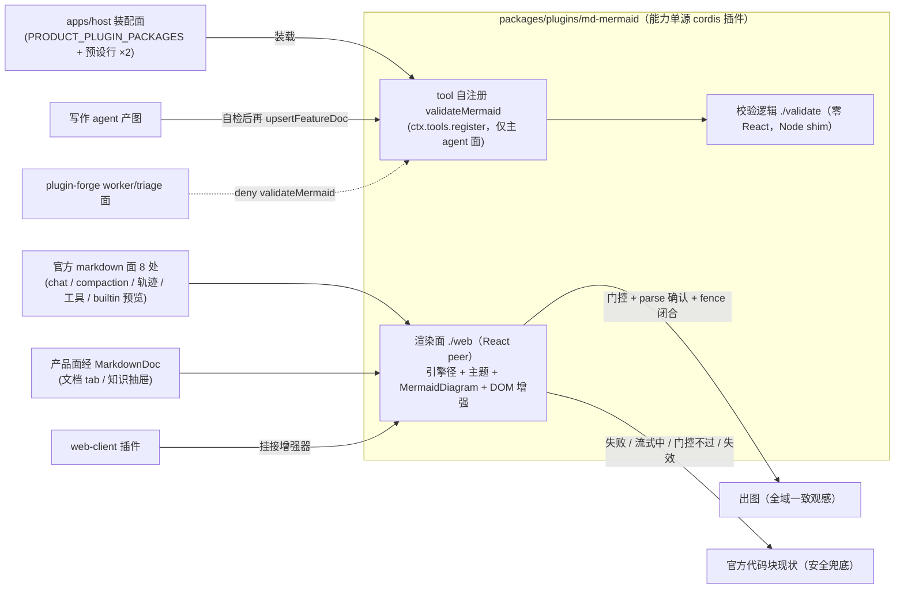

# md-mermaid cordis 插件：mermaid 渲染与图源校验

## 问题

**渲染缺口**：agent 在 chat 中输出 mermaid 图源是高频场景（工作区文档公约要求 mermaid
优先），但官方渲染链（`dsh-client-ui-chat` → AssistantMarkdown → MarkdownText）**零
mermaid 能力且无代码块级扩展缝**（MarkdownText props 面固定——ui-primitives 0.2.0-rc.2
类型核实）。用户看到代码块源码，需手动复制到文档 tab 看图，体验割裂。产品侧能力散居
`apps/web/views/docs` 双形态并存，机制不统一；现行主题观感偏淡（节点/边框 washed
out）。

**写作面无自检**：agent 写文档带 mermaid → 源非法 → GUI 回退卡，定位成本落在人身上。
2026-10-13 实证四处带病 fence（一行双节点 `/` 分隔、sequenceDiagram 消息内 `;` 截断
×2、`·`+`@` 标签组合文法不可组合——全部经 mermaid 12.1.0 `parse()` 复现）；本提案评
审过程又添第五例（flowchart 标签未引号括号）。修复需自制脚本 + DOM shim 考古；
write-prd / ui-design / tech-design 产图直入 `upsertFeatureDoc`，错误直到人类在回退卡
处才暴露。mermaid parse 错误信息质量高（行号 + `Expecting X`），可直接喂回 agent 自
修——缺的只是暴露面。

## 方案

**预防 → 渲染 → 兜底三层闭环，能力单源插件包**：`packages/plugins/md-mermaid` 为
cordis 插件（tool 自注册）+ web 库（渲染面）——mermaid 依赖全仓唯一引用方；远征与
突击双组合装载（突击会话同享预防面）。

**目录约定**：`packages/plugins/` 为 cordis 插件包新居所（本提案首住户 md-mermaid）；
既有 `packages/plugin-forge` / `plugin-forge-spec` 平铺位置不动（迁移非本提案范
围）。



**能力包（packages/plugins/md-mermaid，cordis 插件 + 双面出口）**

- 插件入口 `.`（Node）：apply 内 `ctx.tools.register(validateMermaid)`——注册面零
  中介（无 spec 薄壳）；ctx 经结构化窄类型（faces.ts 模式，零 dsh 运行时依赖——
  plugin-forge-spec 同法）。
- 校验面 `./validate`（零 React）：引擎适配器（Node DOM shim + loose + parse 归
  一）、引擎注册表 `Record<format, adapter>`（本期只装 mermaid，结构预留）、fence
  提取正则、首行头词探测（auto）、裁决归一形状。
- 渲染面 `./web`（React peer）：引擎懒加载唯一径（浏览器 strict，Hard Rule 不破）+
  主题变量（含调优）、MermaidFigure/MermaidFallbackCard/MermaidDiagram、DOM 渐进增
  强模块。
- mermaid 依赖只在包内一处——版本锁死由结构保证。

**工具面（validateMermaid，包内自注册）**

- **命名裁决**：agent 识别优先——调用时上下文字面即 ```mermaid，零跳步；注册表中立
  性代价后置（多引擎落地时刻 = 单常量 + 技能文案 + deny 名单的可见小改）。包名
  md-mermaid 与工具名 validateMermaid 同域自洽（chart 词汇退役）。

- 入参双模：`source` = 单图源（严格单枚）；`docRel` = 文档相对路径（扫全部
  mermaid fence 逐枚裁决，行号 = fence 起始行）；`format?` 显式覆盖，缺省 auto（机
  械探测不经 LLM）。
- 裁决归一形状：source 模式 `{ ok, format, line?, message? }`；docRel 模式
  `{ fences: [{ line, format, ok, message? }] }`；未知头词显式 unsupported（不假失
  败）。
- **flowchart 第一公民**（渲染主型 + 实证事故主型）：专项测试矩阵打头。
- 仅主 agent：`FORGE_DENY_IN_WORKER` 七员→八员（deny 名单对已装载工具名合法；双组
  合装载后工具恒在场，deny 恒有效）；triage 面同名单继承。
- 消费闭环：write-prd / ui-design / tech-design 三技能 SKILL.md 增一行纪律（图写完
  → validateMermaid 自检 → 再 upsertFeatureDoc）。

**渲染层（单径统一）**

- 单径全域：凡 `.md-code-block` DOM（官方 CodeBlock 唯一形态，类名稳定非哈希）即扫
  描增强——产品面与官方面同机制、同引擎同主题同回退；内容合法即出图；官方未来新面
  自动纳入。
- 退役清单：doc-segments 分段器、md-segments-body、md-preview-body 及
  'dswf-md-mermaid' 预览扩展注册链整体退役；sidebar md 预览回归官方 builtin；
  MarkdownDoc（官方渲染唯一包装入口，结构测试 pin）保留。
- 幂等重增强 + 流式保持代码形态 + 安全降级（门控不过/探测失效 = 官方代码块现状，不
  炸）。
- 主题调优：对比度与层次 + 浅深双主题可读，全域单点生效。

**host 装配面（产品插件入图，M3 3.7 增 spec 同法先例）**

- `PRODUCT_PLUGIN_PACKAGES` +1；三供应面同步（apps/host 依赖树 workspace 链 /
  profile.dev link 行 / assemble-installer-resources PRODUCT_PACKAGES 拷贝）；预设
  patch 双组合各 +1 装载行；presets.test / runtime-packages.test pin 同步。

## 改动影响范围

**纳入**

- 新包 `packages/plugins/md-mermaid`（`@dsh-forge/md-mermaid`，tsc 构建——contracts 先例）：插
  件入口（tool 自注册）+ 校验面（适配器/注册表/fence 提取/裁决）+ 渲染面（引擎径 +
  主题 + 组件 + DOM 增强器）及其测试（插件注册 pin、真引擎集成测试[混型合法集 + 五
  处实证非法源回归 + flowchart 专项矩阵 + unsupported/空源边界]、MermaidDiagram 既
  有测试迁移、增强器新增）。
- apps/web：依赖改 `@dsh-forge/md-mermaid`（workspace:*，引 `./web` 面；mermaid 直接
  依赖退役）；client 插件挂接 DOM 增强（分段链与 'dswf-md-mermaid' 注册链删除）；
  EntryDrawer/docs 正文改 MarkdownDoc 全量渲染；增强图容器 CSS（超宽横滚）。
- apps/host：装配面六触点（PRODUCT_PLUGIN_PACKAGES / 三供应面 / 预设 patch ×2 /
  pin 同步）。
- plugin-forge：`FORGE_DENY_IN_WORKER` +validateMermaid（worker/triage 面拒入，单测
  守护同步）。
- plugin-forge-spec：仅技能文案——三技能 SKILL.md 回写一行 + forge:spec 提示段一
  句；代码与 tool 面零改动（三动词不动，无新依赖）。

**排除**

- 其他图语言实装（plantuml/graphviz——双面注册表缝预留；复活触发 = GUI 支持新图
  型）。
- 渲染级校验（出 SVG）；写入门（upsertFeatureDoc 拒写）与 CI 全库 fence 扫荡（复活
  触发 = 仓库再现带病入仓图）。
- worker 面放行（复活触发 = doc 型任务实测高频需要）。
- 设置开关；第二 client 插件 boot 机械（md-mermaid 是 host 侧 cordis 插件，非 web
  client 插件）。
- 官方包零改动；pin-05 等既有契约测试面零扩大（pin-10 不动——spec 三动词不变）。
- MarkdownDoc 包装语义不变；组件 CSS 不入包。

## 验收

1. chat 中区 assistant 消息内已闭合 ```mermaid 块自动渲染为图，含 loadOlder 回溯加载
   的历史消息。
2. 流式输出期间 mermaid fence 保持官方代码块形态，fence 闭合后自动出图，无闪烁、无
   中途半图。
3. 非法 mermaid 源回退为源码卡展示，异常不外溢。
4. 超宽图在内容区内横向滚动，不破版式。
5. 全域一致：产品面（文档 tab / 知识抽屉）与官方面（chat、builtin md 预览切回）同
   机制出图，同引擎同主题。
6. 增强失效（DOM 形变化模拟）时安全降级为官方代码块现状，无未捕获异常。
7. 渲染层退役完成：apps/web 无 doc-segments/md-segments-body/md-preview-body 残留
   （结构测试锚）；sidebar md 预览默认 builtin。
8. mermaid 全仓唯一引用方 = packages/plugins/md-mermaid——apps/web 与其余包源码零直接
   import mermaid、零直接依赖（结构测试锚）。
9. 包可独立构建（tsc -b），双消费面构建通过（apps/web `./web` workspace 消费）。
10. 懒加载纪律：客户端零 mermaid 会话零引擎加载（关键字门控先行）；宿主 tool 不调
    用零装载——单测锚。
11. 主题调优：节点底/边框/连线/文字对比度可辨、浅深双主题可读——实机走查记录归档
    （不进 git）。
12. validateMermaid source 模式：混型合法集返回 ok:true；非法源返回 line + message
    ——五处实证源全部复现命中（含 flowchart 两坑）。
13. validateMermaid docRel 模式：多 fence 文档逐枚裁决（行号 = fence 起始行）；空源
    快速失败；未知头词显式 unsupported。
14. flowchart 专项矩阵（graph 旧语法/中文 id/引号标签/`<br/>`/`/` 字符位等合法集；
    一行双节点/未引号 `·`+`@`/缺头残源非法集）逐条通过，非法错误含行号。
15. 插件装载与主 agent 面：远征+突击双组合预设装载断言（presets.test）；worker 与
    triage 派生面 deny 含 validateMermaid（fail-loud 断言）。
16. 消费闭环：三技能 SKILL.md 回写一行 + forge:spec 提示段一句；质量门全绿
    （md-mermaid / plugin-forge / apps/host / apps/web 及牵连 pin）。

**一致性核对**：AC1/2/3/4 ← chat 增强；AC5 ← 单径全域；AC6 ← 安全降级；AC7 ← 退役
纳入项；AC8/9 ← 能力单源包；AC10 ← 双面懒加载设计；AC11 ← 主题调优；AC12–14 ← 校验
面纳入项；AC15 ← 插件装配 + deny 纳入项；AC16 ← 技能回写纳入项。纳入项与验收双向覆
盖，无互斥（AC1 与 AC2 时序互补；AC15 的 deny 恒有效恰依赖 AC15 的双组合装载——同
一改动面自洽）。

## 技术附录

### A. 官方 markdown 渲染面枚举（0.2.0-rc.2 实测）

MarkdownText 消费共 7 包 8 处：chat（assistant 正文、compaction 摘要体）、
trajectory、tool、user-questions、deliverables、agent-preset、
sidebar-documentpreview（builtin md 预览）。机制面与枚举无关：凡 `md-code-block`
DOM 即覆盖，官方未来新面自动纳入。

### B. 官方 CodeBlock DOM 解剖与 infostring 不可观测性

- 根节点 `div.md-code-block`（稳定非哈希类名）+ `data-code-wrap`；内容锚
  `div[data-code-block-content]`；源文本经 `pre` textContent 可恢复（官方复制钮同
  径）。
- **infostring 渲染后不可观测**：mermaid 不在 `dsh-util-code-language` 扩展表 →
  CodeToolbar 语言位显示通用文案；plain 渲染分支无 `language-*` 类。故增强采用内
  容判据（关键字门控 + parse 确认），全域统一。

### C. 探测与替换机制（渲染面）

- 扫描：MutationObserver（防抖）扫全 DOM `.md-code-block`。
- 门控：内容首行图型关键字（flowchart/graph/sequenceDiagram/erDiagram/classDiagram/
  stateDiagram/gantt/pie/mindmap/journey/gitGraph/timeline/quadrantChart/sankey/
  xychart/block/architecture/packet/kanban/radar/requirement 等，含可选 YAML
  frontmatter 首行）→ 通过才触发引擎懒加载，parse 确认后 render，成功替换。
- 替换：目标块旁插入图容器并隐藏原 content（不删官方节点）；官方重渲重建后按
  data 标记 + 源 hash 幂等重增强。
- 已知精度边界（全域一致接受）：无语言 fence 内合法图源同样出图——判据是「内容合
  法」而非「作者声明」。

### D. validateMermaid 工具（包内自注册）

- 注册机制：插件入口 apply 内 `ctx.tools.register(...)`（dsh ToolRuntime 通用服务
  面——spec 三动词同径）；ctx 结构化窄类型（faces.ts 模式），包零 dsh 运行时依赖
  （plugin-forge-spec 同法先例）。
- 分派是机械判断不经 LLM：auto = 首行头词探测（mermaid `detectType()` 提升）；注
  册表 `Record<format, adapter>`，本期只装 mermaid（结构预留、依赖不预支）。
- Node DOM shim（~6 行，2026-10-13 实证）：`window = globalThis` + `Element` 桩 +
  `document` 桩 + `addEventListener` 桩——满足 DOMPurify 模块级装配与 mermaid init
  监听；桩局限校验面内一次性执行并代码注记。
- `securityLevel:'loose'`（校验面）与渲染面 'strict' 同维：只差标签净化，语法门同
  一 parse 抛错路径（实证一致）。
- fence 提取正则单源（`/```mermaid\r?\n([\s\S]*?)```/g`，随能力入包）；typed
  error → tool-error 发射（verb=validateMermaid）；无 contracts/core/GUI 改动。

### E. 单包三面出口（能力单源）

- exports 分径：`.` = 插件入口（Node，cordis loader 装载面）；`./validate` = 零
  React 纯逻辑；`./web` = React 组件 + 增强器（React peerDependency，optional
  meta）。
- mermaid 依赖只在包 dependencies 一处：渲染面（浏览器 strict 动态 import 经消费
  方 Vite 惰性 chunk）与校验面（Node shim loose 动态 import）各自装载语义独立、版
  本单点同步。

### F. host 装配面清单（M3 3.7 先例复刻，六触点）

`PRODUCT_PLUGIN_PACKAGES` 数组 + apps/host/package.json workspace 链 +
profile.dev/package.json link 行 + assemble-installer-resources PRODUCT_PACKAGES 拷
贝（源路径 packages/plugins/md-mermaid）+ 预设 patch 远征/突击双组合装载行 +
presets.test/runtime-packages.test pin 同
步。**deny 名单约束**：driver toolFilter 对未知名 loud 校验——双组合装载使
validateMermaid 恒在场，`FORGE_DENY_IN_WORKER` 增员恒安全（装配面 pin 守护装载不
缺席）。

### G. 依赖与构建

md-mermaid：tsc -b（contracts 先例），三面出口各自可独立消费。plugin-forge：仅
assemble.ts deny 名单 + 单测同步。apps/web：mermaid 直接依赖退役。

### H. 主题调优（终案裁决链 2026-10-13，任务 1.11 + 1.13 落地）

多轮 Chromium 实渲染评审收敛（证据：walkthrough/theme-design-review.html）：白节点
（bluish-00）浮于簇底 + **柔蓝描边 #7aaaff（deepseek-400，品牌蓝降一档）** + 柔灰线
#adb2b8（bluish-400）/ 簇边 #e1e5ee（200）三级层次 + **亮蓝文字 #5686fe
（deepseek-450）** + 白净边标签。约束不变：实值取官方静态令牌镜像（khroma 派生禁
var()）；浅主题先行，深主题可读校验（联动属后续面）。评审否决项：深灰节点分层版
（1.11 首落）、纯灰阶 A、全强度品牌蓝 #4176e6 描边、蓝文字 #4176e6/#4868b2（不够
亮）与 #7aaaff（越可读底线）。

## 整合来源

本提案整合自 chatview-mermaid v4（渲染增强 + 能力包）与 diagram-syntax-validator
（validateMermaid 工具，2026-10-13 独立成稿；用户裁决：工具能力并入 md-mermaid 包、
插件自注册、双组合装载）——后者注册后按 superseded 处置。
