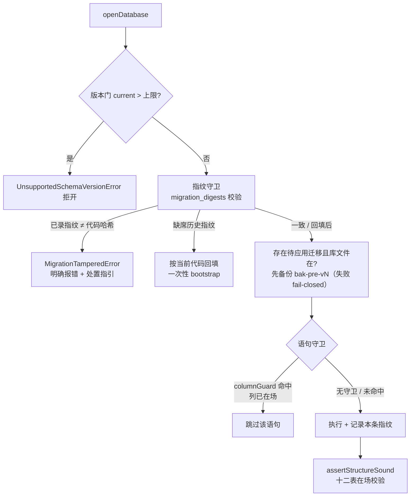

# 提案：迁移机制加固——v2 自愈化 + 迁移指纹守卫

## 需求

2026-10-14 cad-agent 工作区 forge.db 开库即隔离（`no such table: bugs`）暴露出迁移机制的结构性缺口：

- 仓规允许「v1 直改」（修改已发布迁移的语句），导致同一 `schema_meta` 版本号下存在**多条库谱系**（10-13 谱系无 bugs 表 / fix-bug 后谱系有 bugs 无 fix_approach）。
- 版本门只看版本数字，不感知谱系差异；后续迁移（v2 的 `ALTER TABLE bugs`）按单一谱系假设书写，落在旧谱系库上必然失败 → 整域隔离。
- 本次活库靠手工数据级原地迁移救回，但机制未变——下一次直改还会以同样方式炸。

目标：

1. **治存量**：v2 收敛化——任何谱系的 version=1 库应用 v2 后都收敛到同一 v2 终态，不再依赖「v1 语句恰好长什么样」。
2. **防复发**：迁移指纹守卫——已应用迁移的语句哈希随库记录；今后再改已发布迁移的语句，开库时在版本门处明确报错（带处置指引），而不是让后续迁移在运行期神秘失败。
3. **数据零丢失**：自动升级必须保数据——应用待补迁移前自动文件级备份（fail-closed）；迁移单事务原子（任一步失败库文件回原状）。
4. **不兼容变更必须带数据迁移脚本**：改列名/类型/表重建等不兼容变更，一律以同事务 DDL+DML 序列承载（`INSERT … SELECT` 搬数、撤/复建 append-only 触发器后回填），禁止「废弃重建丢历史」；谱系回归测试断言业务行保留。
5. **回归钉**：历史谱系夹具测试（旧十表 v1 库 / fix-bug 后 v1 库 / 全新建库），锁死收敛行为。

## 方案

六处机制改动：

1. **Migration 语句守卫**（`db/schema.ts` + `db/open.ts`）：`statements` 条目从 `string` 扩为 `string | { sql, columnGuard?: { table, column } }`——SQLite 无 `ADD COLUMN IF NOT EXISTS`，应用前查 `pragma table_info`，列已在场则跳过该语句。
2. **v2 自愈化**（`forge/workspace/migrations.ts`，`FORGE_DB_SCHEMA_VERSION` 维持 2）：v2 语句改为收敛式——`CREATE TABLE IF NOT EXISTS bugs`（v2 终态 21 列，含 fix_approach 内联）+ `CREATE INDEX IF NOT EXISTS idx_bugs_status` + 守卫式 `ALTER TABLE bugs ADD COLUMN fix_approach`。v1 不动。三条谱系收敛验证：
   - 10-13 谱系（无 bugs）：v2 全量建表（含 fix_approach），守卫 ALTER 跳过 ✓
   - fix-bug 后谱系（bugs 无 fix_approach）：CREATE IF NOT EXISTS 跳过，守卫 ALTER 补列 ✓
   - 全新库：v1 建 bugs（20 列）→ v2 守卫 ALTER 补 fix_approach ✓
3. **迁移指纹守卫**（`db/open.ts` + `db/errors.ts`）：新基建表 `migration_digests(version PK, digest)`（机制级 `CREATE TABLE IF NOT EXISTS`，不占迁移版本号）；应用迁移成功后同事务记录该版本语句集 sha-256；开库时对已应用版本逐一校验——缺席（历史库）按当前代码一次性回填（bootstrap，接受现状为正典），不一致即抛 `MigrationTamperedError`（指明版本号 + 处置指引：恢复语句或重建库）。中央 state.db 序列经同一 `openDatabase` 机制自动受益。
4. **迁移前自动备份**（`db/open.ts`，实现 = `VACUUM INTO`）：存在待应用迁移且库文件已存在时，先执行 `VACUUM INTO '{file}.bak-{日期}-pre-v{目标版本}'`（按目标版本覆盖保留一份）；备份失败 fail-closed——不应用任何迁移直接抛错。用 `VACUUM INTO` 而非裸文件拷贝：库开 WAL，最近提交可停留在 `-wal` 文件，裸拷主文件会丢最近事务；`VACUUM INTO` 由 SQLite 产出含全部已提交数据的完整快照。备份兜「迁移逻辑写错但事务提交成功」的逻辑性丢数据；事务原子性兜「迁移中途失败」——两层合围数据零丢失。中央与工作区序列同机制。
5. **数据迁移实现配方**（关键逻辑——机制级保障 + 两套配方，`statements` 序列本就支持 DDL/DML 混排，无需新承载机制）：
   - **迁移事务统一 `PRAGMA defer_foreign_keys = ON`**（`applyMigration` 事务开头机制级设置）：FK 校验延迟到 COMMIT——表重建期间允许暂态引用悬空，最终结构一致即放行；语句失败整体回滚不受影响。
   - **加列回填配方**：守卫式 `ADD COLUMN` → `DROP TRIGGER IF EXISTS`（append-only 表先撤触发器，否则 UPDATE 触发 RAISE）→ `UPDATE … SET 新列 = …` 回填 → 按原文复建触发器。
   - **表重建配方**（改列名/类型/结构重组）：`ALTER TABLE t RENAME TO t_old` → `CREATE TABLE t`（新形）→ `INSERT INTO t SELECT … FROM t_old`（列映射搬数）→ `DROP TABLE t_old` → 重建索引/触发器。全程单事务，搬数与结构变更原子。
   - 禁止「废弃重建」绕过数据迁移。
6. **隔离免重启恢复**（`forge/workspace/store.ts`）：隔离表条目从「永久 fail-fast」改为「带重试窗的 fail-fast」——记录隔离时刻，`ensureOpen` 触达已隔离工作区时若超过重试间隔（30s）则重试开库；成功即清除隔离、缓存句柄（恢复无需重启进程），失败则刷新隔离时刻并沿用同一 typed error。重试窗内维持原 fail-fast 语义（同一实例、不重复记账），避免密集失败刷屏。迁移自愈落地后，被隔离工作区的库文件一经新代码开库成功，30s 内自动回归。

## 改动范围

| 文件 | 改动 |
|---|---|
| `packages/core/src/db/schema.ts` | `Migration.statements` 类型扩展（守卫形态） |
| `packages/core/src/db/open.ts` | 守卫执行 + `migration_digests` 记录/校验/回填 + 迁移前自动备份 |
| `packages/core/src/db/errors.ts` | `MigrationTamperedError` typed error |
| `packages/core/src/forge/workspace/migrations.ts` | v2 语句收敛化改写（头注纪律更新：禁改已发布迁移） |
| `packages/core/src/forge/workspace/store.ts` | `EXPECTED_TABLES` +1（migration_digests，十二表）；隔离表重试窗（30s 后重试开库，成功清除隔离） |
| `packages/core/src/forge/workspace/migrations.test.ts` | pin 测试适配 v2 新语句形态 |
| `packages/core/src/forge/workspace/store.test.ts` | 表在场清单断言适配 + 隔离重试窗单测（窗内 fail-fast 同实例 / 窗外重试 / 恢复成功清隔离） |
| `packages/core/src/db/db.test.ts` | 守卫执行 + 指纹记录/校验/篡改拒开 + 迁移前备份（落盘/失败 fail-closed/幂等覆盖）单测 |
| `packages/core/src/forge/workspace/migrations.lineage.test.ts`（新） | 三谱系夹具收敛回归 |

## 影响范围

- **工作区 forge.db**：v2 语句形态变更——已升 v2 的活库（含手工修复的 cad-agent 库）重开走指纹回填路径，零数据改动；未升 v2 的旧谱系库（如有）开库即自愈收敛。
- **中央 state.db**：同机制接入——既有库首开回填 v1 指纹，零 schema 版本变化。
- **旧代码前向兼容**：未升级的进程打开带 `migration_digests` 的工作区库会因表在场清单不符而隔离（开发期可接受，升级即恢复）。
- **纪律面**：migrations.ts 头注由「v1 直改」改为「已发布迁移禁改语句，只能追加新版本」；pin 测试同步收口。

## 验收

- [ ] 三谱系夹具（旧十表 v1 / fix-bug 后 v1 / 全新库）经 `openDatabase + assertStructureSound` 开库收敛到 v2 终态：12 表、bugs 21 列含 fix_approach、`FORGE_DB_SCHEMA_VERSION=2`、`foreign_key_check` 零违例。
- [ ] 夹具库中既有业务行（tasks/task_records/proposals）迁移后全保留。
- [ ] 篡改复现：已录指纹的库对应用户代码改动已发布迁移语句后开库 → `MigrationTamperedError` 明确拒开（含版本号与处置指引），不做任何半套迁移。
- [ ] 历史库首开指纹回填幂等（重开不再回填、不报错）。
- [ ] 数据零丢失·备份：存在待应用迁移的既有库开库前自动落 `{file}.bak-{日期}-pre-v{n}` 备份；备份失败时不应用任何迁移（fail-closed 抛错，库文件原状）。
- [ ] 数据零丢失·原子性：迁移语句中途失败 → 整体回滚，库内无半套结构与版本行，业务数据原状。
- [ ] 不兼容变更承载形态：示例迁移单测覆盖两套配方——加列回填（撤/复建 append-only 触发器 + UPDATE）与表重建（RENAME → 新形 → INSERT…SELECT 搬数 → DROP，FK 子表在场）——验证搬数原子、业务行保留、COMMIT 时 FK 校验通过。
- [ ] 隔离重试窗：隔离后窗内（<30s）`ensureOpen` 抛同一 error 实例；窗外重试开库，迁移已修复时恢复成功返回句柄且后续触达不再抛；重试仍失败刷新隔离时刻不重复记账。
- [ ] 质量门：`just compile` / `just lint` / `just unit-test` 全绿。
