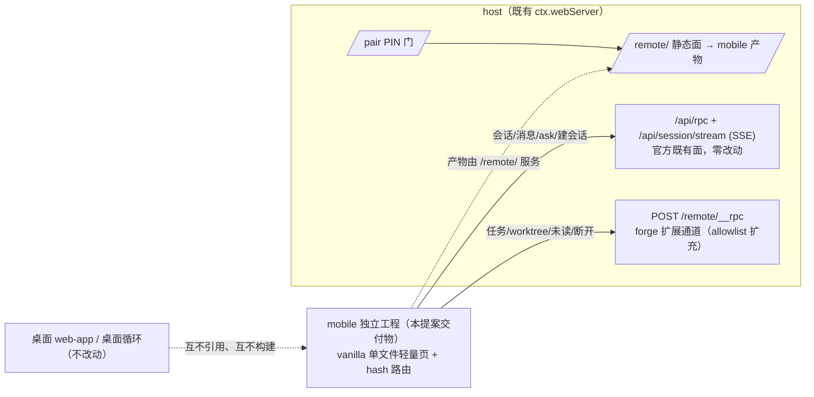

# mobile-ui：手机端受限视图独立工程

**UI 唯一定稿基准**：`mobile-ui/mobile-ui-mockup-final.html`（10 屏综合稿，与 proposal 同目录）；渲染细则基准：`mobile-remote-approval/walkthrough/mobile-message-rendering-gallery-v2.html`。

## 需求

手机端（经配对进入的远程受限视图）当前复用桌面 web-app 的裁剪分支，UI 与桌面工程耦合，无法独立演进。用户已完成 UI 定稿（上述综合稿），并裁决：**手机端做独立插件/工程，不与桌面版混合**。

目标形态：DeepSeek 手机端风格的受限视图——对话为主视图，抽屉会话列表（项目树/置顶/未读）、hero 新会话（模式/分支乐观切换）、分页 ask 面板、悬浮球任务进度（暂停/派发）、worker 会话（one-shot 只读 / continuable 可续聊）、模型/推理等级切换、文档卡片与全屏阅读。

## 方案

### 硬边界（最高裁决）

**手机端 = 纯 view 层。除用户输入与动作意图的转发外，只做两件事：接收数据、渲染页面。**

| 职责 | 归属 |
|---|---|
| 任务循环的全部执行（派发 worker、结算、followup 注入、runId 铸发、哨兵消息生成） | **桌面端**（host 侧循环） |
| 数据获取、会话操作、状态校验、分支冲突检查 | **host 侧**（校验失败 → 手机端只呈现确认框/提示） |
| 手机端 | 展示接收数据 + 渲染；发送的只有用户输入与动作意图（消息、ask 回答、暂停/派发按钮 = 意图转发，执行一律 host 守卫后落地）；数据 stale 时按钮置灰 |

手机端零业务逻辑、零校验、零循环状态维护；永远不出现「循环因手机端操作而改变行为」的路径。

### 结构：官方 DSH Mobile 同构分叉

探针实证（官方 app.asar `renderMobilePage`）：**官方手机端不复用桌面 `dsh-client-ui-*` React 组件**，而是单文件轻量页（vanilla HTML/JS + 手写移动 CSS），复用的是官方 API 面。本工程照此架构：

- **mobile 工程 = 独立构建单元**：独立入口、独立 dist、独立依赖清单；不 import 桌面 web-app 任何模块。共享的只有 API 协议与设计令牌基准（DESIGN.md）。
- **单轻量页、无框架 runtime**：扫码即用秒开；桌面组件不可迁移（pointer/hover 密度）；不背第二条前端构建管线。esbuild 模块化源码（core/views/widgets 三层）打包成单文件 dist。
- **重评框架阈值**（出现任一再议）：① 复杂表单编辑器；② 离线 + 本地状态回放（PWA 级）；③ 有状态浮层面 ≥15 个。

### 数据面：双通道

**官方 API 面（零新增 host 代码）**：`/api/rpc`（`session.list/create/history/prompt(mode:steer)/cancel`、`workspace.list`、`interaction.pending/answer/cancel`）+ `/api/session/stream` SSE + `/api/status` 心跳 + `/brand-logo/*`。对话引擎全链照搬官方手机页实现（SSE→rAF 合帧→末条补丁、乐观提示、轮询退避 750ms→5s、revision 守卫、触底跟随、EventSource 原生重连 + 心跳判活 + 断线覆盖层）。

**forge 扩展面（`/remote/__rpc` allowlist 扩充）**：

| 通道 | 落法 |
|---|---|
| 任务进度 | `forge:remote/progress`（已有） |
| 任务暂停/派发 | 透传桥上 `transitionTask`，动作白名单限 suspended/pending（意图转发，host 守卫执行） |
| 分支/worktree | 透传 `forge:worktree/{branches,list,sessionCreate}`（桥上已有） |
| 分支切换校验 | 新增薄方法：`sessionLinks` + `listTasks` 组合反查运行中任务 |
| 未读徽标 | 新增：host 维护 per-session lastSeen（dsh-home 状态文件） |
| 断开连接 | `forge:remote/disconnect`（已有）+ 状态读 |
| worker 会话类型 | 批次①探针核实 subagent one-shot/continuable 字段；缺席则 host 补派生 |

### 消息渲染（定稿基准 = gallery-v2 + 综合稿屏②）

- **投影**：`user/message`→蓝右气泡、`assistant/chunk`→流式/折叠 thinking 卡、`assistant/message`→终态覆盖、`tool/call+result`→折叠活动卡；无角色标识（样式区分）。
- **视觉三层级**：正文气泡 ＞ 无气泡左缘活动卡（thinking/tool/subagent/job）＞ 居中系统层（循环卡/chip、turn-status）。
- **shell 工具 = 终端风格块**（仅 pwsh/sh）：首行 `$ 命令`（`$` = shell 提示符），其后输出；错误红显；摘要行展示命令、过长截断。其它工具 = 「任务/调用｜分隔线｜结果」分段风格。
- **subagent/job 异步三工具**（启动/查询/强制杀死各为一个工具卡）；结果可能隔多条消息返回 → **异步结果卡**（默认折叠仅显开头，可展开全量）。
- **折叠空间纪律**：活动卡收起 = 摘要行 + 结果段 ~3 行预览渐隐；展开 = 调用段在结果段上方就地撑开（单块内，不另开块）；段落与摘要同宽占满。长消息（>~8 行）同法渐隐 + 展开全部。折叠/展开交互全类型统一（`details[open]` chevron 旋转）。
- **文档卡片**：agent 产出 md/txt/csv/html + 返回链接 → 类型徽标卡（文件名 + size 右对齐于 › 前；无类型说明文案）；点开 → **全屏阅读页**（← 退出 + 文件名 + 「渲染｜文本」胶囊；html/md/csv 默认渲染可切纯文本，csv/md 表格居中；txt 恒纯文本；链接走内置浏览器）。md 渲染 = 批次③引入轻量 md 函数（marked 级）+ `@dsh-forge/md-mermaid` DOM 增强器单源复用（动态 import、暗色锚同源、横滚/双指缩放、只观察消息流容器）。
- **循环消息哨兵**（读侧约定，不碰会话格式）：桌面端循环注入消息经 `session.prompt` 携带 `⟨forge:loop⟩ {kind,runId,task,state}` 头；手机端识别 → 循环卡家族（kind 定色条：dispatch 蓝/followup 浅蓝/state 灰/done 绿，色板同任务面板）；只管自己注入的（harness 自动 continuation 不标识）。**runId = slug + 序号/时间戳**（slug 可重跑，需唯一），slug 作展示名。穿插：同 runId 非最新卡退化为单行 chip（不重排时间线）；多池：悬浮球只反映最近 running run，任务浮层顶部 run 切换 chips。
- **历史加载**：打开会话默认只加载最近 **10 条**（`session.history` maxMessages），数量为移动端可配置常量；上翻到顶分页拉更早。

### 设置面板与模型切换（v7 定稿）

- composer 滑杆设置钮 → **最小化设置面板**（无标题/无说明文本）：模型行（当前值 + ›）+ 推理等级分段控件内联（选档即生效）；preset 锁定语义 host 侧执行，UI 不展示。
- **唯一子视图 = 模型列表**（仅切换模型时打开）：返回钮与搜索框同行（sticky）；100+ 模型多提供商 = 检索（~300ms 防抖、过滤态扁平列表、面板高度恒定防抖动）+ 提供商分组折叠（计数，数据源 = 官方 model catalog）+ 最近使用置顶（**手机页 localStorage**，按配对域隔离——纯视图层状态，零 host 改动；跨设备需求出现再升 host）；当前模型右侧对勾；选中态配方全站统一（primary 边 + 7% tint）；模型行无标签。
- 推理等级档位随所选模型 `reasoning.efforts` 联动，不支持则隐藏该段。

### 交互契约（承综合定稿）

| 面 | 裁决 |
|---|---|
| 顶栏 | ☰（24px，12px 未读徽标）· 居中标题（截断）· ＋新会话图标；无项目/分支/模式控件 |
| 消息流 | 仅消息区竖直滚动（3px 细滚动条），顶栏/输入框固定；新消息滚动到底按钮（未读红点计数） |
| 输入行 | 模式（左，已建会话只读）· worktree（中，截断只显 wt 名，点看全量：名称与路径分行）· 滑杆设置钮 · 发送（右） |
| hero | 默认模式=突击、分支=当前所在分支/worktree（不强切）；乐观切换，host 校验失败弹确认框（选回/仍要切换），UI 无预检说明文本 |
| 抽屉 | 项目树分组（桌面同折叠规则，不展示会话数量）· 置顶/归档（手机不展示归档）· 双级未读徽标 · 底部连接状态（点看详情 + 断开） |
| ask 面板 | 占位输入框（互斥）；一屏一题分页，左上角序号/总数，上一个｜提交｜下一个；checkbox 方框对勾、radio 圆形，主按钮 #4176e6 |
| 任务进度 | 悬浮球可拖拽、贴边收纳透明半圆；浮层主标题=提案名/副标题=slug；任务卡=编号·title+右上角状态徽标（对齐桌面端状态集），运行中显暂停，底部统一派发；运行中置顶、已完成折叠；无审批、无进度百分比 |
| worker 会话 | 点任务卡进入，← 图标退出；one-shot 只读、continuable 可发送；状态徽标同任务面板；模式/worktree 跟随主会话只读继承 |
| 图标 | 全 SVG（官方资产/同风格自绘 16px viewBox、1px 描边、currentColor），无 emoji；左上角抽屉图标 24px、未读徽标 12px |

### 批次切分（3 批，每批独立真机验收）

1. **底座 + 对话通道**：mobile 工程脚手架（esbuild/hash 路由）、`/remote/` 服务接入、官方 API/SSE 分叉（对话引擎全链 + ask 分页卡 + 设置面板与模型切换）、worker 类型字段探针。
2. **抽屉 + hero 新会话**：抽屉（项目树/置顶/归档/未读/连接状态）、hero（模式/分支选择、乐观切换、确认框）、未读徽标（host lastSeen 落地）。
3. **任务进度 + worker + 循环卡 + 文档**：悬浮球与任务浮层（暂停/派发）、worker 会话双形态、循环消息哨兵 + runId 聚合、文档卡片/全屏阅读 + 轻量 md + mermaid 增强器。

## 改动影响范围

- 新增 mobile 独立工程（apps/mobile：源码、esbuild 构建、单文件产物接入 `/remote/` 静态面）。
- host 侧改动（收敛于两面）：`/remote/__rpc` allowlist 扩充（worktree 透传/任务动作/断开/状态读）+ 新增薄方法（分支切换校验、lastSeen 存储、worker 类型派生视探针）；`/remote/` 静态面改指 mobile 产物。
- **零改动**：官方 webServer API（`/api/rpc`/SSE）、配对/PIN/隧道机械、桌面 web-app、会话格式（哨兵是读侧约定）。
- 外部依赖装配面遵守真机端到端取证门禁。

## 验收

1. 手机真机经配对进入 `/remote/` 加载 mobile 独立单文件产物（非桌面裁剪分支），各屏与 `mobile-ui-mockup-final.html` 逐位对照一致。
2. 对话：SSE 流式渲染 + 断线降级轮询 + 恢复自愈；可发送消息（含 continuable worker 注入下一轮）；仅消息区滚动；打开会话默认加载最近 10 条（可配置）。
3. ask 面板：一屏一题分页、序号/总数、上一个/提交/下一个、多选方框✓，经 `interaction.answer` 提交。
4. 抽屉：项目树分组/折叠、置顶归档规则同桌面端、未读徽标与 host lastSeen 一致、连接状态弹层可断开。
5. hero：默认当前分支/worktree 与突击模式；切换分支 host 校验失败弹确认框。
6. 设置面板：最小化两行入口；模型列表 100+ 多提供商检索/分组/最近使用（localStorage）正常；推理等级随模型联动；选中态与桌面端一致。
7. 任务进度：悬浮球拖拽/贴边半圆；状态徽标对齐桌面端；暂停/派发意图经 host 守卫生效；多 run 切换 chips 正确。
8. worker 会话：one-shot 只读、continuable 可发送。
9. 循环卡：哨兵消息渲染为循环卡/chip，runId 聚合正确，穿插不重排时间线。
10. 文档卡片/全屏阅读页：md/txt/csv/html/链接五类识别；html/md/csv 默认渲染可切纯文本；表格居中。
11. 质量门（compile/fmt/lint/test）全绿；每批真机端到端取证归档 walkthrough/。
