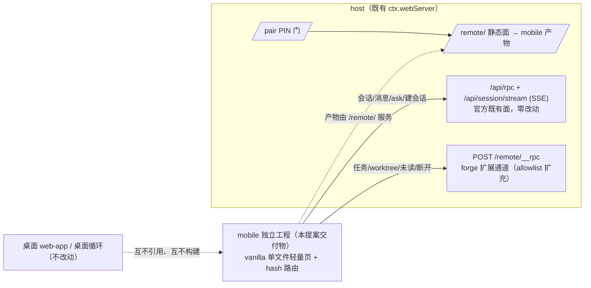

# mobile-ui：手机端受限视图独立工程

## 需求

手机端（经配对进入的远程受限视图）当前复用桌面 web-app 的裁剪分支，UI 与桌面工程耦合，无法独立演进 mockup v6 定稿的移动形态。用户已完成 9 屏设计定稿（`.forge/docs/proposals/mobile-remote-approval/walkthrough/mobile-ui-mockup-v6.html`），并裁决：**手机端做独立插件/工程，不与桌面版混合**。

目标形态：DeepSeek 手机端风格的受限视图——对话为主视图，抽屉会话列表（项目树/置顶/未读）、hero 新会话（模式/分支乐观切换）、分页 ask 面板、悬浮球任务进度（暂停/派发）、worker 会话（one-shot 只读 / continuable 可续聊）。

## 方案

### 硬边界（最高裁决，覆盖一切后续设计）

**手机端 = 纯 view 层。除用户输入与动作意图的转发外，只做两件事：接收数据、渲染页面。**

| 职责 | 归属 |
|---|---|
| 任务循环的全部执行（派发 worker、结算、followup 注入、runId 铸发、哨兵消息生成） | **桌面端**（host 侧循环） |
| 数据获取、会话操作、状态校验、分支冲突检查 | **host 侧**（校验失败 → 手机端只呈现确认框/提示） |
| 手机端 | 展示接收数据 + 渲染；发送的只有用户输入与动作意图（消息、ask 回答、暂停/派发按钮 = 意图转发，执行一律 host 校验后落地）；数据 stale 时按钮置灰（乐观只在展示态，不在执行态） |

手机端零业务逻辑、零校验、零循环状态维护；永远不出现「循环因手机端操作而改变行为」的路径。

### 结构：官方 DSH Mobile 同构分叉

探针实证（官方 app.asar `out/main/index.js` `renderMobilePage` :916-1105）：**官方手机端不复用桌面 `dsh-client-ui-*` React 组件**，而是单文件轻量页（vanilla HTML/JS + 手写移动 CSS），复用的是官方 API 面。本工程照此架构：



- **mobile 工程 = 独立构建单元**：独立入口、独立 dist、独立依赖清单；不 import 桌面 web-app 任何模块。共享的只有 API 协议与设计令牌基准（DESIGN.md 色板/圆角/0.5px 描边语言）。
- **单轻量页、无框架 runtime**：与官方同取舍——扫码即用秒开（隧道首开零依赖）、桌面组件不可迁移（pointer/hover 密度）、不背第二条前端构建管线的版本负担。esbuild 模块化源码打包成单文件 dist，保持「一次请求零依赖」形态。
- **重评框架阈值**（出现任一再议，当前远未到）：① 复杂表单编辑器（多字段联动）；② 离线 + 本地状态回放（PWA 级）；③ 有状态浮层面 ≥15 个事件委托互踩。

### 数据面：双通道，全部只读 + 意图转发

**官方 API 面（零新增 host 代码）**——官方手机页已消费的同款：

| 能力 | 端点 |
|---|---|
| 会话列表/建会话 | `/api/rpc` `session.list` / `session.create` |
| 消息读 + 流式 | `session.history` + **`/api/session/stream` SSE**（snapshot/event 帧） |
| 发消息（用户输入/continuable worker 注入） | `session.prompt`（mode:'steer'） |
| ask 问答 | `interaction.pending` / `interaction.answer` / `interaction.cancel` |
| 停止生成 | `session.cancel` |
| 连接判活/隧道过期 | `/api/status`（1.5s 心跳）+ `/brand-logo/*` |

**对话引擎全链照搬官方实现**（SSE→rAF 合帧→末条 outerHTML 补丁、乐观提示 + 文本计数去重、轮询兜底退避 750ms→5s、revision 守卫防双源覆盖、触底 <90px 跟随、EventSource 原生重连 + 3 次心跳失败断线覆盖层、hidden 停轮询）——这是移动弱网最难踩平的部分，官方已交付，直接分叉。

**forge 扩展面（`/remote/__rpc` allowlist 扩充）**：

| 通道 | 落法 |
|---|---|
| 任务进度 | `forge:remote/progress`（**已有**） |
| 任务暂停/派发 | 透传桥上 `transitionTask`，动作白名单限 suspended/pending 两转换（意图转发，host 守卫执行） |
| 分支/worktree | 透传 `forge:worktree/{branches,list,sessionCreate}`（桥上已有） |
| 分支切换校验 | 新增薄方法：`sessionLinks` + `listTasks` 组合反查运行中任务（无新数据源） |
| 未读徽标 | 新增：host 维护 per-session lastSeen（dsh-home 状态文件 + 读写方法） |
| 断开连接 | `forge:remote/disconnect`（fix-10 缝，已有）+ 状态读 |
| worker 会话类型（one-shot/continuable） | 批次①探针核实 subagent 类型字段在场性；缺席则 host 补派生 |

### 消息渲染（官方事件投影 + forge 扩展）

官方投影：`user/message`→用户气泡、`assistant/chunk`（text/reasoning delta）→流式/折叠 thinking 卡、`assistant/message`→终态覆盖、`tool/call`+`tool/result`→折叠工具卡（运行中扫光/完成/错误）。md 渲染分两档：对话内 = 官方极简内联（粗体/链接/表格）；提案/feature/bug 等文档详情 = 批次③引入轻量 md 渲染函数（marked 级、无框架依赖、esbuild 内联；文档原文在 host，经网络传输到手机渲染）+ **`@dsh-forge/md-mermaid` DOM 增强器单源复用**（框架无关纯 DOM 机械，无需重构；动态 import 首块惰性加载、暗色主题锚同源、横向滚动/双指缩放移动适配、只观察消息流容器）。

**循环消息渲染约定（读侧哨兵，不碰会话格式）**：

- 桌面端循环注入的消息经 `session.prompt` 携带哨兵头：`⟨forge:loop⟩ {"kind":"dispatch|followup|state","runId":"…","task":"…","state":"…"}`；
- 手机端投影函数检测哨兵 → 渲染为**循环卡家族**（kind 决定图标/色条，色板复用任务面板 `.st.*`；窄幅卡片 + 左色条，与普通消息明显区隔）；
- **穿插消息**：同 runId 的非最新卡退化为单行 chip（不重排历史时间线），最新状态卡完整展示；点击 chip/卡片 → 任务浮层定位该 run 全量时间线；
- **多任务池**：每池一 runId（slug+时间戳）；流内卡片按 runId 分组、历史池落「已完成运行」折叠组；悬浮球只反映最近 running 的 run；任务浮层顶部 run 切换 chips（默认选中最近 running）；
- 只管自己注入的——harness 自动 continuation 不标识（无误判面）；桌面端循环卡暂原样文本，后续可用 client-plugin DOM 增强器同法识别（与 md-mermaid 同一手法）。

### 交互契约（承 mockup v6 定稿）

| 面 | 裁决 |
|---|---|
| 顶栏 | ☰（未读徽标）· 居中标题（截断）· ＋新会话图标；无项目/分支/模式控件 |
| 输入行 | 模式（左）· worktree（中，截断只显 wt 名，点看全量：名称与路径分行）· 发送（右）；已建会话中模式/worktree 禁用只读 |
| hero | 默认模式=突击、分支=当前项目当前所在分支/worktree（不强切）；**乐观切换**：先切，host 校验不通过弹确认框（选回原分支/仍要切换），UI 不展示预检说明文本 |
| 抽屉 | 项目树分组（桌面同折叠规则，不展示会话数量）· 置顶/归档（手机不展示归档）· 双级未读徽标 · 底部连接状态（无账号；点看状态详情 + 断开按钮） |
| ask 面板 | 占位输入框（互斥）；一屏一题分页，左上角序号/总数，上一个｜提交｜下一个；checkbox 方框对勾、radio 圆形，主按钮 #4176e6 与派发一致 |
| 任务进度 | 悬浮球可拖拽、贴左右边框收纳透明半圆；浮层主标题=提案名/副标题=slug；任务卡=编号·title+右上角状态徽标（对齐桌面端状态集），运行中显暂停（已暂停无按钮），底部统一派发；运行中置顶、已完成折叠；无审批、无进度百分比 |
| worker 会话 | 点任务卡进入，← 图标退出；one-shot 输入禁用只读，continuable 可发送（注入下一轮）；状态徽标同任务面板；模式/worktree 跟随主会话只读继承 |
| 消息流 | 无角色标识（样式区分）；仅消息区竖直滚动（3px 细滚动条），顶栏/输入框固定不动；**打开会话默认只加载最近 10 条消息**（`session.history` 的 maxMessages），数量为移动端可配置常量；上翻到顶再拉更早分页 |
| 未读 | ☰ 徽标 + 抽屉会话行/分组行双级红点计数（host per-session lastSeen） |
| 图标 | 全 SVG（官方图标资产/同风格自绘 16px viewBox、1px 描边、currentColor），无 emoji |
| 渲染对照 | 全消息类型渲染效果基准 = `mobile-remote-approval/walkthrough/mobile-message-rendering-gallery.html`（官方投影类型 + forge 循环卡家族） |

### 工程结构

```
apps/mobile/
  src/
    core/      # rpc 封装、SSE 链（官方分叉）、心跳、hash 路由（#/chat/:id、#/tasks…）
    views/     # 每屏一个 render 函数（chat / drawer / hero / tasks / worker / asks）
    widgets/   # 列表行、状态徽标、确认框、悬浮球、循环卡（纯函数 → HTML string）
  build → esbuild 单文件 dist（内联 CSS/JS，官方「一次请求零依赖」形态）
```

### 批次切分（3 批，每批独立真机验收）

1. **底座 + 对话通道**：mobile 工程脚手架（esbuild/hash 路由）、`/remote/` 服务接入、官方 API/SSE 分叉接入（对话引擎全链 + ask 分页卡）、worker 类型字段探针。
2. **抽屉 + hero 新会话**：抽屉（项目树/置顶/归档/未读/连接状态）、hero（模式/分支选择、乐观切换、确认框）、未读徽标（host lastSeen 落地）。
3. **任务进度 + worker + 循环卡**：悬浮球与任务浮层（暂停/派发意图转发）、worker 会话双形态、循环消息哨兵识别 + runId 聚合、mermaid 增强器接入。

## 改动影响范围

- 新增 mobile 独立工程（apps/mobile：源码、esbuild 构建、单文件产物接入 `/remote/` 静态面）。
- host 侧改动（收敛于两面）：`/remote/__rpc` allowlist 扩充（worktree 透传/任务动作/断开/状态读）+ 新增薄方法（分支切换校验、lastSeen 存储、worker 类型派生视探针）；`/remote/` 静态面改指 mobile 产物。
- **零改动**：官方 webServer API（`/api/rpc`/SSE）、配对/PIN/隧道机械、桌面 web-app、会话格式（哨兵是读侧约定）。
- mockup v6 为 UI 验收基准；外部依赖装配面遵守真机端到端取证门禁。

## 验收

1. 手机真机经配对进入 `/remote/` 加载 mobile 独立单文件产物（非桌面裁剪分支），9 屏形态与 mockup v6 逐位对照一致。
2. 对话：SSE 流式渲染 + 断线降级轮询 + 恢复自愈（官方引擎分叉行为一致）；可发送消息（含 continuable worker 注入下一轮）；仅消息区滚动。
3. ask 面板：一屏一题分页、序号/总数、上一个/提交/下一个、多选方框✓，经 `interaction.answer` 提交。
4. 抽屉：项目树分组/折叠、置顶归档规则同桌面端、未读徽标与 host lastSeen 一致、连接状态弹层可断开（`forge:remote/disconnect` 生效）。
5. hero：默认当前分支/worktree 与突击模式；切换分支 host 校验失败弹确认框（选回/仍要切换）。
6. 任务进度：悬浮球拖拽/贴边半圆收纳；任务卡状态徽标对齐桌面端状态集；暂停/派发意图经 host 守卫在管线生效；多 run 切换 chips 正确。
7. worker 会话：one-shot 只读、continuable 可发送，判定与任务元数据一致。
8. 循环卡：桌面端注入的哨兵消息在手机端渲染为循环卡/chip，runId 聚合正确，穿插不重排时间线。
9. 质量门（compile/fmt/lint/test）全绿；每批真机端到端取证归档 walkthrough/。
