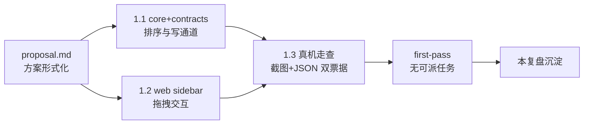

# first-pass 复盘 — project-manual-order

- 日期：2026-10-30
- 复盘对象：proposal `project-manual-order`（左侧栏项目手动排序）
- 术语：first-pass = 首次无可派任务；收口 = merged 终态。

## 一、飞轮硬指标（检查点快照直算）

| 指标 | 值 | 说明 |
|---|---|---|
| 一次通过率 | 1 | 尚无 merged 帧，基线即当前 |
| 返工增量比 | 0.0% | 无返工改动 |
| 修正波次 | 0 | 无修正轮 |
| fix 密度 | 0.0% | 无 fix 任务 |

**越阈判定**：修正波次 0 < 阈值 6（settings `flywheel.reviewWaveThreshold`）→ 未越阈，无注册硬门；复盘沉淀照常完成。

## 二、经验提取与核验方式

三视角提取：验收取证面 / 实现方案面 / 流程协作面。
**偏差记录**：本任务为 subagent 深度上限会话，无法再派发独立核验 agent——「多 agent 交叉核验」降级为单视角三方提取，由主会话补跑双独立核验 agent（A/B）交叉核验。

**交叉核验结论（2026-10-30，主会话补跑）**：核验 A/B 独立复核四条条目（技术断言对源码逐条验证、重复度、泛化价值、溯源完备性），结论一致——四条全部成立入库；条目 3（html5-drag-not-cdp-trusted-input）证据票据文件名修正为 `ev6-dragging-styles.json`（已改）。无重复条目，泛化价值成立，bug id 缺席合理（缺陷待裁决未进台账）。

## 三、沉淀清单（已入 .knowledge/）

| 类型 | 文件 | 一句话 |
|---|---|---|
| examples | [full-renumber-idempotent-sort-write.md](../../../../.knowledge/examples/full-renumber-idempotent-sort-write.md) | 排序写回全量重编号：单事务 1..n 覆盖写，幂等无碰撞，不做 midpoint |
| examples | [four-key-total-order-null-last.md](../../../../.knowledge/examples/four-key-total-order-null-last.md) | 四键字典序严格全序 + NULL 垫底，存量零回填零扰动 |
| lessons | [html5-drag-not-cdp-trusted-input.md](../../../../.knowledge/lessons/html5-drag-not-cdp-trusted-input.md) | Electron HTML5 拖拽无法 CDP 受信驱动——合成事件取证 + 边界如实标注 |
| lessons | [silent-entry-absence-no-diag.md](../../../../.knowledge/lessons/silent-entry-absence-no-diag.md) | 入口静默缺席无告警是可观测性缺口——取证走等价路径，缺陷挂裁决不就地修 |

- learn 技能：本会话技能目录无 `learn`，按既有 .knowledge 条目同构字段（title/summary/keywords/domainPath + 溯源三字段）直接落盘，格式与存量条目一致。
- conventions：本特性无跨特性普适的新约束候选（守卫式迁移、emitDiag、官方对齐均为既有 convention 的常规遵循），不新增——避免稀释正本。
- 提炼态晋升：无条目申请晋升 docs/conventions 正本。

## 四、翻车点与遗留项

1. **「＋ 添加项目」dev 实机打不开且零告警**：是否缺陷待主会话裁决（不排除预期内装配缺席）；取证已走 preload RPC 等价路径收口验收。
2. **纯受信指针拖拽未取证**：平台边界（CDP 无 drag 事件序列），写通道经合成 DragEvent + 重启持久双证成立。
3. **取证遗留状态**：pmo-fixture 项目未注销、v2-repo-a 归档态、视图停留默认——均在 dev 隔离 home，不污染生产。

## 五、链路经验（已经双独立核验 agent 交叉核验确认）

- **验收条 ↔ 算法性质一一对应**：提案验收节 P1–P4 逐条绑定排列算法形式化性质（严格全序/保序投影/幂等写回/NULL 垫底），走查与单测可直接按性质设计夹具——提案期形式化是本特性零返工的第一因。
- **真机走查双票据**：视觉截图（归档裁决）+ JSON 票据（序逐位比对/计算样式）互补，截图不可得时 JSON 仍可裁决。
