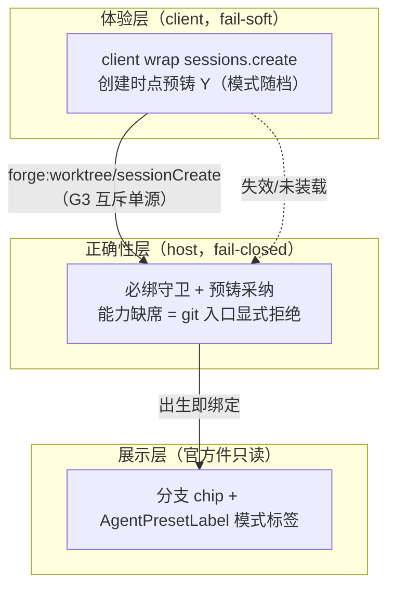
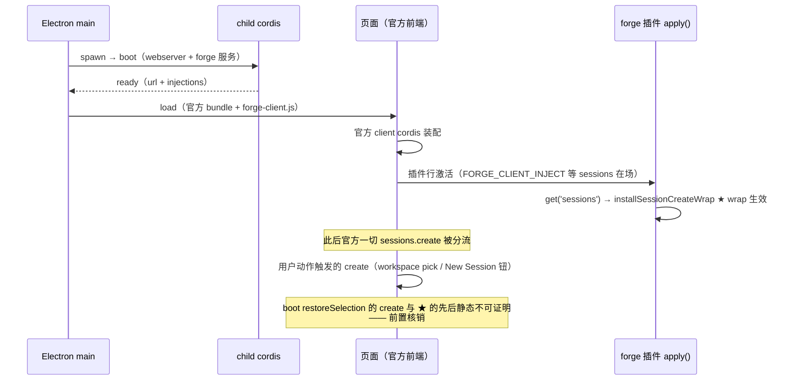

# 会话绑定与模式档保障体系

## 背景与问题

会话与 worktree 的绑定（分支 chip、封存硬保证、cwd 守护、工作区归属）只能写于会话创建时点（header 不可变 + 单写者铁律），无补写面。现状绑定保障存在三类缺口：

1. **兜底层曾死路**：必绑重路由的 blank 判据与官方投影语义漂移，官方直建会话永无绑定（已修 `93d1f921`，本方案的起点而非范围）；
2. **能力缺席静默降级**：gitWorktree 能力未解析 → 零拦截照常跑，git 项目会话静默无绑定，违背"运行时行为正常"原则；
3. **体验层脆弱**：绑定编排依赖 client arm（草稿意图驱动 + 选中态 sessionStorage 记忆），跨重启失效，与 host 守卫存在竞态窗口；且重路由 accept-swap 存在客户端 pending 回执不退役的 UI 跟绑边界（已记账）。

可行性已双路核销（2026-10-17）：官方前端创建收口单一（UiWorkspaceService 三处调用期属性查找，全命中）；服务实例可写有 host 侧同款先例；G3 blank 复用对官方客户端无害（retain/release 平衡替换）；能力缺席判 git 有结构纪律背书的 core 探针路。完整取证见两份核销报告（本目录归档）。

## 目标

1. **出生即绑定**：git 项目的会话自创建时点即携带绑定与模式档，分支 chip 与模式标签出生即正常；
2. **运行时行为正常**：装载一次性自证 + 行存续看门，正确性层失败显式拒绝（fail-closed），体验层失败 fail-soft 由 host 兜底；
3. **体验层换血**：sessions.create wrap 上位承担创建时点改道预铸，arm 编排链整体退役；确认交互链（1.19 确认框 + 1.34 确认闩锁 +「不再提示」）剥离重锚点选时点，与 arm 零依赖（设计 A 终态）。

## 架构（三层定稿）



职责铁律：体验层决定换绑多早发生，正确性层保证换绑必然发生。client wrap 失效 → 退化为 guard 首条消息兜底（现状世界），永不更坏。

## 工作项

### W2 host 能力缺席显式拒绝（fail-closed 收口）

- **判定核**：入口同步查 `resolveGitWorktree() === undefined`（粘性能力位）→ 缺席跑 `@dsh-forge/core createGitIdentityPort().commonDirAnchor(cwd)` 探针（结构测试背书的装配胶水先例）→ 有锚 = git → 显式拒绝；null = 真非 git → 官方原流。**探针逐次现跑、零缓存**——git 仓库可被移除，git 项目可变非 git，判定结果不作会话期记忆（创建入口非热路径，零缓存无固定税顾虑）。能力在场路径零改动（非介入面零固定税维持）。
- **拒绝面两入口**：① 创建入口 sessionCreate——contracts 新增 typed error code（rpcEnvelope 只认 ERROR_CODES），前端走现成 RpcClientError → Toast 链；② 发送入口 prompt 拦截——SessionSealedError 先例（Error + 可读中文 message + 稳定 name），经官方 Remote 错误面进 composer。
- **裁决拆分**：「能力缺席显式拒绝」与「瞬态异常是否按 D1-c 收紧封存面」为两个独立决策，不捆绑；瞬态 fail-open 分支全部保留现状。

交付披露（W2 评审 warning，2026-10-18）：

- **0-60s 瞬态窗口 fail-open**：能力缺席但 60s 放弃位未盖时（`child.ts:488-497` 盖位时点），`absentGitProbe` 在盖位检查处直接放行（`worktree-rpc.ts:264-270` 判定序：先能力位 → 后 `guardState === 'absent'`）——窗口内 git 项目的创建与首条 prompt 落主树、无拒绝。取舍：粘性能力位未到期判「真非 git」有误伤风险，D1 拆分裁决保留现状；逃逸会话由能力到位后的 judge 重路由兜底。
- **能力缺席期固定探针税**：`guardState` 盖位后，judge（每次 prompt，`worktree-rpc.ts:644`）与 sessionCreate 入口（`:579`）各现跑一次 `commonDirAnchor` git 探针（零缓存）——fail-closed 显式拒绝的必然代价，非介入面「零固定税」纪律在此面被打破（能力在场路径仍零改动）。

改动范围：`apps/host/src/ipc/worktree-rpc.ts`（judge/sessionCreate 入口分流 + 探针缓存）、`apps/host/src/boot/child.ts`（能力轮询放弃路径盖 `guardState: 'absent'` 状态位，dep 注入）、`packages/contracts`（typed error code）、`apps/web/src/client-plugin/plugin.ts`（拒绝错误呈现）、`apps/host/src/ipc/worktree-rpc.test.ts` + e2e（能力缺席矩阵：git 拒 / 非 git 照常）。

### W3 client wrap sessions.create（体验层主径，arm 编排链退役 + 确认交互链重锚点选时点）

- **wrap 语义**：装配期对 `ctx.sessions` 服务对象做 `create` 属性替换（host interceptRequiredBinding 同配方，dispose 恢复）；资格门 = 全新创建（无 sessionId）∧ cwd/workspace 命中注册 git 项目 ∧ 能力可用；改道 = `forge:worktree/sessionCreate`（wrap 创建恒绑项目根——注册行 ws_path；选中树不在创建时点消费，由 host 首条消息必绑重路由兑现，1-27/1-29 spec 语义；G3 互斥与 guard 共享 blank 产物）；响应契约保真 `{sessionId: Y, agentPreset: 预铸头实际档}`。adopt 径（带 sessionId）与 fork 不在 wrap 面。任何 wrap 内异常 fail-open 透传 original。
- **arm 编排链整体退役；确认交互链剥离重锚点选时点，与 arm 零依赖（设计 A 终态，2026-10-18 用户裁决）**：wrap 承担创建时点改道预铸；确认交互链（1.19 确认框 + 1.34 确认闩锁 +「不再提示」）从 arm 效应链剥离，独立锚在点选时点承接跨分支确认。
  - 删（与终态一致）：armDefault 效应链、createWorktreeOrchestrator、composerDraftFace/carryDraft、blankSessionByCwd、armSuppressed/cancelSuppressed、1.25 编排失败 Toast 文案族（create 失败改走官方 createFailed toast）；
  - 留：hero worktree chip + 选中态 + sessionStorage 项目记忆 + pushSelection（host 首条消息必绑重路由单源——wrap 创建恒绑项目根，不读选中态）；
  - 确认终态（#4 设计 A）：跨分支确认框 + 1.34 确认闩锁 +「不再提示」锚在点选时点（1.19 语义回归）——点选命中跨分支且未闩锁/未「不再提示」时立现，确认 = 闩锁置位 + 选中态落定，闩锁命中（同目标已确认）点选静默切换零重弹；wrap 在官方 create 调用内部，不得中途插框。
- **草稿/回执天然落 Y**：官方 replaceMain 自带 retain/open Y，草稿（会话寻址 InputHub）与 pending echo 零搬运跟随；X 永不物化，零残留。

改动范围：`apps/web/src/client-plugin/plugin.ts`（wrap 注册 + arm inject 整面移除——零 inject 面）、`apps/web/src/client-plugin/create-wrap.ts`（既有——桌面入口分流：资格门 + 改道 + fail-open）、移动端 hero 建会话首选预铸 + fail-open 回退（语义契约见「移动端一致逻辑」小节——实现归 mobile-ui 工程，两案联动）、`apps/web/src/views/session/WorktreeFaces.tsx`（arm 效应链删除、确认框重锚点选时点）、`apps/web/src/views/session/HeroWorkspacePicker.tsx`（createWorktreeOrchestrator 删除）、`apps/web/src/views/session/hero-picker-model.ts`（shouldArmSelectedRow/blankSessionIdByCwdOf 删除、闩锁保留）、`plugin.test.ts` + e2e（1-27 升级创建即绑定断言、1-29 arm 退役语义更新、移动端 hero 预铸优先契约钉）。

#### W3 关键代码示例：入口分流（官方 create 内部逻辑零触碰）

三条铁律：**① 内部零触碰**——wrap 只有整调用改道与原样透传两种动作，绝不读取/改写官方 createOrAdopt 分支行为；**② 判定逐次独立**——每次创建现查现判，零缓存（git 仓库可被移除，git 项目可变非 git）；**③ fail-open 透传**——改道链任何异常（host 判非 git / RPC 失败 / 预铸失败）= 官方原流，且 original 调用永不落入改道 try 域（官方自身的错误原样上抛）。

```ts
// apps/web/src/client-plugin/create-wrap.ts（关键形态示意）
type CreateOpts = { readonly workspaceId?: string; readonly cwd?: string; readonly sessionId?: string }

export function installSessionCreateWrap(
  sessions: { create: (opts?: CreateOpts) => Promise<string> },
  deps: { forgeRpc: () => ForgeRpcClient; projectRows: () => readonly ProjectSummary[] },
): () => void {
  const original = sessions.create
  const wrapped = async (opts?: CreateOpts): Promise<string> => {
    // ① adopt 径直通：带 sessionId = 官方复用既有会话（reuseBlank 采纳），不改道
    if (opts?.sessionId !== undefined) return original(opts)
    // ② 目标树逐次独立判定（零缓存）：workspaceId → 注册项目 ws_path；cwd → 直用；
    //    非 forge 项目 / 未注册 / 判定异常 → null = 官方原流
    let tree: string | null = null
    try {
      tree = treeOf(opts, deps.projectRows())          // 每次现查项目行，不读任何记忆
    } catch {
      tree = null
    }
    if (tree === null) return original(opts)
    // ③ 改道预铸：git 判定与模式随档在 host 逐次现跑（doSessionCreate 内 git 现查，无缓存）；
    //    G3 互斥与 guard/arm 共享 blank 产物，零双建
    try {
      const product = await deps.forgeRpc().worktree.sessionCreate({ worktreePath: tree })
      return product.sessionId                          // 官方前端自 retain/open Y——草稿回执原生对位
    } catch {
      // ④ fail-open：改道失败 = 官方原流（降级态 = 现状世界，guard 兜底）
      return original(opts)
    }
  }
  sessions.create = wrapped                             // 调用期属性查找全命中（Q2 核销：官方仅 3 处）
  return () => {
    sessions.create = original                          // dispose 恢复原方法（host 同配方）
  }
}
```

判定位置说明：客户端 wrap 只做「workspaceId/cwd → 注册项目树」的映射；**git 与否的实质判定在 host `doSessionCreate` 内逐次现跑**（resolveBranch 起 git 子进程，无缓存）——host 判非 git 抛错 → wrap ④ 透传官方原流。判定 fresh 性由 host 每次创建现查保证，客户端不预判、不缓存。

> **复用优先核销注记（ctx.intercept 排除 + 官方缝全景核查，2026-10-17）**：cordis `ctx.intercept(name, config)`（vendor/cordis/src/context.ts:127-145）是**服务配置合并缝**——给下游插件把 config 合并进服务解析配置（`Service[symbols.resolveConfig]`，类型约束 `Context[K] extends { [symbols.config]: infer T }`），不接触方法分派；ClientSessions 无 config 槽，对 create 调用为 no-op。
>
> **官方缝全景核查**（vendor/cordis/src/reflect.ts + events.ts + fiber.ts 深挖）：ctx 为 Proxy（ReflectService.handler），服务解析存在原生拦截缝 `internal/get` waterfall（reflect.ts:153-167，洋葱式可替换解析结果）——**存在但排除**，两硬伤：① 捕获时序脆弱（UiWorkspaceService 在 apply 时一次性捕获 sessions 引用，此后不再过 proxy；wrap 必须赶在其 apply 前挂上 = 引入 boot 时序依赖）；② 爆破半径全局（拦所有插件 fiber 对 sessions 的解析，含官方内部与 trace 语义）。另核销：`ctx.set` 有 fiber 所有权封死（第三方插件换服务值 = throw，reflect.ts:260-262），但**服务对象上的方法影子替换不经 ctx.set**——官方封整值替换、留白方法替换 = 「方法 wrap」缝合法性的源码级佐证。结论：属性替换 wrap 仍为最优解。

#### wrapped 伪代码（逐段注解）

```ula
═══ 装配期：插件 apply() 执行，一次性安装 ═══

install(sessions, deps):
    original ← sessions.create            # 留底：官方原方法引用
    sessions.create ← wrapped             # 影子属性，此后全页面 create 命中这里
    return dispose:                       # 卸载缝
        sessions.create ← original        # 恢复原方法（host 同配方）


═══ wrapped(opts) —— 每次官方 create 调用进入 ═══

wrapped(opts?: { workspaceId?, cwd?, sessionId? }) → Promise<会话id>:

    # ── ① adopt 径直通 ──────────────────────────────
    # 带 sessionId = 官方在复用/采纳既有会话（reuseBlank 采纳流），
    # 它已有身份，改道无意义 → 原样透传
    if opts.sessionId ≠ 空缺:
        return original(opts)             # ① 出口：官方原流


    # ── ② 目标树逐次判定（零缓存核心段）────────────────
    # 每次调用重新解析，不读任何上次结论：
    #   · workspaceId → forge 注册项目行（排除归档）→ ws_path（列表 RPC 每次现拉）
    #   · 只有 cwd → 直接作为候选树（git 与否交给 host 现判）
    #   · 判定过程任何异常（列表拉取失败等）→ null
    tree ← 判定目标树(opts, deps.项目行现查())

    if tree = null:
        return original(opts)             # ② 出口：非 forge 项目 / 未注册 → 官方原流
                                          #（非 git 项目永远走这里 = 零行为差异）


    # ── ③ 改道：预铸采纳（try 域只罩改道链）────────────
    try:
        product ← deps.forgeRpc().worktree.sessionCreate({
            worktreePath: tree
            # host 侧 doSessionCreate 在此做「逐次现跑」的实质判定：
            #   · resolveBranch 起 git 子进程现查——仓库已被移除？
            #     此刻判非 git → 抛错 → 落入下面 catch
            #   · 预铸头：cwd + 模式档（registry 默认/源档）
            #   · attach 事件 seq 0 → 官方 adopt 正门
            #   · G3 互斥：与 guard/arm 共享同树 blank 产物，零双建
        })
        return product.sessionId          # ③ 出口：官方前端拿到的是 Y——
                                          # retain/open/草稿/回执全原生对位 Y；
                                          # Y 出生即带绑定 → chip 出生即挂

    catch:
        # ── ④ fail-open：改道链任何异常 ────────────────
        # 覆盖：host 判非 git（仓库被移除的当下）/ RPC 不通 / 预铸失败
        # 语义 = 降级到现状世界：官方直建无绑定会话，host guard 首条消息兜底
        return original(opts)             # ④ 出口：官方原流
```

三个易错点：

1. **original 永不落 try 域**：①②④ 三个 `return original(opts)` 都在改道 try 之外——官方自身抛的错（如 workspace 不存在）原样上抛给官方前端，不会被 catch 吞掉再调一次（防双调）；
2. **「零缓存」贯穿两层**：客户端 ② 段每次现查项目行，host ③ 段每次现跑 git 子进程——任何一层都不存「这是 git 项目」的结论，仓库在两次创建之间被移除，下一次创建立刻判非 git；
3. **wrapped 无 UI、无等待**：跨分支确认在点选时点已问过人（重锚后的 1.19），host 选中记忆只落已确认目标、由首条消息必绑重路由消费（wrap 创建恒绑项目根，不在创建时点读选中态）——wrapped 本体是纯快速判定 + 一次 RPC（官方 create 调用内部不能卡模态框）。

一次调用的四种归宿：

| 进入 wrapped 时的世界 | 走到哪 | 用户得到 |
|---|---|---|
| adopt 复用（带 sessionId） | ① original | 官方原生复用 |
| forge 项目 + 仓库健在 | ③ 预铸 Y | 出生带绑定的 Y，双 chip 齐全 |
| forge 项目但仓库刚被移除 | ④ original | 官方直建 X（此刻判非 git，合理） |
| 非 forge / 未注册工作区 | ② original | 官方直建（零介入面） |

#### 移动端一致逻辑（依 mobile-ui 提案定形——语义契约单源，非代码共享）

移动端（mobile-ui 提案：独立 vanilla 单文件工程，无 cordis client/sessions 服务——桌面属性替换 wrap 结构性不存在）与桌面 wrap 的「一致」= **语义契约一致**，判定单源在 host：

- **移动端 hero 建会话首选预铸**：`/remote/__rpc` 透传 `forge:worktree/sessionCreate`（mobile-ui 提案已规划通道）——`{worktreePath: hero 当前树, agentPreset: hero 模式档}`（移动端缺省突击 = 产品裁决，走 sessionCreate 显式档字段）；**失败 fail-open 回退**官方 `/api/rpc session.create`——与桌面 wrap ④ 出口同语义；
- **判定单源 = host**：git 与否在 `doSessionCreate` 逐次现跑（零缓存同款）；移动端零判定代码——天然满足 mobile-ui「纯 view 层」硬边界与独立工程边界（不 import 桌面模块，共享的只有 API 协议）；
- **guard 兜底恒在**：移动端回退径产生的无绑定 X，首条消息由 host prompt 拦截重路由（拦截在 host 侧，与前端形态无关——`/api/rpc` prompt 同样过拦截）；
- hero 乐观切换 + host 校验失败弹确认框（mobile-ui 契约）与桌面 1.19 点选确认同语义：校验单点在 host。

#### installSessionCreateWrap 执行时机（精确时序）


执行点位 = client 插件 `apply()` 内、`clientCtx.get('sessions')` 到手之后（plugin.ts:2306 同点位）；每页面生命周期恰一次，页面刷新随重装载等价重入。运行期不重复安装（属性替换无自动消失通道）；消失风险仅外部对账（prune 类）——W4 看门（`internal/service` 事件 + 壳轮询）主动检测。



两个已核销时序事实：① apply 等 `sessions` inject face 在场才跑——wrap 安装点与 sessions 服务可用点同步，无反向窗口；② 激活百毫秒刻度（~145ms，单次 e2e 实证量级参考），用户交互秒级起步——对人触发的创建余量三个数量级。

官方 create 四触点 vs wrap 生效时刻：

| 官方 create 触点 | 触发时机 | 时序判定 |
|---|---|---|
| workspace pick 预建 blank（connectWorkspace） | 用户点选/进入项目 | 用户动作，晚于激活——安全 |
| blank 采纳（reuseBlank，带 sessionId） | 用户动作 | 走 ① 直通，不依赖时序 |
| New Session 钮（startSession） | 用户动作 | 用户动作，安全 |
| boot 恢复（restoreSelection） | **启动期自动流** | ⚠️ 唯一紧窗口——前置核销 #1 探针取证；逃逸会话由 guard 首条消息重路由兜底 |

### W4 装载自证 + 行存续看门

- **host**：installSendGuard 成功路径自证 wrap 换芯（读回 controller.prompt 已换 + guard 非空，失败 fail-loud）；60s 放弃点盖 `guardState: 'absent'`（W2 拒绝面判定源）。
- **client**：激活自证补两块（RPC 试呼 `forge:worktree/list` 轻探 + wrap 代理证据）；**prune 看门必须活在壳 bundle 全局面**（周期查 `__DSH_FORGE_CLIENT__` 与 `ctx.slots.entries` 计数）——插件 fiber 内看门随插件同殁，检不出 prune；**增配官方信号源**：`internal/service` 事件（reflect.notify 服务注销时 emit，reflect.ts:330-334）——sessions 服务注销 = prune 级联回收的官方信号，事件监听 + 壳轮询双保险。
- 语义：自证失败 fail-loud（diag/console + 显式 UI 态），不静默残缺。

改动范围：`apps/web/src/client-plugin/plugin.ts`、壳 bundle 全局脚本（`apps/web/src/shell/`）、`apps/host/src/boot/child.ts`、对应单测。

## 前置核销清单（立项后、实现前逐项闭环）

| # | 项 | 归属 |
|---|---|---|
| 1 | boot 时序探针：forge wrap 安装 vs 官方首个 create（restoreSelection/startSession）先后 | W3 |
| 2 | 真机探针：sessions 实例可写性 + wrap 生效 + create 失败 → 官方 createFailed toast 链（外部依赖装配面结算门：fake 不算交付） | W3 |
| 3 | adopt 径 create({sessionId}) 与 fork 的改道边界裁决 | W3 |
| 4 | 跨分支确认重锚定交互设计（点选时点 + 1.34 闩锁/不再提示平移） | W3 |
| 5 | sessionCreate 错误 → 官方 createFailed 文案语义映射 | W3 |
| 6 | D1 拆分裁决：「能力缺席显式拒绝」与「瞬态异常是否按 D1-c 收紧封存面」两案独立 | W2 |
| 7 | 两提案联动（mobile-ui × 本案）：`/remote/__rpc` 透传 `sessionCreate` 的 allowlist 落地时序与 `agentPreset` 字段过桥序列化核对（通道形态已定——mobile-ui 提案已规划透传）；移动端 hero 首选预铸 + fail-open 回退的语义钉（契约测试） | W3 |

> **核销闭环（2026-10-17，真机取证）**：#1/#2 探针双过——boot apply 期 wrap 安装点恒早于官方首个 create（+95~+109ms，`probe-boot-timing.md`）；ClientSessions 实例可写 + apply 点属性替换 wrap 对官方入口生效 + create 失败走官方 createFailed toast 链（`probe-real-device-wrap.md`，截图留证）。#3-#7 五项裁决见 `adjudications.md`。

## 验收口径（真机端到端）

1. 重启应用 → hero 直输（不碰 picker）→ 会话出生即绑定（attach@seq0 先于首条消息）；
2. 分支 chip 出生即挂；模式标签 = hero 预设档（默认远征/选过突击则突击），首条消息后不漂移；
3. 提交回执正常退役，零 pending 卡挂；
4. wrap 注销注入 → 首条消息仍获绑定（guard 兜底），体验降级正确性无损；
5. 能力缺席注入 → git 入口显式拒绝、非 git 照常（W2）；
6. arm 退役后 1-29 纯选中态语义零回归；
7. 移动端（自建面）创建 git 项目会话 → 出生即绑定，与桌面 wrap 同语义（共享分流核心单源断言）；任一端 wrap 失效注入 → host guard 兜底成立。

## 边界与不做的事

- 不改制官方创建链本体（api-session-controller createOrAdopt 分支）——wrap 只做子集改道 + fail-open 透传；
- 跨树创建不进 wrap（attachSession 校验 header.cwd ≡ workspace.path，改向即官方归属面碎裂）——跨树由选中编排承担（选中记忆经首条消息必绑重路由消费，wrap 创建恒绑项目根）；
- 既有无绑定历史会话不回填（官方铁律，仅对新会话生效）；
- worker/fork 不经 wrap 与重路由入口（agents.create 直驱 / fork 方法，结构性隔离；guard 侧 header.parentSession 排除已落地）；
- 守卫判读链既有 `cachedResolve` G8 会话期缓存（每消息 git 子进程固定税纪律，首条消息判读路径）维持现状——与本方案「创建入口判定零缓存」作用域不同（判读 vs 创建），是否统一另案评估；
- 路径 B（host 创建 wrap）挂起：W3 成立后动机减弱，真机走查仍见跟绑边界再唤醒；
- 「创建时点钩子」长期推官方上游（reuse-official-mechanisms：记录官方缺什么、为何自建）；
- scaffold 拓扑测试 3 败为既有漂移，独立缺陷不混入本方案。

## 关键官方机械锚点（承重假设已核销，2026-10-17）

- 创建收口：ui-workspace lib/client.js `apply(ctx)` 注入 sessions → UiWorkspaceService 三处 `this.sessions.create` 调用期属性查找；官方无「hero 提交时建会话」触点（sink 注释：会话在 workspace pick 时物化；composer 无会话即 inert）。
- 服务单例可写：dsh-api-session-controller client.js `rootCtx.reflect.provide("sessions")`，ClientSessions 实例无 freeze；属性替换配方先例 = host interceptRequiredBinding。
- 模式投影：agentPreset 投影 init = header.agentPreset ?? null，agent-preset/selected 事件推进（agent-preset-registry lib）；blank 投影 = 仅 turn/start 清位（api-session-controller sessionListMetadata fold）。
- blank 复用无害：官方 replaceMain = retain → 换位 → previous.release() 平衡替换；reuseBlank 本身 = 带 id 重发 create（adopt 正门），writer-held 有官方降级兜底。

## 附录：cordis ctx 扩展点全景清单（2026-10-17 深挖，防重复挖掘）

源：vendor/cordis/src（context/reflect/events/fiber/service/registry）。ctx 为 Proxy（ReflectService.handler），机制分四层：Proxy 分派 → 解析（fiber store + isolate + internal 事件）→ 注册（reflect）→ 生命周期（fiber.effect）。

| # | 机制 | 源码 | 语义 | 本方案判定 |
|---|---|---|---|---|
| 1 | `internal/get` waterfall | reflect.ts:153-167 | 非 runtime fiber 的 ctx.<name> 读取走洋葱拦截，可替换解析结果 | 存在但排除——捕获时序脆弱 + 爆破半径全局（见核销注记） |
| 2 | `internal/set` waterfall | reflect.ts:191-193 | 服务写入洋葱拦截 | 暂无需求 |
| 3 | `internal/service` 事件 | reflect.ts:330-334 | 服务 provide/unregister 官方信号 | **W4 采用**（行存续看门信号源） |
| 4 | `ctx.accessor(name,{get,set})` | reflect.ts:345-353 | 计算属性缝；set 可拒绝 | 不能覆盖已声明服务名（sessions 为 service 型）——劫持不可行；产品 ctx 属性可用 |
| 5 | `ctx.set` fiber 所有权 | reflect.ts:254-265 | 第三方插件换服务值 = throw | 判定性佐证：整值替换官方封死，方法影子替换留白 = 方法 wrap 缝合法 |
| 6 | `provide(name,value,check)` | reflect.ts:277-305 | check 可用性谓词 | 可选增强（forge host 服务现未用） |
| 7 | `ctx.mixin` | reflect.ts:364-390 | 服务成员转发为 ctx 属性 | 可选（官方 ctx.on/emit 即此实现） |
| 8 | `isolate` 作用域 | context.ts:17-18 | 服务按 scope label 隔离 | 已在用（预设 plan-mode/compaction group） |
| 9 | `internal/listener` bail 门 | events.ts:296 | 监听器注册 bail 否决门 | 机制记录 |
| 10 | `ctx.intercept` 配置合并 | context.ts:127-145 | 服务解析配置合并（config 槽） | 排除——非方法拦截，ClientSessions 无 config 槽 |
| 11 | `Service[symbols.extend/invoke/tracker]` | service.ts | 可调用服务/诊断跟踪 | 机制记录 |
| 12 | `ctx.effect` 生命周期 | fiber.ts:418-429 | 装卸对称 effect（含 label 诊断） | 已在用（input-triggers 撤销等），看门可用 |
